# Documento de Apoyo No. 10.1 – Configuración del RoboClaw 2x15A con Basicmicro Motion Studio.

> Versión en Markdown del documento de apoyo, para consultar y copiar comandos desde GitHub. El documento de Word (formato GFPI-F-135) no se publica en el repositorio.

**Duración Estimada:** 1,5 horas.

**Sesión:** Día 2 – 03/11/2026, bloque 2 (11:00 a.m. – 12:30 p.m.).

**Relación con la Guía de Aprendizaje:** Actividad 3.3.1 – carpeta «10. CONFIGURACIÓN ROBOCLAW».

**Diseñado por:** Julián René Cháux Cedeño.

## 1. OBJETIVOS DE APRENDIZAJE

- Instalar Motion Studio (versión actual o *Legacy*, según la versión del hardware) y conectar el RoboClaw.
- Configurar el modo de control *Packet Serial*, la dirección 128 (0x80) y la velocidad de 38 400 baudios.
- Ejecutar el *Autotune* de velocidad, interpretar P, I, D y QPPS y guardarlos en la memoria del controlador.
- Diagnosticar encoders invertidos o desconectados.

## 2. FUNDAMENTOS

El RoboClaw 2x15A controla dos motores DC con escobillas (15 A continuos y 30 A pico por canal, 6–34 V) y lee dos encoders de cuadratura [3]. En modo **Packet Serial** recibe órdenes binarias con dirección, comando, datos y CRC-16, y responde 0xFF a cada escritura válida (manual rev. 5.6, incluido en la carpeta PROGRAMAS) [2]; así lo usa el driver ROS 2 `mr_base` (DA-12.1). El RoboClaw cierra internamente un lazo **PID de velocidad** por motor: el computador pide una velocidad en cuentas por segundo y el controlador ajusta el ciclo útil del PWM para mantenerla.

$$u\left( t \right)={K}_{p}e\left( t \right)+{K}_{i}\int_{0}^{t} e\left( τ \right)dτ+{K}_{d}\frac{de\left( t \right)}{dt},e={\omega }_{ref}-{\omega }_{medida} \qquad (1)$$

**QPPS** (*quadrature pulses per second*) es la velocidad máxima del motor en cuentas/s medida por el Autotune; el RoboClaw la usa para normalizar la acción de control. Con el motor Pololu 25D 47:1 (2248,86 cuentas por vuelta [6]) el valor medido en un robot del laboratorio fue 6937 cuentas/s, es decir, 185 rpm en la salida y 0,87 m/s con ruedas de 90 mm. El software debe pedir como máximo ~80 % de QPPS para dejar margen al PID.

*Tabla 1. Configuración del RoboClaw para este robot.*

| **Parámetro** | **Valor** | **Dónde se usa** |
|---|---|---|
| Control Mode | Packet Serial | Protocolo binario del driver ROS 2 |
| Packet Serial Address | 128 (0x80) | `address: 128` en `mr_base.yaml` |
| Baudrate | 38400 | `baud: 38400` (por USB el valor no limita la velocidad, pero se deja igual) |
| Velocity P, I, D, QPPS | Autotune por motor | Lazo interno del RoboClaw; `mr_base` los lee al arrancar |

## 3. MATERIALES

- Robot del DA-8.1 con las ruedas **levantadas** del piso.
- PC con Windows y cable USB mini-B.
- Instaladores en la carpeta «10. CONFIGURACIÓN ROBOCLAW/PROGRAMAS/BASIC MICRO» (Motion Studio, versión *Legacy* funcional y controlador USB `USBRoboclawVirtualComport`).

> **Seguridad:**
>
> NO realice conexiones eléctricas definitivas sin la verificación previa del instructor. Antes de energizar: polaridad de la batería, interruptor y paro de emergencia en serie, regulador ajustado al voltaje de la Jetson y ruedas levantadas en la primera prueba de motores.

## 4. PROCEDIMIENTO

### Paso 1. Descargar e instalar Motion Studio

Desde la página del producto en Basicmicro, sección de descargas, obtenga *Basicmicro Motion Studio* [1] e instálelo. Si Windows no reconoce el puerto, instale el controlador USB incluido en la carpeta PROGRAMAS.

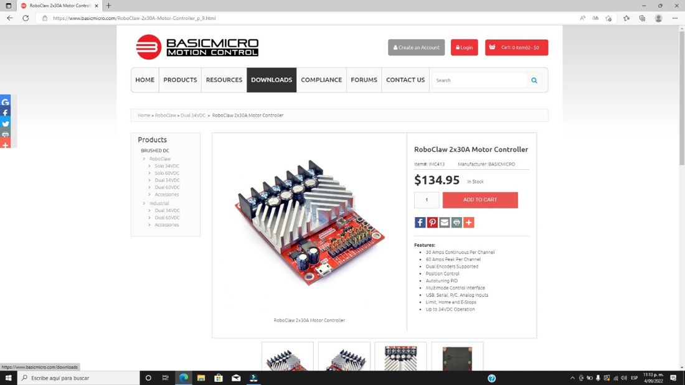

*Figura 1. Página del RoboClaw 2x15A en el sitio de Basicmicro.*

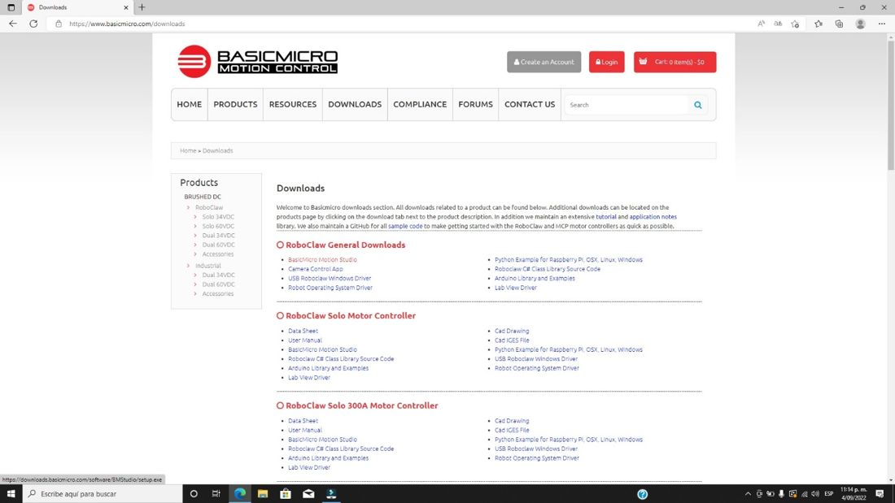

*Figura 2. Sección de descargas del RoboClaw en el sitio de Basicmicro.*

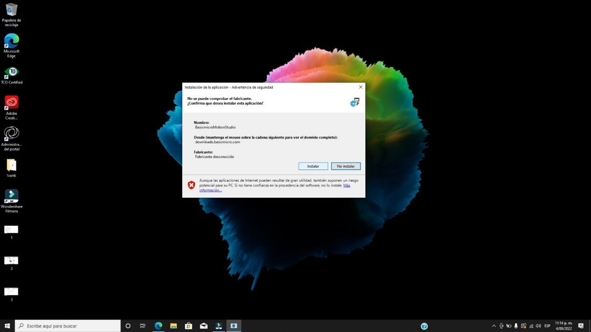

*Figura 3. Instalación de Motion Studio: aceptar la advertencia de seguridad de Windows.*

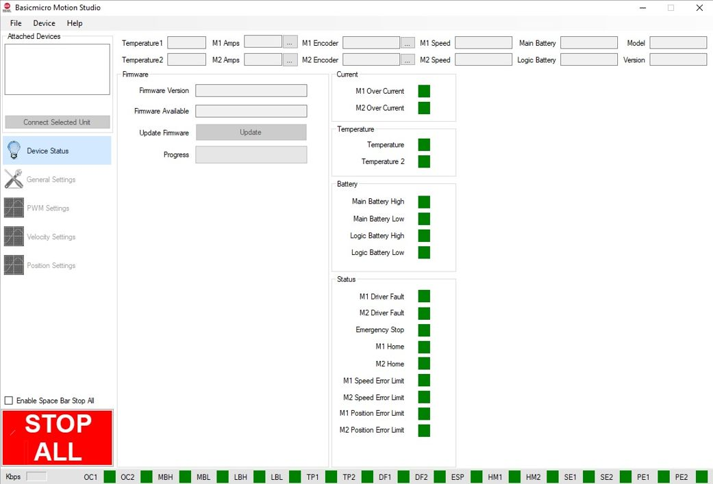

*Figura 4. Interfaz de Motion Studio al abrirse, todavía sin un RoboClaw conectado.*

### Paso 2. Elegir la versión correcta (V5 → Legacy)

Las unidades del laboratorio son RoboClaw 2x15A **V5**. Las versiones recientes de Motion Studio no las reconocen y muestran el mensaje de la figura siguiente. En ese caso use la versión *Legacy*: carpeta PROGRAMAS («Legacy version Funcional») o menú *Help → Download Legacy Motion Studio*.

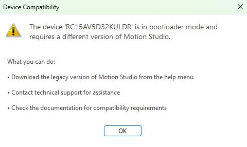

*Figura 5. Motion Studio reciente frente a un RoboClaw V5 («RC15AV5…»): requiere otra versión.*

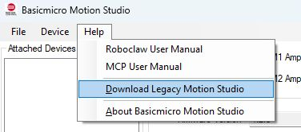

*Figura 6. Descarga de la versión Legacy desde el menú Help.*

> **Compatibilidad:**
>
> La misma distinción existe en las librerías de Python del fabricante: la librería *legacy* es la indicada para RoboClaw V5 y anteriores [4] y `basicmicro_python` para los controladores actuales [5]. El driver `mr_base` implementa solo comandos comunes a ambas (lectura de encoders y velocidad, velocidad con aceleración, ciclo útil, batería, temperatura y estado).

### Paso 3. Conectar y actualizar el firmware

Conecte el RoboClaw por USB. Seleccione la unidad detectada y pulse *Connect Selected Unit*. Si el programa ofrece una versión de firmware más reciente compatible con su hardware, actualícela y anote la versión.

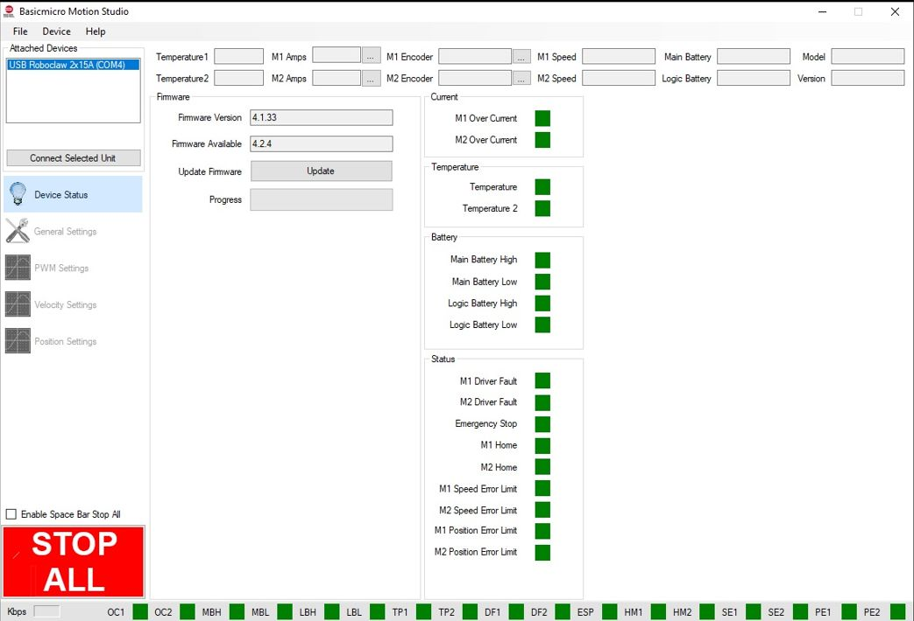

*Figura 7. Unidad conectada y versión de firmware detectada.*

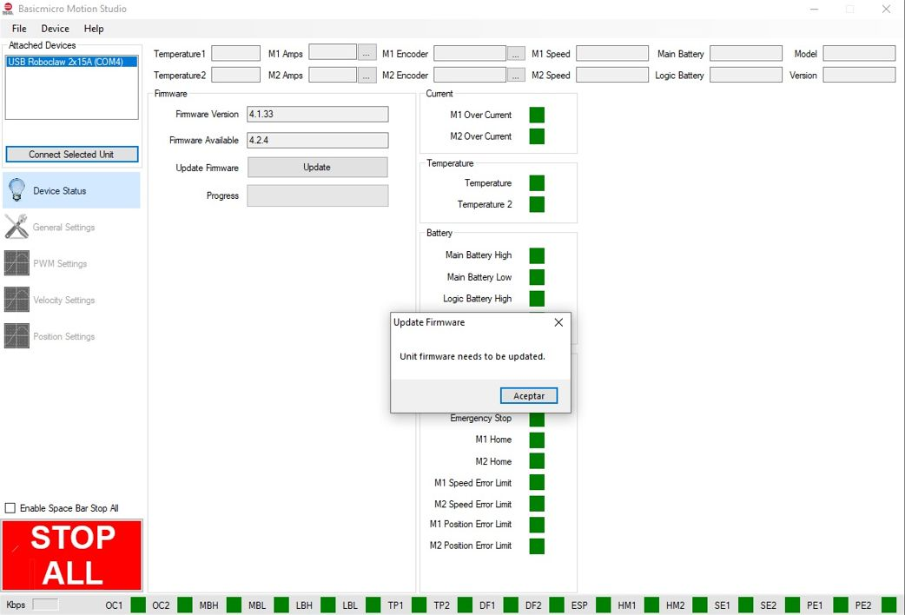

*Figura 8. Aviso de actualización de firmware al conectar la unidad.*

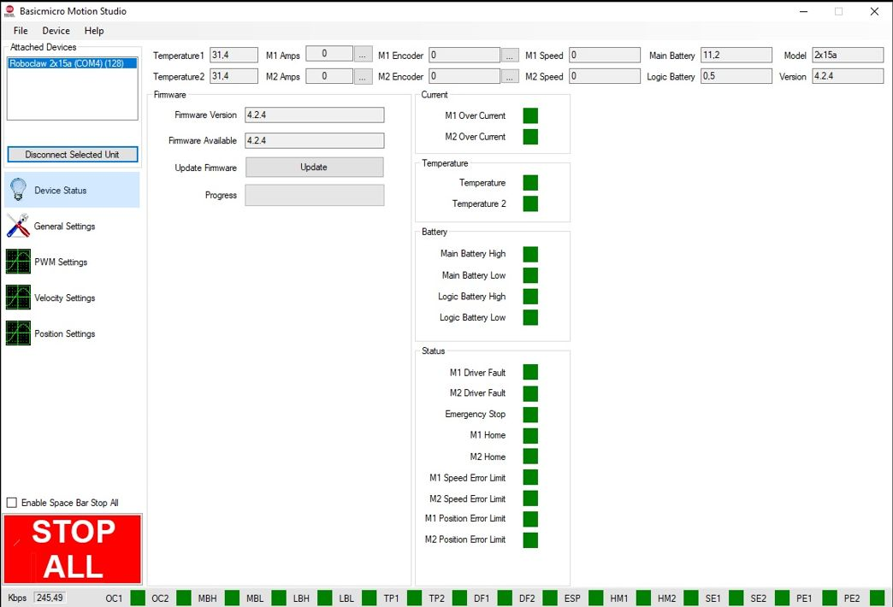

*Figura 9. Unidad conectada: en el panel izquierdo, Device Status, General Settings, PWM Settings, Velocity Settings y Position Settings.*

### Paso 4. General Settings

Configure *Control Mode = Packet Serial*, *Packet Serial Address = 128* y *Baudrate = 38400*. Deje el resto por defecto, salvo los límites de batería si su kit lo exige (consulte el manual).

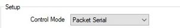

*Figura 10. Modo de control Packet Serial.*

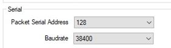

*Figura 11. Dirección 128 y 38 400 baudios.*

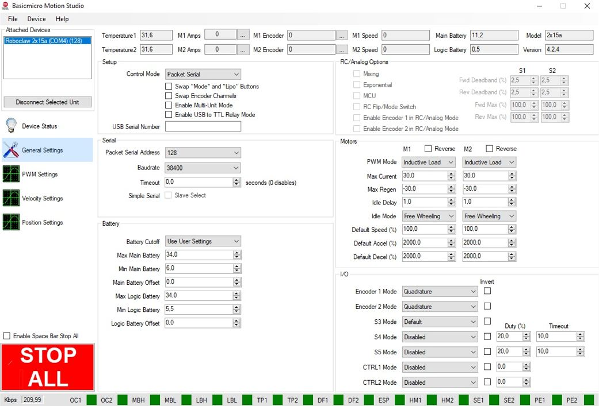

*Figura 12. Vista completa de General Settings con la configuración del robot.*

### Paso 5. Prueba de PWM y encoders

En *PWM Settings* mueva suavemente cada control deslizante. La rueda debe girar y el contador del encoder del mismo motor debe **aumentar** cuando el PWM es positivo. Anote el sentido real de cada rueda (adelante o atrás): lo necesitará para `invert_left`/`invert_right` en el DA-12.1.

### Paso 6. Autotune de velocidad

En *Velocity Settings* pulse *Autotune* para el motor 1 y luego para el motor 2. El motor hará movimientos en ambos sentidos y escribirá P, I, D y QPPS. Si aparece «Encoder direction is reversed relative to motor direction», intercambie físicamente los canales A y B de ese encoder y repita.

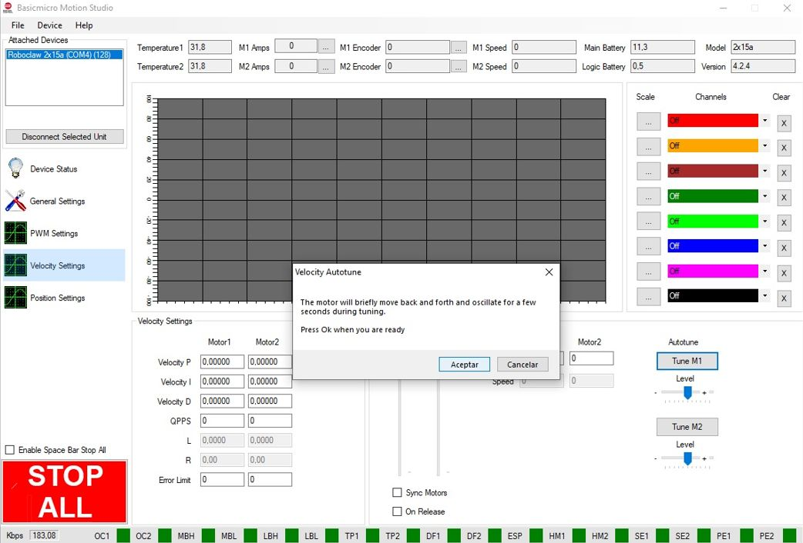

*Figura 13. Autotune de velocidad: el motor se moverá en ambas direcciones durante unos segundos.*

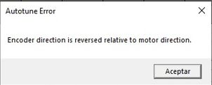

*Figura 14. Error de Autotune por encoder invertido.*

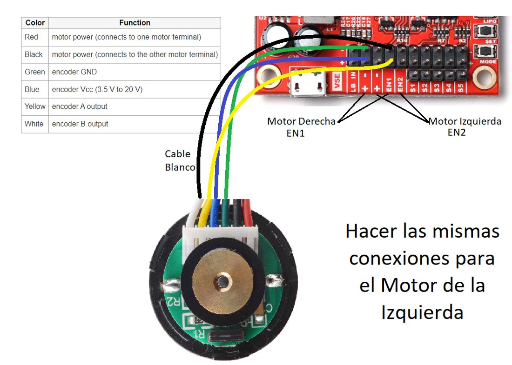

*Figura 15. Si aparece el error, intercambie los cables A y B del encoder (amarillo y blanco) en el conector EN1 o EN2.*

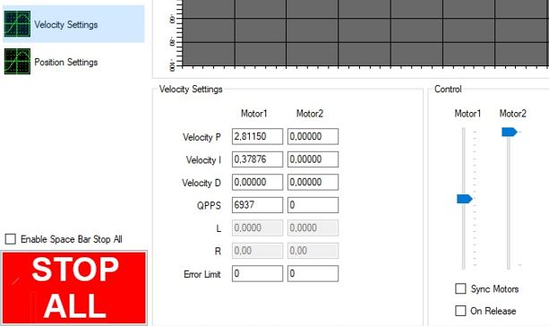

*Figura 16. Resultado del Autotune del motor 1 en un robot del laboratorio: P = 2,81150; I = 0,37876; D = 0; QPPS = 6937.*

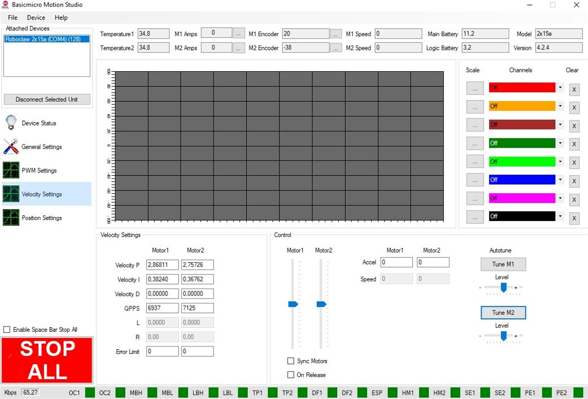

*Figura 17. Autotune terminado para los dos motores: P, I, D y QPPS de cada uno.*

### Paso 7. Verificar y guardar

Grafique la consigna y la velocidad medida para comprobar que el motor sigue la referencia sin oscilar. Para que los cambios queden en el controlador pulse **Device → Write Settings**; sin este paso se pierden al apagar.

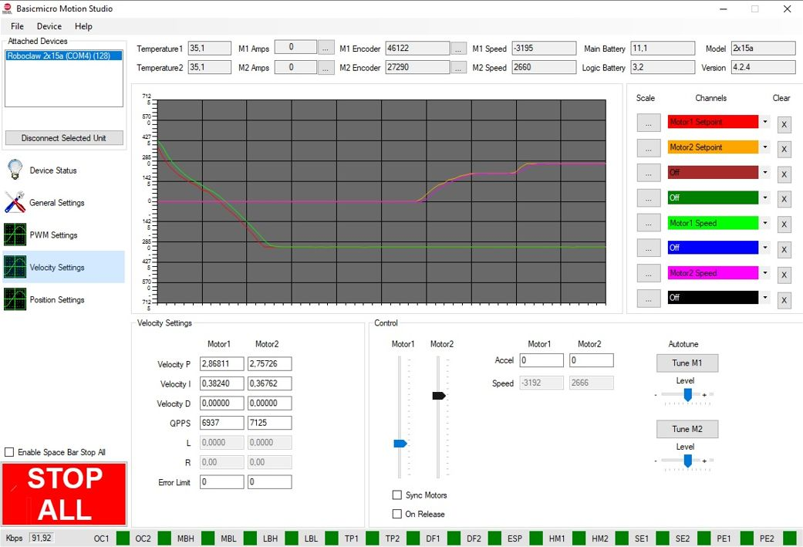

*Figura 18. Gráfica de consigna y velocidad de los dos motores durante la prueba.*

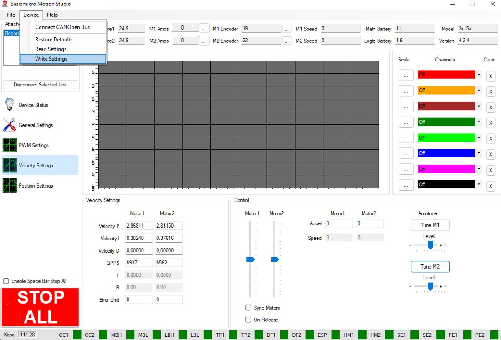

*Figura 19. Device → Write Settings guarda la configuración en el RoboClaw.*

*Tabla 2. Resultado del Autotune de su robot (diligenciar). El driver ROS 2 los imprime al arrancar.*

| **Motor** | **Rueda** | **P** | **I** | **D** | **QPPS** | **Firmware** |
|---|---|---|---|---|---|---|
| M1 | derecha |  |  |  |  |  |
| M2 | izquierda |  |  |  |  |  |

## 5. COMPROBACIÓN DESDE LINUX (SIN WINDOWS)

Con el espacio de trabajo robots\_ws preparado según el DA-9.1 [8] (en el PC con Ubuntu 22.04 o en el computador del robot), conecte el RoboClaw por USB y repita el diagnóstico sin Motion Studio:

**Terminal – PC o robot (donde esté conectado el RoboClaw)**

```bash
# version, baterias, PID y encoders en vivo
ros2 run mr_base check_roboclaw --port /dev/roboclaw
# mueve cada motor al 10 % de QPPS (ruedas arriba)
ros2 run mr_base check_roboclaw --port /dev/roboclaw --probar
```

Salida esperada (abreviada): versión `USB Roboclaw 2x15a v4.x`, batería principal en voltios, PID de cada motor con el QPPS que escribió el Autotune y, con `--probar`, «OK, mismo signo» para ambos motores.

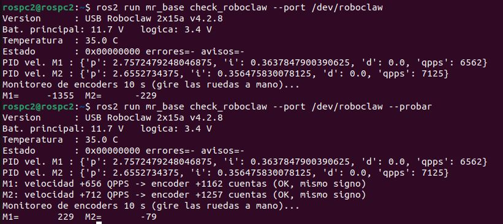

> **Reto:**
>
> Si el QPPS del motor izquierdo es 6500 y el del derecho 6937, ¿qué velocidad lineal máxima puede pedir el software sin saturar ninguna rueda, dejando 20 % de margen? (ruedas de 90 mm, 2248,86 cuentas/vuelta).

## REFERENCIAS

**[1]** Basicmicro Motion Control, *RoboClaw 2x15A Motor Controller* (descargas: Motion Studio y RoboClaw User Manual). [En línea]. Disponible: [https://www.basicmicro.com/RoboClaw-2x15A-Motor-Controller_p_10.html](https://www.basicmicro.com/RoboClaw-2x15A-Motor-Controller_p_10.html)

**[2]** Basicmicro Motion Control, *RoboClaw Series Brushed DC Motor Controllers – User Manual*, rev. 5.6 (firmware 4.1.20 y posteriores). Copia incluida en «10. CONFIGURACIÓN ROBOCLAW/PROGRAMAS/BASIC MICRO/Legacy version Funcional».

**[3]** Pololu Corporation, *RoboClaw 2x15A Motor Controller (V6B/V6F)* (item #3683; 2 × 15 A continuos, 30 A pico, 6–34 V). [En línea]. Disponible: [https://www.pololu.com/product/3683/specs](https://www.pololu.com/product/3683/specs)

**[4]** Basicmicro Motion Control, *roboclaw\_python\_library (legacy: RoboClaw V5 y anteriores)*. [En línea]. Disponible: [https://github.com/basicmicro/roboclaw_python_library](https://github.com/basicmicro/roboclaw_python_library)

**[5]** Basicmicro Motion Control, *basicmicro\_python – Python 3 library for Basicmicro packet serial* (v2.0.10, licencia MIT). [En línea]. Disponible: [https://github.com/basicmicro/basicmicro_python](https://github.com/basicmicro/basicmicro_python)

**[6]** Pololu Corporation, *47:1 Metal Gearmotor 25Dx67L mm HP 12V with 48 CPR Encoder* (item #4846; relación 46,85:1; 2248,86 cuentas/vuelta). [En línea]. Disponible: [https://www.pololu.com/product/4846](https://www.pololu.com/product/4846)

**[7]** J. R. Cháux Cedeño, *Robótica básica – Semana 2: construcción y programación de un robot móvil (documentos de apoyo 8 a 18)*, SENA, 2022–2025.

**[8]** J. R. Cháux Cedeño, *robots\_ws – paquetes ROS 2 del curso (repositorio en GitHub, licencia Apache-2.0), 2026. [En línea]. Disponible: https://github.com/jchauxdev/robots\_ws*
