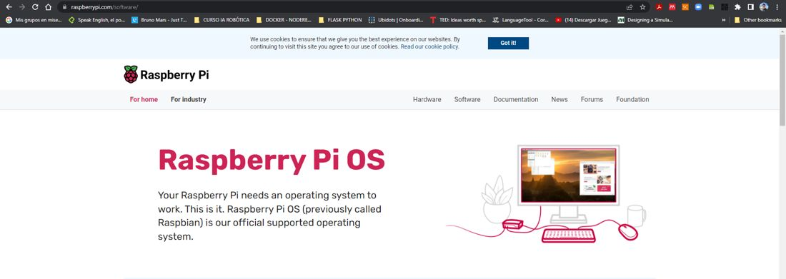
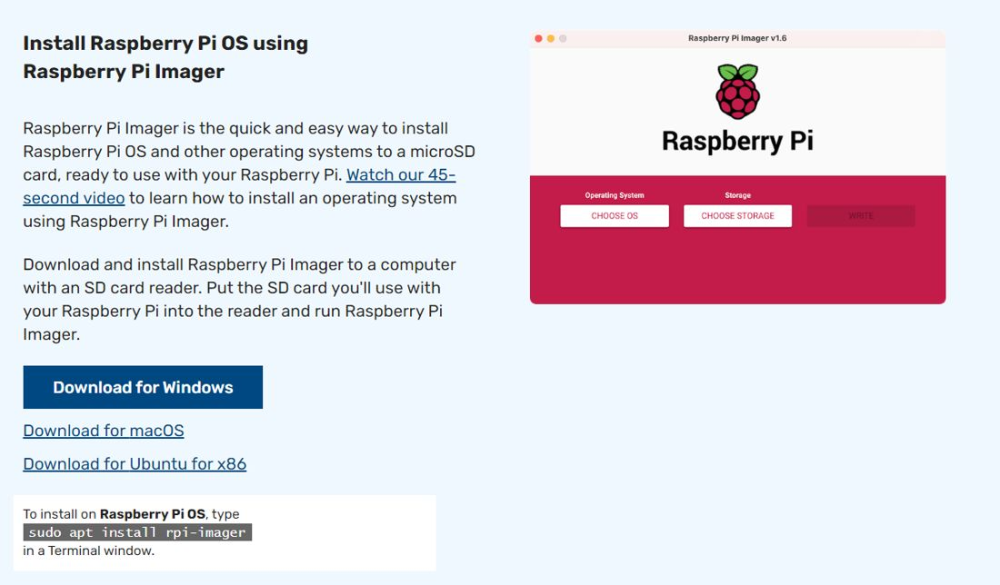
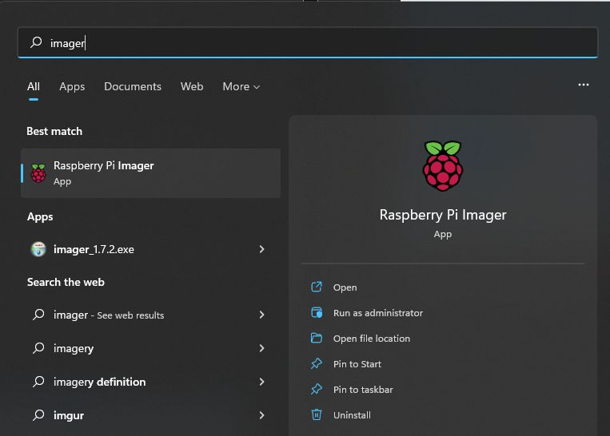
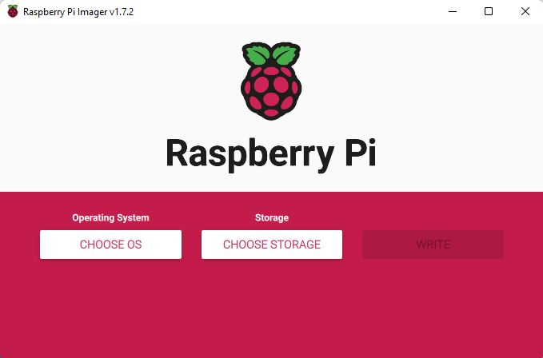
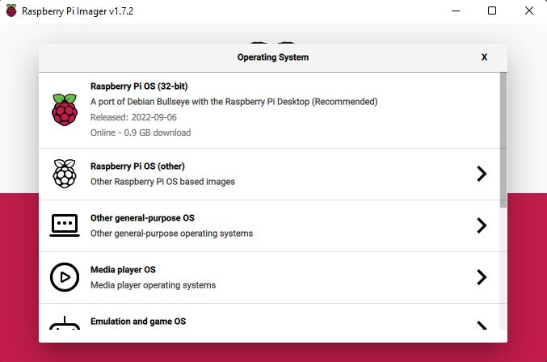
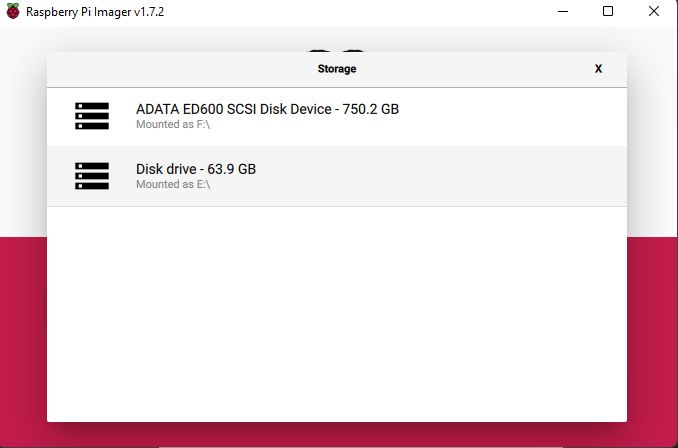
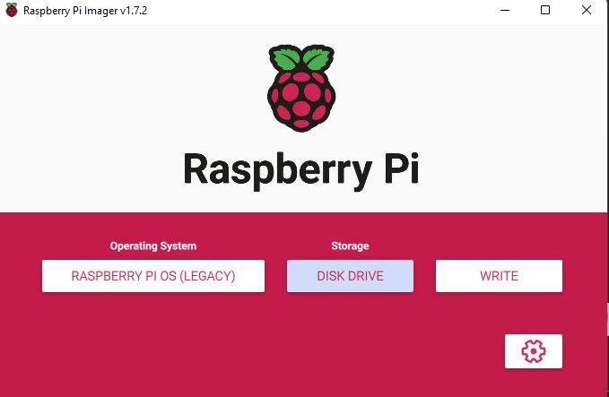
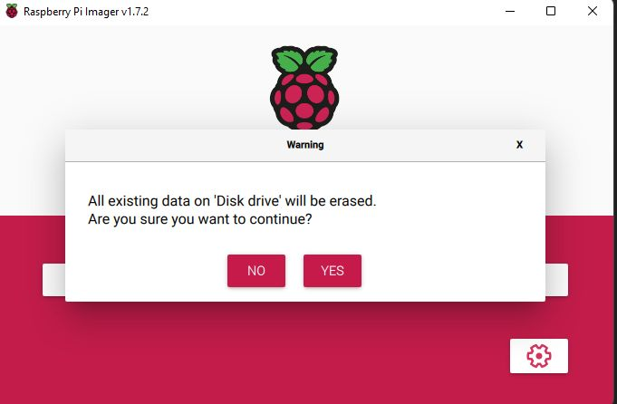
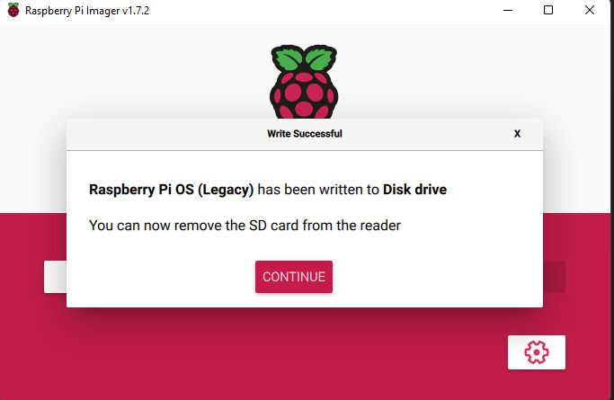

# Documento de Apoyo No. 11.1 (Raspberry Pi 4) – Ubuntu 22.04 y ROS 2 Humble en la Raspberry Pi 4 (alternativa).

> Versión en Markdown del documento [11.1. Ubuntu 22.04 y ROS 2 Humble en Raspberry Pi 4.docx](11.1.%20Ubuntu%2022.04%20y%20ROS%202%20Humble%20en%20Raspberry%20Pi%204.docx) para consultar y copiar comandos desde GitHub. El documento de Word es la versión oficial (formato GFPI-F-135).

**Duración Estimada:** 1 hora.

**Sesión:** Día 2 – 03/11/2026, bloque 3 (2:00 p.m. – 5:00 p.m.).

**Relación con la Guía de Aprendizaje:** Actividad 3.3.2 – carpeta «11. INSTALACIÓN DE LINUX - ROS 2 - RPI - JETSON».

**Diseñado por:** Julián René Cháux Cedeño.

## 1. CONTEXTO

La Raspberry Pi 4 admite **Ubuntu 22.04 (arm64)**, plataforma de nivel 1 de ROS 2 Humble [1], por lo que Humble se instala con apt en minutos, igual que en el PC. Se usa como alternativa a la Jetson Nano (no tiene GPU CUDA, pero tiene más soporte de software).

## 2. PROCEDIMIENTO

1. Con Raspberry Pi Imager [3] grabe *Other general-purpose OS → Ubuntu → Ubuntu Desktop 22.04 LTS (64-bit)* [2] en una microSD de 32 GB.
1. En las opciones avanzadas del Imager fije hostname (tabla del DA-11.1 de la Nano), usuario y Wi-Fi.
1. Arranque, actualice e instale ROS 2 Humble con el procedimiento oficial (repositorio con `ros2-apt-source`, como en el DA-02 de la transferencia del cobot):



*Figura 1. Página de software de Raspberry Pi (https://www.raspberrypi.com/software/).*



*Figura 2. Enlace de descarga de Raspberry Pi Imager.*



*Figura 3. Con la tarjeta SD insertada, abrir Raspberry Pi Imager desde el menú Inicio.*



*Figura 4. Raspberry Pi Imager (se elige Ubuntu 22.04 de 64 bits).*



*Figura 5. CHOOSE OS: para Ubuntu 22.04 se entra a Other general-purpose OS → Ubuntu.*



*Figura 6. Seleccionar la unidad de la tarjeta SD.*



*Figura 7. Sistema y unidad elegidos: pulsar WRITE.*



*Figura 8. Confirmar que se borrará la tarjeta.*



*Figura 9. Grabación terminada: retirar la tarjeta del lector.*

**Terminal – Raspberry Pi**

```bash
sudo apt update && sudo apt install -y software-properties-common curl
sudo add-apt-repository universe
export ROS_APT_SOURCE_VERSION=$(curl -s https://api.github.com/repos/ros-infrastructure/ros-apt-source/releases/latest | grep -F "tag_name" | awk -F\" '{print $4}')
curl -L -o /tmp/ros2-apt-source.deb "https://github.com/ros-infrastructure/ros-apt-source/releases/download/${ROS_APT_SOURCE_VERSION}/ros2-apt-source_${ROS_APT_SOURCE_VERSION}.$(. /etc/os-release && echo $VERSION_CODENAME)_all.deb"
sudo apt install /tmp/ros2-apt-source.deb && sudo apt update
sudo apt install -y ros-humble-ros-base ros-dev-tools python3-serial
echo "source /opt/ros/humble/setup.bash" >> ~/.bashrc
```

### Verificar la instalación de ROS 2

Abra una terminal nueva (para que se lea el `~/.bashrc`) y compruebe la instalación:

**Terminal – Raspberry Pi**

```bash
# debe mostrar: humble
printenv ROS_DISTRO
# debe mostrar: 2
printenv ROS_VERSION
# debe mostrar: 3
printenv ROS_PYTHON_VERSION
# todas las variables de ROS cargadas
printenv | grep -i ^ros
# distribution name: humble
ros2 doctor --report | grep -A4 "ROS 2 INFORMATION"
# ros-base no los trae
sudo apt install -y ros-humble-demo-nodes-cpp ros-humble-demo-nodes-py
# en otra terminal: ros2 run demo_nodes_py listener
ros2 run demo_nodes_cpp talker
```

Si `printenv ROS_DISTRO` no muestra nada, el entorno no está cargado: verifique que existe `/opt/ros/humble/setup.bash` y la línea `source` al final de `~/.bashrc`. Si el archivo no existe, la instalación falló y debe repetirse revisando los mensajes de `apt`.

> **Insertar imagen:**
>
> *Captura de la salida de* `printenv ROS_DISTRO` *y del talker/listener.*

Después prepare el espacio de trabajo robots\_ws como en el PC (DA-9.1: reserva mr\_ws, dependencias con rosdep y paquetes mr\_base y mr\_sim) y continúe con el DA-12.1. En la Pi conviene ejecutar Nav2 y slam\_toolbox en el PC del instructor, igual que con la Nano.

## REFERENCIAS

**[1]** Open Robotics, *REP 2000 – ROS 2 Releases and Target Platforms*. [En línea]. Disponible: [https://www.ros.org/reps/rep-2000.html](https://www.ros.org/reps/rep-2000.html)

**[2]** Canonical, *Install Ubuntu on a Raspberry Pi*. [En línea]. Disponible: [https://ubuntu.com/download/raspberry-pi](https://ubuntu.com/download/raspberry-pi)

**[3]** Raspberry Pi Ltd., *Raspberry Pi Imager*. [En línea]. Disponible: [https://www.raspberrypi.com/software/](https://www.raspberrypi.com/software/)

**[4]** Open Robotics, *ROS 2 Documentation: Humble Hawksbill*. [En línea]. Disponible: [https://docs.ros.org/en/humble/](https://docs.ros.org/en/humble/)

**[5]** J. R. Cháux Cedeño, *Robótica básica – Semana 2: construcción y programación de un robot móvil (documentos de apoyo 8 a 18)*, SENA, 2022–2025.
