# Documento de Apoyo No. 11.1 (Jetson Nano) – Instalación de JetPack 4.6.6 (Ubuntu 18.04) en la Jetson Nano: descarga de la imagen, grabación de la microSD o SDK Manager.

> Versión en Markdown del documento [11.1. Instalación de Linux JETSON NANO (JetPack 4.6.6).docx](11.1.%20Instalación%20de%20Linux%20JETSON%20NANO%20(JetPack%204.6.6).docx) para consultar y copiar comandos desde GitHub. El documento de Word es la versión oficial (formato GFPI-F-135).

**Duración Estimada:** 1,5 horas (más el tiempo de descarga de la imagen, ≈ 6,6 GB).

**Sesión:** Día 2 – 03/11/2026, bloque 3 (2:00 p.m. – 5:00 p.m.).

**Relación con la Guía de Aprendizaje:** Actividad 3.3.2 – carpeta «11. INSTALACIÓN DE LINUX - ROS 2 - RPI - JETSON», subcarpeta «2. JETSON NANO».

**Diseñado por:** Julián René Cháux Cedeño.

## 1. OBJETIVOS DE APRENDIZAJE

- Identificar la última versión de JetPack compatible con la Jetson Nano y dónde descargarla.
- Grabar la imagen en la microSD con balenaEtcher (método A) o instalar con SDK Manager (método B).
- Completar la configuración inicial y actualizar el sistema a JetPack 4.6.6 (Jetson Linux R32.7.6).
- Dejar la Jetson Nano lista para ejecutar ROS 2 Humble en un contenedor (DA-11.2).

## 2. CONTEXTO

La **Jetson Nano** (primera generación) solo es compatible con **JetPack 4**, basado en **Ubuntu 18.04**. En el archivo de versiones de NVIDIA [1] la Nano aparece hasta **JetPack 4.6.6** (Jetson Linux **R32.7.6**); ninguna versión de JetPack 5, 6 o 7 la incluye. Con JetPack 4.6.6, publicada el 22/11/2024, NVIDIA cerró la serie JetPack 4 [4]: es la versión que se debe usar en la Nano.

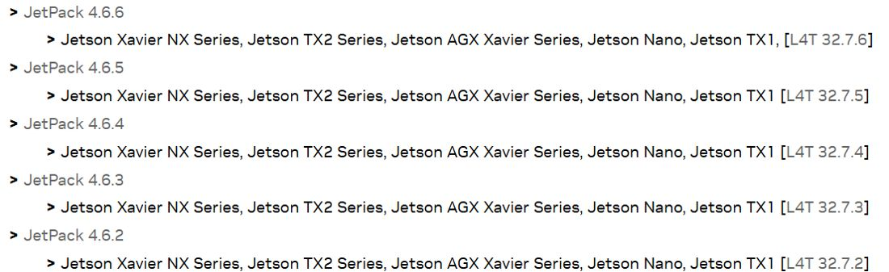

*Figura 1. Archivo de JetPack: las versiones 4.6.2 a 4.6.6 incluyen la Jetson Nano; JetPack 4.6.6 corresponde a L4T 32.7.6 (captura del instructor).*

Ubuntu 18.04 no es plataforma de ROS 2 Humble (Humble apunta a Ubuntu 22.04) [8]; por eso en la Nano ROS 2 se ejecuta en un contenedor Docker (DA-11.2).

> **Nota:**
>
> NVIDIA no publica una imagen de microSD propia de la 4.6.6: la página de JetPack 4.6.6 [2] enlaza la imagen **jetson-nano-jp461** (JetPack 4.6.1, R32.7.1). Esa imagen ya usa el repositorio APT de R32.7, así que al actualizarla con `apt` queda en R32.7.6 = JetPack 4.6.6 (Paso 5) [5].
>
> Con SDK Manager (método B) se instala directamente la versión 4.6.x más reciente que ofrezca.

## 3. MATERIALES

- Jetson Nano Developer Kit (4 GB, revisión A02 o B01) o Jetson Nano 2GB Developer Kit.
- Fuente de 5 V / 4 A con conector cilíndrico (puente J48 colocado) o fuente micro-USB de 5 V / 2 A.
- Tarjeta microSD de 32 GB como mínimo (64 GB recomendada, UHS-I) y lector de tarjetas.
- Monitor HDMI o DisplayPort, teclado y ratón USB para el primer arranque.
- PC con Internet y balenaEtcher (método A) o PC con Ubuntu 18.04 y SDK Manager (método B, cable micro-USB de datos y un puente).
- La imagen ya descargada está en la carpeta «ISO JETPACK»: jetson-nano-jp461-sd-card-image.zip (6,6 GB).

## 4. PROCEDIMIENTO

### Paso 1. Descargar la imagen de la microSD

*Tabla 1. Enlaces de descarga oficiales.*

| **Recurso** | **Enlace** |
|---|---|
| Archivo de todas las versiones de JetPack | https://developer.nvidia.com/embedded/jetpack-archive |
| JetPack 4.6.6 (última para la Nano) | https://developer.nvidia.com/jetpack-sdk-466 |
| Imagen SD – Jetson Nano Developer Kit (4 GB) | https://developer.nvidia.com/embedded/l4t/r32\_release\_v7.1/jp\_4.6.1\_b110\_sd\_card/jeston\_nano/jetson-nano-jp461-sd-card-image.zip |
| Imagen SD – Jetson Nano 2GB Developer Kit | https://developer.nvidia.com/embedded/l4t/r32\_release\_v7.1/jp\_4.6.1\_b110\_sd\_card/jetson\_nano\_2gb/jetson-nano-2gb-jp461-sd-card-image.zip |
| Guía de inicio de NVIDIA (grabación paso a paso) | https://developer.nvidia.com/embedded/learn/get-started-jetson-nano-devkit |

1. Ingrese a la página de **JetPack 4.6.6** (Tabla 1) y baje hasta la sección **Installing JetPack**.
1. En **SD Card Image Method** abra **JETSON NANO DEVELOPER KITS** y pulse **Download the SD Card Image** de su placa: Jetson Nano Developer Kit (4 GB) o Jetson Nano 2GB Developer Kit (Figura 2).
1. Se descarga un archivo .zip (jetson-nano-jp461-sd-card-image.zip). No es necesario descomprimirlo.

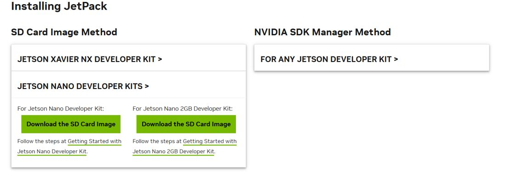

*Figura 2. Página de JetPack 4.6.6, sección Installing JetPack: imagen SD para las Jetson Nano Developer Kits y método SDK Manager (captura del instructor).*

### Paso 2. Método A (recomendado): grabar la microSD con balenaEtcher

NVIDIA recomienda balenaEtcher [6] para grabar la imagen, en Windows, macOS o Linux [3]:

1. Descargue e instale **balenaEtcher** en el PC.
1. Inserte la microSD en el PC con el lector de tarjetas.
1. En balenaEtcher pulse **Flash from file** y seleccione el .zip descargado.
1. En **Select target** elija la microSD. Verifique la capacidad de la unidad para no borrar un disco del PC.
1. Pulse **Flash!** y espere a que termine la escritura y la validación (10 a 20 minutos).
1. En Windows pueden aparecer avisos para formatear la unidad: pulse **Cancelar**; la tarjeta ya está lista.
1. Retire la microSD del PC.

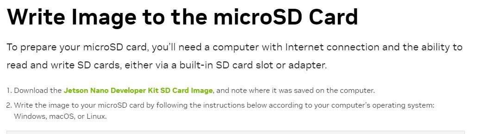

*Figura 3. Guía de inicio de NVIDIA: Write Image to the microSD Card.*

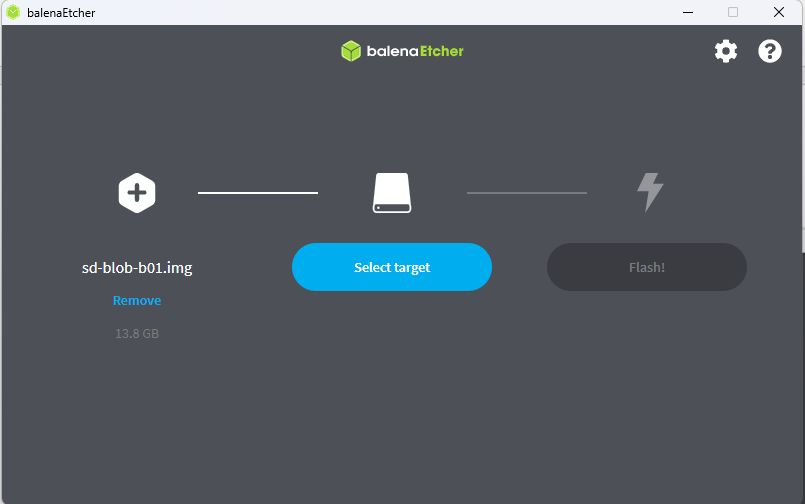

*Figura 4. balenaEtcher: selección de imagen y unidad.*

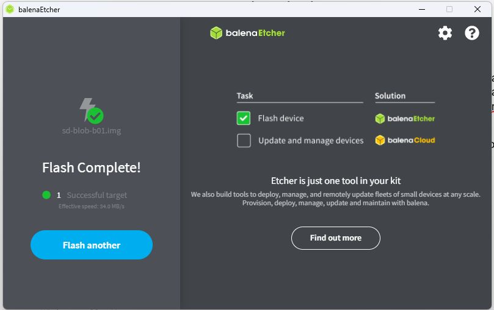

*Figura 5. Grabación terminada.*

### Paso 3. Método B (alternativa): SDK Manager desde un PC con Ubuntu 18.04

SDK Manager [7] graba la Jetson Nano por USB. Para JetPack 4 el PC debe tener **Ubuntu 18.04** nativo (no máquina virtual); si el PC tiene otra versión, use la imagen Docker de SDK Manager para Ubuntu 18.04 que ofrece la misma página. Con la microSD insertada en la Jetson, SDK Manager graba el sistema y además instala CUDA, cuDNN y TensorRT. Las capturas son de una instalación hecha por el instructor; SDK Manager muestra la versión 4.6.x que tenga disponible: elija la más reciente.

**3.1 Instalar SDK Manager en el PC.** Inicie sesión con su cuenta de desarrollador de NVIDIA, descargue el .deb e instálelo:

**Terminal – PC con Ubuntu 18.04**

```bash
sudo apt install ./sdkmanager_[versión]_amd64.deb
sdkmanager
```

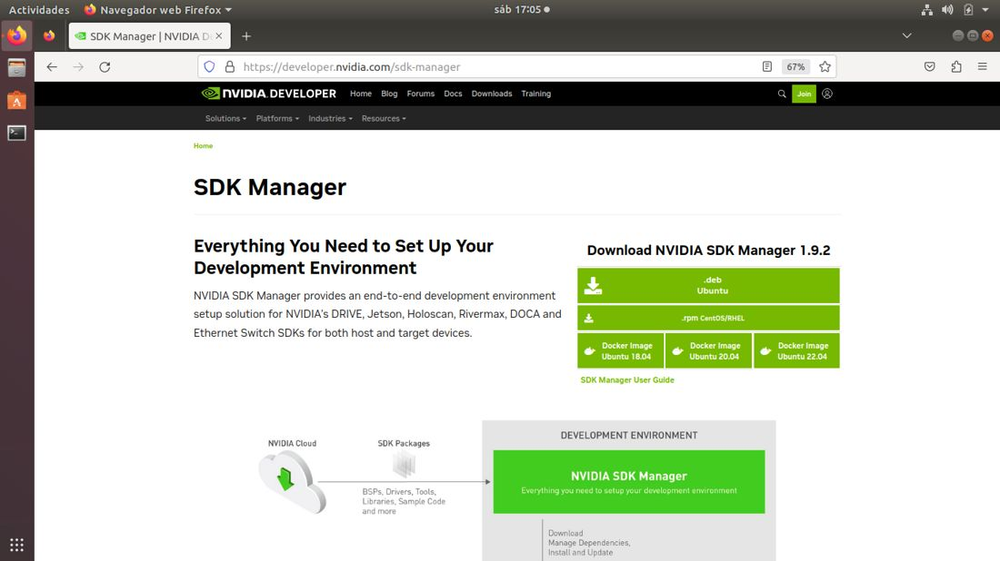

*Figura 6. Página de SDK Manager: descarga del .deb para Ubuntu.*

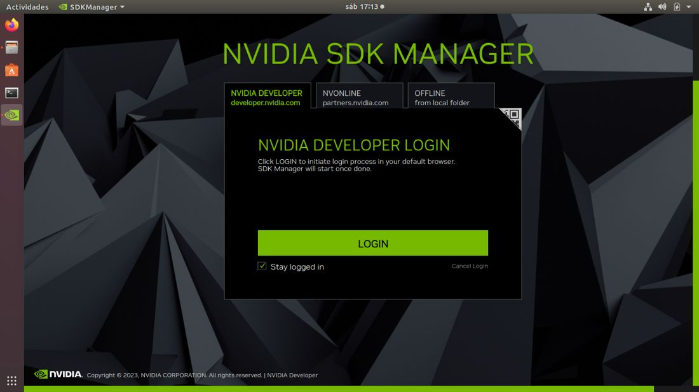

*Figura 7. Inicio de sesión en SDK Manager con la cuenta de NVIDIA.*

**3.2 Poner la Jetson Nano en modo de recuperación (Force Recovery):**

1. Con la Jetson apagada y sin fuente, inserte la microSD (puede estar vacía).
1. Coloque un puente entre los pines **FC REC** y **GND**: pines 9 y 10 del conector de botones J50 en la placa B01, o pines 3 y 4 del conector J40 en la placa A02.
1. Coloque el puente J48 para alimentar por el conector cilíndrico y conecte el cable micro-USB de datos entre la Jetson y el PC.
1. Conecte la fuente: la placa enciende en modo de recuperación. Retire el puente FC REC – GND.

**3.3 Configurar y grabar con SDK Manager:**

1. En **STEP 01** SDK Manager detecta la placa por USB: elija **Jetson Nano** (o la versión 2GB) y la versión de JetPack 4.6.x. Desmarque **Host Machine** si solo va a preparar la Jetson.
1. En **STEP 02** revise los componentes (Jetson OS y Jetson SDK Components), acepte las licencias y pulse **Continue**; escriba la contraseña del PC cuando la pida.
1. Cuando aparezca la ventana *SDK Manager is about to flash your Jetson Nano module*, elija **Manual Setup – Jetson Nano**, **OEM Configuration: Pre-Config** y escriba el usuario y la contraseña de la Jetson. Pulse **Flash**.
1. Espere la grabación (STEP 03). Al terminar, la Jetson reinicia con Ubuntu 18.04 y SDK Manager instala los componentes por la conexión USB (IP 192.168.55.1) con el usuario y la contraseña creados.
1. Cuando aparezca **INSTALLATION COMPLETED SUCCESSFULLY**, pulse **Finish** y continúe en el Paso 5.

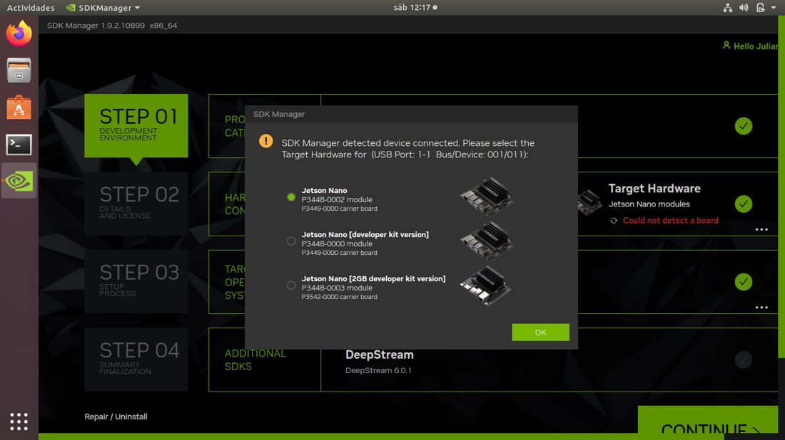

*Figura 8. STEP 01: SDK Manager detecta la placa conectada y pide elegir el modelo de Jetson Nano.*

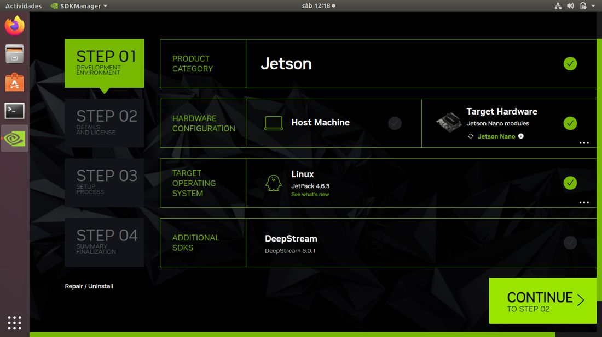

*Figura 9. STEP 01: categoría Jetson, placa Jetson Nano y versión de JetPack.*

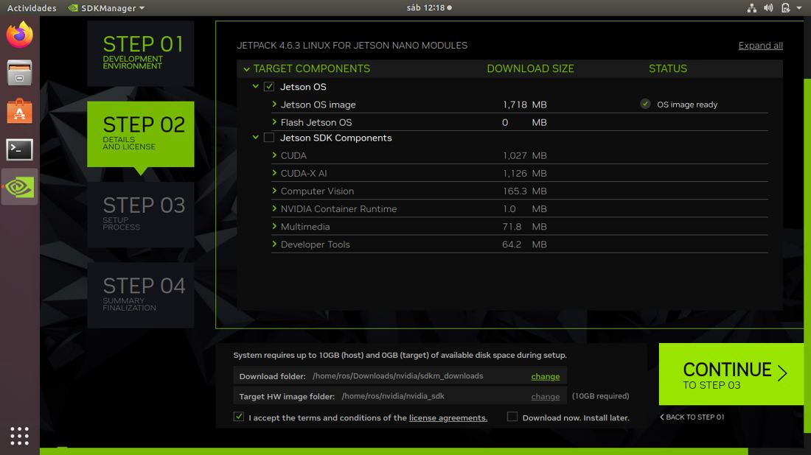

*Figura 10. STEP 02: componentes (Jetson OS y Jetson SDK Components) y licencias.*

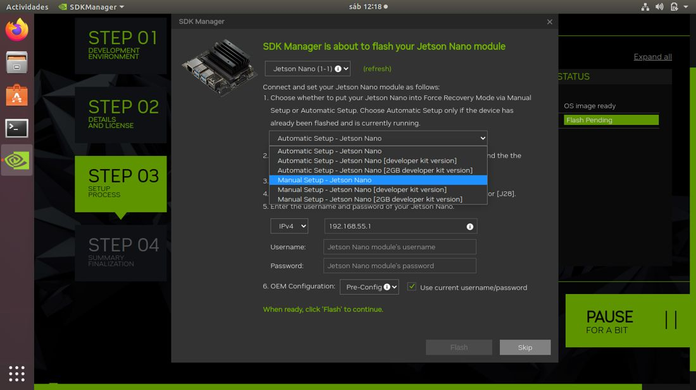

*Figura 11. Ventana de grabación: elegir Manual Setup – Jetson Nano.*

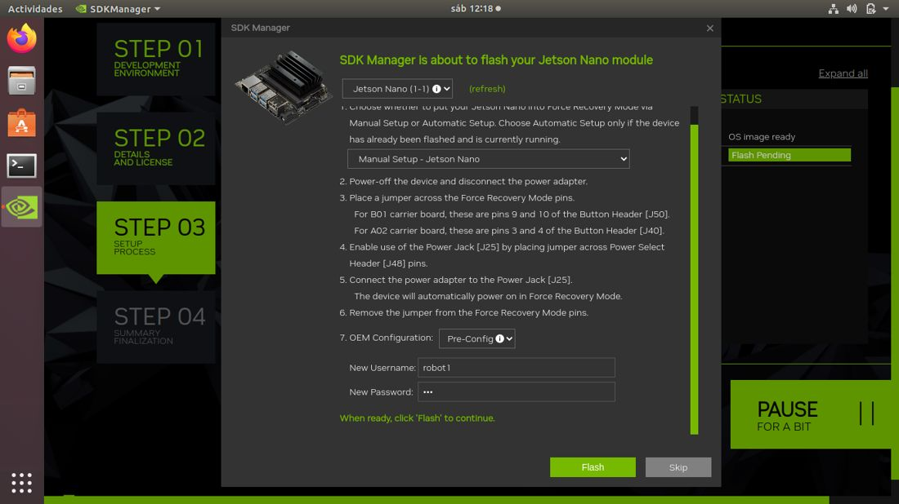

*Figura 12. Instrucciones del modo de recuperación y usuario de la Jetson (Pre-Config).*

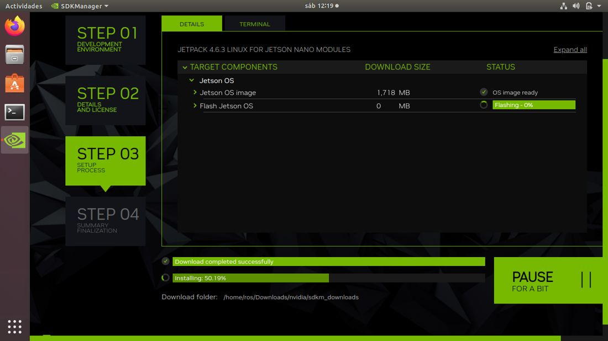

*Figura 13. STEP 03: descarga completa y grabación del Jetson OS en curso.*

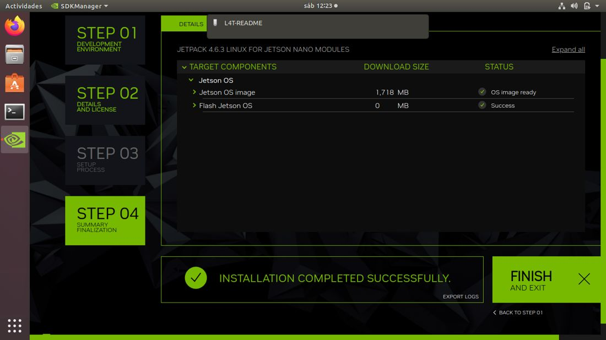

*Figura 14. STEP 04: instalación completada (INSTALLATION COMPLETED SUCCESSFULLY).*

### Paso 4. Primer arranque y configuración inicial (método A)

Inserte la microSD en la ranura que está debajo del módulo de la Jetson Nano (figura siguiente), conecte pantalla, teclado y ratón, y por último la fuente de 5 V / 4 A por el conector cilíndrico (puente J48 colocado). Acepte la licencia y configure idioma, teclado, zona horaria, usuario y contraseña. En el modo de potencia elija **MAXN (10 W)** si su regulador entrega 4 A (DA-8.1); si no, 5 W. Con el método B la cuenta ya quedó creada (Pre-Config) y el sistema arranca directamente en el escritorio.

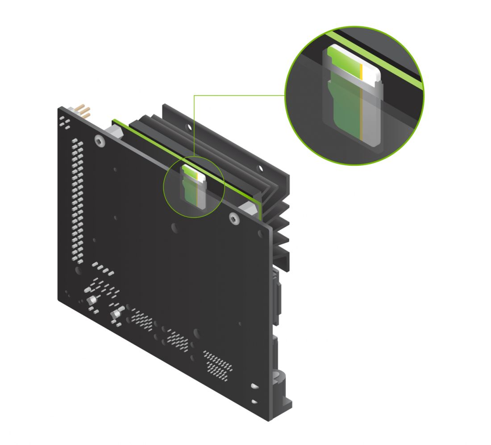

*Figura 15. Ranura de la microSD en el módulo de la Jetson Nano.*

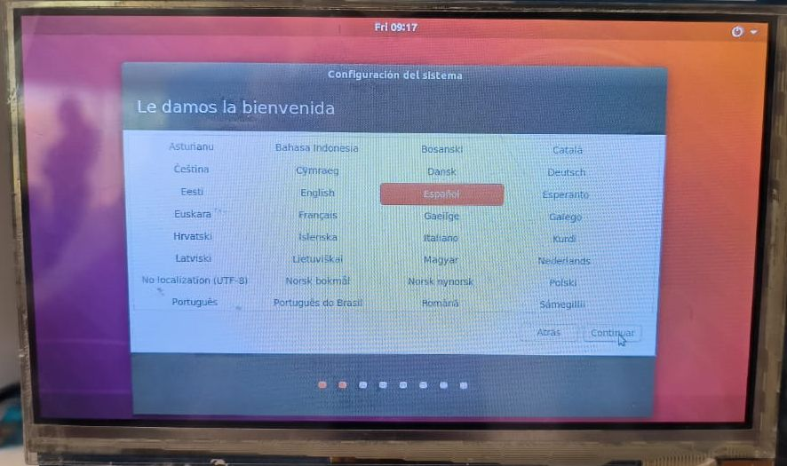

*Figura 16. Primer arranque: elegir el idioma.*

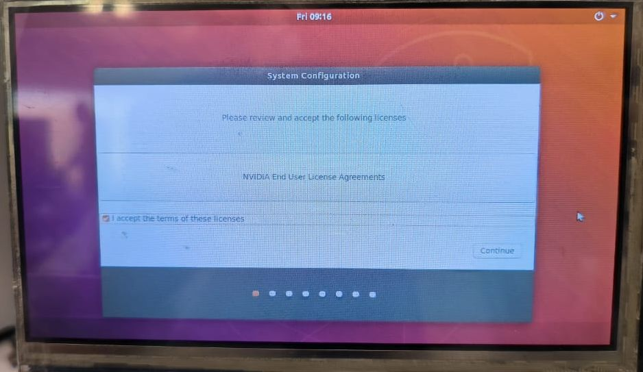

*Figura 17. Aceptar el acuerdo de licencia de NVIDIA.*

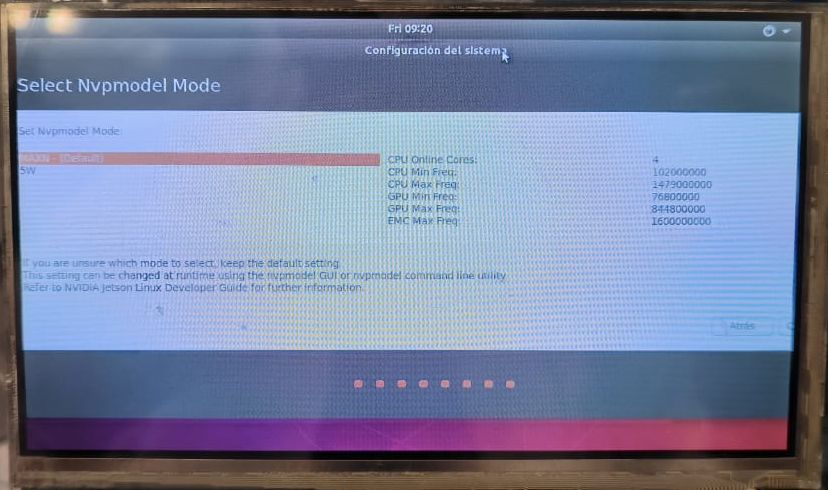

*Figura 18. Selección del modo de potencia durante la configuración inicial.*

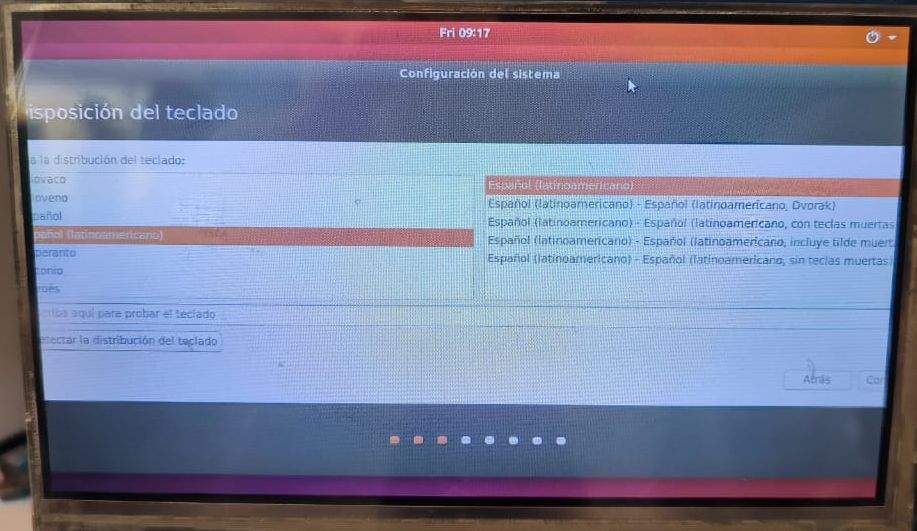

*Figura 19. Distribución del teclado.*

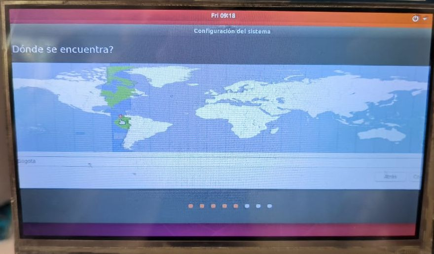

*Figura 20. Ubicación (zona horaria).*

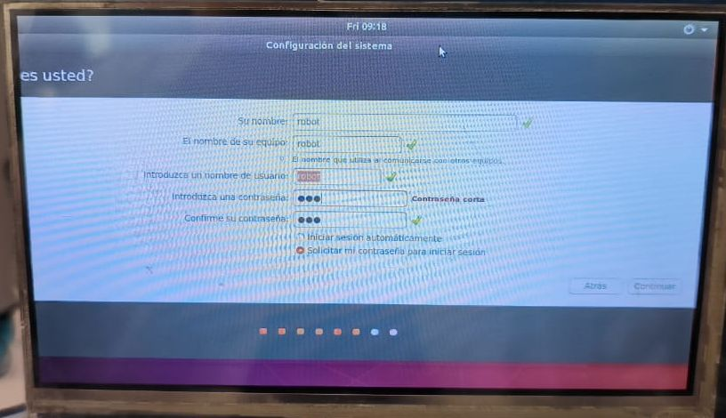

*Figura 21. Nombre, nombre del equipo, usuario y contraseña.*

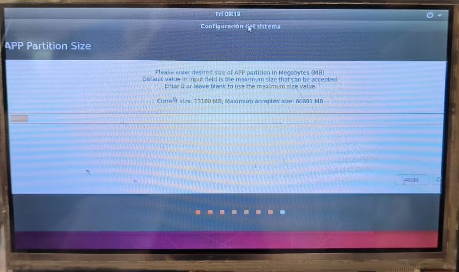

*Figura 22. Tamaño de la partición: dejar el valor por defecto.*

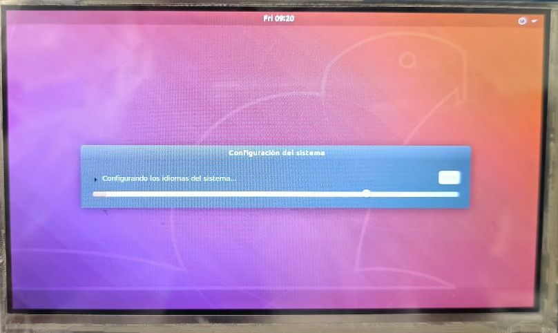

*Figura 23. El sistema termina la configuración.*

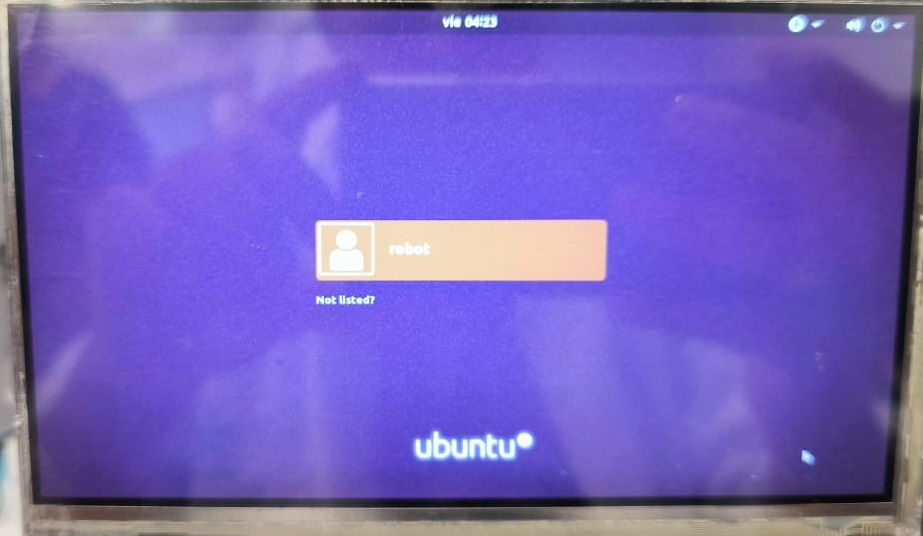

*Figura 24. Pantalla de inicio de sesión de Ubuntu: sistema listo.*

### Paso 5. Actualizar a JetPack 4.6.6, nombre de equipo y verificación

*Tabla 2. Nombres de equipo por robot.*

| **Equipo** | **Hostname del robot** | **IP fija del robot (DA-13.1)** |
|---|---|---|
| 1 | robot1 | 192.168.0.201 |
| 2 | robot2 | 192.168.0.202 |
| 3 | robot3 | 192.168.0.203 |
| 4 | robot4 | 192.168.0.204 |
| 5 | robot5 | 192.168.0.205 |
| 6 | robot6 | 192.168.0.206 |

**Terminal – Jetson Nano**

```bash
# lleva el sistema a JetPack 4.6.6 (Jetson Linux R32.7.6)
sudo apt update && sudo apt upgrade -y
sudo reboot
# R32 (release), REVISION: 7.6
cat /etc/nv_tegra_release
# Ubuntu 18.04.x LTS
lsb_release -ds
# segun la tabla
sudo hostnamectl set-hostname robot1
# modo de potencia actual (0 = MAXN 10 W, 1 = 5 W)
sudo nvpmodel -q
# Docker viene con JetPack; cierre y abra la sesion despues
docker --version && sudo usermod -aG docker $USER
```

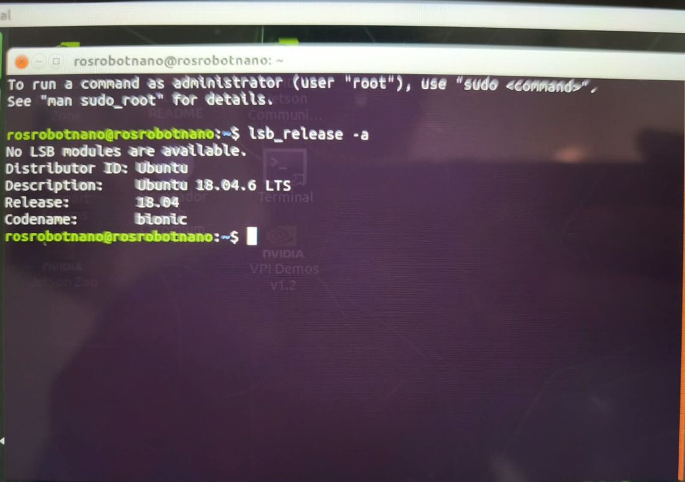

*Figura 25. Comprobación final en la Jetson Nano: lsb_release -a muestra Ubuntu 18.04.6 LTS (bionic) (fotografía del instructor).*

> **Precaución:**
>
> No interrumpa `apt upgrade` ni apague la placa mientras actualiza: el paquete nvidia-l4t-bootloader escribe el cargador de arranque. Si `apt` falla con nvidia-l4t-bootloader o nvidia-l4t-initrd, verifique el espacio libre (`df -h`); si persiste, regrabe la microSD y repita la actualización.

### Paso 6. Memoria de intercambio para compilar

Con 4 GB de RAM, compilar paquetes de ROS 2 puede agotar la memoria. Agregue un archivo de intercambio de 4 GB:

**Terminal – Jetson Nano**

```bash
sudo fallocate -l 4G /swapfile && sudo chmod 600 /swapfile
sudo mkswap /swapfile && sudo swapon /swapfile
echo '/swapfile none swap sw 0 0' | sudo tee -a /etc/fstab
free -h
```

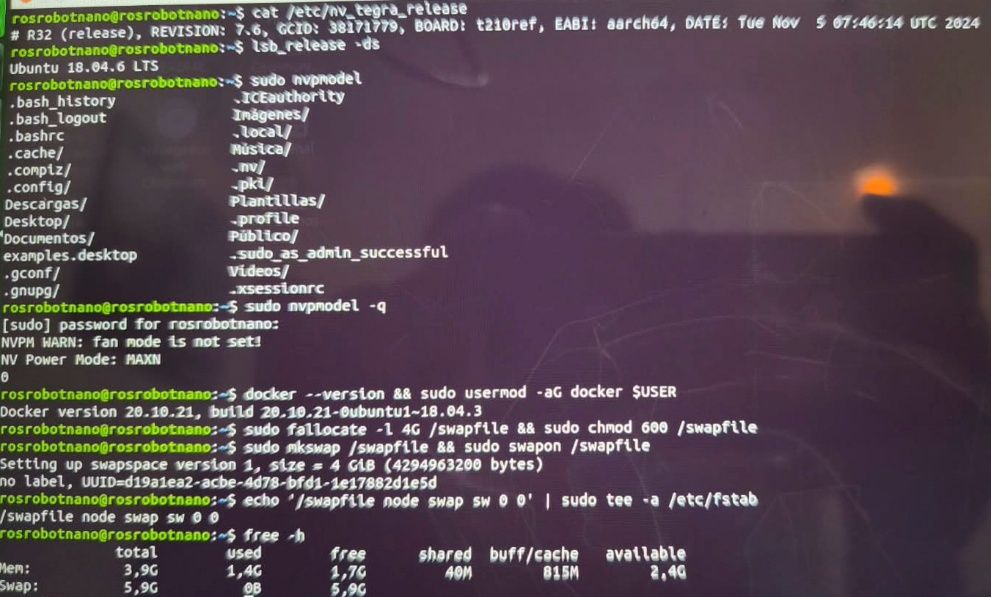

Con el sistema listo, continúe con ROS 2 Humble en el contenedor (DA-11.2).

## 5. VERIFICACIÓN Y EVIDENCIAS

*Tabla 3. Lista de verificación.*

| **#** | **Criterio** | **Evidencia** |
|---|---|---|
| 1 | Imagen correcta para su placa (4 GB o 2 GB) | Nombre del .zip descargado o captura de SDK Manager |
| 2 | Jetson Linux R32.7.6 (JetPack 4.6.6) y Ubuntu 18.04 | `cat /etc/nv_tegra_release` y `lsb_release -ds` |
| 3 | Hostname según la Tabla 2 | `hostname` |
| 4 | Docker disponible para el usuario | `docker --version` sin `sudo` |
| 5 | Intercambio de 4 GB activo | `free -h` |

## 6. SOLUCIÓN DE PROBLEMAS

*Tabla 4. Problemas frecuentes.*

| **Síntoma** | **Causa probable** | **Solución** |
|---|---|---|
| La Nano no muestra imagen al encender | Grabación incompleta o microSD defectuosa | Regrabe con balenaEtcher y la validación activada; pruebe otra tarjeta |
| La placa se reinicia o se apaga sola | Fuente insuficiente (micro-USB) en MAXN | Use la fuente de 5 V / 4 A con el puente J48, o el modo 5 W |
| `R32 ... REVISION: 7.1` después de actualizar | No se ejecutó `apt upgrade` o no se reinició | Repita el Paso 5 y reinicie |
| SDK Manager no detecta la Jetson | Cable micro-USB solo de carga o la placa no está en recuperación | Use un cable de datos; repita 3.2 con el puente FC REC – GND |
| SDK Manager no ofrece JetPack 4 | PC con Ubuntu 20.04 o 22.04 | Use un PC con Ubuntu 18.04, la imagen Docker de SDK Manager o el método A |

## REFERENCIAS

**[1]** NVIDIA, *JetPack Archive*. [En línea]. Disponible: [https://developer.nvidia.com/embedded/jetpack-archive](https://developer.nvidia.com/embedded/jetpack-archive)

**[2]** NVIDIA, *JetPack SDK 4.6.6* (Jetson Linux R32.7.6, Ubuntu 18.04). [En línea]. Disponible: [https://developer.nvidia.com/jetpack-sdk-466](https://developer.nvidia.com/jetpack-sdk-466)

**[3]** NVIDIA, *Get Started With Jetson Nano Developer Kit* (incluye *Write Image to the microSD Card*). [En línea]. Disponible: [https://developer.nvidia.com/embedded/learn/get-started-jetson-nano-devkit](https://developer.nvidia.com/embedded/learn/get-started-jetson-nano-devkit)

**[4]** NVIDIA Developer Forums, *Announcing End of Life for NVIDIA JetPack 4 with the release of JetPack 4.6.6* (22/11/2024; Jetson Linux R32.7.6). [En línea]. Disponible: [https://forums.developer.nvidia.com/t/announcing-end-of-life-for-nvidia-jetpack-4-with-the-release-of-jetpack-4-6-6/314302](https://forums.developer.nvidia.com/t/announcing-end-of-life-for-nvidia-jetpack-4-with-the-release-of-jetpack-4-6-6/314302)

**[5]** NVIDIA Developer Forums, *Jetpack 4.6.3 is upgraded to jetpack 4.6.6 online* (actualización por APT dentro de R32.7). [En línea]. Disponible: [https://forums.developer.nvidia.com/t/jetpack-4-6-3-is-upgraded-to-jetpack-4-6-6-online/318075](https://forums.developer.nvidia.com/t/jetpack-4-6-3-is-upgraded-to-jetpack-4-6-6-online/318075)

**[6]** Balena, *balenaEtcher – Flash OS images to SD cards & USB drives*. [En línea]. Disponible: [https://etcher.balena.io](https://etcher.balena.io)

**[7]** NVIDIA, *NVIDIA SDK Manager*. [En línea]. Disponible: [https://developer.nvidia.com/sdk-manager](https://developer.nvidia.com/sdk-manager)

**[8]** Open Robotics, *REP 2000 – ROS 2 Releases and Target Platforms*. [En línea]. Disponible: [https://www.ros.org/reps/rep-2000.html](https://www.ros.org/reps/rep-2000.html)
