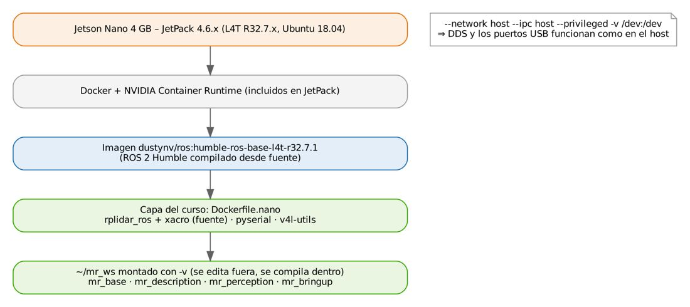
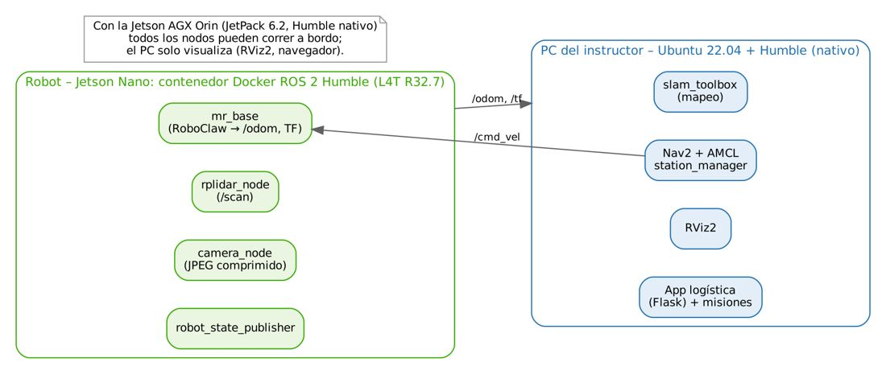
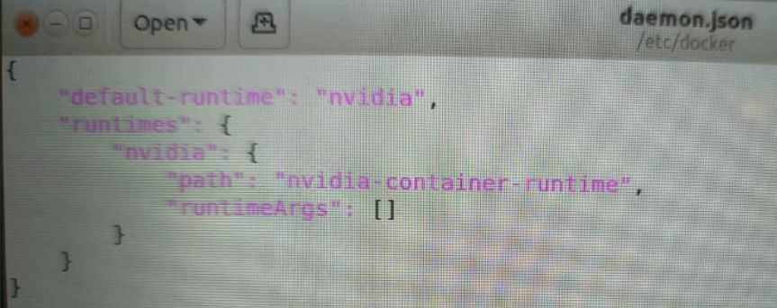
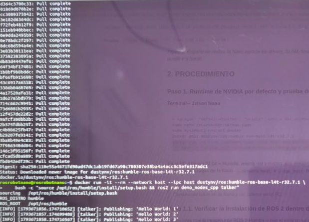

# Documento de Apoyo No. 11.2 (Jetson Nano) – ROS 2 Humble en la Jetson Nano mediante contenedores Docker.

> Versión en Markdown del documento de apoyo, para consultar y copiar comandos desde GitHub. El documento de Word (formato GFPI-F-135) no se publica en el repositorio.

**Duración Estimada:** 1,5 horas.

**Sesión:** Día 2 – 03/11/2026, bloque 3 (2:00 p.m. – 5:00 p.m.).

**Relación con la Guía de Aprendizaje:** Actividad 3.3.2 – carpeta «11. INSTALACIÓN DE LINUX - ROS 2 - RPI - JETSON», subcarpeta «2. JETSON NANO».

**Diseñado por:** Julián René Cháux Cedeño.

## 1. FUNDAMENTOS: ¿POR QUÉ UN CONTENEDOR?

ROS 2 Humble se distribuye en binarios para Ubuntu 22.04 [1]; la Nano está limitada a Ubuntu 18.04 (JetPack 4.6.x) [3]. NVIDIA mantiene en jetson-containers imágenes de ROS 2 compiladas desde fuente para L4T R32.7: `dustynv/ros:humble-ros-base-l4t-r32.7.1` (también -ros-core y -desktop) [2]. Según su documentación, un equipo con JetPack 4.6.x puede ejecutar imágenes construidas para otra versión de JetPack 4.6. Como ROS 2 vive dentro del contenedor, no se instalan paquetes `ros-humble-*` con `apt`: los paquetes adicionales se compilan desde fuente.

*Tabla 1. Alternativas para ROS 2 en la Jetson Nano.*

| **Opción** | **Ventajas** | **Limitaciones** | **Decisión** |
|---|---|---|---|
| Contenedor dustynv/ros:humble (L4T R32.7.1) | Listo en minutos; mantenido por NVIDIA; GPU disponible | Paquetes extra desde fuente; Ubuntu 18.04 por dentro | Recomendada |
| Compilar Humble nativo en Ubuntu 18.04 | Sin Docker | Horas de compilación, parches de dependencias | No recomendada |



*Figura 1. Capas de software del robot con Jetson Nano.*



*Figura 2. Reparto de nodos: la Nano ejecuta los drivers; SLAM, Nav2, RViz2 y la App corren en el PC (Ubuntu 22.04). Con la AGX Orin todo puede ir a bordo.*

Este documento se hace completo en la Jetson Nano y no necesita el PC ni la red: la comunicación entre la Nano y el PC se configura y se prueba en la carpeta 13 (DA-13.1 y DA-13.2).

## 2. PROCEDIMIENTO (EN LA JETSON NANO)

### Paso 1. Configurar Docker: runtime de NVIDIA y permisos

JetPack ya trae Docker y el runtime de NVIDIA. Para que todos los contenedores usen la GPU sin escribir `--runtime nvidia` cada vez, el runtime de NVIDIA se deja **por defecto** en `/etc/docker/daemon.json` [8]. Abra el archivo con un editor de texto:

**Terminal – Jetson Nano**

```bash
# en el escritorio
sudo gedit /etc/docker/daemon.json
# por SSH o sin escritorio
sudo nano /etc/docker/daemon.json
```

Agregue la línea `"default-runtime": "nvidia",` al inicio del objeto, de modo que el archivo quede así, y guarde:

**Contenido de /etc/docker/daemon.json – se edita en el editor, no en la terminal**

```
{
    "default-runtime": "nvidia",
    "runtimes": {
        "nvidia": {
            "path": "nvidia-container-runtime",
            "runtimeArgs": []
        }
    }
}
```



*Figura 3. Archivo /etc/docker/daemon.json con el runtime de NVIDIA por defecto (fotografía del instructor).*

Reinicie Docker y agregue su usuario al grupo `docker` para usarlo sin `sudo` [9]:

**Terminal – Jetson Nano**

```bash
sudo systemctl restart docker
sudo usermod -aG docker $USER
# aplica el grupo en esta terminal (o cierre sesión y vuelva a entrar)
newgrp docker
# debe mostrar: Default Runtime: nvidia
docker info | grep -i runtime
```

### Paso 2. Descargar la imagen de ROS 2 Humble y probarla en la Nano

La imagen pesa varios GB; la descarga toma unos minutos. Luego se prueba la demo *talker/listener* con dos contenedores en la misma Nano:

**Terminal – Jetson Nano (1)**

```bash
docker pull dustynv/ros:humble-ros-base-l4t-r32.7.1
docker run -it --rm --network host --ipc host dustynv/ros:humble-ros-base-l4t-r32.7.1 \
    bash -c "source /opt/ros/humble/install/setup.bash && ros2 run demo_nodes_cpp talker"
```

**Terminal – Jetson Nano (2)**

```bash
docker run -it --rm --network host --ipc host dustynv/ros:humble-ros-base-l4t-r32.7.1 \
    bash -c "source /opt/ros/humble/install/setup.bash && ros2 run demo_nodes_cpp listener"
```



*Figura 4. Descarga de la imagen y talker publicando Hello World dentro del contenedor (fotografía del instructor).*

> **Resultado esperado:**
>
> El talker publica `Hello World: n` y el listener responde `I heard: [Hello World: n]`. Detenga los dos con Ctrl + C. Las opciones `--network host` e `--ipc host` hacen que DDS se comporte como si los nodos corrieran fuera del contenedor; por eso, más adelante, también podrán comunicarse con el PC.

> **Nota:**
>
> La prueba entre la Nano y el PC (talker en la Nano, listener en el PC) se hace en el DA-13.2, después de configurar la red local (DA-13.1).

### Paso 3. Verificar ROS 2 dentro del contenedor

Compruebe que la imagen trae ROS 2 Humble y que el entorno se carga correctamente:

**Terminal – Jetson Nano**

```bash
docker run -it --rm --network host dustynv/ros:humble-ros-base-l4t-r32.7.1 bash
# dentro del contenedor:
source /opt/ros/humble/install/setup.bash
# debe mostrar: humble
printenv ROS_DISTRO
# debe mostrar: 2
printenv ROS_VERSION
# debe mostrar: 3
printenv ROS_PYTHON_VERSION
# todas las variables de ROS cargadas
printenv | grep -i ^ros
# demo_nodes_cpp y demo_nodes_py
ros2 pkg list | grep demo_nodes
# salir del contenedor
exit
```

Fuera del contenedor (en el Ubuntu 18.04 de la Nano) `printenv ROS_DISTRO` no muestra nada: es lo esperado, porque ROS 2 solo existe dentro de la imagen. Si dentro del contenedor tampoco aparece `humble`, revise la ruta del `setup.bash` (`ls /opt/ros/humble/`) y que la imagen descargada sea la indicada.

### Paso 4. Imagen del robot y espacio de trabajo robots_ws

La imagen del robot se construye con `docker/Dockerfile.nano`, que viene en el repositorio robots\_ws [7]. Agrega a la imagen de ROS 2 las **dependencias** que en la Nano no se pueden instalar con `apt`: el driver del RPLidar (rama ros2 de Slamtec) [4] y xacro, compilados desde fuente, más pyserial y v4l-utils. Equivale al Paso 3 del DA-9.1 en el PC, donde las dependencias se instalan de una vez. Los **paquetes del curso** no van en la imagen: se agregan paso a paso a `~/robots_ws`, igual que en el PC.

> **Imagen y espacio de trabajo:**
>
> ¿Dónde está el espacio de trabajo? `~/robots_ws` vive en el disco de la Nano, fuera de Docker. `run_nano.sh` arranca el contenedor con `-v ~/robots_ws:/root/robots_ws`: el contenedor ve esa misma carpeta como `/root/robots_ws`. No es una copia; es la misma carpeta vista desde los dos lados.
>
> Por eso los archivos se copian y se editan en la Nano, se compilan dentro del contenedor (Paso 5) y lo compilado (`build/`, `install/`, `log/`) queda en el disco de la Nano aunque el contenedor se borre al salir.
>
> La imagen solo se reconstruye si cambia el `Dockerfile.nano`; para agregar o cambiar paquetes basta con volver a compilar.

El espacio de trabajo se clona desde GitHub, como en el PC (DA-9.1). La diferencia es que el Ubuntu 18.04 de la Nano trae git 2.17, que no tiene el comando `git sparse-checkout`: se usa el método clásico, que hace lo mismo con el archivo `.git/info/sparse-checkout` (la lista de carpetas que se descargan).

| **Paquete / carpeta** | **Para qué sirve** | **Qué contiene** | **Dónde se usa** |
|---|---|---|---|
| `docker/` | Herramientas para ejecutar ROS 2 Humble en la Jetson Nano (Ubuntu 18.04) dentro de un contenedor. No es un paquete y no se compila. | Dockerfile.nano (imagen con ROS 2 Humble y las dependencias), run\_nano.sh (entra al contenedor o ejecuta en él un comando con robots\_ws cargado) y build\_ws\_nano.sh (compila robots\_ws dentro del contenedor). | Solo la Jetson Nano. |
| `src/mr_base` | Driver ROS 2 del RoboClaw: recibe las órdenes de velocidad (cmd\_vel), mueve los motores y publica la odometría (odom), la TF odom → base\_footprint, joint\_states y el diagnóstico. | base\_node.py (nodo), roboclaw.py (protocolo Packet Serial), kinematics.py (cinemática diferencial), herramientas check\_roboclaw y mover, config/mr\_base.yaml, launch/base.launch.py y la regla udev/99-mr-robot.rules (/dev/roboclaw). | Computador del robot (Jetson Nano, Orin Nano, AGX Orin o Raspberry Pi), que tiene el RoboClaw conectado. En el PC, con el robot virtual. |

Se agrega con estos comandos:

**Terminal – Jetson Nano**

```bash
sudo apt install -y git
# espacio de trabajo en la Nano: solo la carpeta docker/ y el primer paquete, mr_base
git clone --no-checkout --depth 1 https://github.com/jchauxdev/robots_ws.git ~/robots_ws
cd ~/robots_ws
git config core.sparseCheckout true
printf '/*.md\n/.gitignore\n/docker/\n/src/mr_base/\n' > .git/info/sparse-checkout
git checkout main
# README.md  docker  src (mr_base)
ls ~/robots_ws ~/robots_ws/src
# construir la imagen del robot con las dependencias (toma varios minutos)
cd ~/robots_ws/docker && docker build -f Dockerfile.nano -t mr_robot:humble-nano .
```

### Paso 5. Compilar el espacio de trabajo dentro del contenedor

**Terminal – Jetson Nano (contenedor)**

```bash
# abre una terminal dentro del contenedor (~/robots_ws montado)
cd ~/robots_ws/docker && ./run_nano.sh
# compila los paquetes que hay en ~/robots_ws/src (por ahora, mr_base)
/root/robots_ws/docker/build_ws_nano.sh
source /root/robots_ws/install/setup.bash
# humble
printenv ROS_DISTRO
# mr_base
ros2 pkg list | grep mr_
exit
```

`run_nano.sh` usa `--privileged -v /dev:/dev` para que el contenedor vea los puertos del robot y las cámaras, y monta `~/robots_ws` para editar el código fuera y compilarlo dentro. No use `rosdep` dentro del contenedor: intentaría instalar paquetes apt de Ubuntu 18.04.

> **INSERTAR IMAGEN / CAPTURA (por el instructor):**
>
> *Captura de* `ros2 pkg list | grep mr_` *dentro del contenedor.*

### Paso 6. Regla udev y prueba de comunicación con el RoboClaw

La regla udev que da el nombre fijo `/dev/roboclaw` se instala en el Ubuntu 18.04 de la Nano, **fuera** del contenedor (el contenedor ve los puertos de la Nano). Conecte el RoboClaw (ya configurado con Motion Studio, DA-10.1) por USB, con la batería conectada y las ruedas levantadas:

**Terminal – Jetson Nano**

```bash
# permiso para los puertos serie (cierre sesión y vuelva a entrar)
sudo usermod -aG dialout $USER
# nombre fijo /dev/roboclaw (detalle en el DA-12.3)
sudo cp ~/robots_ws/src/mr_base/udev/99-mr-robot.rules /etc/udev/rules.d/
sudo udevadm control --reload-rules && sudo udevadm trigger
# debe mostrar: /dev/roboclaw -> ttyACM0
ls -l /dev/roboclaw
# versión, batería, PID y encoders (dentro del contenedor)
cd ~/robots_ws/docker && ./run_nano.sh ros2 run mr_base check_roboclaw --port /dev/roboclaw
```

> **Resultado esperado:**
>
> `check_roboclaw` muestra la versión del firmware (`USB Roboclaw 2x15a ...`), la tensión de la batería, el PID de velocidad de cada motor y la lectura de los encoders. La prueba de sentido de giro (`--probar`) y la configuración del driver se hacen en el DA-12.1.

## 3. USO DE LA NANO EN LOS DOCUMENTOS SIGUIENTES

Con la imagen del robot lista, los drivers se lanzan a medida que se conecta cada componente. En la Nano los comandos `ros2` de esos documentos se ejecutan dentro del contenedor, anteponiendo `./run_nano.sh` desde `~/robots_ws/docker`, por ejemplo `./run_nano.sh ros2 launch mr_bringup robot.launch.py lidar:=false` (`run_nano.sh` carga ROS 2 y `robots_ws` antes de ejecutar el comando).

Los paquetes que faltan se agregan en el Paso 0 de cada documento, en la Nano y fuera del contenedor: se añade la carpeta del paquete a `.git/info/sparse-checkout`, se descarga con `git read-tree -mu HEAD` y se compila con `./run_nano.sh /root/robots_ws/docker/build_ws_nano.sh`. Las correcciones del instructor se reciben con `cd ~/robots_ws && git pull`.

**Terminal – Jetson Nano**

```bash
# ejemplo (DA-12.1): agregar mr_description y mr_bringup
cd ~/robots_ws
printf '/src/mr_description/\n/src/mr_bringup/\n' >> .git/info/sparse-checkout
git read-tree -mu HEAD
cd ~/robots_ws/docker && ./run_nano.sh /root/robots_ws/docker/build_ws_nano.sh
```

*Tabla 2. La Jetson Nano en los documentos siguientes.*

| **Documento** | **Qué se hace con la Nano** |
|---|---|
| DA-12.1 a DA-12.3 | Se agregan `mr_description` y `mr_bringup`; driver del RoboClaw (`--probar`, parámetros y teleoperación), calibración y reglas udev |
| DA-13.1 y DA-13.2 | Red local y red ROS 2: prueba talker/listener entre la Nano y el PC |
| DA-13.3 | Arranque automático de los drivers con systemd (variante con Docker) |
| DA-15.1 y DA-16.1 | Se agrega `mr_perception` (cámara USB); el RPLidar usa el driver que ya trae la imagen |
| DA-17.1 en adelante | La Nano ejecuta los drivers; SLAM, Nav2, RViz2 y la App corren en el PC (Figura 2) |

> **Qué corre dónde:**
>
> La App web, slam\_toolbox y Nav2 no están en la imagen ros-base; en el esquema con Nano se ejecutan en el PC. Compilar Nav2 dentro del contenedor es posible, pero toma horas y consume la RAM de la Nano.

> **Validación:**
>
> Los Pasos 1 y 2 se verificaron en una Jetson Nano física (Figuras 3 y 4). La imagen del robot (Pasos 4 y 5) se verificó en la sintaxis de los archivos; registre en la evidencia cualquier ajuste que requiera su unidad.

## REFERENCIAS

**[1]** Open Robotics, *REP 2000 – ROS 2 Releases and Target Platforms*. [En línea]. Disponible: [https://www.ros.org/reps/rep-2000.html](https://www.ros.org/reps/rep-2000.html)

**[2]** D. Franklin (NVIDIA), *jetson-containers – paquete ros* (imágenes dustynv/ros:humble-ros-base-l4t-r32.7.1). [En línea]. Disponible: [https://github.com/dusty-nv/jetson-containers/tree/master/packages/physicalAI/ros](https://github.com/dusty-nv/jetson-containers/tree/master/packages/physicalAI/ros)

**[3]** NVIDIA, *Announcing End of Life for NVIDIA JetPack 4 with the release of JetPack 4.6.6* (22/11/2024; Jetson Linux R32.7.6). [En línea]. Disponible: [https://forums.developer.nvidia.com/t/announcing-end-of-life-for-nvidia-jetpack-4-with-the-release-of-jetpack-4-6-6/314302](https://forums.developer.nvidia.com/t/announcing-end-of-life-for-nvidia-jetpack-4-with-the-release-of-jetpack-4-6-6/314302)

**[4]** Shanghai Slamtec Co., *rplidar\_ros* (rama ros2, v2.1.4). [En línea]. Disponible: [https://github.com/Slamtec/rplidar_ros/tree/ros2](https://github.com/Slamtec/rplidar_ros/tree/ros2)

**[5]** Open Robotics, *ROS 2 Documentation: Humble Hawksbill*. [En línea]. Disponible: [https://docs.ros.org/en/humble/](https://docs.ros.org/en/humble/)

**[6]** S. Macenski, T. Foote, B. Gerkey, C. Lalancette y W. Woodall, "Robot Operating System 2: Design, architecture, and uses in the wild," *Science Robotics*, vol. 7, no. 66, eabm6074, 2022, doi: 10.1126/scirobotics.abm6074.

**[7]** J. R. Cháux Cedeño, *robots\_ws – paquetes ROS 2 del curso* (repositorio en GitHub, licencia Apache-2.0), 2026. [En línea]. Disponible: [https://github.com/jchauxdev/robots_ws](https://github.com/jchauxdev/robots_ws)

**[8]** NVIDIA, *NVIDIA Container Toolkit – Configuring Docker* (runtime nvidia en /etc/docker/daemon.json). [En línea]. Disponible: [https://docs.nvidia.com/datacenter/cloud-native/container-toolkit/latest/install-guide.html](https://docs.nvidia.com/datacenter/cloud-native/container-toolkit/latest/install-guide.html)

**[9]** Docker Inc., *Linux post-installation steps for Docker Engine* (grupo docker). [En línea]. Disponible: [https://docs.docker.com/engine/install/linux-postinstall/](https://docs.docker.com/engine/install/linux-postinstall/)
