# Documento de Apoyo No. 11.1 (SSH) – Conexión remota al robot por SSH y edición con VS Code.

> Versión en Markdown del documento [11.1. Configurar SSH remoto y VS Code.docx](11.1.%20Configurar%20SSH%20remoto%20y%20VS%20Code.docx) para consultar y copiar comandos desde GitHub. El documento de Word es la versión oficial (formato GFPI-F-135).

**Duración Estimada:** 45 minutos.

**Sesión:** Día 2 – 03/11/2026, bloque 3 (2:00 p.m. – 5:00 p.m.).

**Relación con la Guía de Aprendizaje:** Actividad 3.3.2 – carpeta «11. INSTALACIÓN DE LINUX - ROS 2 - RPI - JETSON».

**Diseñado por:** Julián René Cháux Cedeño.

## 1. SERVIDOR SSH EN EL ROBOT

**Terminal – robot**

```bash
# debe decir active (running)
sudo systemctl status ssh
# si no esta instalado
sudo apt install openssh-server
sudo systemctl enable --now ssh
# solo si el cortafuegos esta activo
sudo ufw allow ssh
# IP del robot
hostname -I
```

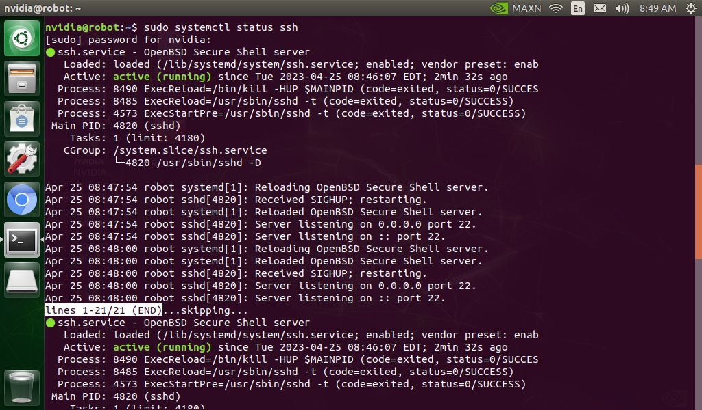

*Figura 1. Estado del servicio SSH.*

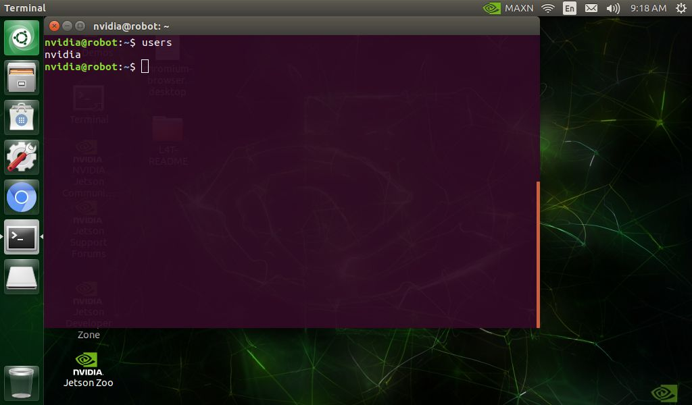

*Figura 2. Usuario actual del computador del robot con el comando users.*

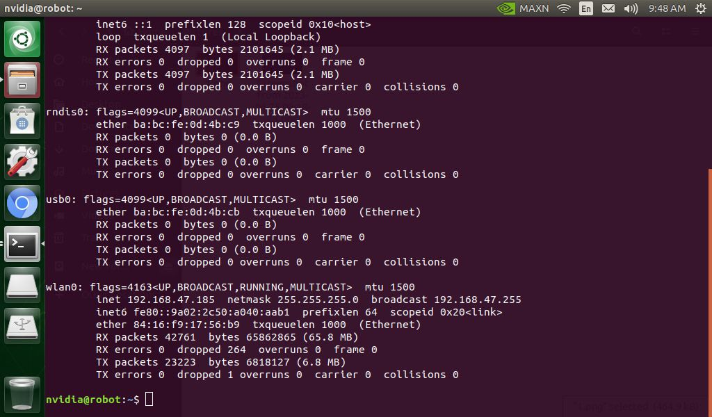

*Figura 3. Dirección IP del robot con ifconfig (o ip -4 addr).*

## 2. PRUEBA DESDE EL PC

**Terminal – PC**

```bash
ping 192.168.0.201
# o ssh usuario@robot1.local
ssh usuario@192.168.0.201
# acceso con llave, sin contraseña
ssh-keygen -t ed25519 && ssh-copy-id usuario@192.168.0.201
```

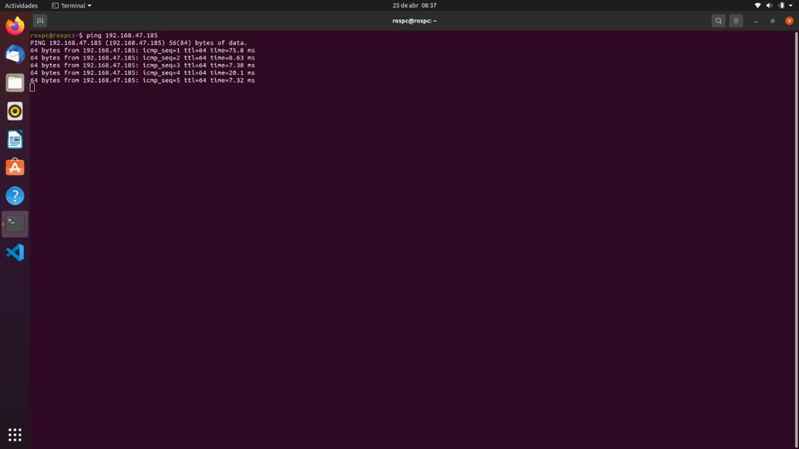

*Figura 4. Prueba de conectividad con ping desde el PC.*

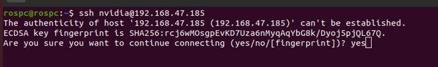

*Figura 5. Primera conexión por SSH: confirmar con yes la huella del servidor.*

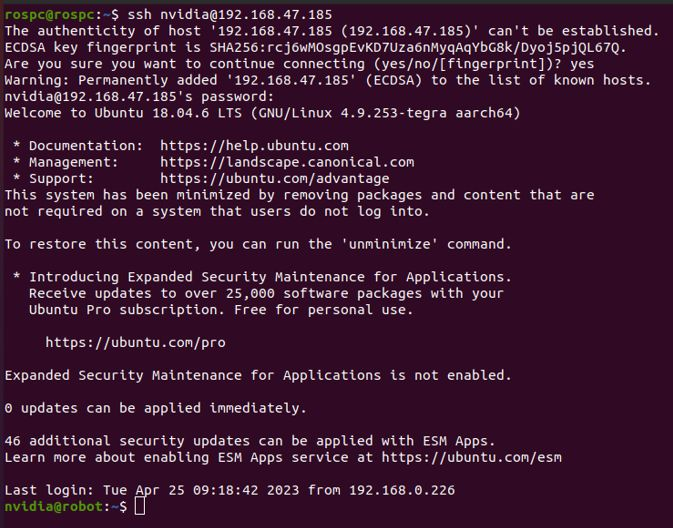

*Figura 6. Sesión SSH abierta en el robot tras escribir la contraseña.*

## 3. VS CODE REMOTE-SSH

VS Code Remote-SSH exige en el equipo remoto glibc ≥ 2.28 y libstdc++ ≥ 3.4.25; **Ubuntu 18.04 no está soportado** [1]. Por lo tanto:

*Tabla 1. Edición remota según el computador del robot.*

| **Computador del robot** | **Sistema** | **Remote-SSH** | **Cómo trabajar** |
|---|---|---|---|
| Jetson AGX Orin | Ubuntu 22.04 (JetPack 6.2) | Sí | Remote-SSH |
| Raspberry Pi 4 | Ubuntu 22.04 | Sí | Remote-SSH |
| Jetson Nano | Ubuntu 18.04 (JetPack 4.6.x) | No (glibc 2.27) | Editar robots\_ws en el PC y sincronizar con `rsync`/git, o editar por terminal (nano/vim) vía SSH |

Procedimiento con Remote-SSH (AGX o Pi): instale la extensión *Remote Development*, pulse el botón verde de la esquina inferior izquierda → *Connect to Host… → Add New SSH Host* → `ssh usuario@IP`, abra la carpeta `~/robots_ws` y marque «Sí, confío en los autores». La primera conexión descarga el servidor de VS Code, por lo que ambos equipos necesitan Internet.

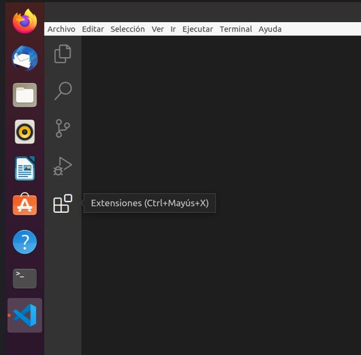

*Figura 7. Acceso a las extensiones de VS Code.*

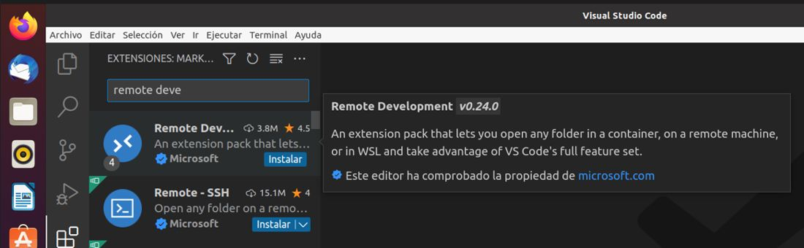

*Figura 8. Búsqueda de la extensión Remote Development.*

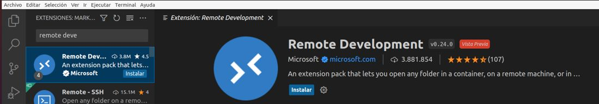

*Figura 9. Extensión Remote Development.*

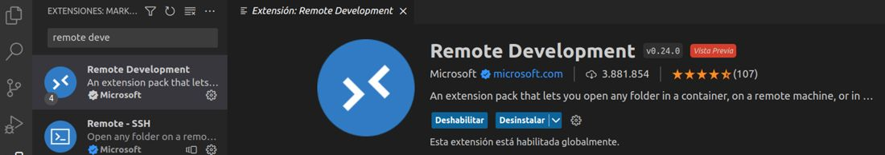

*Figura 10. Instalación de la extensión en curso.*

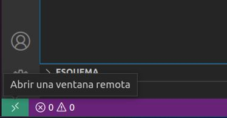

*Figura 11. Botón verde de conexiones remotas en la esquina inferior izquierda.*

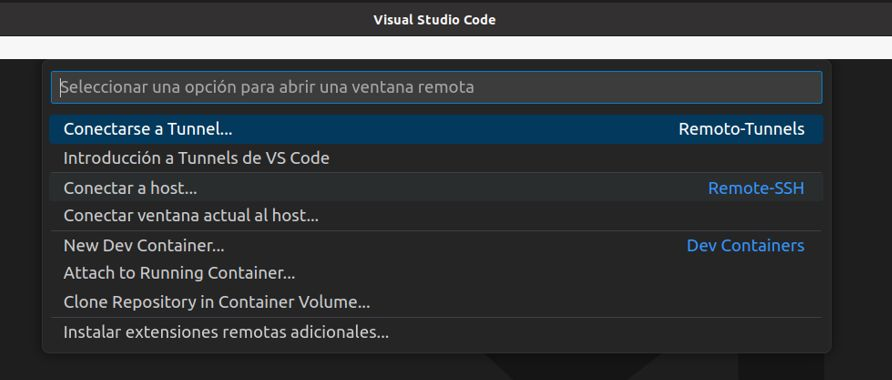

*Figura 12. Paleta de comandos: Remote-SSH, conectar al host.*

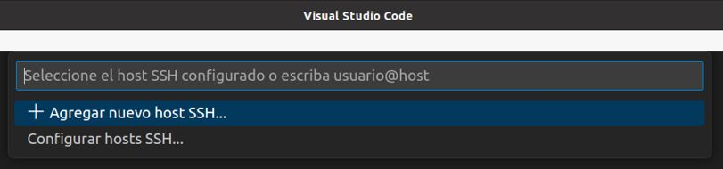

*Figura 13. Agregar un nuevo host SSH.*

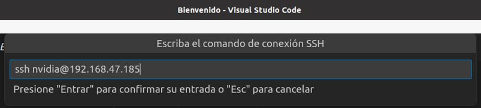

*Figura 14. Escribir ssh usuario@IP_DEL_ROBOT en la paleta de comandos.*

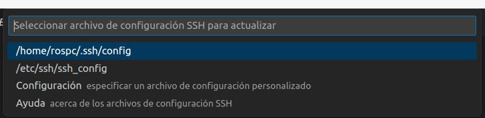

*Figura 15. Elegir el primer archivo de configuración SSH.*

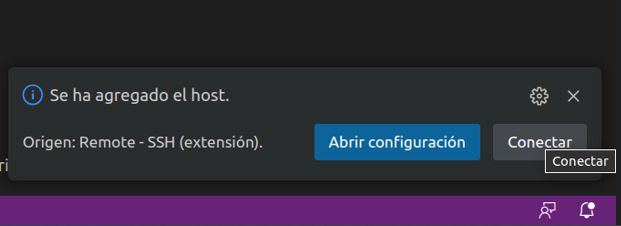

*Figura 16. Mensaje de host agregado: pulsar Conectar.*

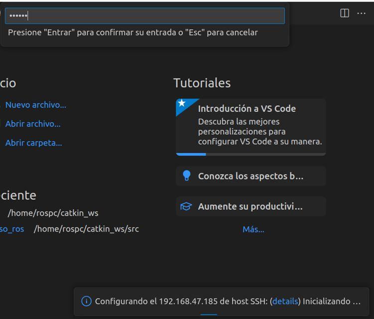

*Figura 17. Escribir la contraseña del robot y presionar Enter.*

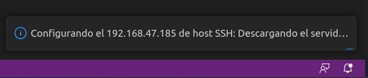

*Figura 18. VS Code descarga e instala su servidor en el robot (requiere Internet la primera vez).*

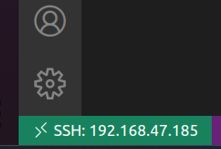

*Figura 19. Conexión SSH establecida: el botón inferior izquierdo muestra el host.*

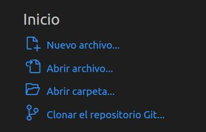

*Figura 20. Opción Abrir carpeta en la página de inicio.*

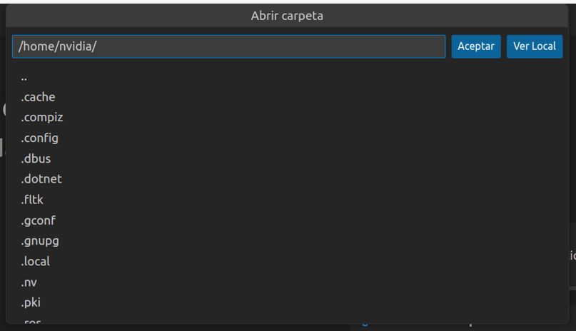

*Figura 21. Elegir la carpeta del robot que se va a abrir.*

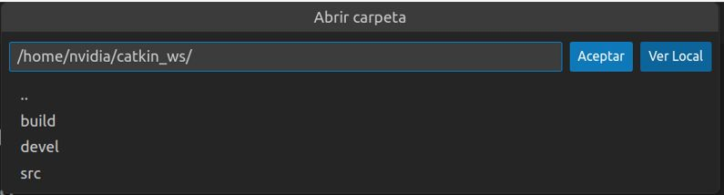

*Figura 22. Confirmar la carpeta con Aceptar.*

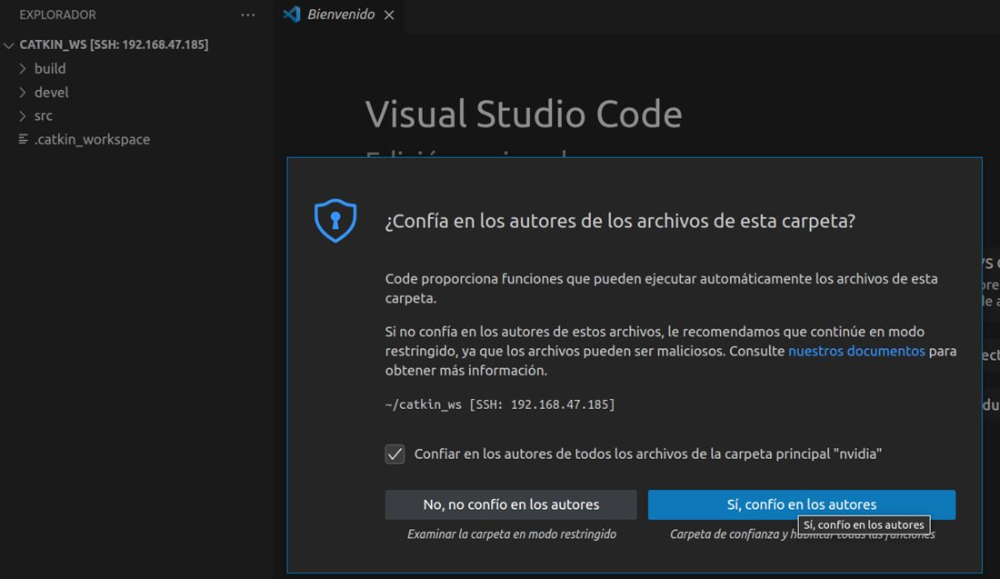

*Figura 23. Confiar en los autores de la carpeta.*

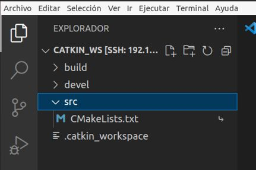

*Figura 24. Carpeta del robot abierta en VS Code remoto.*

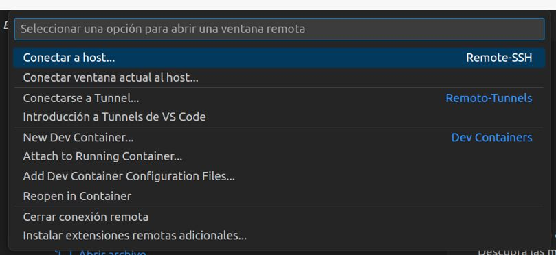

*Figura 25. Cerrar la conexión remota desde la paleta de comandos.*

Para la Nano, sincronice desde el PC después de editar:

**Terminal – PC**

```bash
rsync -av --exclude build --exclude install --exclude log ~/robots_ws/ usuario@robot1.local:~/robots_ws/
ssh usuario@robot1.local "cd ~/robots_ws/docker && ./run_nano.sh /root/robots_ws/docker/build_ws_nano.sh"
```

## 4. TERMINAL REMOTA CON REMMINA

Remmina (instalado por defecto en Ubuntu) también abre sesiones SSH: protocolo SSH, IP del robot, usuario y contraseña. Para escritorio remoto completo vea el DA-11.1 (VNC).

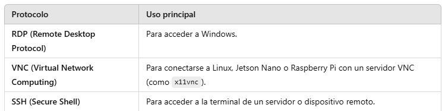

*Figura 26. Protocolos de Remmina y su uso principal: RDP, VNC y SSH.*

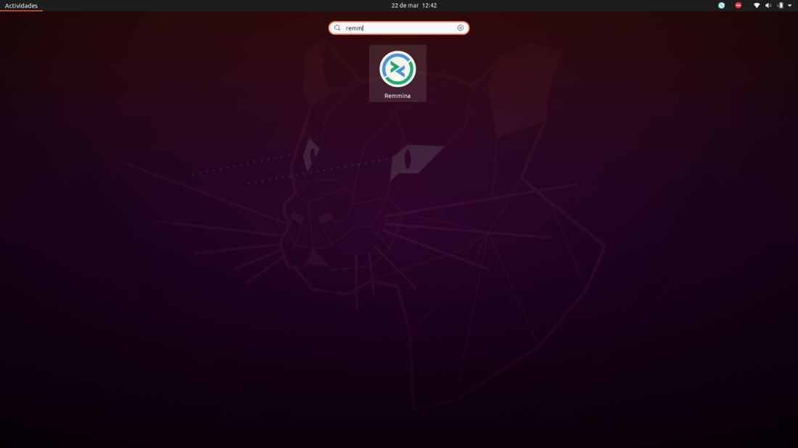

*Figura 27. Búsqueda de Remmina en las aplicaciones de Ubuntu.*

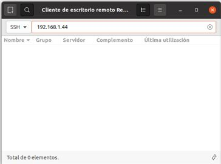

*Figura 28. Remmina: protocolo SSH y dirección IP del robot.*

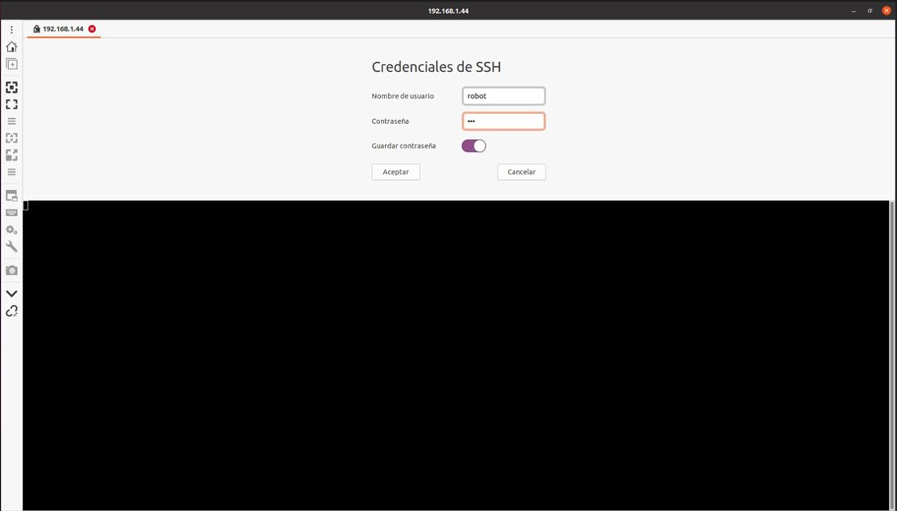

*Figura 29. Usuario y contraseña del robot.*

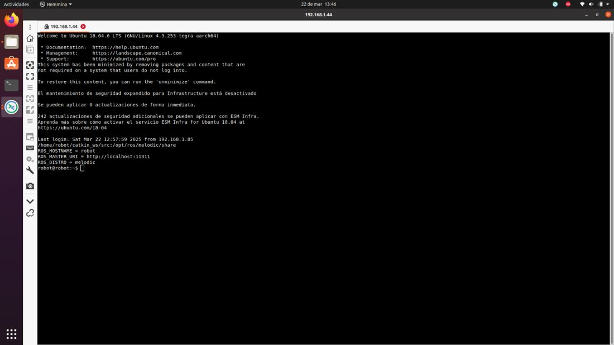

*Figura 30. Terminal remota del robot abierta en Remmina.*


*Figura 31. Botón para desconectar la sesión (barra lateral de Remmina).*

## REFERENCIAS

**[1]** Microsoft, *Remote Development with Linux* (requisitos del servidor: glibc ≥ 2.28). [En línea]. Disponible: [https://code.visualstudio.com/docs/remote/linux](https://code.visualstudio.com/docs/remote/linux)

**[2]** J. R. Cháux Cedeño, *Robótica básica – Semana 2: construcción y programación de un robot móvil (documentos de apoyo 8 a 18)*, SENA, 2022–2025.

**[3]** J. R. Cháux Cedeño, *mr\_ws – espacio de trabajo ROS 2 del robot móvil diferencial* (material de esta transferencia, licencia Apache-2.0), 2026.
