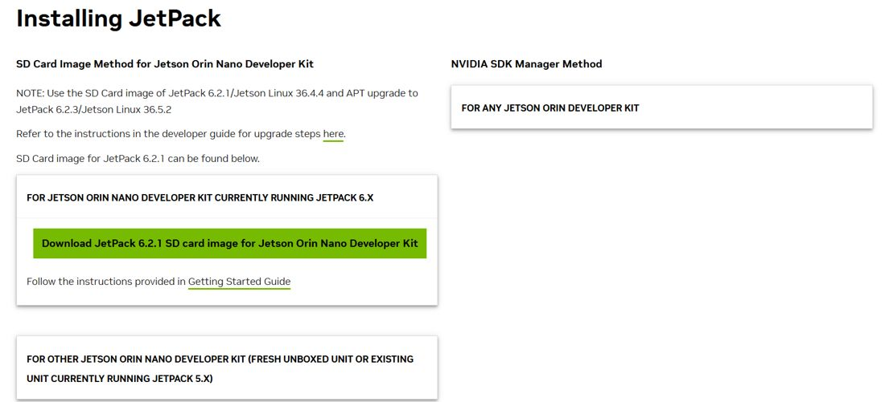
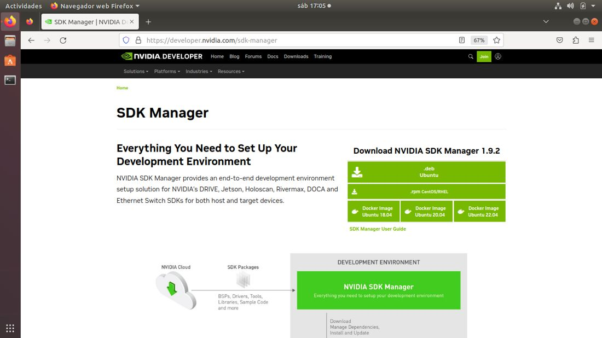
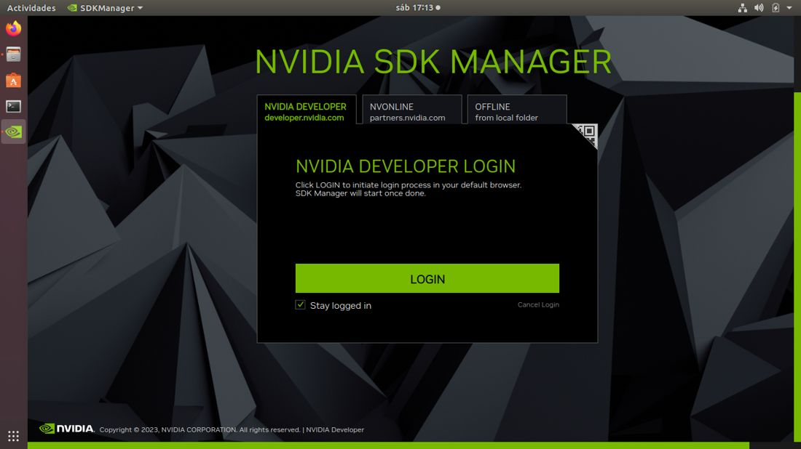
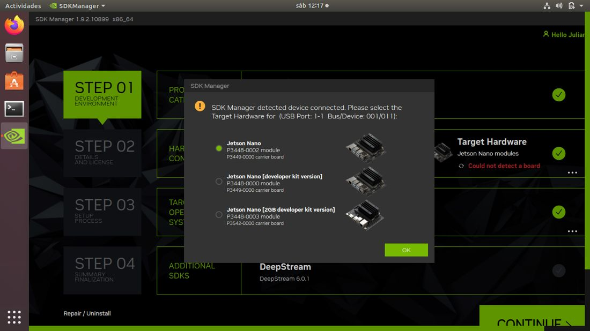
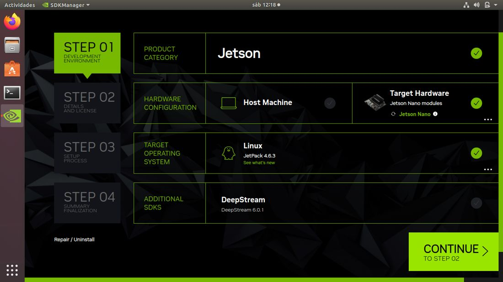
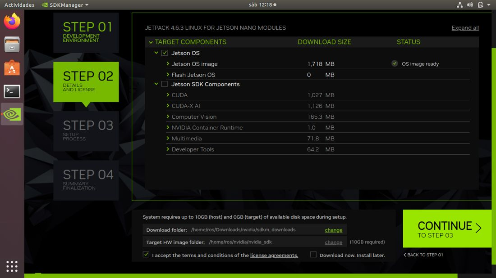
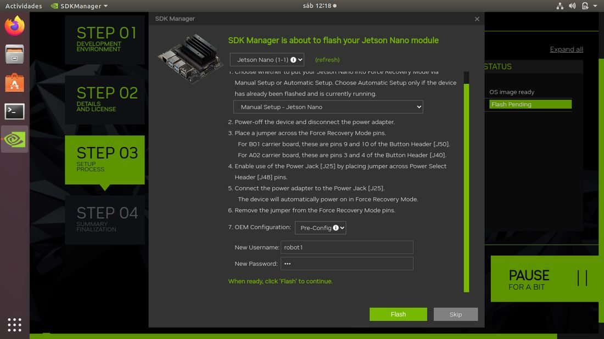
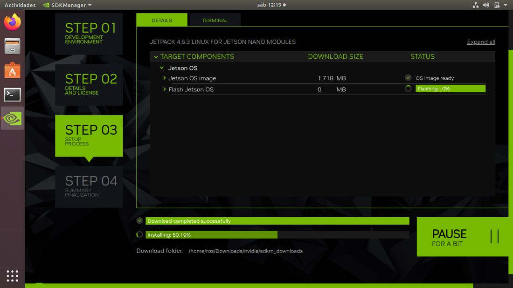

# Documento de Apoyo No. 11.1 (Jetson AGX Orin) – Ubuntu 22.04 con JetPack 6.2 y ROS 2 Humble en la Jetson AGX Orin Developer Kit.

> Versión en Markdown del documento [11.1. Jetson AGX Orin como computador del robot.docx](11.1.%20Jetson%20AGX%20Orin%20como%20computador%20del%20robot.docx) para consultar y copiar comandos desde GitHub. El documento de Word es la versión oficial (formato GFPI-F-135).

**Duración Estimada:** 1,5 horas (más el tiempo de descarga de JetPack con SDK Manager).

**Sesión:** Día 2 – 03/11/2026, bloque 3 (2:00 p.m. – 5:00 p.m.).

**Relación con la Guía de Aprendizaje:** Actividad 3.3.2 – carpeta «11. INSTALACIÓN DE LINUX - ROS 2 - RPI - JETSON», subcarpeta «5. JETSON AGX ORIN».

**Diseñado por:** Julián René Cháux Cedeño.

## 1. OBJETIVOS DE APRENDIZAJE

- Identificar la versión de JetPack que trae la Jetson AGX Orin y elegir la forma de instalar JetPack 6.2.
- Grabar Ubuntu 22.04 con JetPack 6.2 usando SDK Manager (en la memoria eMMC, un disco NVMe, una memoria USB o una tarjeta microSD) y actualizarlo a la versión 6.2.3.
- Activar el modo de potencia MAXN.
- Instalar ROS 2 Humble de forma nativa, verificarlo y dejar listos los paquetes del robot móvil.

## 2. CONTEXTO

La **Jetson AGX Orin Developer Kit** usa JetPack 6, basado en **Ubuntu 22.04** [1], plataforma de primer nivel de **ROS 2 Humble** [4]: ROS 2 se instala directamente con `apt`, igual que en el PC. Con su GPU Ampere y su memoria, puede ejecutar a bordo SLAM, Nav2, la RealSense y la App sin depender del PC.

El sistema operativo viene grabado de fábrica en la memoria **eMMC** interna [2]. A diferencia de la Jetson Orin Nano Developer Kit, NVIDIA **no publica una imagen para tarjeta microSD** de la AGX Orin: JetPack se instala con **SDK Manager** desde un PC con Ubuntu, que puede grabarlo en la eMMC, en un disco NVMe, en una memoria USB o en una tarjeta microSD.

*Tabla 1. La Jetson AGX Orin frente a los otros computadores del robot.*

|  | **Jetson Nano (primera generación)** | **Jetson Orin Nano DK 8 GB** | **Jetson AGX Orin DK** |
|---|---|---|---|
| JetPack / Ubuntu | 4.6.6 / 18.04 | 6.2.x / 22.04 | 6.2.x / 22.04 |
| ROS 2 Humble | En Docker (DA-11.2) | Nativo | Nativo (este documento) |
| Cómo se instala JetPack | Imagen en microSD | Imagen en microSD o SDK Manager | Preinstalado en eMMC o SDK Manager |
| Almacenamiento del sistema | microSD | microSD o NVMe | eMMC, NVMe, USB o microSD |
| Modo de máxima potencia | MAXN (10 W) | MAXN SUPER | MAXN |

> **Precaución:**
>
> Use JetPack **6.2.x** (Ubuntu 22.04). No instale JetPack 7.x: está basado en Ubuntu 24.04, en el que ROS 2 Humble no tiene soporte oficial; todo el material del curso (mr\_ws) está preparado para Humble.

## 3. MATERIALES

- Jetson AGX Orin Developer Kit con su fuente de alimentación y el cable USB Type-A a Type-C incluido.
- Monitor (DisplayPort), teclado y ratón USB para la configuración inicial.
- Para SDK Manager: PC x86\_64 con **Ubuntu 20.04 o 22.04 nativo** (no máquina virtual), 8 GB de RAM, al menos 25 GB libres en disco, conexión a Internet y una cuenta gratuita del programa de desarrolladores de NVIDIA.
- Opcional: disco NVMe, memoria USB o tarjeta microSD si no se va a usar la eMMC.

## 4. PROCEDIMIENTO

### Paso 1. Identificar qué JetPack trae la Jetson

1. Conecte monitor, teclado y ratón, y luego la fuente.
1. Si es el primer arranque, complete el asistente de Ubuntu (licencia, idioma, teclado, zona horaria, usuario, contraseña y red).
1. Abra una terminal y consulte la versión de Jetson Linux:

**Terminal – Jetson**

```bash
cat /etc/nv_tegra_release
lsb_release -ds
```

*Tabla 2. Decisión según lo que trae la Jetson.*

| **Resultado** | **JetPack instalado** | **Qué hacer** |
|---|---|---|
| `R36 …` y Ubuntu 22.04 | JetPack 6.x | Continúe con el Paso 3 (actualizar por APT). No necesita grabar. |
| `R35 …` y Ubuntu 20.04 | JetPack 5.x | Grabe JetPack 6.2 con SDK Manager (Paso 2): no se puede pasar de 5 a 6 por APT. |
| No arranca o se quiere usar NVMe/USB/microSD | — | Grabe con SDK Manager (Paso 2). |

### Paso 2. Grabar JetPack 6.2 con SDK Manager

En la página de JetPack 6.2.3 [1], sección *Installing JetPack*, la opción para la AGX Orin es **NVIDIA SDK Manager Method – FOR ANY JETSON ORIN DEVELOPER KIT** [3]; el método de imagen SD de esa página es solo para la Orin Nano.



*Figura 1. Página de descarga de JetPack 6.2.3: para la Jetson AGX Orin se usa el método SDK Manager (columna derecha).*

**2.1 Instalar SDK Manager en el PC.** Inicie sesión en la página de SDK Manager con su cuenta de NVIDIA, descargue el `.deb` e instálelo:

**Terminal – PC**

```bash
sudo apt install ./sdkmanager_[versión]_amd64.deb
```

Las capturas de SDK Manager de este paso se tomaron instalando una Jetson Nano (JetPack 4.6.x). Con la AGX Orin el proceso es el mismo: elija la placa Jetson AGX Orin y la versión JetPack 6.2.x.



*Figura 2. Página de SDK Manager: descarga del .deb para Ubuntu (captura con una Jetson Nano).*



*Figura 3. Inicio de sesión en SDK Manager con la cuenta de NVIDIA (captura con una Jetson Nano).*

**2.2 Poner la Jetson en modo de recuperación (Force Recovery)** [2]:

1. Con la Jetson apagada y sin energía, conéctela al PC con el cable USB Type-A a Type-C incluido, en el puerto **Type-C que está junto al conector de 40 pines**.
1. Mantenga presionado el botón **Force Recovery** (el botón del medio).
1. Sin soltarlo, conecte la fuente de alimentación (puerto Type-C que está sobre el conector DC); suelte el botón después de unos segundos.

**Terminal – PC**

```bash
# debe aparecer un dispositivo NVIDIA Corp. (APX)
lsusb | grep -i nvidia
```

**2.3 Configurar y grabar con SDK Manager:**

1. Ejecute `sdkmanager` e inicie sesión con su cuenta de NVIDIA; la Jetson AGX Orin debe detectarse por USB.
1. En el paso 1 (*Environment Setup*) desmarque **Host Machine** si solo va a preparar la Jetson.
1. Seleccione **JetPack 6.2.x** (la que instala Ubuntu 22.04) y continúe al paso 2.
1. Acepte las licencias. SDK Manager descarga los componentes y prepara la imagen.
1. Cuando pregunte por la Jetson, elija **Manual Setup** (Force Recovery), el destino de almacenamiento (**eMMC** por defecto, o NVMe, USB o microSD) y cree el usuario y la contraseña iniciales.
1. Pulse **Flash**. Al terminar, la Jetson reinicia con Ubuntu 22.04; complete el asistente con monitor y teclado si lo pide.
1. SDK Manager instala luego los componentes (CUDA, cuDNN, TensorRT) por SSH: use la IP **192.168.55.1** (conexión USB-C) y el usuario y la contraseña creados.

Grabación con SDK Manager (capturas con una Jetson Nano; en la AGX Orin aparecen su placa y JetPack 6.2.x):



*Figura 4. STEP 01: SDK Manager detecta la placa conectada y pide elegir el modelo (captura con una Jetson Nano).*



*Figura 5. STEP 01: categoría Jetson, placa y versión de JetPack (captura con una Jetson Nano).*



*Figura 6. STEP 02: componentes (Jetson OS y Jetson SDK Components) y licencias (captura con una Jetson Nano).*


*Figura 7. Ventana de grabación: elegir Manual Setup (captura con una Jetson Nano).*



*Figura 8. Usuario de la Jetson (Pre-Config); las instrucciones de recuperación son las de la Nano: use las del punto 2.2 (captura con una Jetson Nano).*



*Figura 9. STEP 03: descarga completa y grabación del sistema en curso (captura con una Jetson Nano).*


*Figura 10. STEP 04: instalación completada (INSTALLATION COMPLETED SUCCESSFULLY) (captura con una Jetson Nano).*

### Paso 3. Actualizar a JetPack 6.2.3 y verificar el sistema

**Terminal – Jetson**

```bash
# lleva el sistema a JetPack 6.2.3
sudo apt update && sudo apt upgrade -y
sudo reboot
# Ubuntu 22.04.x LTS
lsb_release -ds
# R36 (release), REVISION: 5.x
cat /etc/nv_tegra_release
# CUDA, cuDNN, TensorRT (si no los instaló SDK Manager)
sudo apt install -y nvidia-jetpack
```

### Paso 4. Modo de potencia MAXN y nombre del equipo

Seleccione el modo MAXN en el menú de potencia de la esquina superior derecha del escritorio o por terminal:

**Terminal – Jetson**

```bash
# modo actual
sudo nvpmodel -q
# lista de modos con su número (ID) y nombre
grep POWER_MODEL /etc/nvpmodel.conf
# MAXN en la AGX Orin (confirme el ID en la lista anterior)
sudo nvpmodel -m 0
# nombre del equipo según la tabla del DA-11.1 de la Nano
sudo hostnamectl set-hostname robot1
```

> **Precaución:**
>
> En MAXN la AGX Orin consume más: use la fuente incluida con la Developer Kit y asegure la ventilación. Para alimentarla desde la batería del robot, consulte primero en la guía de NVIDIA el rango de tensión de entrada admitido y use un regulador adecuado; el regulador de 5 V del DA-8.1 no sirve para la AGX Orin.

### Paso 5. Instalar ROS 2 Humble

Se sigue el procedimiento oficial de ROS 2 Humble para Ubuntu 22.04 (arm64) [5]:

**Terminal – Jetson**

```bash
# verificar UTF-8
locale
sudo apt update && sudo apt install -y locales
sudo locale-gen en_US en_US.UTF-8
sudo update-locale LC_ALL=en_US.UTF-8 LANG=en_US.UTF-8
export LANG=en_US.UTF-8
sudo apt install -y software-properties-common
sudo add-apt-repository universe
sudo apt update && sudo apt install -y curl
export ROS_APT_SOURCE_VERSION=$(curl -s https://api.github.com/repos/ros-infrastructure/ros-apt-source/releases/latest | grep -F "tag_name" | awk -F'"' '{print $4}')
curl -L -o /tmp/ros2-apt-source.deb "https://github.com/ros-infrastructure/ros-apt-source/releases/download/${ROS_APT_SOURCE_VERSION}/ros2-apt-source_${ROS_APT_SOURCE_VERSION}.$(. /etc/os-release && echo ${UBUNTU_CODENAME:-${VERSION_CODENAME}})_all.deb"
sudo dpkg -i /tmp/ros2-apt-source.deb
sudo apt update && sudo apt upgrade -y
sudo apt install -y ros-humble-desktop ros-dev-tools
```

`ros-humble-desktop` incluye ROS 2, RViz2, demos y tutoriales; `ros-dev-tools` incluye `colcon`, `rosdep` y `vcstool`. Cargue el entorno en cada terminal nueva e inicialice `rosdep`:

**Terminal – Jetson**

```bash
echo "source /opt/ros/humble/setup.bash" >> ~/.bashrc
source ~/.bashrc
# solo la primera vez
sudo rosdep init
rosdep update
```

### Paso 6. Verificar la instalación de ROS 2

**Terminal – Jetson**

```bash
# debe mostrar: humble
printenv ROS_DISTRO
# debe mostrar: 2
printenv ROS_VERSION
# todas las variables de ROS cargadas
printenv | grep -i ^ros
# debe terminar con: All <n> checks passed
ros2 doctor
# demo: en una terminal
ros2 run demo_nodes_cpp talker
# en otra terminal
ros2 run demo_nodes_py listener
```

> **Resultado esperado:**
>
> `humble` y `2` en las variables; en la demo, el talker publica `Hello World: n` y el listener responde `I heard: [Hello World: n]`.

### Paso 7. Paquetes del robot móvil y espacio de trabajo

**Terminal – Jetson**

```bash
sudo apt install -y ros-humble-navigation2 ros-humble-nav2-bringup ros-humble-slam-toolbox \
  ros-humble-rplidar-ros ros-humble-usb-cam ros-humble-teleop-twist-keyboard ros-humble-xacro \
  ros-humble-joint-state-publisher-gui ros-humble-depthimage-to-laserscan python3-serial python3-flask
```

Luego prepare el espacio de trabajo robots\_ws siguiendo el DA-9.1 (los mismos pasos del PC: reserva mr\_ws [6], dependencias y paquetes mr\_base y mr\_sim) y continúe con el driver del RoboClaw (DA-12.1); la red entre el robot y el PC se configura después, en la carpeta 13.

> **Nota:**
>
> **RealSense en la AGX:** se instala con `sudo apt install ros-humble-librealsense2* ros-humble-realsense2-*` (DA-20.1). Conéctela a un puerto USB 3 de la AGX. Si la misma AGX controla también el cobot, el robot se lanza con `namespace:=mr` (DA-21.1) para que sus TF no choquen con las del cobot.

## 5. VERIFICACIÓN Y EVIDENCIAS

*Tabla 3. Lista de verificación.*

| **#** | **Criterio** | **Evidencia** |
|---|---|---|
| 1 | Ubuntu 22.04 con JetPack 6.2.3 (Jetson Linux 36.5.x) | `lsb_release -ds` y `cat /etc/nv_tegra_release` |
| 2 | Modo MAXN activo | `sudo nvpmodel -q` |
| 3 | ROS 2 Humble instalado y funcionando | `printenv ROS_DISTRO` y demo talker/listener |
| 4 | Espacio de trabajo robots\_ws con los paquetes del robot móvil | `ros2 pkg list \| grep mr_` (DA-9.1) |

## 6. SOLUCIÓN DE PROBLEMAS

*Tabla 4. Problemas frecuentes.*

| **Síntoma** | **Causa probable** | **Solución** |
|---|---|---|
| SDK Manager no detecta la Jetson | No entró en recuperación o se usó el puerto USB-C equivocado | Repita el Paso 2.2 con la placa sin energía; use el Type-C junto al conector de 40 pines; verifique con `lsusb` |
| SDK Manager no ofrece JetPack 6.2 | Versión antigua de SDK Manager | Instale la versión más reciente desde la página de NVIDIA |
| `apt upgrade` no pasa de JetPack 5 a 6 | El salto de versión mayor no se hace por APT | Grabe JetPack 6.2 con SDK Manager (Paso 2) |
| `E: Unable to locate package ros-humble-desktop` | Repositorio de ROS 2 no configurado | Repita el Paso 5 desde `ros2-apt-source` |
| Falla la instalación de componentes por SSH | Sin conexión USB-C o credenciales distintas | Verifique `ping 192.168.55.1` desde el PC y el usuario creado al grabar |

## REFERENCIAS

**[1]** NVIDIA, *JetPack SDK 6.2.3* (Jetson Linux 36.5.2, Ubuntu 22.04). [En línea]. Disponible: [https://developer.nvidia.com/embedded/jetpack-sdk-623](https://developer.nvidia.com/embedded/jetpack-sdk-623)

**[2]** NVIDIA, *Jetson AGX Orin Developer Kit User Guide – Software Setup* (configuración preinstalada, SDK Manager y modo de recuperación). [En línea]. Disponible: [https://docs.nvidia.com/jetson/agx-orin-devkit/user-guide/latest/software-setup.html](https://docs.nvidia.com/jetson/agx-orin-devkit/user-guide/latest/software-setup.html)

**[3]** NVIDIA, *NVIDIA SDK Manager*. [En línea]. Disponible: [https://developer.nvidia.com/sdk-manager](https://developer.nvidia.com/sdk-manager)

**[4]** Open Robotics, *REP 2000 – ROS 2 Releases and Target Platforms*. [En línea]. Disponible: [https://www.ros.org/reps/rep-2000.html](https://www.ros.org/reps/rep-2000.html)

**[5]** Open Robotics, *ROS 2 Documentation: Humble Hawksbill*. [En línea]. Disponible: [https://docs.ros.org/en/humble/](https://docs.ros.org/en/humble/)

**[6]** J. R. Cháux Cedeño, *mr\_ws – espacio de trabajo ROS 2 del robot móvil diferencial* (material de esta transferencia, licencia Apache-2.0), 2026.
