# Documento de Apoyo No. 11.1 (Jetson Orin Nano) – Ubuntu 22.04 con JetPack 6.2 y ROS 2 Humble en la Jetson Orin Nano Developer Kit de 8 GB.

> Versión en Markdown del documento [11.1. Jetson Orin Nano DK 8GB - Ubuntu 22.04, JetPack 6.2 y ROS 2 Humble.docx](11.1.%20Jetson%20Orin%20Nano%20DK%208GB%20-%20Ubuntu%2022.04,%20JetPack%206.2%20y%20ROS%202%20Humble.docx) para consultar y copiar comandos desde GitHub. El documento de Word es la versión oficial (formato GFPI-F-135).

**Duración Estimada:** 1,5 horas (más el tiempo de descarga de la imagen, ≈ 11 GB).

**Sesión:** Día 2 – 03/11/2026, bloque 3 (2:00 p.m. – 5:00 p.m.).

**Relación con la Guía de Aprendizaje:** Actividad 3.3.2 – carpeta «11. INSTALACIÓN DE LINUX - ROS 2 - RPI - JETSON», subcarpeta «4. JETSON ORIN NANO DK 8GB».

**Diseñado por:** Julián René Cháux Cedeño.

## 1. OBJETIVOS DE APRENDIZAJE

- Verificar el firmware de la placa y elegir el método de instalación de JetPack 6.2 (tarjeta microSD o SDK Manager).
- Instalar Ubuntu 22.04 con JetPack 6.2 en la Jetson Orin Nano Developer Kit y actualizarlo a la versión 6.2.3.
- Activar el modo de potencia MAXN SUPER.
- Instalar ROS 2 Humble de forma nativa y verificar la instalación.

## 2. CONTEXTO

La **Jetson Orin Nano Developer Kit de 8 GB** es compatible con JetPack 6, basado en **Ubuntu 22.04** [1], que es la plataforma de primer nivel de **ROS 2 Humble** [7]. Por eso ROS 2 se instala directamente con `apt`, igual que en el PC y en la Jetson AGX Orin, sin contenedores Docker (a diferencia de la Jetson Nano de primera generación, que solo admite Ubuntu 18.04).

*Tabla 1. La Jetson Orin Nano frente a los otros computadores del robot.*

|  | **Jetson Nano (primera generación)** | **Jetson Orin Nano DK 8 GB** | **Jetson AGX Orin 32 GB** |
|---|---|---|---|
| JetPack / Ubuntu | 4.6.6 / 18.04 | 6.2.x / 22.04 | 6.2.x / 22.04 |
| ROS 2 Humble | En Docker (DA-11.2) | Nativo (este documento) | Nativo |
| Almacenamiento del sistema | microSD | microSD o NVMe (sin eMMC) | eMMC o NVMe |
| Memoria | 4 GB | 8 GB | 32 GB |
| Modo de máxima potencia | MAXN (10 W) | MAXN SUPER | MAXN |

> **Precaución:**
>
> Use JetPack **6.2.x** (Ubuntu 22.04). No instale JetPack 7.x: está basado en Ubuntu 24.04, en el que ROS 2 Humble no tiene soporte oficial; todo el material del curso (robots\_ws) está preparado para Humble.

## 3. MATERIALES

- Jetson Orin Nano Developer Kit de 8 GB con su fuente de alimentación.
- Tarjeta microSD de 64 GB o más (clase A2 recomendada) y lector de tarjetas.
- Monitor (DisplayPort o adaptador), teclado y ratón USB para el primer arranque.
- PC con Internet y balenaEtcher (método A) o PC con Ubuntu 20.04/22.04 nativo y SDK Manager (método B).
- Para el método B: cable USB-C de datos (no solo de carga) y un puente (jumper) para el modo de recuperación.
- La imagen ya descargada está en esta carpeta: `jetson-orin-nano-devkit-super-SD-image_JP6.2.1.zip`.

## 4. PROCEDIMIENTO

### Paso 1. Verificar la versión del firmware de la placa

La imagen de JetPack 6 solo arranca si el firmware de la placa (UEFI/QSPI) es de la versión **36.0 o superior**. Las placas nuevas (recién desempacadas) o que tenían JetPack 5 pueden traer un firmware anterior:

1. Conecte monitor y teclado y encienda la placa (con o sin microSD).
1. Presione repetidamente **Esc** hasta que aparezca el menú de configuración UEFI.
1. Lea la versión del firmware en la parte superior de la pantalla.

*Tabla 2. Decisión según el firmware.*

| **Versión que aparece** | **Qué hacer** |
|---|---|
| 36.x o superior | Continúe con el Paso 2 (método A) o el Paso 3 (método B). |
| Menor que 36.0 (por ejemplo 35.x) | Actualice primero el firmware (recuadro siguiente) o use el método B con SDK Manager, que lo actualiza al grabar. |

> **Nota:**
>
> **Actualización del firmware con la imagen puente JetPack 5.1.3** [3]:
>
> 1) Grabe en una microSD la imagen JetPack 5.1.3 indicada por NVIDIA para la Orin Nano, arranque, complete la configuración inicial y conéctese a Internet.
>
> 2) Compruebe la actualización programada con `sudo systemctl status nv-l4t-bootloader-config` y reinicie; no desconecte la energía mientras se actualiza.
>
> 3) Ejecute `sudo apt update && sudo apt install nvidia-l4t-jetson-orin-nano-qspi-updater` y reinicie de nuevo.
>
> 4) Apague, cambie a la microSD con JetPack 6.2.1 (Paso 2) y continúe.

### Paso 2. Método A (recomendado): imagen en la tarjeta microSD

Descargue la imagen desde la página de JetPack 6.2.3 [1], sección *Installing JetPack → SD Card Image Method for Jetson Orin Nano Developer Kit*, botón **FOR JETSON ORIN NANO DEVELOPER KIT CURRENTLY RUNNING JETPACK 6.X**. Se descarga un `.zip` con la imagen 6.2.1 (Jetson Linux 36.4.4); después del primer arranque se actualiza a 6.2.3 (Jetson Linux 36.5.2) por APT. El procedimiento sigue la guía de inicio de NVIDIA [2].

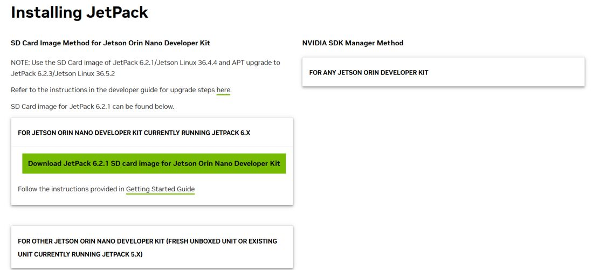

*Figura 1. Página de descarga de JetPack 6.2.3: método de imagen SD para la Jetson Orin Nano Developer Kit y método SDK Manager (captura de la guía del instructor).*

1. Instale **balenaEtcher** en el PC (herramienta recomendada por NVIDIA).
1. Inserte la microSD en el PC con el adaptador.
1. En balenaEtcher elija **Flash from file** y seleccione el `.zip` descargado (no es necesario descomprimirlo).
1. En **Select target** elija la microSD (verifique la unidad para no borrar datos del PC).
1. Pulse **Flash!** y espere a que termine la escritura y la validación.
1. Retire la microSD e insértela en la ranura que está **debajo del disipador** del módulo de la Jetson.
1. Conecte monitor, teclado y ratón, y luego la fuente: la placa arranca con Ubuntu 22.04.
1. Complete el asistente inicial: licencia, idioma, teclado, zona horaria, usuario, contraseña y red Wi-Fi o cableada.

Las figuras siguientes muestran, en orden, el asistente del primer arranque de la Jetson Orin Nano con la imagen de JetPack 6.2.1 y la verificación final del sistema.

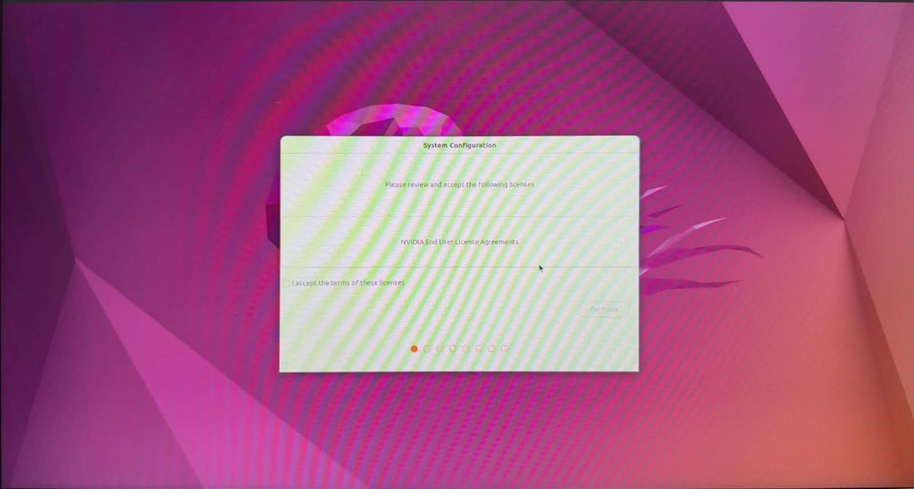

*Figura 2. Acuerdo de licencia de NVIDIA: aceptar para continuar (fotografía del instructor).*

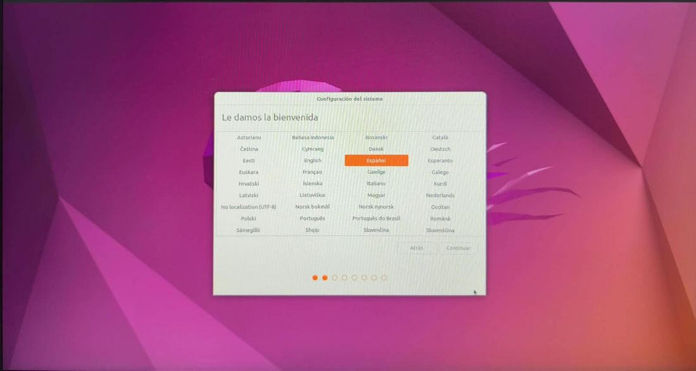

*Figura 3. Idioma del sistema (Le damos la bienvenida) (fotografía del instructor).*

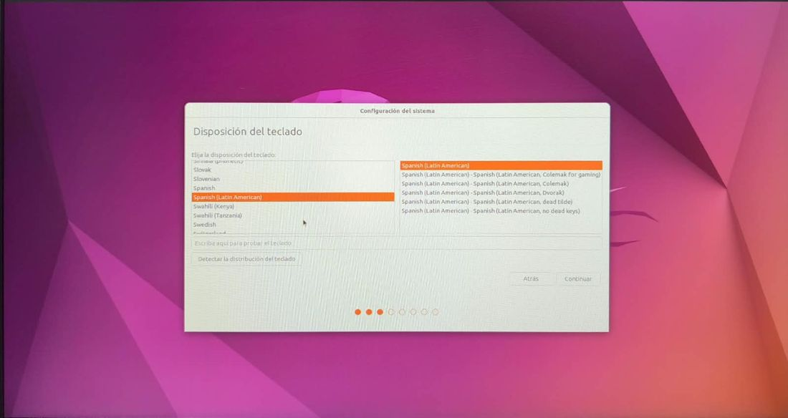

*Figura 4. Disposición del teclado (fotografía del instructor).*

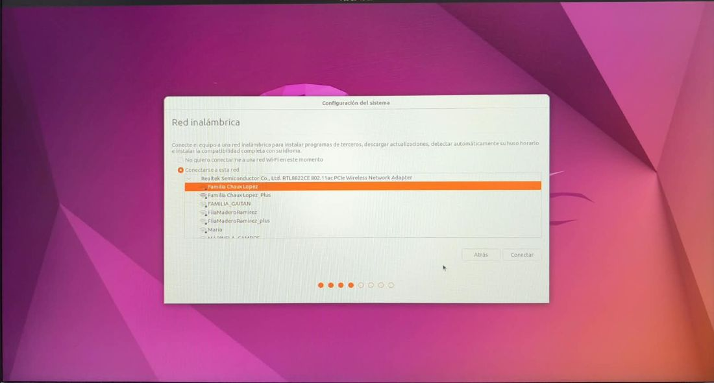

*Figura 5. Conexión a la red inalámbrica (fotografía del instructor).*

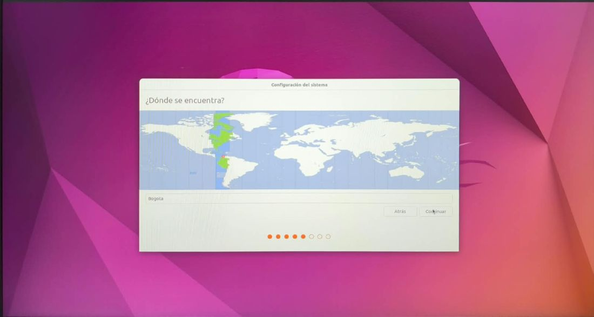

*Figura 6. Zona horaria (¿Dónde se encuentra?) (fotografía del instructor).*

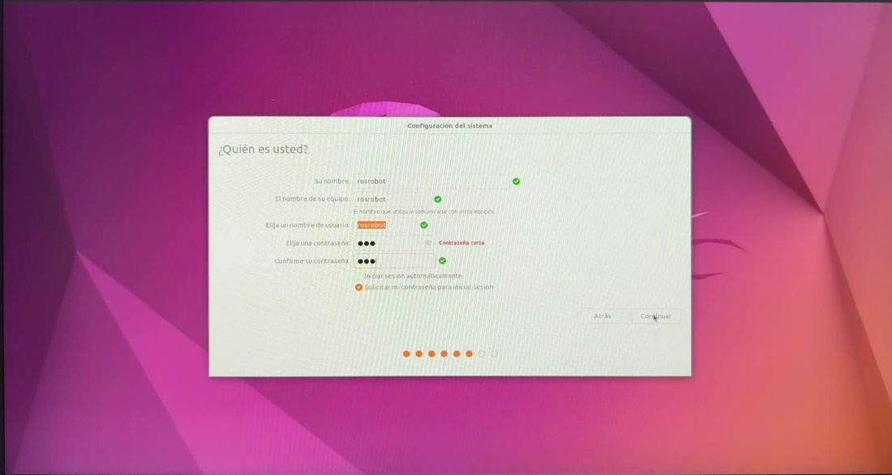

*Figura 7. Nombre, nombre del equipo, usuario y contraseña (¿Quién es usted?) (fotografía del instructor).*

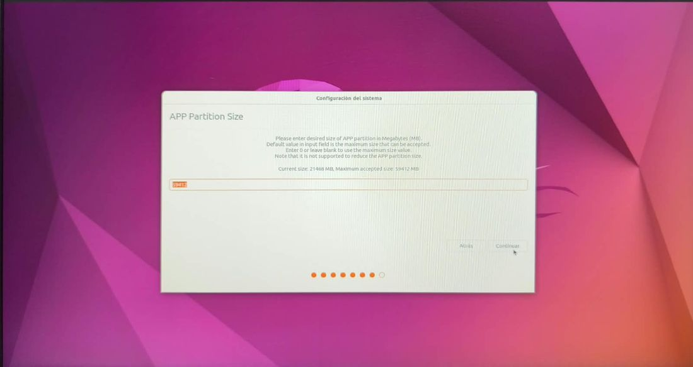

*Figura 8. Tamaño de la partición de aplicaciones (APP Partition Size): dejar el valor por defecto (fotografía del instructor).*

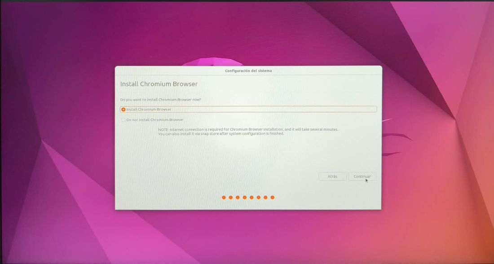

*Figura 9. Instalación del navegador Chromium (opcional) (fotografía del instructor).*

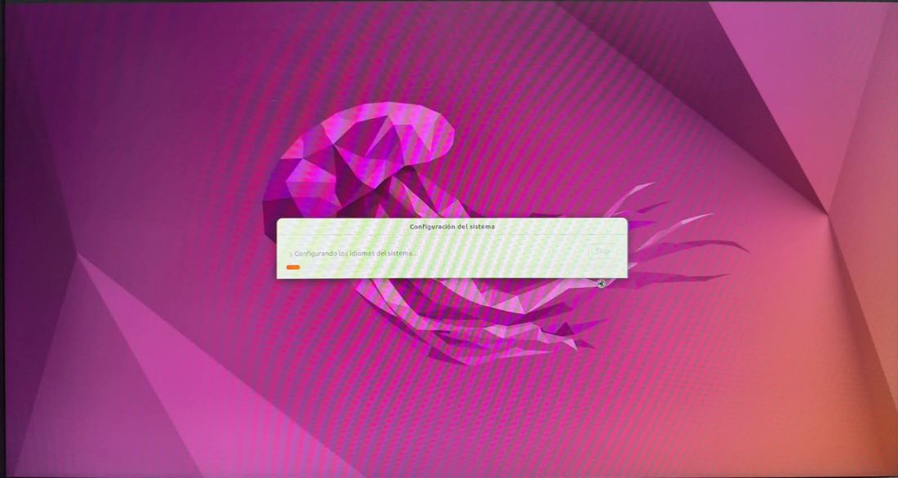

*Figura 10. El sistema aplica la configuración (fotografía del instructor).*

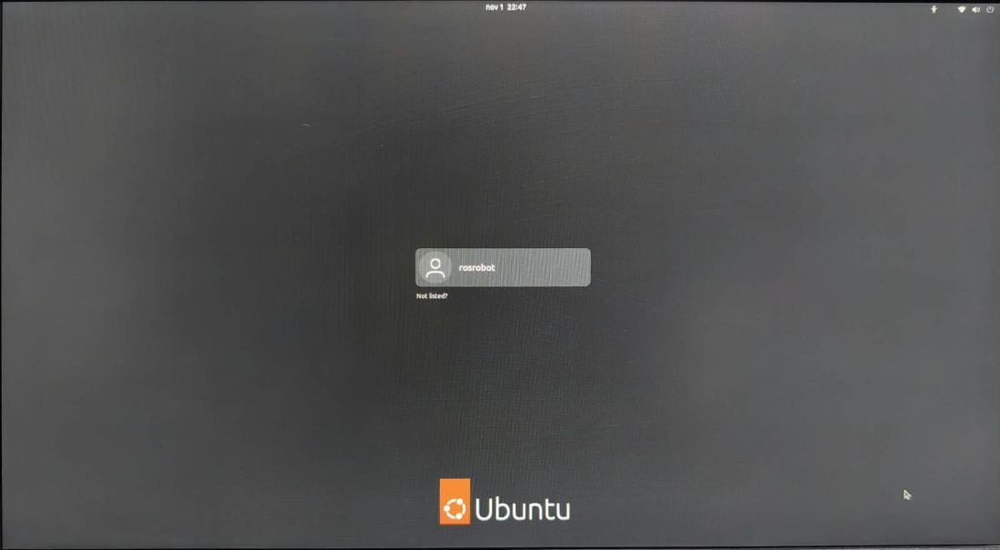

*Figura 11. Pantalla de inicio de sesión con el usuario creado (fotografía del instructor).*

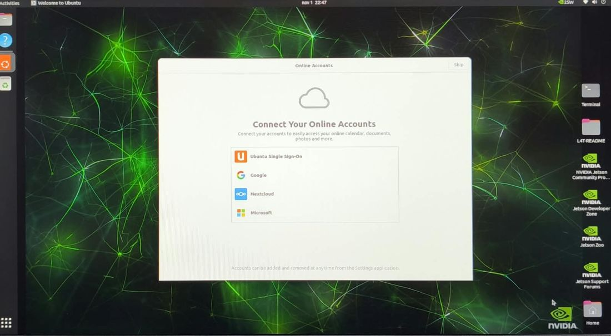

*Figura 12. Primer escritorio de Ubuntu en la Jetson: la ventana de cuentas en línea se puede omitir (fotografía del instructor).*

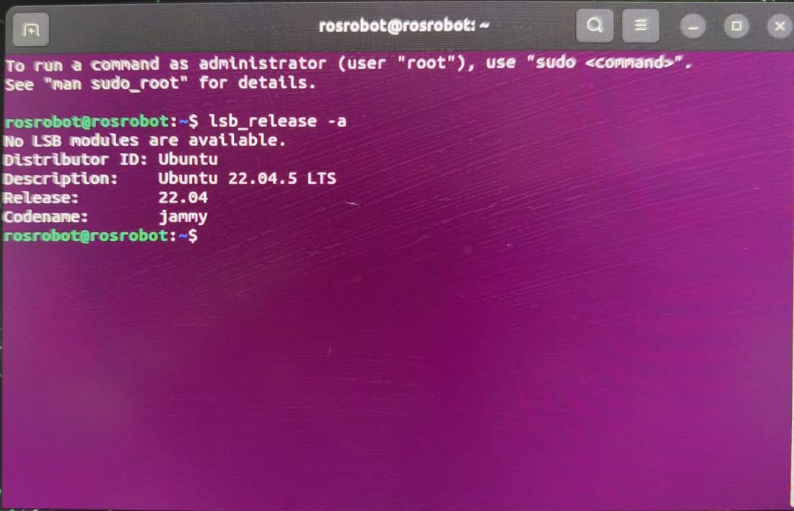

*Figura 13. Verificación con lsb_release -a: Ubuntu 22.04.5 LTS (jammy) (fotografía del instructor).*

### Paso 3. Método B (alternativa): SDK Manager desde un PC con Ubuntu

SDK Manager [5] graba la Jetson por USB desde un PC con **Ubuntu 20.04 o 22.04 nativo** (no máquina virtual). Permite instalar en microSD o en un disco NVMe y actualiza el firmware de la placa en el proceso.

**3.1 Instalar SDK Manager en el PC.** Inicie sesión en la página de SDK Manager con su cuenta de desarrollador de NVIDIA, descargue el `.deb` e instálelo:

**Terminal – PC**

```bash
sudo apt install ./sdkmanager_[versión]_amd64.deb
```

Las capturas de SDK Manager de este paso se tomaron instalando una Jetson Nano (JetPack 4.6.x). Con la Orin Nano el proceso es el mismo: elija la placa Jetson Orin Nano y la versión JetPack 6.2.x.

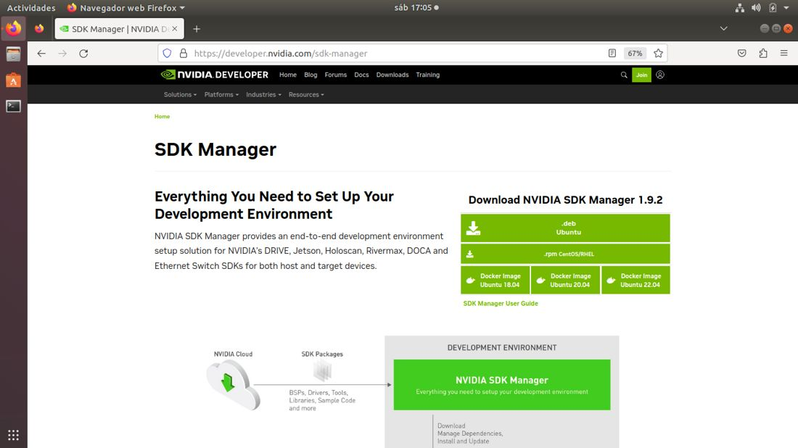

*Figura 14. Página de SDK Manager: descarga del .deb para Ubuntu (captura con una Jetson Nano).*

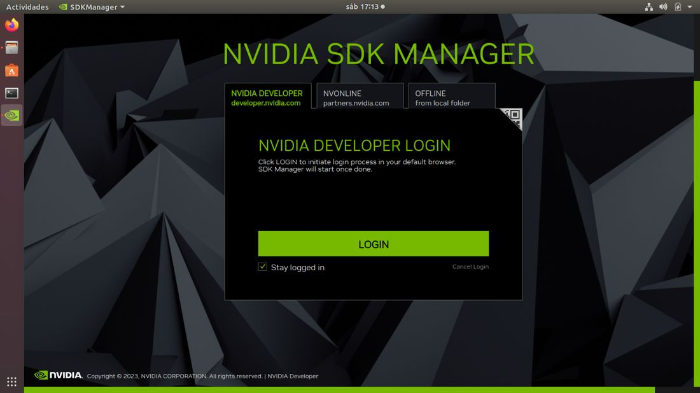

*Figura 15. Inicio de sesión en SDK Manager con la cuenta de NVIDIA (captura con una Jetson Nano).*

**3.2 Poner la Jetson en modo de recuperación (Force Recovery):**

1. Con la Jetson apagada y sin fuente, coloque un puente entre los pines **FC REC** y **GND** del conector de botones (debajo del módulo).
1. Conecte la fuente de energía y luego el cable USB-C entre la Jetson y el PC.
1. Retire el puente: la placa queda en modo de recuperación.

**3.3 Configurar y grabar con SDK Manager:**

1. Ejecute `sdkmanager` e inicie sesión con su cuenta de NVIDIA; la Jetson Orin Nano debe detectarse por USB.
1. En el paso 1 (*Environment Setup*) desmarque **Host Machine** si solo va a preparar la Jetson.
1. Seleccione **JetPack 6.2.x** (la que instala Ubuntu 22.04) y continúe al paso 2.
1. Acepte las licencias. SDK Manager descarga los componentes y prepara la imagen.
1. Cuando pregunte el modo de la Jetson, elija **Manual Setup** (Force Recovery), el destino (microSD o NVMe) y cree el usuario y la contraseña iniciales.
1. Pulse **Flash**. Al terminar, la Jetson reinicia con Ubuntu 22.04; complete el asistente con monitor y teclado si lo pide.
1. SDK Manager instala luego los componentes (CUDA, TensorRT, etc.) por SSH: use la IP **192.168.55.1** (conexión USB-C) y el usuario y la contraseña creados.

Grabación con SDK Manager (capturas con una Jetson Nano; en la Orin Nano aparecen su placa y JetPack 6.2.x):

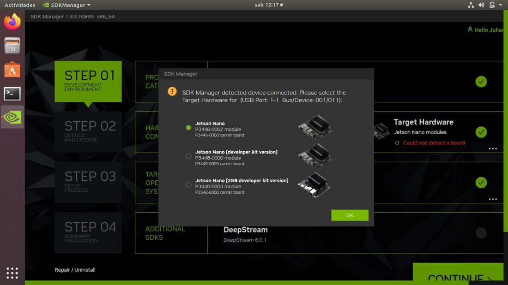

*Figura 16. STEP 01: SDK Manager detecta la placa conectada y pide elegir el modelo (captura con una Jetson Nano).*

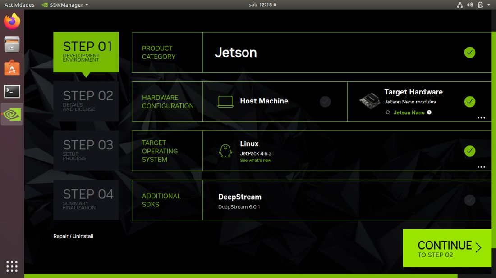

*Figura 17. STEP 01: categoría Jetson, placa y versión de JetPack (captura con una Jetson Nano).*

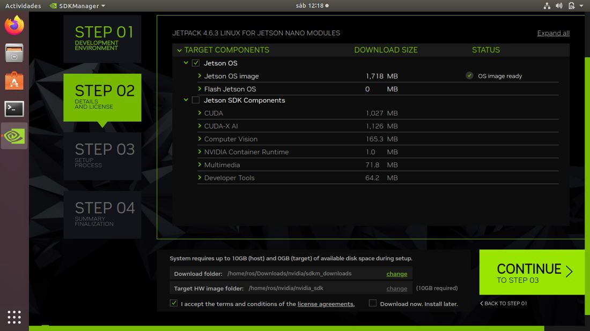

*Figura 18. STEP 02: componentes (Jetson OS y Jetson SDK Components) y licencias (captura con una Jetson Nano).*

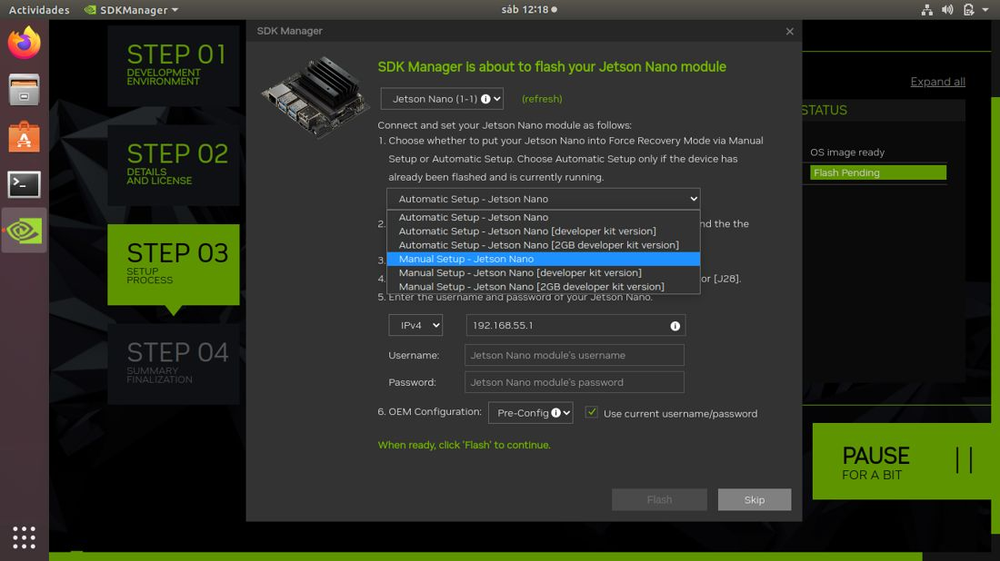

*Figura 19. Ventana de grabación: elegir Manual Setup (captura con una Jetson Nano).*

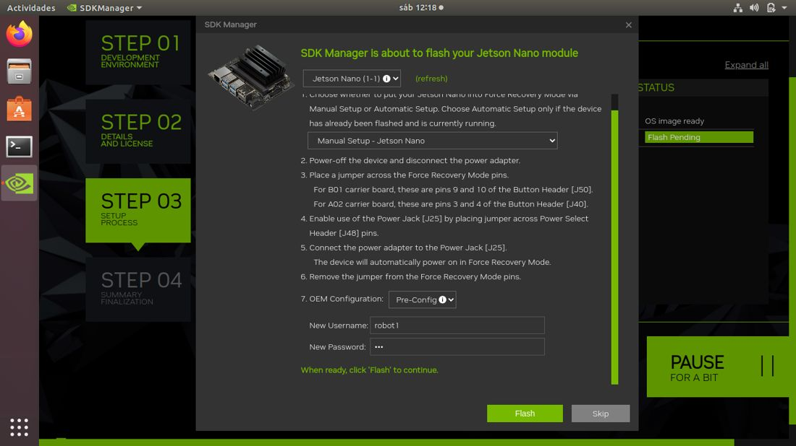

*Figura 20. Usuario de la Jetson (Pre-Config); las instrucciones de recuperación son las de la Nano: use las del punto 3.2 (captura con una Jetson Nano).*

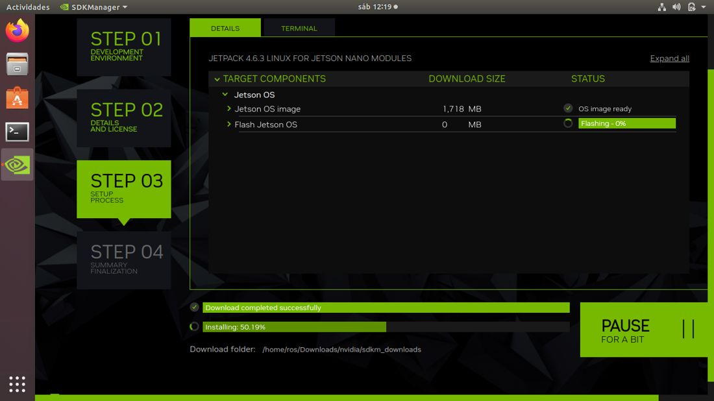

*Figura 21. STEP 03: descarga completa y grabación del sistema en curso (captura con una Jetson Nano).*

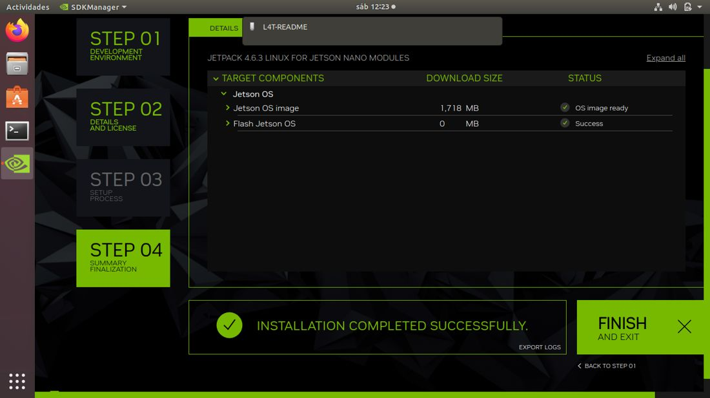

*Figura 22. STEP 04: instalación completada (INSTALLATION COMPLETED SUCCESSFULLY) (captura con una Jetson Nano).*

### Paso 4. Actualizar a JetPack 6.2.3 y verificar el sistema

**Terminal – Jetson**

```bash
# lleva el sistema a JetPack 6.2.3
sudo apt update && sudo apt upgrade -y
sudo reboot
# Ubuntu 22.04.x LTS
lsb_release -ds
# R36 (release), REVISION: 5.x
cat /etc/nv_tegra_release
# opcional: CUDA, cuDNN, TensorRT (si usó el método A)
sudo apt install -y nvidia-jetpack
```

Si tras reiniciar el sistema programa otra actualización del firmware (`sudo systemctl status nv-l4t-bootloader-config`), reinicie de nuevo y no desconecte la energía hasta que termine.

### Paso 5. Modo de potencia MAXN SUPER y nombre del equipo

JetPack 6.2 agrega a la Orin Nano 8 GB los modos 15 W, 25 W y **MAXN SUPER** [4]. Selecciónelo en el menú de potencia de la esquina superior derecha del escritorio o por terminal:

**Terminal – Jetson**

```bash
# modo actual
sudo nvpmodel -q
# lista de modos con su número (ID) y nombre
grep POWER_MODEL /etc/nvpmodel.conf
# MAXN SUPER en la Orin Nano 8 GB (confirme el ID en la lista anterior)
sudo nvpmodel -m 2
# nombre del equipo según la tabla del DA-11.1 de la Nano
sudo hostnamectl set-hostname robot1
```

> **Precaución:**
>
> La Developer Kit se alimenta por el conector cilíndrico con **9 a 20 V** (la fuente incluida es de 19 V); **no admite 5 V** [6]. En el robot no use el regulador de 5 V del DA-8.1: alimente la Jetson con un regulador de salida entre 9 y 20 V (por ejemplo 12 V) capaz de entregar la potencia del modo MAXN SUPER, y asegure la ventilación del disipador.

### Paso 6. Instalar ROS 2 Humble

Se sigue el procedimiento oficial de ROS 2 Humble para Ubuntu 22.04 (arm64) [8]:

**Terminal – Jetson**

```bash
# verificar UTF-8
locale
sudo apt update && sudo apt install -y locales
sudo locale-gen en_US en_US.UTF-8
sudo update-locale LC_ALL=en_US.UTF-8 LANG=en_US.UTF-8
export LANG=en_US.UTF-8
sudo apt install -y software-properties-common
sudo add-apt-repository universe
sudo apt update && sudo apt install -y curl
export ROS_APT_SOURCE_VERSION=$(curl -s https://api.github.com/repos/ros-infrastructure/ros-apt-source/releases/latest | grep -F "tag_name" | awk -F'"' '{print $4}')
curl -L -o /tmp/ros2-apt-source.deb "https://github.com/ros-infrastructure/ros-apt-source/releases/download/${ROS_APT_SOURCE_VERSION}/ros2-apt-source_${ROS_APT_SOURCE_VERSION}.$(. /etc/os-release && echo ${UBUNTU_CODENAME:-${VERSION_CODENAME}})_all.deb"
sudo dpkg -i /tmp/ros2-apt-source.deb
sudo apt update && sudo apt upgrade -y
sudo apt install -y ros-humble-desktop ros-dev-tools
```

`ros-humble-desktop` incluye ROS 2, RViz2, demos y tutoriales; `ros-dev-tools` incluye `colcon`, `rosdep` y `vcstool`. Cargue el entorno en cada terminal nueva e inicialice `rosdep`:

**Terminal – Jetson**

```bash
echo "source /opt/ros/humble/setup.bash" >> ~/.bashrc
source ~/.bashrc
# solo la primera vez
sudo rosdep init
rosdep update
```

### Paso 7. Verificar la instalación de ROS 2

**Terminal – Jetson**

```bash
# debe mostrar: humble
printenv ROS_DISTRO
# debe mostrar: 2
printenv ROS_VERSION
# todas las variables de ROS cargadas
printenv | grep -i ^ros
# debe terminar con: All <n> checks passed
ros2 doctor
# demo: en una terminal
ros2 run demo_nodes_cpp talker
# en otra terminal
ros2 run demo_nodes_py listener
```

> **Resultado esperado:**
>
> `humble` y `2` en las variables; en la demo, el talker publica `Hello World: n` y el listener responde `I heard: [Hello World: n]`.

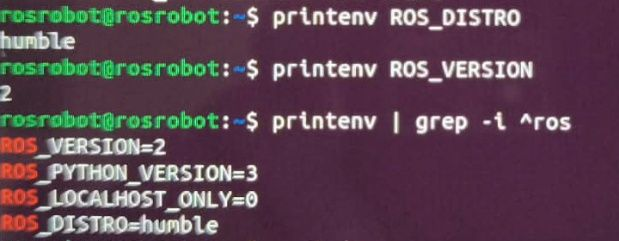

### Paso 8. Espacio de trabajo robots_ws en el robot y prueba del RoboClaw

Con ROS 2 instalado, la Jetson recibe el mismo espacio de trabajo `~/robots_ws` que se creó en el PC (DA-9.1, Pasos 2 a 7): se clona vacío desde GitHub, se agregan `mr_base` y `mr_sim` y se instala la regla udev del RoboClaw. Al final se comprueba que el robot se comunica con el RoboClaw.

**8.1 Herramientas y clonación del espacio de trabajo.**

**Terminal – Jetson**

```bash
sudo apt install -y git tree python3-serial
# solo la primera vez en el equipo (si ya se hizo, muestra un aviso)
sudo rosdep init
rosdep update
git clone --filter=blob:none --sparse https://github.com/jchauxdev/robots_ws.git ~/robots_ws
mkdir -p ~/robots_ws/src && cd ~/robots_ws
colcon build
```

**8.2 Cargar el espacio de trabajo en cada terminal.** Abra `~/.bashrc` con un editor de texto:

**Terminal – Jetson**

```bash
# en el escritorio
gedit ~/.bashrc
# por SSH o sin escritorio
nano ~/.bashrc
```

Pegue al final del archivo estas líneas, guarde (Ctrl + S en gedit; Ctrl + O, Enter y Ctrl + X en nano) y cierre el editor. La primera ya está si siguió el paso de instalación de ROS 2:

**Contenido para ~/.bashrc – se pega en el editor, no en la terminal**

```bash
source /opt/ros/humble/setup.bash
[ -f ~/robots_ws/install/setup.bash ] && source ~/robots_ws/install/setup.bash
source /usr/share/colcon_cd/function/colcon_cd.sh
export _colcon_cd_root=~/robots_ws
```

**Terminal – Jetson**

```bash
source ~/.bashrc
# debe mostrar: /home/<usuario>/robots_ws/install
printenv COLCON_PREFIX_PATH
```

**8.3 Agregar mr\_base y mr\_sim e instalar la regla udev.**

| **Paquete / carpeta** | **Para qué sirve** | **Qué contiene** | **Dónde se usa** |
|---|---|---|---|
| `src/mr_base` | Driver ROS 2 del RoboClaw: recibe las órdenes de velocidad (cmd\_vel), mueve los motores y publica la odometría (odom), la TF odom → base\_footprint, joint\_states y el diagnóstico. | base\_node.py (nodo), roboclaw.py (protocolo Packet Serial), kinematics.py (cinemática diferencial), herramientas check\_roboclaw y mover, config/mr\_base.yaml, launch/base.launch.py y la regla udev/99-mr-robot.rules (/dev/roboclaw). | Computador del robot (Jetson Nano, Orin Nano, AGX Orin o Raspberry Pi), que tiene el RoboClaw conectado. En el PC, con el robot virtual. |
| `src/mr_sim` | Robot virtual para practicar sin hardware: hace las veces del RoboClaw y del lidar, de modo que mr\_base y la navegación funcionan igual que con el robot real. | roboclaw\_emulator (RoboClaw emulado en un puerto serie virtual), lidar\_sim (lidar simulado que publica scan), world\_gen (genera mundos) y worlds/ con el mundo laboratorio. | PC. En el robot se agrega para tener el mismo robots\_ws, pero no se ejecuta. |

Se agrega con estos comandos:

**Terminal – Jetson**

```bash
cd ~/robots_ws
git sparse-checkout add src/mr_base src/mr_sim
rosdep install --from-paths ~/robots_ws/src --ignore-src -r -y --skip-keys "mr_navigation jc_driver"
colcon build --symlink-install --packages-select mr_base mr_sim
source install/setup.bash
# mr_base, mr_sim
ros2 pkg list | grep mr_
# permiso para los puertos serie (cierre sesión y vuelva a entrar)
sudo usermod -aG dialout $USER
# nombre fijo /dev/roboclaw (detalle en el DA-12.3)
sudo cp ~/robots_ws/src/mr_base/udev/99-mr-robot.rules /etc/udev/rules.d/
sudo udevadm control --reload-rules && sudo udevadm trigger
```

**8.4 Prueba de comunicación con el RoboClaw.** Conecte el RoboClaw (ya configurado con Motion Studio, DA-10.1) por USB a la Jetson, con la batería conectada y las ruedas levantadas:

**Terminal – Jetson**

```bash
# debe mostrar: /dev/roboclaw -> ttyACM0
ls -l /dev/roboclaw
# versión, batería, PID y encoders
ros2 run mr_base check_roboclaw --port /dev/roboclaw
```

> **Resultado esperado:**
>
> `check_roboclaw` muestra la versión del firmware (`USB Roboclaw 2x15a ...`), la tensión de la batería, el PID de velocidad de cada motor y la lectura de los encoders. La prueba de sentido de giro de los motores (`--probar`) y la configuración del driver se hacen en el DA-12.1.

> **Precaución:**
>
> Si `/dev/roboclaw` no existe, desconecte y conecte el cable USB y revise `ls /dev/ttyACM*`. Si aparece `Permission denied`, cierre sesión y vuelva a entrar para que se aplique el grupo `dialout`.

## 5. VERIFICACIÓN Y EVIDENCIAS

*Tabla 3. Lista de verificación.*

| **#** | **Criterio** | **Evidencia** |
|---|---|---|
| 1 | Firmware de la placa 36.x o superior | Foto de la pantalla UEFI (Paso 1) |
| 2 | Ubuntu 22.04 con JetPack 6.2.3 (Jetson Linux 36.5.x) | `lsb_release -ds` y `cat /etc/nv_tegra_release` |
| 3 | Modo MAXN SUPER activo | `sudo nvpmodel -q` |
| 4 | ROS 2 Humble instalado y funcionando | `printenv ROS_DISTRO` y demo talker/listener |

## 6. SOLUCIÓN DE PROBLEMAS

*Tabla 4. Problemas frecuentes.*

| **Síntoma** | **Causa probable** | **Solución** |
|---|---|---|
| La placa no arranca con la microSD de JetPack 6 | Firmware anterior a 36.0 | Paso 1: actualice el firmware con la imagen puente 5.1.3 o use SDK Manager |
| SDK Manager no detecta la Jetson | Cable USB-C solo de carga, o la placa no entró en recuperación | Use un cable de datos; repita el Paso 3.2 con la placa sin energía antes de poner el puente |
| balenaEtcher falla al validar | Tarjeta defectuosa o falsificada | Pruebe otra microSD de marca reconocida |
| No aparece MAXN SUPER en el menú | Imagen sin la configuración Super | Use la imagen `…devkit-super-SD-image…` de JetPack 6.2.x o grabe con SDK Manager 6.2.x |
| `E: Unable to locate package ros-humble-desktop` | Repositorio de ROS 2 no configurado | Repita el Paso 6 desde `ros2-apt-source` |
| La Jetson se apaga sola en el robot | Fuente o regulador insuficiente para MAXN SUPER | Use un regulador de mayor corriente o baje a 15 W desde el menú de potencia |

## REFERENCIAS

**[1]** NVIDIA, *JetPack SDK 6.2.3* (Jetson Linux 36.5.2, Ubuntu 22.04; imagen SD 6.2.1 / Jetson Linux 36.4.4 con actualización por APT). [En línea]. Disponible: [https://developer.nvidia.com/embedded/jetpack-sdk-623](https://developer.nvidia.com/embedded/jetpack-sdk-623)

**[2]** NVIDIA, *Jetson Orin Nano Developer Kit Getting Started Guide*. [En línea]. Disponible: [https://developer.nvidia.com/embedded/learn/get-started-jetson-orin-nano-devkit](https://developer.nvidia.com/embedded/learn/get-started-jetson-orin-nano-devkit)

**[3]** NVIDIA, *Jetson Orin Nano Developer Kit User Guide – JetPack 6.x Update Path* (actualización del firmware UEFI/QSPI). [En línea]. Disponible: [https://docs.nvidia.com/jetson/orin-nano-devkit/user-guide/latest/update_firmware.html](https://docs.nvidia.com/jetson/orin-nano-devkit/user-guide/latest/update_firmware.html)

**[4]** NVIDIA, *NVIDIA JetPack 6.2 Brings Super Mode to NVIDIA Jetson Orin Nano and Jetson Orin NX Modules* (NVIDIA Technical Blog), ene. 2025. [En línea]. Disponible: [https://developer.nvidia.com/blog/nvidia-jetpack-6-2-brings-super-mode-to-nvidia-jetson-orin-nano-and-jetson-orin-nx-modules](https://developer.nvidia.com/blog/nvidia-jetpack-6-2-brings-super-mode-to-nvidia-jetson-orin-nano-and-jetson-orin-nx-modules)

**[5]** NVIDIA, *NVIDIA SDK Manager*. [En línea]. Disponible: [https://developer.nvidia.com/sdk-manager](https://developer.nvidia.com/sdk-manager)

**[6]** NVIDIA Developer Forums, *Jetson Orin Nano Input Voltage* (respuesta de NVIDIA: entrada de 9 a 20 V por el conector DC). [En línea]. Disponible: [https://forums.developer.nvidia.com/t/jetson-orin-nano-input-voltage/298625](https://forums.developer.nvidia.com/t/jetson-orin-nano-input-voltage/298625)

**[7]** Open Robotics, *REP 2000 – ROS 2 Releases and Target Platforms*. [En línea]. Disponible: [https://www.ros.org/reps/rep-2000.html](https://www.ros.org/reps/rep-2000.html)

**[8]** Open Robotics, *ROS 2 Documentation: Humble Hawksbill*. [En línea]. Disponible: [https://docs.ros.org/en/humble/](https://docs.ros.org/en/humble/)

**[9]** J. R. Cháux Cedeño, *robots\_ws – paquetes ROS 2 del curso (repositorio en GitHub, licencia Apache-2.0), 2026. [En línea]. Disponible: https://github.com/jchauxdev/robots\_ws*
