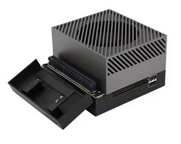
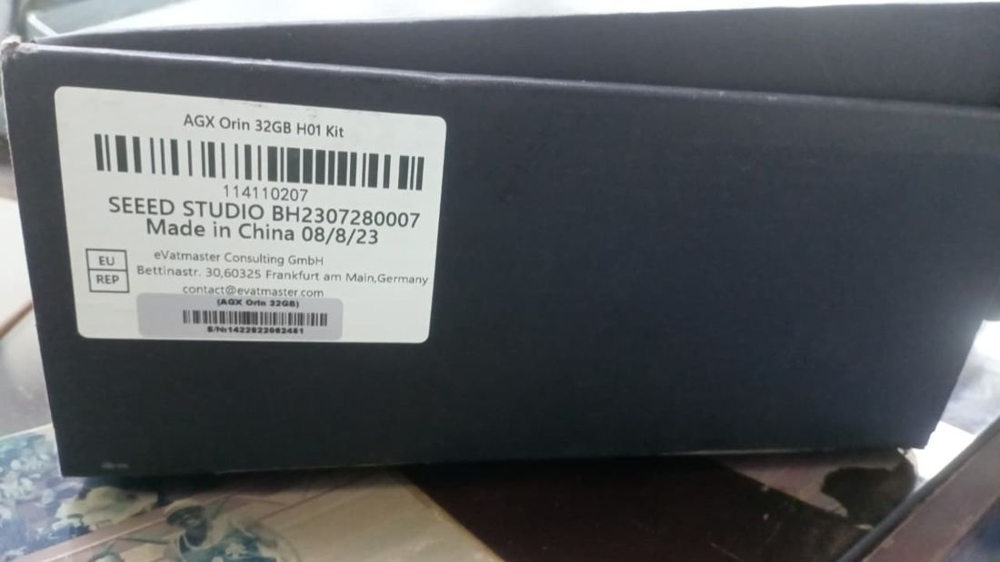
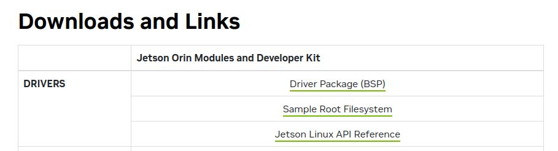
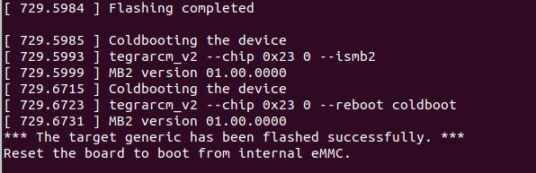

# Documento de Apoyo No. 11.1 (Seeed AGX Orin) – Ubuntu 22.04 con JetPack 6.2 y ROS 2 Humble en la Seeed Jetson AGX Orin 32GB H01 Kit.

> Versión en Markdown del documento de apoyo, para consultar y copiar comandos desde GitHub. El documento de Word (formato GFPI-F-135) no se publica en el repositorio.

**Duración Estimada:** 2 horas (más el tiempo de descarga del BSP de NVIDIA).

**Sesión:** Día 2 – 03/11/2026, bloque 3 (2:00 p.m. – 5:00 p.m.).

**Relación con la Guía de Aprendizaje:** Actividad 3.3.2 – carpeta «11. INSTALACIÓN DE LINUX - ROS 2 - RPI - JETSON», subcarpeta «4. SEED JETSON AGX ORIN 32GB H01».

**Diseñado por:** Julián René Cháux Cedeño.

## 1. OBJETIVOS DE APRENDIZAJE

- Identificar el kit Seeed Jetson AGX Orin 32GB H01 y por qué se graba con el paquete de drivers de Seeed y no con SDK Manager.
- Preparar en el PC la imagen de Jetson Linux 36.4.3 (JetPack 6.2) con los drivers de la placa H01 y grabarla en la memoria eMMC por línea de comandos.
- Verificar el sistema, instalar los componentes de JetPack, conectar el Wi-Fi interno y activar el modo de potencia MAXN.
- Instalar ROS 2 Humble de forma nativa, preparar el espacio de trabajo robots\_ws y probar la comunicación con el RoboClaw.

## 2. CONTEXTO

El kit Seeed Studio Jetson AGX Orin 32GB H01 lleva el mismo módulo NVIDIA Jetson AGX Orin 32GB que la Developer Kit de NVIDIA, pero en una placa portadora de Seeed, con otros puertos. Por eso **no se graba con SDK Manager ni con el BSP de NVIDIA solo**: con ellos la grabación termina con «flashed successfully», pero el equipo no arranca y vuelve al modo de recuperación (APX). Se graba con el BSP de NVIDIA, Jetson Linux R36.4.3 [1], más el paquete de drivers de Seeed `605_jp62` [2], [3]. El resultado es JetPack 6.2 con Ubuntu 22.04, plataforma de primer nivel de ROS 2 Humble [4]: ROS 2 se instala con apt, igual que en el PC.

*Tabla 1. Seeed Jetson AGX Orin 32GB H01 Kit.*

| **Dato** | **Valor** |
|---|---|
| Modelo | Seeed Studio Jetson AGX Orin 32GB H01 Kit (referencia 114110207) |
| Módulo | NVIDIA Jetson AGX Orin 32GB; en modo de recuperación aparece como 0955:7223 |
| Puertos | 2 RJ45 (1GbE y 10GbE), 2 USB 3.0, 1 HDMI y 1 USB-C (grabación y recuperación). No tiene DisplayPort ni micro-USB [7] |
| Fabricación del equipo del curso | 08/2023, anterior al cambio de revisión de noviembre de 2024 |
| Sistema que queda instalado | JetPack 6.2 (Jetson Linux 36.4.3) con Ubuntu 22.04, en la memoria eMMC |



*Figura 1. Seeed Studio Jetson AGX Orin 32GB H01 Kit [7].*



*Figura 2. Etiqueta del kit del curso: AGX Orin 32GB H01 Kit, referencia 114110207, fabricado el 08/08/2023.*

> **Precaución:**
>
> Use JetPack 6.2 (Ubuntu 22.04) con el paquete de Seeed de esa versión (`605_jp62`). No instale JetPack 7.x: está basado en Ubuntu 24.04, en el que ROS 2 Humble no tiene soporte oficial; todo el material del curso (robots\_ws) está preparado para Humble.

## 3. MATERIALES

- Seeed Jetson AGX Orin 32GB H01 Kit con su fuente de alimentación.
- PC con Ubuntu 22.04 nativo (x86\_64), con al menos 30 GB libres y conexión a Internet. Evite máquinas virtuales.
- Cable USB-C de datos, conectado directo al PC, sin hub.
- Monitor HDMI, teclado y mouse USB para el primer arranque, y cable de red RJ45 para la conexión a Internet de la Jetson.
- Opcional: disco SSD NVMe, si no se va a usar la eMMC.

## 4. PROCEDIMIENTO

### Paso 1. Descargar los archivos en el PC

Cree una carpeta de trabajo en el PC y descargue en ella los tres archivos de la Tabla 2; los dos de NVIDIA están en la sección Downloads and Links de la página de Jetson Linux R36.4.3 (Figura 3):

**Terminal – PC**

```bash
mkdir -p ~/h01 && cd ~/h01
```

*Tabla 2. Archivos para grabar la H01 (en la carpeta ~/h01 del PC).*

| **Archivo** | **Qué es** | **Origen** |
|---|---|---|
| Jetson\_Linux\_R36.4.3\_aarch64.tbz2 | Driver Package (BSP) de NVIDIA | Página de Jetson Linux R36.4.3 [1] |
| Tegra\_Linux\_Sample-Root-Filesystem\_R36.4.3\_aarch64.tbz2 | Sistema de archivos raíz (Ubuntu 22.04) | Página de Jetson Linux R36.4.3 [1] |
| 605\_jp62.tar.gz | Drivers de la placa H01 | Wiki de Seeed, sección JP6.2 [2] |



*Figura 3. Página de Jetson Linux R36.4.3 [1], sección Downloads and Links: Driver Package (BSP) y Sample Root Filesystem.*

### Paso 2. Preparar la imagen en el PC

Se extraen el BSP y el sistema de archivos, se aplican los binarios de NVIDIA y después se copian encima los archivos de Seeed. El último comando crea el usuario de la Jetson:

**Terminal – PC**

```bash
cd ~/h01
tar xf Jetson_Linux_R36.4.3_aarch64.tbz2
sudo tar xpf Tegra_Linux_Sample-Root-Filesystem_R36.4.3_aarch64.tbz2 -C Linux_for_Tegra/rootfs/
cd Linux_for_Tegra
sudo ./tools/l4t_flash_prerequisites.sh
sudo ./apply_binaries.sh
cd ..
# drivers de la placa H01, encima de los de NVIDIA
tar xf 605_jp62.tar.gz
sudo cp -r 605_jp62/Linux_for_Tegra/* Linux_for_Tegra/
cd Linux_for_Tegra
# usuario, contraseña y nombre del equipo de la Jetson (cámbielos en cada equipo)
sudo ./tools/l4t_create_default_user.sh -u <usuario> -p <contraseña> -n robot1 -a --accept-license
```

> **Precaución:**
>
> El orden importa: si `apply_binaries.sh` se ejecuta después de copiar los archivos de Seeed, los sobrescribe y la Jetson no arrancará.

`l4t_create_default_user.sh` deja creados el usuario y la contraseña (`-u`, `-p`) y el nombre del equipo (`-n`, el hostname de la tabla del DA-11.1 de la Jetson Nano: robot1, robot2…), y activa el inicio de sesión automático (`-a`): la Jetson no pasa por el asistente de configuración de Ubuntu. Anote el usuario y la contraseña: no hay valores por defecto.

### Paso 3. Modo de recuperación y grabación en la eMMC

El kit tiene tres botones; el de **recuperación es el del medio**. Con el kit desconectado de la corriente:

1. Mantenga presionado el botón de recuperación y conecte la corriente.
1. Suelte el botón después de unos 2 segundos.
1. Conecte el USB-C del kit al PC.

**Terminal – PC**

```bash
# debe aparecer: 0955:7223 NVIDIA Corp. APX
lsusb | grep -i nvidia
# desactiva la suspensión automática de USB (evita que la grabación se corte)
sudo bash -c 'echo -1 > /sys/module/usbcore/parameters/autosuspend'
# graba en la eMMC y guarda el registro en ~/flash_h01.txt
cd ~/h01/Linux_for_Tegra
sudo ./flash.sh jetson-agx-orin-devkit internal 2>&1 | tee ~/flash_h01.txt
```



*Figura 4. Final de la grabación: «The target generic has been flashed successfully» y reinicio desde la eMMC.*

> **Resultado esperado:**
>
> La grabación tarda unos 10–20 minutos y termina con `The target ... has been flashed successfully`. Si el equipo no se reinicia solo, desconecte la corriente y vuelva a conectarla.

Para instalar el sistema en un SSD NVMe en lugar de la eMMC, la wiki de Seeed usa este comando en lugar de `flash.sh` [2]:

**Terminal – PC (solo para NVMe)**

```bash
cd ~/h01/Linux_for_Tegra
sudo ./tools/kernel_flash/l4t_initrd_flash.sh --external-device nvme0n1p1 \
  -c tools/kernel_flash/flash_l4t_t234_nvme.xml --showlogs --network usb0 \
  jetson-agx-orin-devkit external
```

### Paso 4. Primer arranque, verificación y componentes de JetPack

Conecte el monitor por **HDMI** antes de encender: el kit no tiene DisplayPort. La sesión se abre sola con el usuario del Paso 2. Sin monitor, entre desde el PC por el cable USB-C con `ssh <usuario>@192.168.55.1` (DA-11.1 SSH, sección 1). Conecte el cable de red RJ45 para tener Internet.

**Terminal – Jetson**

```bash
# debe indicar R36 (release), REVISION: 4.3
cat /etc/nv_tegra_release
# Ubuntu 22.04.x LTS
lsb_release -ds
# nombre del equipo del Paso 2 (robot1, robot2…)
hostname
# CUDA, cuDNN y TensorRT
sudo apt update
sudo apt install -y nvidia-jetpack
```

> **Precaución:**
>
> Los paquetes `nvidia-l4t-*` (kernel, cargador de arranque y controladores) los dejó preparados el paquete de Seeed. Si una actualización los reemplaza por los de la Developer Kit de NVIDIA, la H01 puede dejar de arrancar. Antes de instalar ROS 2 (Paso 7, que ejecuta `apt upgrade`), retenga esos paquetes:

**Terminal – Jetson**

```bash
# retener los paquetes nvidia-l4t-* (no se actualizan con apt upgrade)
sudo apt-mark hold $(dpkg-query -W -f='${binary:Package}\n' 'nvidia-l4t-*')
# lista de paquetes retenidos
apt-mark showhold
```

### Paso 5. Wi-Fi interno

El Wi-Fi interno funciona con JetPack 6.2 sin instalar nada. Las unidades fabricadas antes de noviembre de 2024, como la del curso, traen la tarjeta Intel Dual Band Wireless AC 8265 (8086:24fd), con el controlador `iwlwifi` y su firmware ya incluidos en la imagen; la interfaz se llama `wlP1p1s0`. Las unidades posteriores traen el módulo BL-M8822CP1.

**Terminal – Jetson**

```bash
# debe mostrar: Wireless 8265 [8086:24fd]
lspci -nn | grep -i 8086
# wlP1p1s0, tipo wifi
nmcli device
nmcli device wifi list
sudo nmcli device wifi connect "NOMBRE_RED" password "CLAVE_RED"
# señal y velocidad
iw dev wlP1p1s0 link
# IP en la red del aula (192.168.55.1 es la del cable USB-C)
hostname -I
```

Si la señal es débil, revise que las antenas estén conectadas; no hace falta un adaptador Wi-Fi USB. Solo si `dmesg` muestra `failed to load iwlwifi-8265` habría que instalar `linux-firmware`.

### Paso 6. Modo de potencia MAXN

Seleccione el modo MAXN en el menú de potencia de la esquina superior derecha del escritorio o por terminal:

**Terminal – Jetson**

```bash
# modo actual
sudo nvpmodel -q
# lista de modos con su número (ID) y nombre
grep POWER_MODEL /etc/nvpmodel.conf
# MAXN (en la AGX Orin 32GB suele ser el 0) (confirme el ID en la lista anterior)
sudo nvpmodel -m 0
```

> **Precaución:**
>
> En MAXN la AGX Orin consume más: use la fuente incluida con el kit y asegure la ventilación. Para alimentarla desde la batería del robot, consulte primero en la wiki de Seeed [2] el rango de tensión de entrada admitido y use un regulador adecuado; el regulador de 5 V del DA-8.1 no sirve para la AGX Orin.

### Paso 7. Instalar ROS 2 Humble

Se sigue el procedimiento oficial de ROS 2 Humble para Ubuntu 22.04 (arm64) [5]:

**Terminal – Jetson**

```bash
# verificar UTF-8
locale
sudo apt update && sudo apt install -y locales
sudo locale-gen en_US en_US.UTF-8
sudo update-locale LC_ALL=en_US.UTF-8 LANG=en_US.UTF-8
export LANG=en_US.UTF-8
sudo apt install -y software-properties-common
sudo add-apt-repository universe
sudo apt update && sudo apt install -y curl
export ROS_APT_SOURCE_VERSION=$(curl -s https://api.github.com/repos/ros-infrastructure/ros-apt-source/releases/latest | grep -F "tag_name" | awk -F'"' '{print $4}')
curl -L -o /tmp/ros2-apt-source.deb "https://github.com/ros-infrastructure/ros-apt-source/releases/download/${ROS_APT_SOURCE_VERSION}/ros2-apt-source_${ROS_APT_SOURCE_VERSION}.$(. /etc/os-release && echo ${UBUNTU_CODENAME:-${VERSION_CODENAME}})_all.deb"
sudo dpkg -i /tmp/ros2-apt-source.deb
sudo apt update && sudo apt upgrade -y
sudo apt install -y ros-humble-desktop ros-dev-tools
```

`ros-humble-desktop` incluye ROS 2, RViz2, demos y tutoriales; `ros-dev-tools` incluye `colcon`, `rosdep` y `vcstool`. Cargue el entorno en cada terminal nueva e inicialice `rosdep`:

**Terminal – Jetson**

```bash
echo "source /opt/ros/humble/setup.bash" >> ~/.bashrc
source ~/.bashrc
# solo la primera vez
sudo rosdep init
rosdep update
```

### Paso 8. Verificar la instalación de ROS 2

**Terminal – Jetson**

```bash
# debe mostrar: humble
printenv ROS_DISTRO
# debe mostrar: 2
printenv ROS_VERSION
# todas las variables de ROS cargadas
printenv | grep -i ^ros
# debe terminar con: All <n> checks passed
ros2 doctor
# demo: en una terminal
ros2 run demo_nodes_cpp talker
# en otra terminal
ros2 run demo_nodes_py listener
```

> **Resultado esperado:**
>
> `humble` y `2` en las variables; en la demo, el talker publica `Hello World: n` y el listener responde `I heard: [Hello World: n]`.

### Paso 9. Paquetes del robot móvil

**Terminal – Jetson**

```bash
sudo apt install -y ros-humble-navigation2 ros-humble-nav2-bringup ros-humble-slam-toolbox \
  ros-humble-rplidar-ros ros-humble-usb-cam ros-humble-teleop-twist-keyboard ros-humble-xacro \
  ros-humble-joint-state-publisher-gui ros-humble-depthimage-to-laserscan python3-serial python3-flask
```

### Paso 10. Espacio de trabajo robots_ws en el robot y prueba del RoboClaw

Con ROS 2 instalado, la Jetson recibe el mismo espacio de trabajo `~/robots_ws` que se creó en el PC (DA-9.1, Pasos 2 a 7): se clona vacío desde GitHub, se agregan `mr_base` y `mr_sim` y se instala la regla udev del RoboClaw. Al final se comprueba que el robot se comunica con el RoboClaw.

**10.1 Herramientas y clonación del espacio de trabajo.**

**Terminal – Jetson**

```bash
sudo apt install -y git tree python3-serial
# solo la primera vez en el equipo (si ya se hizo, muestra un aviso)
sudo rosdep init
rosdep update
git clone --filter=blob:none --sparse https://github.com/jchauxdev/robots_ws.git ~/robots_ws
mkdir -p ~/robots_ws/src && cd ~/robots_ws
colcon build
```

**10.2 Cargar el espacio de trabajo en cada terminal.** Abra `~/.bashrc` con un editor de texto:

**Terminal – Jetson**

```bash
# en el escritorio
gedit ~/.bashrc
# por SSH o sin escritorio
nano ~/.bashrc
```

Pegue al final del archivo estas líneas, guarde (Ctrl + S en gedit; Ctrl + O, Enter y Ctrl + X en nano) y cierre el editor. La primera ya está si siguió el paso de instalación de ROS 2:

**Contenido para ~/.bashrc – se pega en el editor, no en la terminal**

```bash
source /opt/ros/humble/setup.bash
[ -f ~/robots_ws/install/setup.bash ] && source ~/robots_ws/install/setup.bash
source /usr/share/colcon_cd/function/colcon_cd.sh
export _colcon_cd_root=~/robots_ws
```

**Terminal – Jetson**

```bash
source ~/.bashrc
# debe mostrar: /home/<usuario>/robots_ws/install
printenv COLCON_PREFIX_PATH
```

**10.3 Agregar mr\_base y mr\_sim e instalar la regla udev.**

| **Paquete / carpeta** | **Para qué sirve** | **Qué contiene** | **Dónde se usa** |
|---|---|---|---|
| `src/mr_base` | Driver ROS 2 del RoboClaw: recibe las órdenes de velocidad (cmd\_vel), mueve los motores y publica la odometría (odom), la TF odom → base\_footprint, joint\_states y el diagnóstico. | base\_node.py (nodo), roboclaw.py (protocolo Packet Serial), kinematics.py (cinemática diferencial), herramientas check\_roboclaw y mover, config/mr\_base.yaml, launch/base.launch.py y la regla udev/99-mr-robot.rules (/dev/roboclaw). | Computador del robot (Jetson Nano, Orin Nano, AGX Orin o Raspberry Pi), que tiene el RoboClaw conectado. En el PC, con el robot virtual. |
| `src/mr_sim` | Robot virtual para practicar sin hardware: hace las veces del RoboClaw y del lidar, de modo que mr\_base y la navegación funcionan igual que con el robot real. | roboclaw\_emulator (RoboClaw emulado en un puerto serie virtual), lidar\_sim (lidar simulado que publica scan), world\_gen (genera mundos) y worlds/ con el mundo laboratorio. | PC. En el robot se agrega para tener el mismo robots\_ws, pero no se ejecuta. |

Se agrega con estos comandos:

**Terminal – Jetson**

```bash
cd ~/robots_ws
git sparse-checkout add src/mr_base src/mr_sim
rosdep install --from-paths ~/robots_ws/src --ignore-src -r -y --skip-keys "mr_navigation jc_driver"
colcon build --symlink-install --packages-select mr_base mr_sim
source install/setup.bash
# mr_base, mr_sim
ros2 pkg list | grep mr_
# permiso para los puertos serie (cierre sesión y vuelva a entrar)
sudo usermod -aG dialout $USER
# nombre fijo /dev/roboclaw (detalle en el DA-12.3)
sudo cp ~/robots_ws/src/mr_base/udev/99-mr-robot.rules /etc/udev/rules.d/
sudo udevadm control --reload-rules && sudo udevadm trigger
# ModemManager busca módems en los puertos serie y puede quitarle el puerto a mr_base
sudo systemctl disable --now ModemManager
```

**10.4 Prueba de comunicación con el RoboClaw.** Conecte el RoboClaw (ya configurado con Motion Studio, DA-10.1) por USB a la Jetson, con la batería conectada y las ruedas levantadas:

**Terminal – Jetson**

```bash
# debe mostrar: /dev/roboclaw -> ttyACM0
ls -l /dev/roboclaw
# versión, batería, PID y encoders
ros2 run mr_base check_roboclaw --port /dev/roboclaw
```

> **Resultado esperado:**
>
> `check_roboclaw` muestra la versión del firmware (`USB Roboclaw 2x15a ...`), la tensión de la batería, el PID de velocidad de cada motor y la lectura de los encoders. La prueba de sentido de giro de los motores (`--probar`) y la configuración del driver se hacen en el DA-12.1.

> **Precaución:**
>
> Si `/dev/roboclaw` no existe, desconecte y conecte el cable USB y revise `ls /dev/ttyACM*`. Si aparece `Permission denied`, cierre sesión y vuelva a entrar para que se aplique el grupo `dialout`.

> **Nota:**
>
> **RealSense en la AGX:** se instala con `sudo apt install ros-humble-librealsense2* ros-humble-realsense2-*` (DA-20.1). Conéctela a un puerto USB 3 de la AGX. Si la misma AGX controla también el cobot, el robot se lanza con `namespace:=mr` (DA-21.1) para que sus TF no choquen con las del cobot.

## 5. VERIFICACIÓN Y EVIDENCIAS

*Tabla 3. Lista de verificación.*

| **#** | **Criterio** | **Evidencia** |
|---|---|---|
| 1 | Ubuntu 22.04 con JetPack 6.2 (Jetson Linux 36.4.3) y los drivers de Seeed | cat /etc/nv\_tegra\_release y lsb\_release -ds |
| 2 | Paquetes nvidia-l4t-\* retenidos | apt-mark showhold |
| 3 | Wi-Fi interno conectado | nmcli device y hostname -I |
| 4 | Modo MAXN activo | sudo nvpmodel -q |
| 5 | ROS 2 Humble instalado y funcionando | printenv ROS\_DISTRO y demo talker/listener |
| 6 | robots\_ws con mr\_base y mr\_sim; comunicación con el RoboClaw | ros2 pkg list \| grep mr\_ y check\_roboclaw |

## 6. SOLUCIÓN DE PROBLEMAS

*Tabla 4. Problemas frecuentes.*

| **Síntoma** | **Causa** | **Solución** |
|---|---|---|
| «Flashed successfully», pero al reiniciar sigue en APX, el ventilador va lento y no hay video | Se grabó con el BSP de la Developer Kit de NVIDIA (o con SDK Manager), sin los drivers de la placa H01 | Grabe con Jetson Linux 36.4.3 + 605\_jp62 (Pasos 2 y 3) |
| lsusb no muestra 0955:7223 | El kit no entró en recuperación, o cable o puerto USB inadecuados | Repita el Paso 3 con el kit desconectado; use otro cable de datos u otro puerto del PC, sin hub |
| La grabación se corta | Suspensión automática de USB del PC | Ejecute el comando de autosuspend del Paso 3 y vuelva a entrar en recuperación |
| No hay imagen | El kit solo tiene HDMI y no da video sin el BSP correcto | Use HDMI después de grabar con el paquete de Seeed |
| No aparece /dev/ttyACM0 para la consola serie | La H01 no tiene micro-USB de depuración | Use SSH por el USB-C a 192.168.55.1 cuando Ubuntu haya arrancado |
| E: Unable to locate package ros-humble-desktop | Repositorio de ROS 2 no configurado | Repita el Paso 7 desde ros2-apt-source |

## REFERENCIAS

**[1]** NVIDIA, *Jetson Linux R36.4.3* (Driver Package y Sample Root Filesystem). [En línea]. Disponible: https://developer.nvidia.com/embedded/jetson-linux-r3643

**[2]** Seeed Studio, *Flash JetPack to NVIDIA Jetson AGX Orin 32GB H01 Kit*. [En línea]. Disponible: https://wiki.seeedstudio.com/Jetson\_AGX\_Orin\_32GB\_H01\_Flash\_Jetpack

**[3]** Seeed Studio, *Flashear JetPack en el Jetson AGX Orin 32GB H01 Kit* (versión en español). [En línea]. Disponible: https://wiki.seeedstudio.com/es/Jetson\_AGX\_Orin\_32GB\_H01\_Flash\_Jetpack/

**[4]** Open Robotics, *REP 2000 – ROS 2 Releases and Target Platforms*. [En línea]. Disponible: https://www.ros.org/reps/rep-2000.html

**[5]** Open Robotics, *ROS 2 Documentation: Humble Hawksbill*. [En línea]. Disponible: https://docs.ros.org/en/humble/

**[6]** J. R. Cháux Cedeño, *robots\_ws – paquetes ROS 2 del curso* (repositorio en GitHub, licencia Apache-2.0), 2026. [En línea]. Disponible: https://github.com/jchauxdev/robots\_ws

**[7]** *Jetson AGX Orin 32GB H01 Kit with Jetson AGX Orin 32GB module* (especificaciones y puertos). [En línea]. Disponible: https://rcdrone.top/products/jetson-agx-orin-32gb-h01-kit-with-jetson-agx-orin-32gb-module
