# Documento de Apoyo No. 11.1 (SSH) – Conexión remota al robot por SSH y edición con VS Code.

> Versión en Markdown del documento de apoyo, para consultar y copiar comandos desde GitHub. El documento de Word (formato GFPI-F-135) no se publica en el repositorio.

**Duración Estimada:** 45 minutos.

**Sesión:** Día 2 – 03/11/2026, bloque 3 (2:00 p.m. – 5:00 p.m.).

**Relación con la Guía de Aprendizaje:** Actividad 3.3.2 – carpeta «11. INSTALACIÓN DE LINUX - ROS 2 - RPI - JETSON».

**Diseñado por:** Julián René Cháux Cedeño.

## 1. PRIMERA CONEXIÓN A UNA JETSON SIN PANTALLA

Las Jetson **no traen usuario ni contraseña por defecto**: el usuario, la contraseña y el nombre del equipo se crean en la configuración inicial (`oem-config`) del primer arranque. Con monitor, teclado y mouse esa configuración es gráfica (DA-11.1 de cada Jetson). Sin monitor se hace desde el PC por un cable USB: por ese cable la Jetson ofrece una **consola serie**, para la configuración inicial, y una **red** en la que ella siempre tiene la dirección **192.168.55.1** y el PC recibe la 192.168.55.100 [4]–[6]. Esto vale para las tres Jetson del curso; la Raspberry Pi no tiene este modo (nota al final de esta sección).

*Tabla 1. Conexión USB de cada Jetson para el primer acceso sin monitor.*

| **Equipo** | **Cable USB al PC (lado de la Jetson)** | **Alimentación** | **Usuario y contraseña** |
|---|---|---|---|
| Jetson Nano (JetPack 4.6.6) | Micro-USB | Conector de barril (5 V, 4 A) con el puente J48 puesto, para dejar el micro-USB libre | Se crean en oem-config |
| Jetson Orin Nano DK (JetPack 6.2) | USB-C de la tarjeta | Conector de barril, con la fuente de 19 V incluida | Se crean en oem-config (o en Pre-Config de SDK Manager) |
| Jetson AGX Orin DK (JetPack 6.2) | USB-C junto al conector de 40 pines | USB-C encima del conector DC, con la fuente incluida | Se crean en oem-config (o en Pre-Config de SDK Manager) |

Si la Jetson se instaló con SDK Manager (Método B del DA-11.1) y en *OEM Configuration* se eligió *Pre-Config*, el usuario y la contraseña son los que se escribieron ahí y no aparece oem-config: pase directamente al punto 1.2.

**1.1 Configuración inicial por la consola serie (solo el primer arranque).** Grabe la imagen (DA-11.1 de la Jetson), conecte el cable USB al PC como indica la Tabla 1, sin monitor en la salida de video, y encienda la Jetson. Espere alrededor de un minuto y abra la consola serie:

**Terminal – PC**

```bash
sudo apt install -y screen
# aparece un puerto nuevo, normalmente ttyACM0
sudo dmesg | grep -i tty
sudo screen /dev/ttyACM0 115200
```

**PC con Windows:** en el Administrador de dispositivos, *Puertos (COM y LPT)* muestra un *Dispositivo serie USB* (por ejemplo COM5). Abra PuTTY, elija *Serial*, escriba ese puerto y la velocidad 115200 y pulse *Open*.

Si la consola queda en negro, pulse Enter (en la Jetson Nano, Esc). Responda las preguntas de oem-config con las flechas, Tab y Enter: licencia, idioma, teclado, zona horaria (America/Bogota), **nombre del equipo, usuario y contraseña** y, si la ofrece, la red Wi-Fi. Use como nombre del equipo el hostname de la tabla del DA-11.1 de la Jetson Nano (robot1, robot2…) y anote el usuario y la contraseña: no hay otra forma de entrar.

> **Precaución:**
>
> No cierre la consola ni apague la Jetson a mitad de oem-config: la configuración puede quedar incompleta y obligar a grabar de nuevo la tarjeta. Al terminar, la Jetson se reinicia. Para salir de `screen` pulse Ctrl + A, luego K, y confirme con y.

**1.2 Entrar por SSH a través del cable USB.** El servidor SSH ya viene activo en la imagen de NVIDIA:

**Terminal – PC**

```bash
# la Jetson siempre tiene esta dirección por el cable USB
ping -c 3 192.168.55.1
ssh usuario@192.168.55.1
```

La primera vez confirme la huella con `yes` y escriba la contraseña creada en oem-config. Si el PC no recibe la dirección 192.168.55.100 (se revisa con `ip -4 addr`), desconecte y conecte el cable USB. En Windows, si esa red no aparece, haga el punto 1.3 desde la consola serie del punto 1.1.

> **Precaución:**
>
> Las tres Jetson usan la misma dirección por USB. Si antes se conectó a otra Jetson por 192.168.55.1, SSH muestra `WARNING: REMOTE HOST IDENTIFICATION HAS CHANGED!` y no deja entrar: no es un ataque, es la huella guardada de la otra Jetson. Bórrela en el PC (Ubuntu o Windows) con `ssh-keygen -R 192.168.55.1`, vuelva a conectarse y confirme la nueva huella con `yes`. Ocurre cada vez que se cambia de Jetson por el cable USB.

**1.3 Conectar la Jetson a la red del aula.** Con la sesión abierta en la Jetson (por SSH o por la consola serie):

**Terminal – Jetson (por SSH)**

```bash
# redes Wi-Fi disponibles
nmcli device wifi list
sudo nmcli device wifi connect "NOMBRE_RED" password "CLAVE_RED"
# IP en la red del aula (192.168.55.1 es la del cable USB)
hostname -I
```

La Orin Nano DK y la AGX Orin traen Wi-Fi; la Jetson Nano no: use cable Ethernet o un adaptador Wi-Fi USB. Con la IP de la red del aula, o con `nombre.local` (por ejemplo `robot1.local`), se continúa en la sección 2 y ya no se necesita el cable USB. La IP fija del robot se configura en el DA-13.1.

> **Nota:**
>
> **Raspberry Pi 4:** no tiene consola por USB. El nombre del equipo, el usuario, la contraseña y la red Wi-Fi se dejan definidos al grabar la tarjeta, en las opciones avanzadas de Raspberry Pi Imager (DA-11.1 de la Raspberry Pi); Ubuntu Server trae SSH activo, así que luego se entra con `ssh usuario@IP` o `ssh usuario@robot1.local`.

## 2. SERVIDOR SSH EN EL ROBOT

**Terminal – robot**

```bash
# debe decir active (running)
sudo systemctl status ssh
# si no esta instalado
sudo apt install openssh-server
sudo systemctl enable --now ssh
# solo si el cortafuegos esta activo
sudo ufw allow ssh
# IP del robot
hostname -I
```

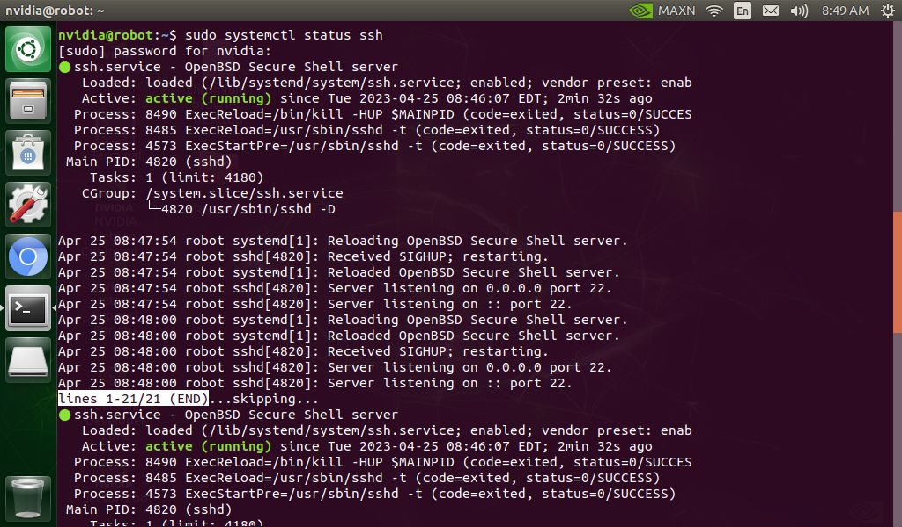

*Figura 1. Estado del servicio SSH.*

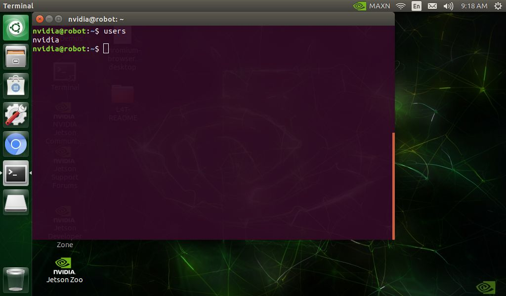

*Figura 2. Usuario actual del computador del robot con el comando users.*

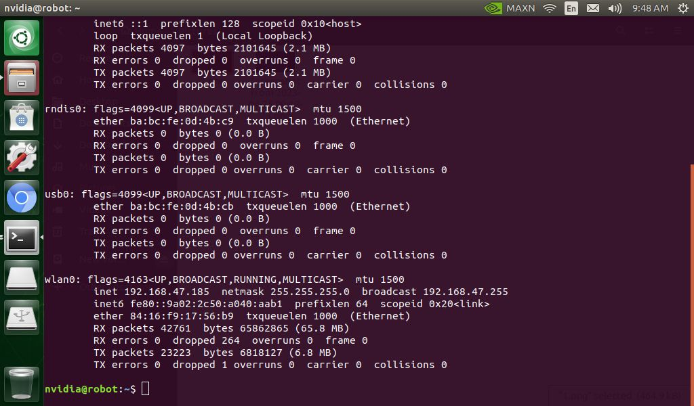

*Figura 3. Dirección IP del robot con ifconfig (o ip -4 addr).*

## 3. PRUEBA DESDE EL PC

**Terminal – PC**

```bash
ping 192.168.0.201
# o ssh usuario@robot1.local
ssh usuario@192.168.0.201
# acceso con llave, sin contraseña
ssh-keygen -t ed25519 && ssh-copy-id usuario@192.168.0.201
```

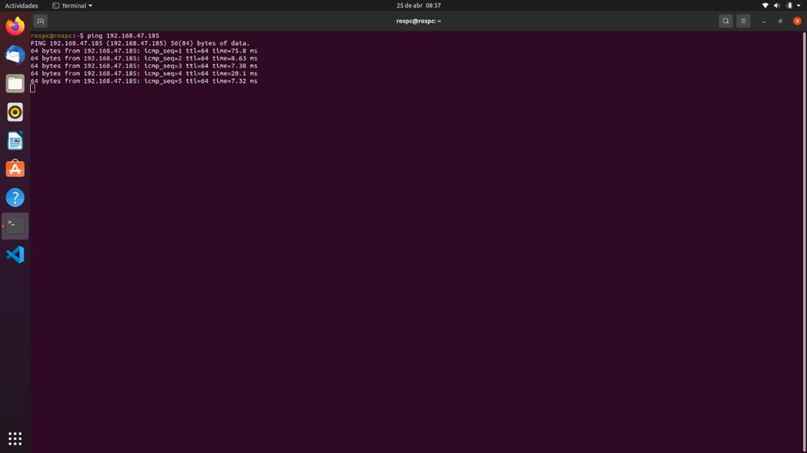

*Figura 4. Prueba de conectividad con ping desde el PC.*

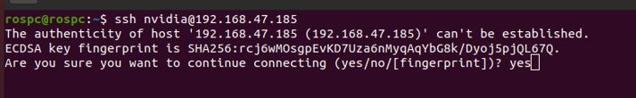

*Figura 5. Primera conexión por SSH: confirmar con yes la huella del servidor.*

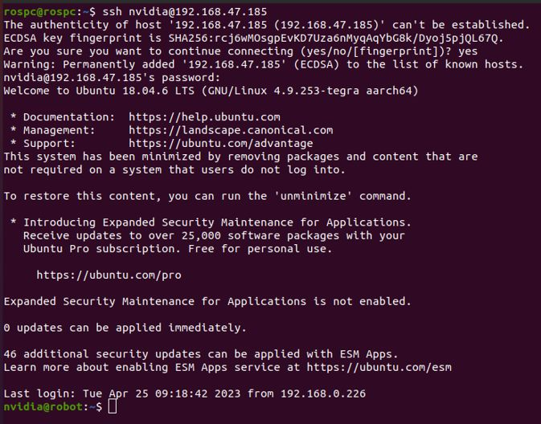

*Figura 6. Sesión SSH abierta en el robot tras escribir la contraseña.*

## 4. VS CODE REMOTE-SSH

VS Code Remote-SSH exige en el equipo remoto glibc ≥ 2.28 y libstdc++ ≥ 3.4.25; **Ubuntu 18.04 no está soportado** [1]. Por lo tanto:

*Tabla 2. Edición remota según el computador del robot.*

| **Computador del robot** | **Sistema** | **Remote-SSH** | **Cómo trabajar** |
|---|---|---|---|
| Jetson AGX Orin | Ubuntu 22.04 (JetPack 6.2) | Sí | Remote-SSH |
| Raspberry Pi 4 | Ubuntu 22.04 | Sí | Remote-SSH |
| Jetson Nano | Ubuntu 18.04 (JetPack 4.6.x) | No (glibc 2.27) | Editar robots\_ws en el PC y sincronizar con `rsync`/git, o editar por terminal (nano/vim) vía SSH |

Procedimiento con Remote-SSH (AGX o Pi): instale la extensión *Remote Development*, pulse el botón verde de la esquina inferior izquierda → *Connect to Host… → Add New SSH Host* → `ssh usuario@IP`, abra la carpeta `~/robots_ws` y marque «Sí, confío en los autores». La primera conexión descarga el servidor de VS Code, por lo que ambos equipos necesitan Internet.

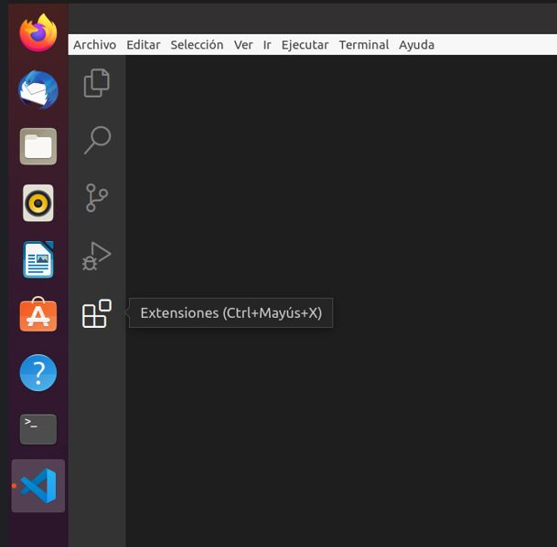

*Figura 7. Acceso a las extensiones de VS Code.*

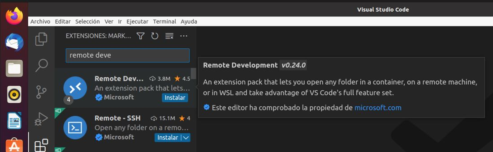

*Figura 8. Búsqueda de la extensión Remote Development.*

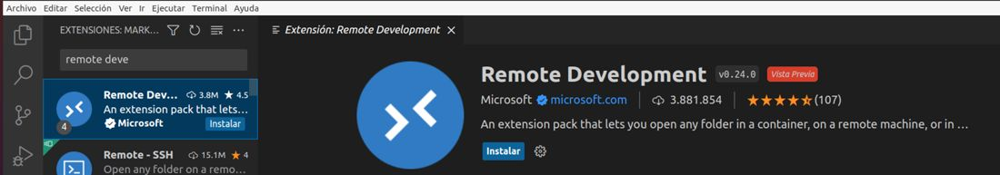

*Figura 9. Extensión Remote Development.*

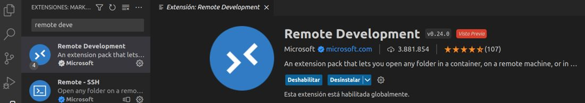

*Figura 10. Instalación de la extensión en curso.*

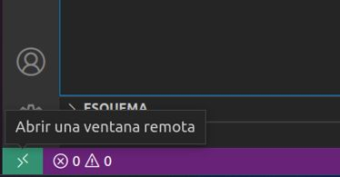

*Figura 11. Botón verde de conexiones remotas en la esquina inferior izquierda.*

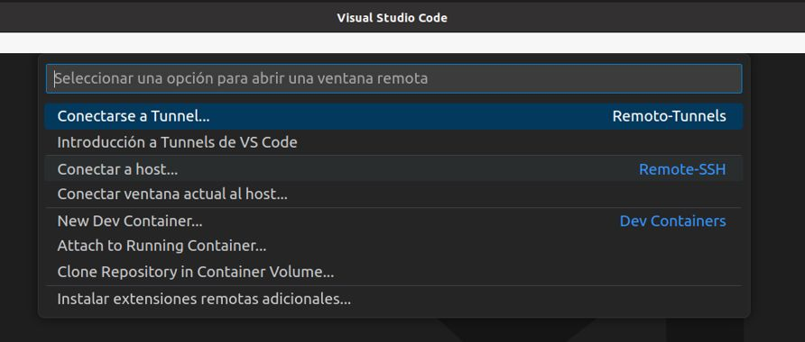

*Figura 12. Paleta de comandos: Remote-SSH, conectar al host.*

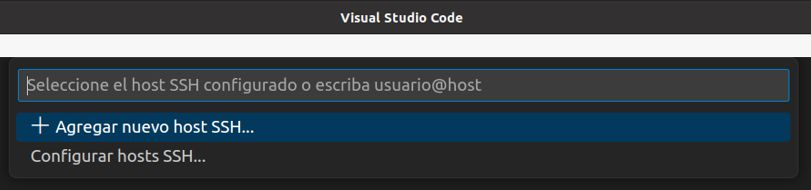

*Figura 13. Agregar un nuevo host SSH.*

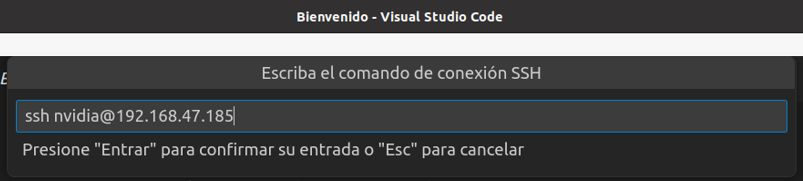

*Figura 14. Escribir ssh usuario@IP_DEL_ROBOT en la paleta de comandos.*

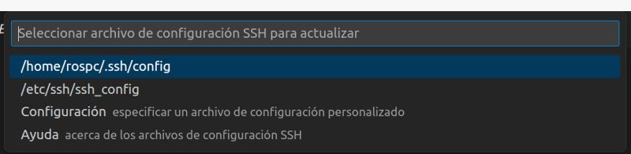

*Figura 15. Elegir el primer archivo de configuración SSH.*

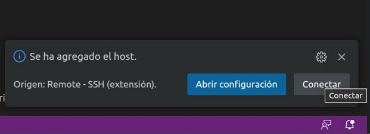

*Figura 16. Mensaje de host agregado: pulsar Conectar.*

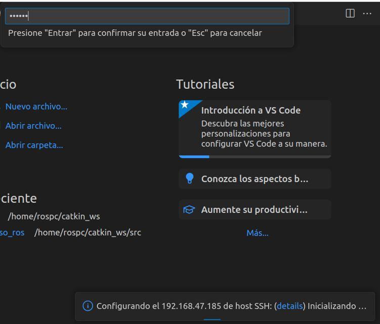

*Figura 17. Escribir la contraseña del robot y presionar Enter.*

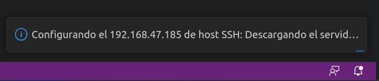

*Figura 18. VS Code descarga e instala su servidor en el robot (requiere Internet la primera vez).*

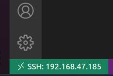

*Figura 19. Conexión SSH establecida: el botón inferior izquierdo muestra el host.*

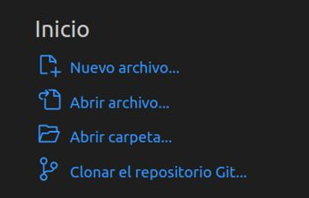

*Figura 20. Opción Abrir carpeta en la página de inicio.*

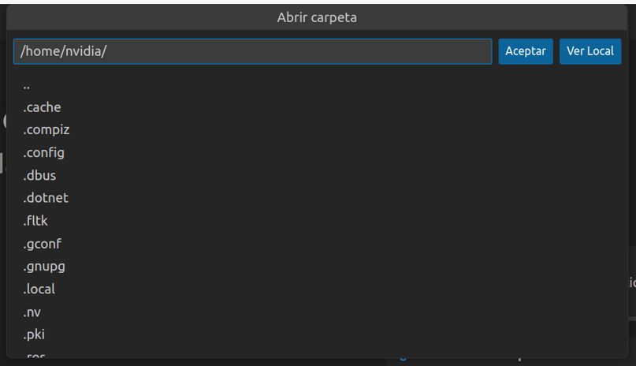

*Figura 21. Elegir la carpeta del robot que se va a abrir.*

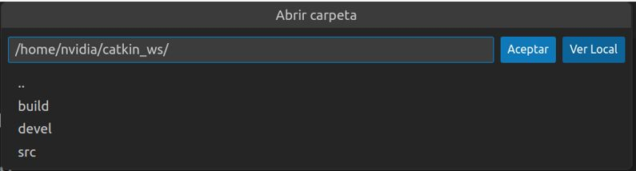

*Figura 22. Confirmar la carpeta con Aceptar.*

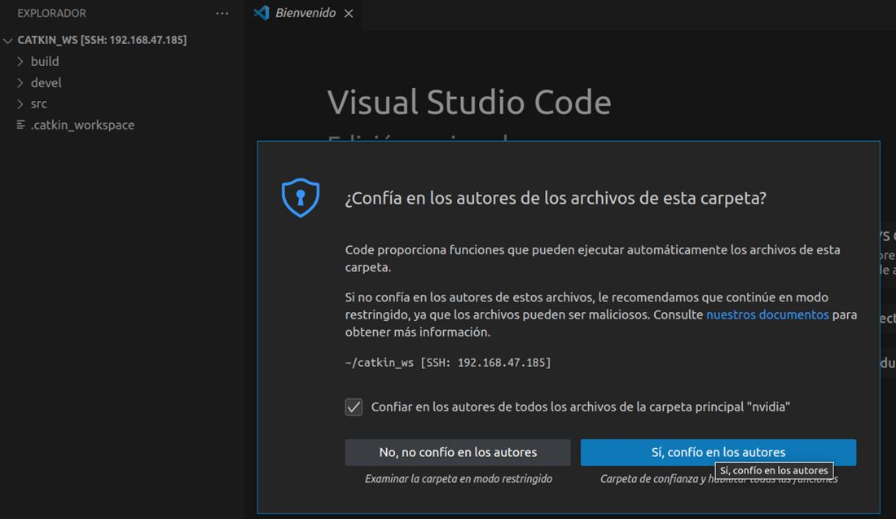

*Figura 23. Confiar en los autores de la carpeta.*

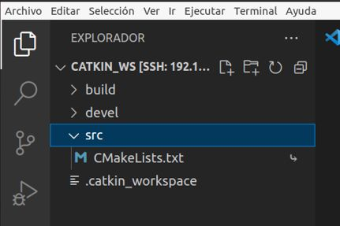

*Figura 24. Carpeta del robot abierta en VS Code remoto.*

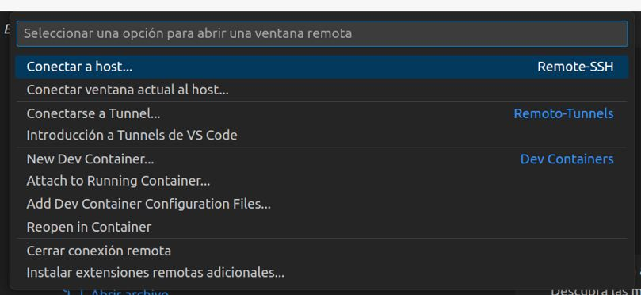

*Figura 25. Cerrar la conexión remota desde la paleta de comandos.*

Para la Nano, sincronice desde el PC después de editar:

**Terminal – PC**

```bash
rsync -av --exclude build --exclude install --exclude log ~/robots_ws/ usuario@robot1.local:~/robots_ws/
ssh usuario@robot1.local "cd ~/robots_ws/docker && ./run_nano.sh /root/robots_ws/docker/build_ws_nano.sh"
```

## 5. TERMINAL REMOTA CON REMMINA

Remmina (instalado por defecto en Ubuntu) también abre sesiones SSH: protocolo SSH, IP del robot, usuario y contraseña. Para escritorio remoto completo vea el DA-11.1 (VNC).

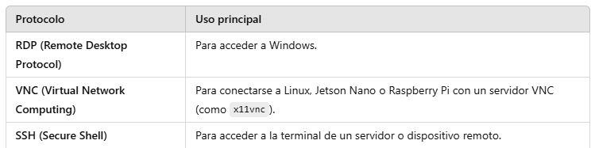

*Figura 26. Protocolos de Remmina y su uso principal: RDP, VNC y SSH.*

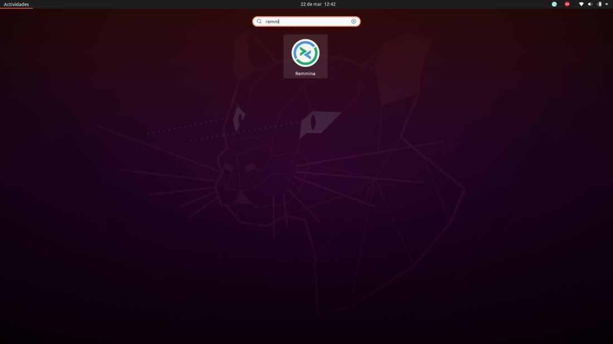

*Figura 27. Búsqueda de Remmina en las aplicaciones de Ubuntu.*

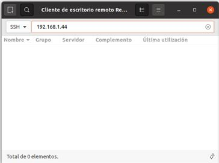

*Figura 28. Remmina: protocolo SSH y dirección IP del robot.*

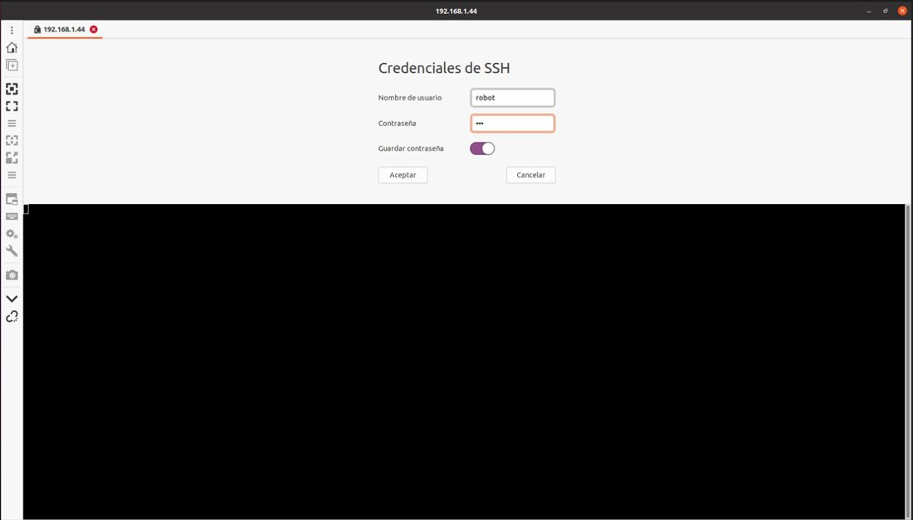

*Figura 29. Usuario y contraseña del robot.*

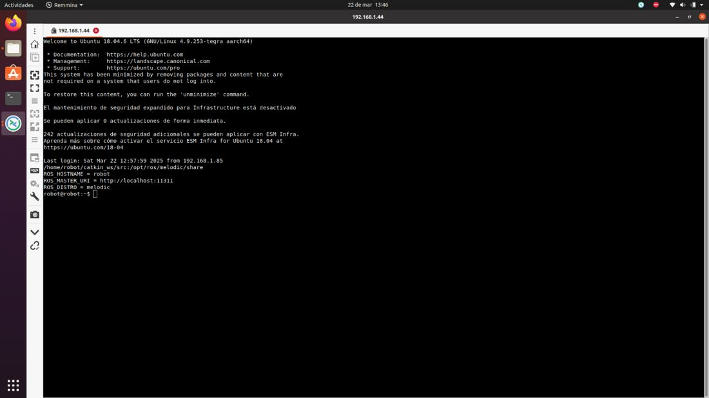

*Figura 30. Terminal remota del robot abierta en Remmina.*


*Figura 31. Botón para desconectar la sesión (barra lateral de Remmina).*

## REFERENCIAS

**[1]** Microsoft, *Remote Development with Linux* (requisitos del servidor: glibc ≥ 2.28). [En línea]. Disponible: [https://code.visualstudio.com/docs/remote/linux](https://code.visualstudio.com/docs/remote/linux)

**[2]** J. R. Cháux Cedeño, *Robótica básica – Semana 2: construcción y programación de un robot móvil (documentos de apoyo 8 a 18)*, SENA, 2022–2025.

**[3]** J. R. Cháux Cedeño, *robots\_ws – paquetes ROS 2 del curso (repositorio en GitHub, licencia Apache-2.0), 2026. [En línea]. Disponible: https://github.com/jchauxdev/robots\_ws*

**[4]** NVIDIA, Jetson AGX Orin Developer Kit User Guide – Quick Start Guide (headless setup: consola serie por USB-C, 115200 baudios, oem-config). [En línea]. Disponible: https://docs.nvidia.com/jetson/agx-orin-devkit/user-guide/latest/quick\_start.html

**[5]** NVIDIA Jetson AI Lab, Getting Started with Jetson (USB device mode: dirección fija 192.168.55.1; nmcli). [En línea]. Disponible: https://www.jetson-ai-lab.com/tutorials/getting-started-with-jetson/

**[6]** JetsonHacks, Jetson Nano – Headless Setup (micro-USB, puente J48, screen /dev/ttyACM0 115200, oem-config), 2019. [En línea]. Disponible: https://jetsonhacks.com/2019/08/21/jetson-nano-headless-setup/
