# Documento de Apoyo No. 11.1 (VNC) – Escritorio remoto del robot con x11vnc, Remmina y TightVNC.

> Versión en Markdown del documento de apoyo, para consultar y copiar comandos desde GitHub. El documento de Word (formato GFPI-F-135) no se publica en el repositorio.

**Duración Estimada:** 45 minutos.

**Sesión:** Día 2 – 03/11/2026, bloque 3 (2:00 p.m. – 5:00 p.m.).

**Relación con la Guía de Aprendizaje:** Actividad 3.3.2 – carpeta «11. INSTALACIÓN DE LINUX - ROS 2 - RPI - JETSON».

**Diseñado por:** Julián René Cháux Cedeño.

En la Jetson Nano (Ubuntu 18.04 con LightDM) se usa x11vnc [1], que comparte la sesión X real, como servicio systemd [3].

## 1. EN EL ROBOT

**Terminal – robot**

```bash
# elegir lightdm como gestor de pantalla
sudo apt update && sudo apt install -y lightdm x11vnc
# debe mostrar /usr/sbin/lightdm
cat /etc/X11/default-display-manager
# contraseña de VNC (no la deje en texto plano)
sudo x11vnc -storepasswd /etc/x11vnc.pass
sudo nano /etc/systemd/system/x11vnc.service
```

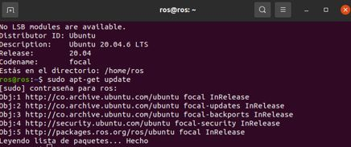

*Figura 1. Actualización de la lista de paquetes en el robot.*

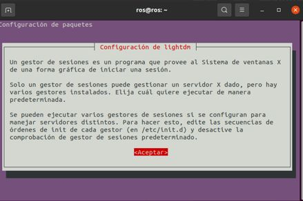

*Figura 2. Durante la instalación aparece la configuración de LightDM: Aceptar.*

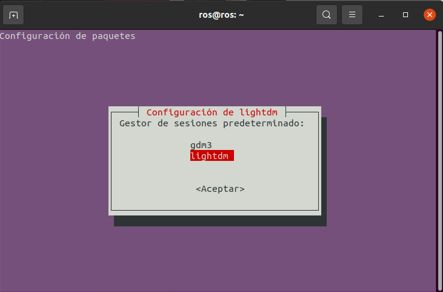

*Figura 3. Elegir lightdm como gestor de sesiones predeterminado.*


*Figura 4. Crear el archivo del servicio con nano.*


*Figura 5. Guardar con Ctrl + X, confirmar la ruta del archivo y salir.*

**/etc/systemd/system/x11vnc.service**

```
[Unit]
Description=x11vnc
After=display-manager.service network.target
[Service]
Type=simple
ExecStart=/usr/bin/x11vnc -forever -display :0 -auth guess -rfbauth /etc/x11vnc.pass -rfbport 5900
Restart=on-failure
[Install]
WantedBy=multi-user.target
```

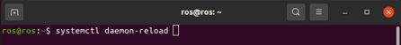

*Figura 6. Recargar systemd.*

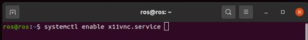

*Figura 7. Habilitar el servicio x11vnc al arranque.*

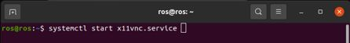

*Figura 8. Iniciar el servicio.*

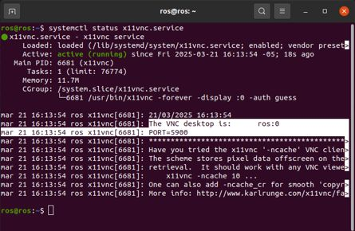

*Figura 9. Servicio x11vnc activo (running) escuchando en el puerto 5900.*

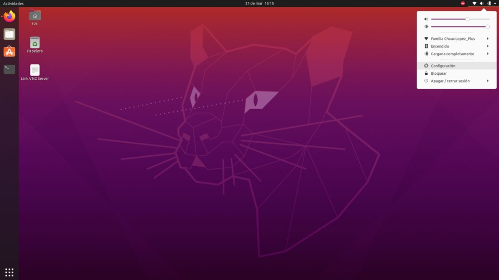

*Figura 10. En el robot, abrir Configuración para desactivar el bloqueo de pantalla (mejora el uso por VNC).*

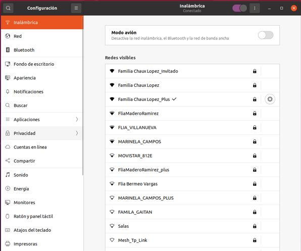

*Figura 11. Configuración → Privacidad.*

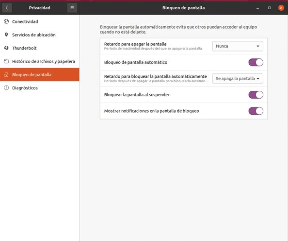

*Figura 12. Bloqueo de pantalla con las opciones activadas.*

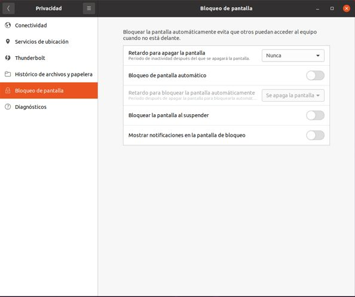

*Figura 13. Bloqueo de pantalla con todas las opciones desactivadas.*

**Terminal – robot**

```bash
sudo systemctl daemon-reload && sudo systemctl enable --now x11vnc.service
# active (running), puerto 5900
systemctl status x11vnc.service
```

> **Seguridad:**
>
> No escriba la contraseña en la línea de comandos (-passwd): con -rfbauth la contraseña queda cifrada en un archivo con permisos de root. VNC no cifra la sesión: úselo solo en la red del laboratorio o a través de un túnel SSH (`ssh -L 5900:localhost:5900 usuario@robot1`).

> **Ubuntu 22.04:**
>
> En la AGX Orin y en Ubuntu 22.04 con GNOME, x11vnc requiere sesión Xorg (no Wayland); como alternativa use el *Escritorio remoto* integrado de GNOME (Configuración → Compartir).

## 2. DESDE EL PC

Linux: Remmina → protocolo VNC → `IP:5900`. Windows: TightVNC Viewer [2] → `IP::5900`.

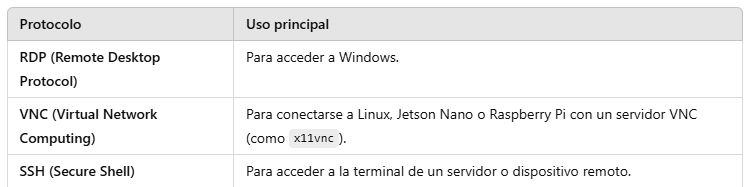

*Figura 14. Protocolos de Remmina y su uso principal.*

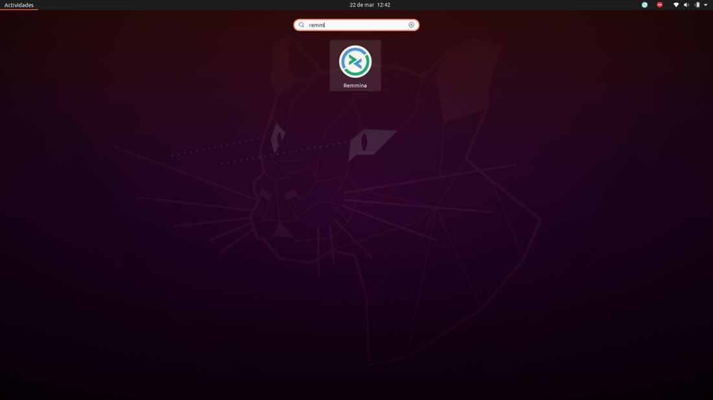

*Figura 15. Búsqueda de Remmina en las aplicaciones de Ubuntu.*

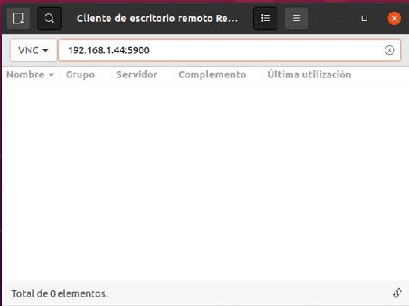

*Figura 16. Conexión VNC con Remmina.*

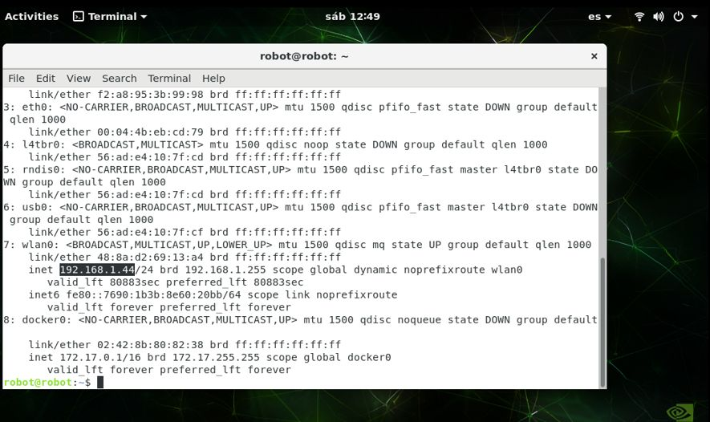

*Figura 17. Dirección IP del robot con ip addr.*

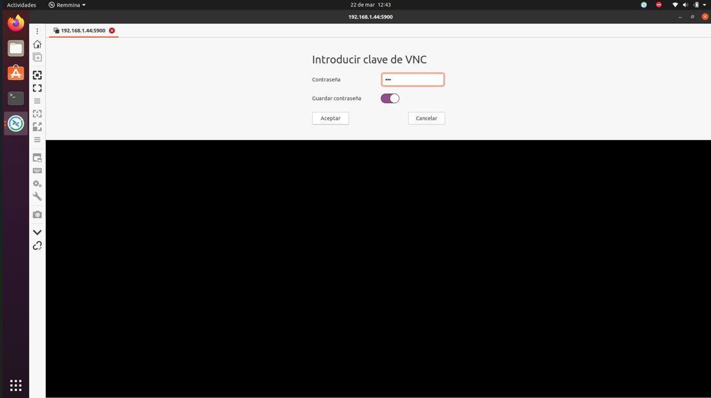

*Figura 18. Contraseña de VNC definida en el servicio.*

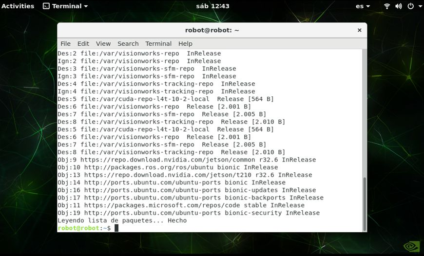

*Figura 19. Escritorio del robot por VNC desde Remmina.*

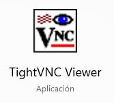

*Figura 20. TightVNC Viewer en Windows.*

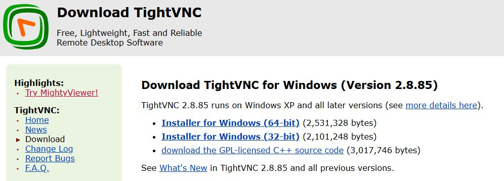

*Figura 21. Página de descarga de TightVNC (https://www.tightvnc.com/download.php).*

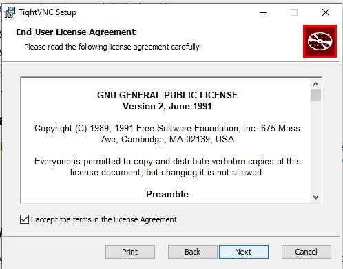

*Figura 22. Instalación de TightVNC: aceptar la licencia.*

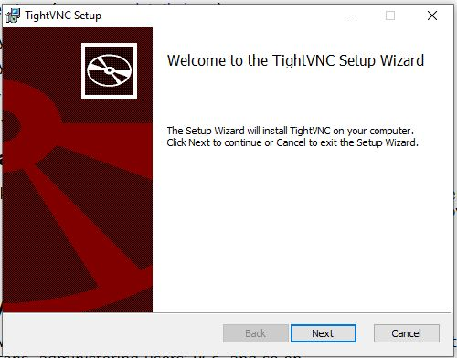

*Figura 23. Asistente de instalación de TightVNC.*

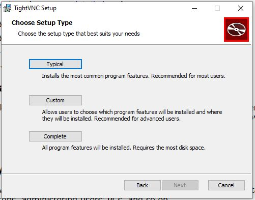

*Figura 24. Tipo de instalación: Typical.*

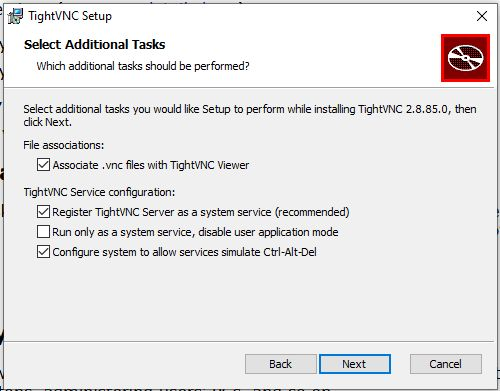

*Figura 25. Tareas adicionales de la instalación.*

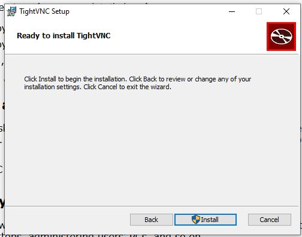

*Figura 26. Instalar.*

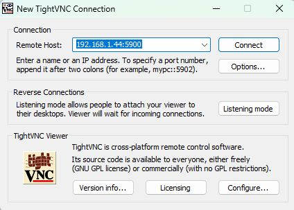

*Figura 27. TightVNC Viewer en Windows.*

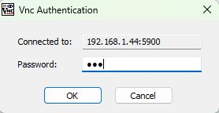

*Figura 28. Contraseña de VNC en TightVNC Viewer.*

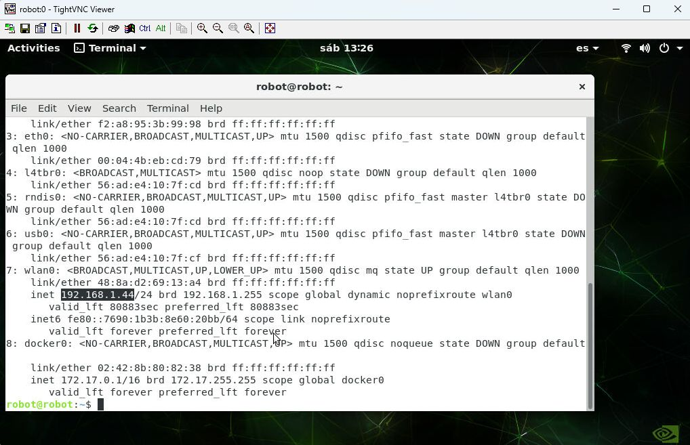

*Figura 29. Escritorio remoto del robot en TightVNC Viewer.*

## REFERENCIAS

**[1]** K. Runge *et al.*, *x11vnc – a VNC server for real X displays*. [En línea]. Disponible: [https://github.com/LibVNC/x11vnc](https://github.com/LibVNC/x11vnc)

**[2]** GlavSoft LLC, *TightVNC Download*. [En línea]. Disponible: [https://www.tightvnc.com/download.php](https://www.tightvnc.com/download.php)

**[3]** systemd project, *systemd.service — Service unit configuration*. [En línea]. Disponible: [https://www.freedesktop.org/software/systemd/man/latest/systemd.service.html](https://www.freedesktop.org/software/systemd/man/latest/systemd.service.html)

**[4]** J. R. Cháux Cedeño, *Robótica básica – Semana 2: construcción y programación de un robot móvil (documentos de apoyo 8 a 18)*, SENA, 2022–2025.
