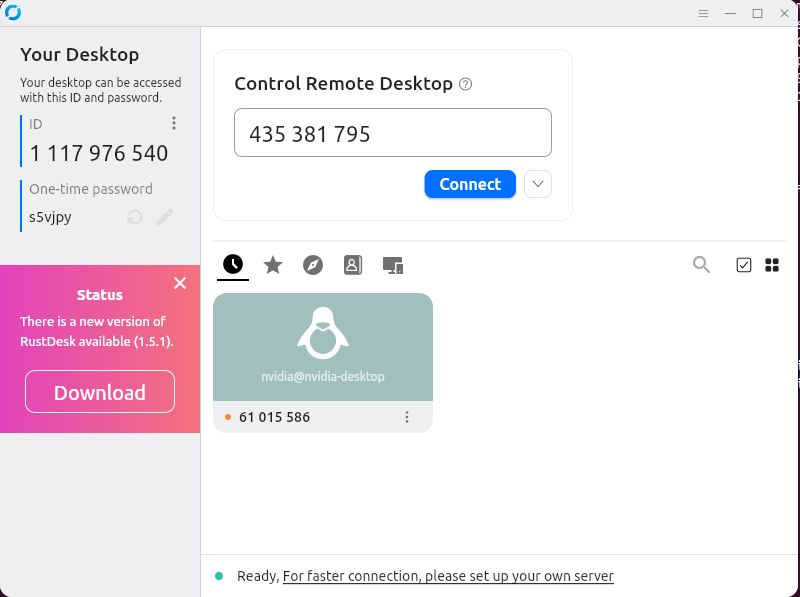
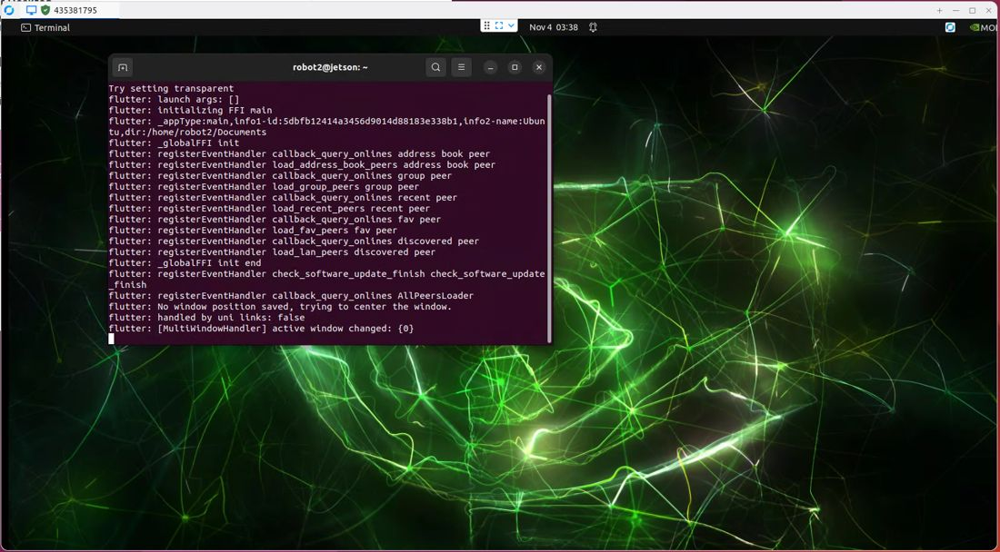

# Documento de Apoyo No. 11.1 (RustDesk) – Escritorio remoto del robot con RustDesk.

> Versión en Markdown del documento de apoyo, para consultar y copiar comandos desde GitHub. El documento de Word (formato GFPI-F-135) no se publica en el repositorio.

**Duración Estimada:** 30 minutos.

**Sesión:** Día 2 – 03/11/2026, bloque 3 (2:00 p.m. – 5:00 p.m.).

**Relación con la Guía de Aprendizaje:** Actividad 3.3.2 – carpeta «11. INSTALACIÓN DE LINUX - ROS 2 - RPI - JETSON», subcarpeta «7. ESCRITORIO REMOTOR RUSTDESK».

**Diseñado por:** Julián René Cháux Cedeño.

## 1. QUÉ ES RUSTDESK

RustDesk es un programa de escritorio remoto libre y gratuito [2]: desde el PC se ve y se maneja el escritorio del computador del robot (Jetson o Raspberry Pi) como si se tuviera su monitor, teclado y mouse. Sirve para usar programas gráficos del robot, como RViz2, sin conectarle una pantalla.

Cada equipo con RustDesk tiene un **ID** (un número) y una **contraseña**. Para conectarse, en el PC se escribe el ID del robot y luego su contraseña. Por eso **RustDesk se instala en los dos equipos**: en el robot, que es el que se controla, y en el PC, desde el que se controla.

*Tabla 1. Qué se instala en cada equipo.*

| **Equipo** | **Papel** | **Paquete de RustDesk** |
|---|---|---|
| Jetson (Orin Nano, AGX Orin) o Raspberry Pi 4, Ubuntu 22.04 | Se controla (robot) | rustdesk-1.5.1-aarch64.deb |
| PC con Ubuntu 22.04 | Controla | rustdesk-1.5.1-x86\_64.deb |
| PC con Windows | Controla | rustdesk-1.5.1-x86\_64.exe |

> **Nota:**
>
> Para escribir comandos en el robot basta SSH (DA-11.1 SSH y VS Code). RustDesk se usa cuando se necesita ver su escritorio.

## 2. PROCEDIMIENTO

### Paso 1. Instalar RustDesk en el robot

En la Jetson o la Raspberry Pi, con conexión a Internet (por SSH o en su escritorio), descargue e instale el paquete para arm64 [1]:

**Terminal – robot (Jetson o Raspberry Pi)**

```bash
wget https://github.com/rustdesk/rustdesk/releases/download/1.5.1/rustdesk-1.5.1-aarch64.deb
sudo apt install ./rustdesk-1.5.1-aarch64.deb
```

### Paso 2. Instalar RustDesk en el PC

**Terminal – PC (Ubuntu)**

```bash
wget https://github.com/rustdesk/rustdesk/releases/download/1.5.1/rustdesk-1.5.1-x86_64.deb
sudo apt install ./rustdesk-1.5.1-x86_64.deb
```

**PC con Windows:** descargue `rustdesk-1.5.1-x86_64.exe` de la misma página de versiones [1] y ejecútelo; puede usarse sin instalar o instalarse con el botón *Instalar* de la ventana.

### Paso 3. Abrir RustDesk en el robot y anotar su ID

En el escritorio del robot abra RustDesk desde el menú de aplicaciones (o escriba `rustdesk` en una terminal del escritorio). La ventana está en inglés: a la izquierda, en *Your Desktop*, muestra el **ID** y la **contraseña de un solo uso** (*One-time password*) de ese equipo (Figura 1). Anote los dos.



*Figura 1. Ventana de RustDesk: a la izquierda, el ID y la contraseña de un solo uso (One-time password) de este equipo; a la derecha, el campo Control Remote Desktop, donde se escribe el ID del equipo al que se quiere conectar.*

La contraseña de un solo uso cambia cada vez que se abre RustDesk. Para entrar siempre sin que alguien esté junto al robot, defina una **contraseña permanente**: en RustDesk, menú ☰ → *Settings → Security → Unlock security settings*, y en *Password* elija *Use permanent password* y escríbala. Use una contraseña segura y no la comparta fuera del equipo de trabajo.

**Terminal – robot (Jetson o Raspberry Pi)**

```bash
# el servicio de RustDesk arranca con el equipo
systemctl status rustdesk
```

### Paso 4. Conectarse desde el PC

1. Abra RustDesk en el PC.
1. En *Control Remote Desktop* escriba el ID del robot y pulse *Connect*.
1. Escriba la contraseña del robot (la de un solo uso o la permanente) y pulse *OK*.

Se abre una ventana con el escritorio del robot (Figura 2); en la pestaña superior aparece el ID del equipo remoto. El mouse y el teclado del PC manejan el robot. Para terminar, cierre esa ventana.



*Figura 2. Escritorio de la Jetson (sesión robot2@jetson) visto desde el PC con RustDesk; en la pestaña superior, el ID del equipo remoto.*

> **Precaución:**
>
> Si aparece una pantalla negra o *No displays*, el robot no tiene un escritorio activo: conéctele un monitor o un emulador de pantalla HDMI (dummy plug) e inicie sesión. Si la conexión no avanza, revise que los dos equipos tengan Internet.

> **Nota:**
>
> Por defecto la conexión pasa por los servidores públicos de RustDesk, aunque los equipos estén en la misma red. Dentro del aula puede conectarse directo por IP: en el robot active *Settings → Security → Enable direct IP access* y en el PC escriba la IP del robot (por ejemplo `192.168.0.201`, DA-13.1) en lugar del ID [2].

## 3. VERIFICACIÓN Y EVIDENCIAS

*Tabla 2. Lista de verificación.*

| **#** | **Criterio** | **Evidencia** |
|---|---|---|
| 1 | RustDesk instalado en el robot y en el PC | Captura de la ventana de RustDesk en cada equipo |
| 2 | Contraseña permanente configurada en el robot | Settings → Security |
| 3 | Escritorio del robot manejado desde el PC | Captura como la Figura 2 |

## REFERENCIAS

**[1]** RustDesk, *RustDesk 1.5.1 – Releases* (paquetes .deb para aarch64 y x86\_64, instalador .exe para Windows). [En línea]. Disponible: [https://github.com/rustdesk/rustdesk/releases/tag/1.5.1](https://github.com/rustdesk/rustdesk/releases/tag/1.5.1)

**[2]** RustDesk, *Documentación del cliente RustDesk* (ID, contraseña, acceso por IP directa). [En línea]. Disponible: [https://rustdesk.com/docs/es/client/](https://rustdesk.com/docs/es/client/)
