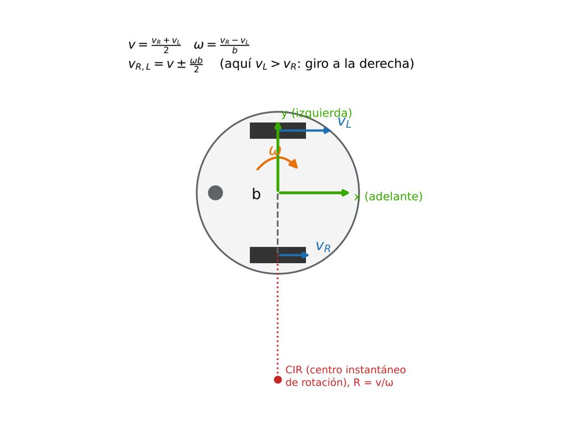
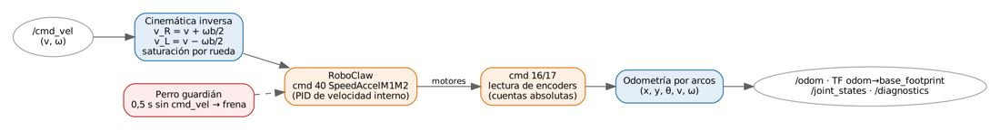
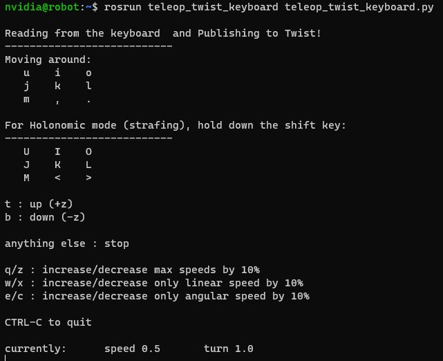

# Documento de Apoyo No. 12.1 – Driver ROS 2 del RoboClaw: instalación, configuración, odometría y pruebas.

> Versión en Markdown del documento de apoyo, para consultar y copiar comandos desde GitHub. El documento de Word (formato GFPI-F-135) no se publica en el repositorio.

**Duración Estimada:** 2 horas.

**Sesión:** Día 3 – 04/11/2026, bloque 1 (8:00 a.m. – 12:00 m.).

**Relación con la Guía de Aprendizaje:** Actividad 3.3.3 – carpeta «12. LIBRERÍA CONTROL MOTORES - ROBOCLAW».

**Diseñado por:** Julián René Cháux Cedeño.

## 1. OBJETIVOS DE APRENDIZAJE

- Explicar la cinemática directa e inversa del robot diferencial y la odometría por encoders.
- Instalar y configurar `mr_base` (puerto, dirección, encoders, geometría, mapeo de motores).
- Verificar el sentido de giro y de los encoders y corregirlo por parámetros.
- Teleoperar el robot y comprobar `/odom`, la TF `odom → base_footprint` y el diagnóstico.

## 2. FUNDAMENTOS

### 2.1 Cinemática diferencial



*Figura 1. Modelo del robot diferencial (REP 103: x adelante, y izquierda, giro antihorario positivo).*

Con velocidades de rueda v\_L, v\_R y separación entre ruedas b, la velocidad lineal y angular del robot son [5]:

$$v=\frac{{v}_{R}+{v}_{L}}{2},  \omega =\frac{{v}_{R}-{v}_{L}}{b} \qquad (1)$$

y, a la inversa, lo que el driver envía a cada rueda cuando recibe `cmd_vel = (v, ω)`:

$${v}_{R}=v+\frac{\omega  b}{2},  {v}_{L}=v-\frac{\omega  b}{2} \qquad (2)$$

El RoboClaw trabaja en cuentas de encoder por segundo. La conversión usa los **pulsos por metro** de la rueda:

$$k=\frac{CPR\cdot N}{\pi D} \left[ \frac{cuentas}{m} \right],  {q}_{R,L}=k {v}_{R,L} \left[ \frac{cuentas}{s} \right] \qquad (3)$$

CPR son las cuentas por vuelta del eje del **motor** (48 en el Pololu 25D, 64 en el 37D, contando los cuatro flancos de la cuadratura), N la relación de la caja y D el diámetro de la rueda [9].

*Tabla 1. Pulsos por metro nominales según el motor (Ec. 3).*

| **Motor** | **CPR motor** | **N exacta** | **Cuentas por vuelta de rueda** | **k con D = 90 mm [cuentas/m]** |
|---|---|---|---|---|
| Pololu 25D 47:1 (#4846) | 48 | 46,85 | 2248,8 | 7953 |
| Pololu 37D 100:1 | 64 | 100 | 6400 | 22 635 |
| Pololu 37D 131:1 (#4756) | 64 | 131,25 | 8400 | 29 709 |
| Pololu 37D 150:1 | 64 | 150 | 9600 | 33 953 |

> **Valor de ticks\_per\_meter:**
>
> No copie valores de otros robots ni ajustes «a prueba y error»: el modelo CAD del robot usa ruedas de 90 mm. Use la Tabla 1 como valor inicial y obtenga el definitivo con la calibración del DA-12.2.

### 2.2 Odometría

Entre dos lecturas de encoder, cada rueda avanza Δs\_L y Δs\_R (cuentas / k). El robot recorre un arco:

$$\Delta s=\frac{\Delta {s}_{R}+\Delta {s}_{L}}{2}, \Delta \theta =\frac{\Delta {s}_{R}-\Delta {s}_{L}}{b}, x+=\frac{\Delta s}{\Delta \theta }\left[ sin\left( \theta +\Delta \theta  \right)-sin\theta  \right], y-=\frac{\Delta s}{\Delta \theta }\left[ cos\left( \theta +\Delta \theta  \right)-cos\theta  \right] \qquad (4)$$

(si Δθ ≈ 0, x += Δs cos θ, y += Δs sin θ). El resultado se publica como `nav_msgs/Odometry` y como la transformación `odom → base_footprint` [8], siguiendo REP 105 [7]. La odometría acumula error sin límite (deslizamiento, diámetro y separación mal conocidos): por eso se calibra (DA-12.2) y luego se corrige con el lidar (AMCL, DA-18.1).

### 2.3 El nodo mr_base



*Figura 2. Flujo del nodo mr_base.*

`mr_base` (paquete del curso [12]) es el driver ROS 2 del RoboClaw. Implementa en Python 3 el subconjunto del protocolo Packet Serial común a las librerías oficiales actual [2] y *legacy* [3], y fue verificado contra la librería oficial. Basicmicro publica además un driver basado en ros2\_control [4], más completo y más complejo; para el curso se prefirió un nodo corto y legible.

## 3. PROCEDIMIENTO

### Paso 1. Incorporar mr_description y mr_bringup a robots_ws (PC y robot)

| **Paquete / carpeta** | **Para qué sirve** | **Qué contiene** | **Dónde se usa** |
|---|---|---|---|
| `src/mr_description` | Modelo del robot (URDF/Xacro): describe sus piezas, medidas y la posición de las ruedas, el lidar y la cámara; con él se publican las TF fijas y se ve el robot en RViz y Gazebo. | urdf/mr\_robot.urdf.xacro y mr\_robot.gazebo.xacro, mallas exportadas de SolidWorks, launch description y display, rviz/robot.rviz. | PC (RViz, Gazebo) y computador del robot (robot\_state\_publisher). |
| `src/mr_bringup` | Arranque del robot: archivos launch que encienden de una vez los nodos de cada situación (robot real, robot virtual, Gazebo, SLAM, navegación, RViz). | launch/ robot, virtual, gazebo, slam, navigation, rviz y realsense\_scan; config/ mr\_base, nav2\_params, slam\_toolbox, usb\_cam y estaciones.yaml; maps/laboratorio; rviz/. | PC y computador del robot. |

Se agrega con estos comandos:

> **Nota:**
>
> **Qué bloque usar:** ejecute solo el bloque de su equipo. PC, Jetson Orin Nano, Jetson AGX Orin (Developer Kit o Seeed) y Raspberry Pi → bloque «PC y robot (Orin Nano, AGX Orin o Raspberry Pi)», con ROS 2 instalado directamente. Jetson Nano → bloque «Jetson Nano», que trabaja dentro del contenedor (run\_nano.sh); en los demás equipos no existe la carpeta ~/robots\_ws/docker. Si no sabe cuál Jetson tiene: cat /etc/nv\_tegra\_release muestra R32 en la Jetson Nano y R36 en las Orin.

**Terminal – PC y robot (Orin Nano, AGX Orin o Raspberry Pi)**

```bash
# PC y computador del robot (Ubuntu 22.04 + Humble). En la Jetson Nano: DA-11.2 (contenedor)
# Paso 0: mr_base y mr_sim ya están en robots_ws (DA-9.1); se agregan el modelo y los lanzadores
# trae lo nuevo del repositorio (correcciones y mejoras)
cd ~/robots_ws && git pull
cd ~/robots_ws && git sparse-checkout add src/mr_description src/mr_bringup
# instala las dependencias de los paquetes agregados
rosdep install --from-paths ~/robots_ws/src --ignore-src -r -y --skip-keys "mr_navigation jc_driver"
cd ~/robots_ws
colcon build --symlink-install
source install/setup.bash
# mr_base mr_bringup mr_description mr_sim
ros2 pkg list | grep mr_
# DA-12.3 (si no lo hizo en el DA-9.1)
sudo cp src/mr_base/udev/99-mr-robot.rules /etc/udev/rules.d/
sudo udevadm control --reload-rules && sudo udevadm trigger && ls -l /dev/roboclaw
```

**Jetson Nano:** los paquetes se agregan en la Nano (fuera del contenedor, método clásico de sparse-checkout) y se compilan dentro del contenedor (DA-11.2). En los pasos siguientes anteponga `./run_nano.sh` (desde `~/robots_ws/docker`) a los comandos `ros2`, por ejemplo `./run_nano.sh ros2 run mr_base check_roboclaw --port /dev/roboclaw --probar`.

**Terminal – Jetson Nano**

```bash
# Paso 0 en la Nano: mr_base ya está (DA-11.2); se agregan el modelo y los lanzadores
# trae lo nuevo del repositorio (correcciones y mejoras)
cd ~/robots_ws && git pull
cd ~/robots_ws && printf '/src/mr_description/\n/src/mr_bringup/\n' >> .git/info/sparse-checkout && git read-tree -mu HEAD
cd ~/robots_ws/docker && ./run_nano.sh /root/robots_ws/docker/build_ws_nano.sh
# mr_base mr_bringup mr_description
./run_nano.sh ros2 pkg list | grep mr_
```

### Paso 2. Parámetros

Edite `~/robots_ws/src/mr_bringup/config/mr_base.yaml` (o una copia) con los datos de su robot:

*Tabla 2. Parámetros principales de mr_base.*

| **Parámetro** | **Valor inicial** | **Significado** |
|---|---|---|
| `port` | /dev/roboclaw | Enlace fijo creado por la regla udev |
| `baud`, `address` | 38400, 128 | Iguales a Motion Studio (DA-10.1) |
| `encoder_cpr`, `gear_ratio` | 48, 46.85 | Motor (Tabla 1) |
| `wheel_diameter` | 0.090 | Diámetro medido [m] |
| `ticks_per_meter` | 0.0 | 0 = se calcula con la Ec. 3; tras calibrar se escribe el valor medido |
| `wheel_separation` | 0.2016 | b medido [m]; se ajusta en la calibración angular |
| `left_motor` | 2 | Canal del motor izquierdo (M2 en el cableado del curso) |
| `invert_left`, `invert_right` | false | true si ese encoder cuenta hacia atrás al avanzar |
| `max_linear_speed`, `max_wheel_speed` | 0.40, 0.50 | Límites [m/s]; ≤ 80 % de QPPS/k |
| `acceleration` | 0.6 | Rampa del comando 40 [m/s²] |
| `cmd_timeout` | 0.5 | Si no llega cmd\_vel en este tiempo, el robot frena |

### Paso 3. Sentido de giro y encoders (ruedas levantadas)

> **Seguridad:**
>
> NO realice conexiones eléctricas definitivas sin la verificación previa del instructor. Antes de energizar: polaridad de la batería, interruptor y paro de emergencia en serie, regulador ajustado al voltaje de la Jetson y ruedas levantadas en la primera prueba de motores.

**Terminal – robot**

```bash
ros2 run mr_base check_roboclaw --port /dev/roboclaw --probar
# M1: velocidad +693 QPPS -> encoder +1380 cuentas (OK, mismo signo)
# M2: velocidad +693 QPPS -> encoder +1377 cuentas (OK, mismo signo)
```

Luego lance el nodo y pida avance lento. **Ambas ruedas deben girar hacia adelante** y `/odom` debe mostrar x creciente; un giro antihorario (`angular.z > 0`) debe aumentar θ. Si una rueda va al revés, intercambie los cables de potencia de ese motor (y vuelva a hacer el Autotune) o use `invert_*`; si el robot gira cuando debería avanzar, revise `left_motor`.

**Terminal – robot**

```bash
# o: ros2 launch mr_bringup robot.launch.py
ros2 launch mr_base base.launch.py
# Ctrl+C para parar
ros2 topic pub -r 10 /cmd_vel geometry_msgs/msg/Twist "{linear: {x: 0.05}}"
ros2 topic echo /odom --field pose.pose.position
# bateria, temperatura, corrientes, estado
ros2 topic echo /diagnostics --once
```

### Paso 4. Teleoperación

Coloque el robot en el piso con espacio libre y teleopere con `teleop_twist_keyboard` [10]. Gracias al perro guardián, si la terminal deja de publicar el robot se detiene en 0,5 s.

**Terminal – robot**

```bash
sudo apt install ros-humble-teleop-twist-keyboard
# i adelante, j/l giro, k parar, q/z velocidad
ros2 run teleop_twist_keyboard teleop_twist_keyboard
```



*Figura 3. Teclas de teleop_twist_keyboard.*

### Paso 5. Movimientos medidos

La herramienta `mover` cierra el lazo sobre `/odom` con un perfil trapezoidal y frenado anticipado (descuenta la latencia del lazo), de modo que el robot se detiene donde la odometría indica la meta:

**Terminal – robot**

```bash
# 1 m hacia adelante
ros2 run mr_base mover avanzar 1.0
# 0,5 m en reversa
ros2 run mr_base mover avanzar -0.5
# 90 grados antihorario
ros2 run mr_base mover girar 90
```

En el robot virtual del curso el error de parada medido fue ≤ 2,6 mm entre 0,5 y 2 m y ≤ 0,6° entre 90° y 360°. Que el robot **realmente** recorra 1 m depende de que k y b estén calibrados (DA-12.2).

### Paso 6. Robot virtual (sin hardware)

`mr_sim` emula el RoboClaw en un puerto serie virtual con el mismo protocolo, motores con rampa y una geometría «real» distinta de la nominal; `mr_base` es el mismo nodo del robot real:

**Terminal – PC (robot virtual)**

```bash
ros2 launch mr_bringup virtual.launch.py
ros2 run teleop_twist_keyboard teleop_twist_keyboard
```

## 4. SOLUCIÓN DE PROBLEMAS

*Tabla 3. Diagnóstico rápido.*

| **Síntoma** | **Causa probable** | **Acción** |
|---|---|---|
| `No se pudo abrir /dev/roboclaw` | Regla udev no instalada o usuario sin permisos | DA-12.3; `ls -l /dev/ttyACM*` |
| `Lectura de encoders fallida` | Dirección o modo distinto de Packet Serial | Revise DA-10.1 (128, Packet Serial) |
| El robot no se mueve, el encoder sí cuenta | QPPS = 0 (sin Autotune) | Haga el Autotune y Write Settings |
| Zumbido de motores detenido | PID activo con consigna 0 | `mr_base` pasa a ciclo útil 0 al detenerse |
| Avanza en curva | Diámetros distintos o PID desigual | DA-12.2 (`left_scale`, `right_scale`) |
| mr\_base se detiene o avisa «Se perdió la conexión con el RoboClaw» al arrancar los motores (versiones anteriores: SerialException: device reports readiness to read but returned no data) | Otro programa usa /dev/roboclaw (ModemManager, el servicio mr-robot o un segundo mr\_base) o el USB se desconecta por una caída de tensión o ruido | sudo fuser -v /dev/roboclaw debe mostrar solo base\_node; sudo systemctl disable --now ModemManager; sudo systemctl stop mr-robot si lanza el robot a mano. Con sudo dmesg -w abierto, si aparece «USB disconnect»: batería, cable USB corto con ferrita y lejos de los cables de los motores. mr\_base se reconecta solo |

> **Insertar imagen:**
>
> *Salida de* `check_roboclaw --probar`*, captura de* `/odom` *y video corto de la teleoperación.*

## REFERENCIAS

**[1]** B. Bazemore, *roboclaw\_ros (ROS 1)*. [En línea]. Disponible: [https://github.com/sonyccd/roboclaw_ros](https://github.com/sonyccd/roboclaw_ros)

**[2]** Basicmicro Motion Control, *basicmicro\_python – Python 3 library for Basicmicro packet serial* (v2.0.10, licencia MIT). [En línea]. Disponible: [https://github.com/basicmicro/basicmicro_python](https://github.com/basicmicro/basicmicro_python)

**[3]** Basicmicro Motion Control, *roboclaw\_python\_library (legacy: RoboClaw V5 y anteriores)*. [En línea]. Disponible: [https://github.com/basicmicro/roboclaw_python_library](https://github.com/basicmicro/roboclaw_python_library)

**[4]** Basicmicro Motion Control, *basicmicro\_ros2 – ROS 2 driver (ros2\_control)*. [En línea]. Disponible: [https://github.com/basicmicro/basicmicro_ros2](https://github.com/basicmicro/basicmicro_ros2)

**[5]** R. Siegwart, I. R. Nourbakhsh y D. Scaramuzza, *Introduction to Autonomous Mobile Robots*, 2nd ed. Cambridge, MA, USA: MIT Press, 2011.

**[6]** T. Foote y M. Purvis, *REP 103 – Standard Units of Measure and Coordinate Conventions*. [En línea]. Disponible: [https://www.ros.org/reps/rep-0103.html](https://www.ros.org/reps/rep-0103.html)

**[7]** W. Meeussen, *REP 105 – Coordinate Frames for Mobile Platforms*. [En línea]. Disponible: [https://www.ros.org/reps/rep-0105.html](https://www.ros.org/reps/rep-0105.html)

**[8]** T. Foote, "tf: The transform library," en *Proc. IEEE Int. Conf. Technologies for Practical Robot Applications (TePRA)*, 2013, pp. 1–6, doi: 10.1109/TePRA.2013.6556373.

**[9]** Pololu Corporation, *47:1 Metal Gearmotor 25Dx67L mm HP 12V with 48 CPR Encoder* (item #4846; relación 46,85:1; 2248,86 cuentas/vuelta). [En línea]. Disponible: [https://www.pololu.com/product/4846](https://www.pololu.com/product/4846)

**[10]** ROS 2, *teleop\_twist\_keyboard* (Humble 2.4.1). [En línea]. Disponible: [https://github.com/ros2/teleop_twist_keyboard](https://github.com/ros2/teleop_twist_keyboard)

**[11]** J. R. Cháux Cedeño, *Robótica básica – Semana 2: construcción y programación de un robot móvil (documentos de apoyo 8 a 18)*, SENA, 2022–2025.

**[12]** J. R. Cháux Cedeño, *robots\_ws – paquetes ROS 2 del curso (repositorio en GitHub, licencia Apache-2.0), 2026. [En línea]. Disponible: https://github.com/jchauxdev/robots\_ws*
