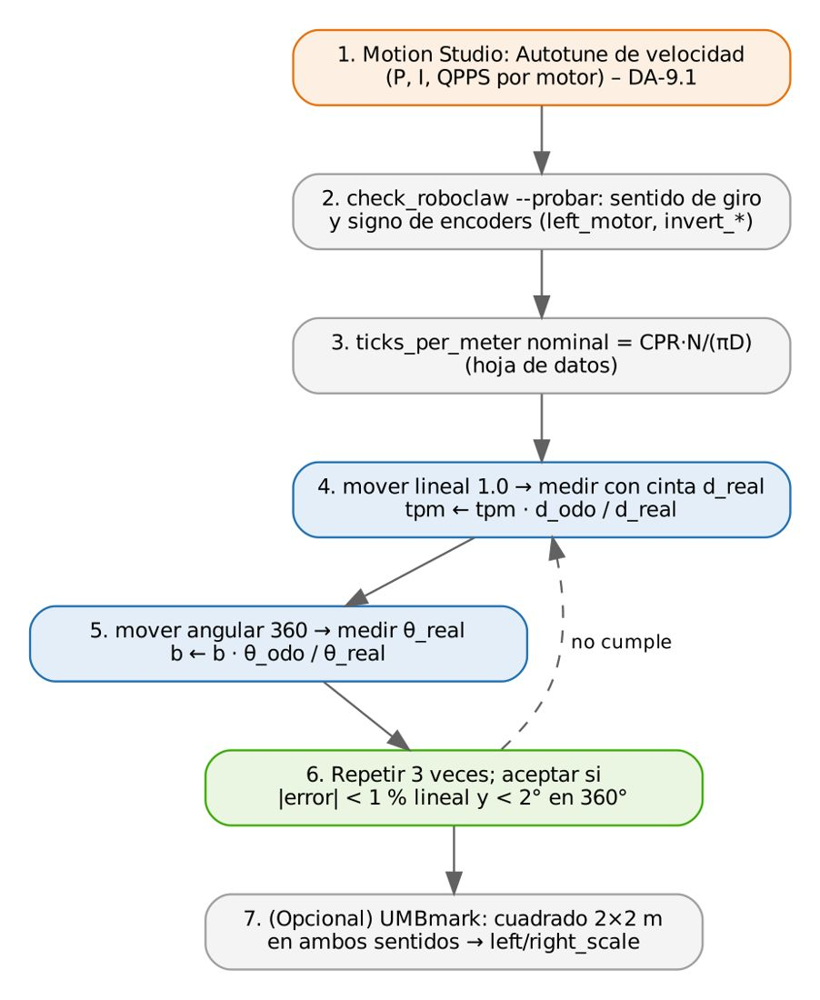
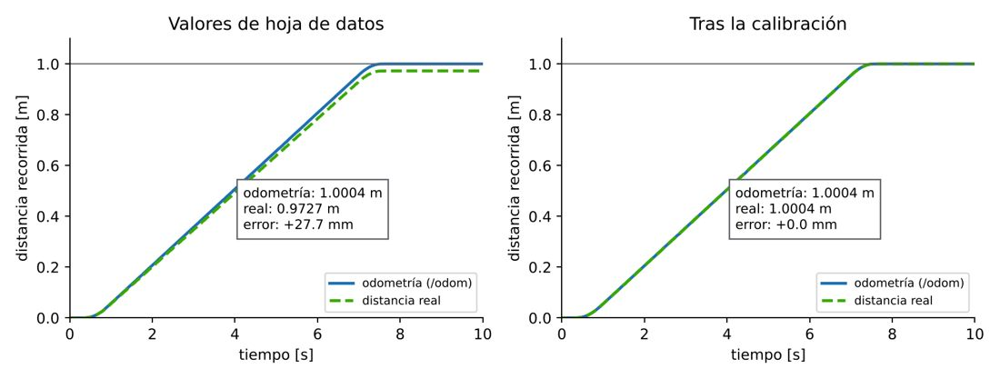

# Documento de Apoyo No. 12.2 – Calibración de la odometría: que 1 metro sea 1 metro.

> Versión en Markdown del documento de apoyo, para consultar y copiar comandos desde GitHub. El documento de Word (formato GFPI-F-135) no se publica en el repositorio.

**Duración Estimada:** 2 horas.

**Sesión:** Día 3 – 04/11/2026, bloque 1 (8:00 a.m. – 12:00 m.).

**Relación con la Guía de Aprendizaje:** Actividad 3.3.3 – carpeta «12. LIBRERÍA CONTROL MOTORES - ROBOCLAW».

**Diseñado por:** Julián René Cháux Cedeño.

## 1. OBJETIVOS DE APRENDIZAJE

- Diferenciar errores sistemáticos y no sistemáticos de la odometría.
- Corregir los pulsos por metro con una prueba de 1 m y la separación de ruedas con un giro de 360°.
- Explicar por qué el orden de las pruebas importa y repetir hasta cumplir la tolerancia.
- Aplicar la prueba bidireccional del cuadrado (UMBmark) para detectar diámetros desiguales.

## 2. FUNDAMENTOS

Borenstein y Feng clasifican los errores de odometría en **sistemáticos** (diámetro promedio distinto del nominal, diámetros desiguales, separación de ruedas incierta) y **no sistemáticos** (deslizamiento, irregularidades del piso) [1]. Los primeros se corrigen con calibración; los segundos se modelan como ruido y los compensa la localización con el lidar [3]. Si el driver usa k y b nominales pero los reales son k\* y b\*:

$${d}_{odo}=\frac{n}{k}, {d}_{real}=\frac{n}{{k}^{*}} ⇒ {k}^{*}=k \frac{{d}_{odo}}{{d}_{real}} \qquad (1)$$

$${\theta }_{odo}=\frac{\Delta {s}_{R}-\Delta {s}_{L}}{b}, {\theta }_{real}=\frac{\Delta {s}_{R}-\Delta {s}_{L}}{{b}^{*}} ⇒ {b}^{*}=b \frac{{\theta }_{odo}}{{\theta }_{real}} \qquad (2)$$

La Ec. 2 solo es válida si Δs ya es correcto, es decir, **después** de corregir k: primero la prueba lineal, reinicio del nodo con el nuevo k y después la angular.



*Figura 1. Procedimiento de calibración.*

## 3. VALIDACIÓN EN EL ROBOT VIRTUAL

El emulador del curso [4] se configuró con una geometría real distinta de la nominal (D = 87,5 mm en lugar de 90 mm; b = 209,0 mm en lugar de 201,6 mm), como ocurre con ruedas comprimidas y un contacto que no está en el centro de la banda. Resultados con `mover` y la verdad terreno del simulador:



*Figura 2. Prueba de 1 m antes y después de calibrar k. El robot se detiene cuando la odometría marca 1 m; con valores de hoja de datos en realidad recorre 0,973 m.*

*Tabla 1. Calibración en el robot virtual. Los valores verdaderos eran k\* = 2248,8/(π·0,0875) = 8180,7 cuentas/m y b\* = 0,2090 m: el procedimiento los recupera en una iteración.*

| **Prueba** | **Odometría** | **Real** | **Error** | **Parámetro corregido** |
|---|---|---|---|---|
| Lineal, valores nominales | 1,0004 m | 0,9727 m | +27,7 mm (+2,85 %) | k: 7953,5 → 8180,4 |
| Angular SIN reiniciar con el nuevo k | 359,69° | 337,31° | +22,4° | b → 0,2150 m (¡incorrecto!) |
| Angular con k ya corregido | 361,65° | 348,79° | +12,9° | b: 0,2016 → 0,2090 m |
| Lineal, calibrado | 1,0004 m | 1,0004 m | 0,0 mm | — |
| Angular, calibrado | 359,60° | 359,57° | +0,04° | — |

## 4. PROCEDIMIENTO EN EL ROBOT REAL

### Paso 1. Preparación

- Piso plano, el mismo donde trabajará el robot. Cinta de enmascarar y cinta métrica de 3 m o más.
- Batería cargada (la velocidad real del PID no depende de la carga, pero el deslizamiento sí).
- Marque en el piso una línea de salida y la dirección de avance; marque el centro del eje de ruedas en el chasis (punto de referencia para medir).

### Paso 2. Prueba lineal

**Terminal – robot**

```bash
cp ~/robots_ws/src/mr_bringup/config/mr_base.yaml ~/mr_base_mi_robot.yaml
ros2 launch mr_bringup robot.launch.py base_config:=$HOME/mr_base_mi_robot.yaml lidar:=false
ros2 run mr_base mover lineal 1.0 --config ~/mr_base_mi_robot.yaml
#   Odometria: 1.0004 m (objetivo 1.000 m)
#   Distancia REAL medida con cinta [m]: 0.981        <- usted la escribe
#   Error: +19.4 mm (+1.98 %)
#   ticks_per_meter: 7953.5 -> 8110.8
#   Actualizado ~/mr_base_mi_robot.yaml. Reinicie mr_base y repita la prueba.
```

Mida desde la marca de salida hasta la misma referencia del chasis. Repita la prueba **tres veces** (ida y vuelta con `lineal -1.0`) y use el promedio si las medidas difieren más de 5 mm.

### Paso 3. Prueba angular (después de reiniciar el nodo)

**Terminal – robot**

```bash
# Ctrl+C en el launch y volver a lanzarlo para que lea el nuevo ticks_per_meter
ros2 run mr_base mover angular 360 --config ~/mr_base_mi_robot.yaml
#   Angulo REAL girado [grados]: 352
```

Para medir el ángulo real pegue una tira de cinta en el piso alineada con el borde del robot antes de girar y mida el ángulo residual con un transportador grande (o la distancia entre marcas y trigonometría).

### Paso 4. Verificación y criterio de aceptación

*Tabla 2. Registro de la calibración (diligenciar).*

| **Prueba** | **Tolerancia** | **Ensayo 1** | **Ensayo 2** | **Ensayo 3** | **¿Cumple?** |
|---|---|---|---|---|---|
| `mover lineal 1.0` | \|error\| ≤ 10 mm (1 %) |  |  |  |  |
| `mover lineal -1.0` | \|error\| ≤ 10 mm |  |  |  |  |
| `mover angular 360` | \|error\| ≤ 2° |  |  |  |  |
| `mover angular -360` | \|error\| ≤ 2° |  |  |  |  |

Cuando cumpla, copie `ticks_per_meter` y `wheel_separation` al archivo `config/mr_base.yaml` del paquete `mr_bringup` (o pase su archivo con `base_config:=`) para que la navegación use los valores calibrados.

### Paso 5 (avanzado). Prueba del cuadrado bidireccional (UMBmark)

Recorra un cuadrado de 2 m en sentido antihorario y otro en horario y mida el error de cierre de cada uno [1]. Si el robot cierra bien en un sentido y mal en el otro, los diámetros de las ruedas son distintos: ajuste `left_scale` y `right_scale` (p. ej. 1,004 y 0,996) y repita.

**Terminal – robot**

```bash
ros2 run mr_base mover cuadrado 2.0 --sentido ccw
ros2 run mr_base mover cuadrado 2.0 --sentido cw
```

> **Reto:**
>
> Con k = 8110,8 cuentas/m, ¿cuál es el diámetro efectivo de la rueda del ejemplo del Paso 2? ¿Qué porcentaje de compresión del neumático representa respecto a 90 mm?

> **Insertar imagen:**
>
> *Fotografía del montaje de la prueba (cinta métrica y marcas) y la tabla de registro completa.*

## REFERENCIAS

**[1]** J. Borenstein y L. Feng, "Measurement and correction of systematic odometry errors in mobile robots," *IEEE Trans. Robotics and Automation*, vol. 12, no. 6, pp. 869–880, 1996, doi: 10.1109/70.544770.

**[2]** R. Siegwart, I. R. Nourbakhsh y D. Scaramuzza, *Introduction to Autonomous Mobile Robots*, 2nd ed. Cambridge, MA, USA: MIT Press, 2011.

**[3]** S. Thrun, W. Burgard y D. Fox, *Probabilistic Robotics*. Cambridge, MA, USA: MIT Press, 2005.

**[4]** J. R. Cháux Cedeño, *robots\_ws – paquetes ROS 2 del curso (repositorio en GitHub, licencia Apache-2.0), 2026. [En línea]. Disponible: https://github.com/jchauxdev/robots\_ws*
