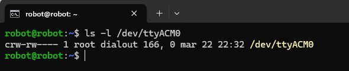
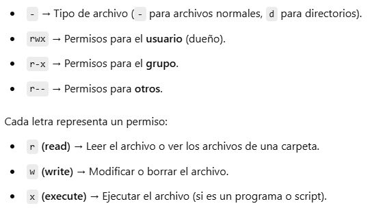
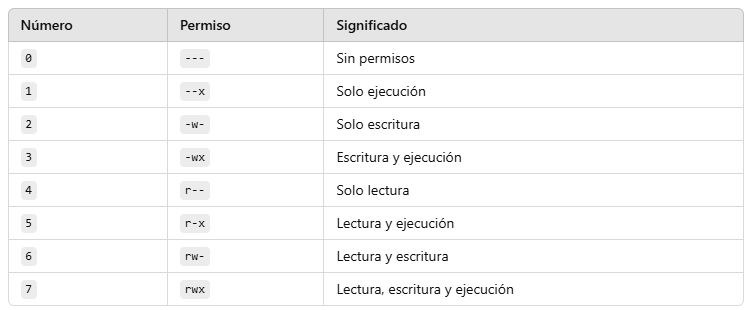
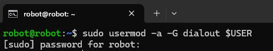
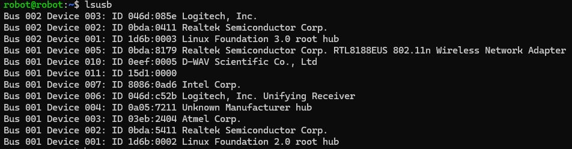
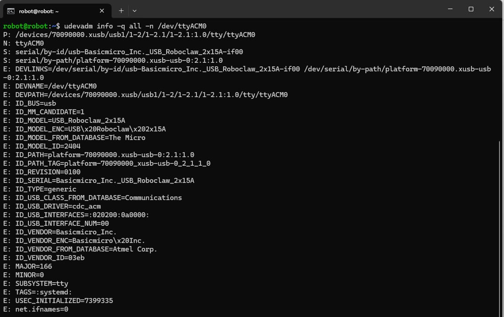
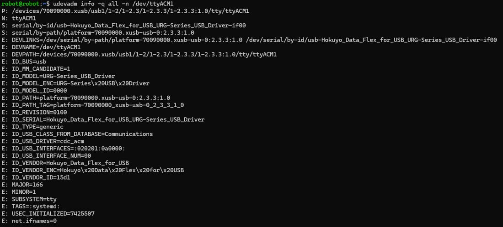
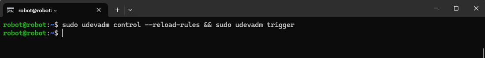
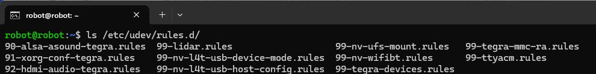

# Documento de Apoyo No. 12.3 – Permisos y nombres fijos de los puertos USB con reglas udev.

> Versión en Markdown del documento de apoyo, para consultar y copiar comandos desde GitHub. El documento de Word (formato GFPI-F-135) no se publica en el repositorio.

**Duración Estimada:** 30 minutos.

**Sesión:** Día 3 – 04/11/2026, bloque 1 (8:00 a.m. – 12:00 m.).

**Relación con la Guía de Aprendizaje:** Actividad 3.3.3 – subcarpeta «14. REGISTRAR PERMISOS TTYACM\_» (y «15. ASIGNAR PUERTO» del lidar).

**Diseñado por:** Julián René Cháux Cedeño.

## 1. EL PROBLEMA

Linux asigna `/dev/ttyACM0`, `/dev/ttyACM1` o `/dev/ttyUSB0` en el orden en que se detectan los dispositivos; si el RoboClaw está apagado al arrancar, el lidar puede tomar su nombre. Además `chmod 777` se pierde al reiniciar. Aquí se usa una sola regla que da permisos y crea enlaces con nombre propio [1].



*Figura 1. Permisos del puerto del RoboClaw: solo el dueño (root) y el grupo dialout pueden usarlo.*



*Figura 2. Cómo leer los permisos de Linux: usuario, grupo y otros; r, w y x.*



*Figura 3. Permisos expresados en números octales.*

## 2. PROCEDIMIENTO

**Terminal – robot**

```bash
# una vez; cierre y abra sesion
sudo usermod -aG dialout $USER
# RoboClaw: 03eb / 2404
udevadm info -q property -n /dev/ttyACM0 | grep -E "ID_VENDOR_ID|ID_MODEL_ID"
# RPLidar:  10c4 / ea60
udevadm info -q property -n /dev/ttyUSB0 | grep -E "ID_VENDOR_ID|ID_MODEL_ID"
```



*Figura 4. Agregar el usuario al grupo dialout.*



*Figura 5. lsusb: identificar los dispositivos USB conectados (RoboClaw, lidar, cámaras).*



*Figura 6. Identificadores del RoboClaw con udevadm info.*



*Figura 7. Identificadores del RPLidar con udevadm info.*

```bash
# /etc/udev/rules.d/99-mr-robot.rules  (incluida en mr_base/udev/)
SUBSYSTEM=="tty", ATTRS{idVendor}=="03eb", ATTRS{idProduct}=="2404", MODE="0666", GROUP="dialout", SYMLINK+="roboclaw", ENV{ID_MM_DEVICE_IGNORE}="1"
KERNEL=="ttyUSB*", ATTRS{idVendor}=="10c4", ATTRS{idProduct}=="ea60", MODE="0666", GROUP="dialout", SYMLINK+="rplidar", ENV{ID_MM_DEVICE_IGNORE}="1"
SUBSYSTEM=="tty", ATTRS{idVendor}=="15d1", ATTRS{idProduct}=="0000", MODE="0666", GROUP="dialout", SYMLINK+="hokuyo"
```

**Terminal – robot**

```bash
sudo cp ~/robots_ws/src/mr_base/udev/99-mr-robot.rules /etc/udev/rules.d/
sudo udevadm control --reload-rules && sudo udevadm trigger
# ModemManager busca módems en los puertos serie y puede quitarle el puerto a mr_base
sudo systemctl disable --now ModemManager
# enlaces a ttyACM*/ttyUSB* con permisos rw
ls -l /dev/roboclaw /dev/rplidar
```



*Figura 8. Recargar las reglas de udev y aplicarlas.*

Los identificadores del RPLidar coinciden con la regla que distribuye Slamtec [2]. Si en el mismo equipo hay otro adaptador CP210x (10c4:ea60), distíngalos por número de serie (`ATTRS{serial}`). En la Jetson Nano la regla se instala en el sistema anfitrión; el contenedor ve los enlaces porque monta `/dev`.

## 3. ELIMINAR UNA REGLA

**Terminal – robot**

```bash
ls /etc/udev/rules.d/
sudo rm /etc/udev/rules.d/99-mr-robot.rules && sudo udevadm control --reload-rules && sudo udevadm trigger
```



*Figura 9. Reglas instaladas en /etc/udev/rules.d/.*

> **Insertar imagen:**
>
> *Salida de* `ls -l /dev/roboclaw /dev/rplidar` *en su robot.*

## REFERENCIAS

**[1]** systemd project, *udev — Dynamic device management* (manual). [En línea]. Disponible: [https://www.freedesktop.org/software/systemd/man/latest/udev.html](https://www.freedesktop.org/software/systemd/man/latest/udev.html)

**[2]** Shanghai Slamtec Co., *rplidar\_ros* (rama ros2, v2.1.4). [En línea]. Disponible: [https://github.com/Slamtec/rplidar_ros/tree/ros2](https://github.com/Slamtec/rplidar_ros/tree/ros2)

**[3]** J. R. Cháux Cedeño, *Robótica básica – Semana 2: construcción y programación de un robot móvil (documentos de apoyo 8 a 18)*, SENA, 2022–2025.
