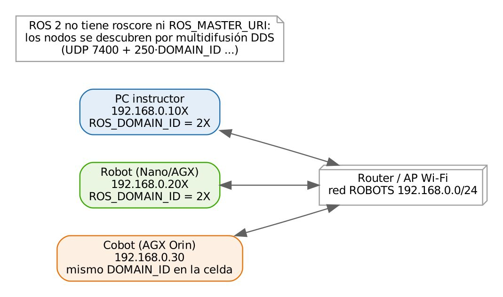
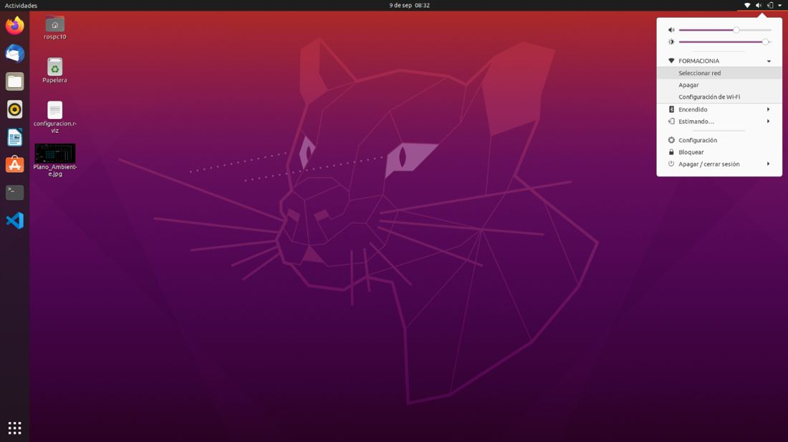
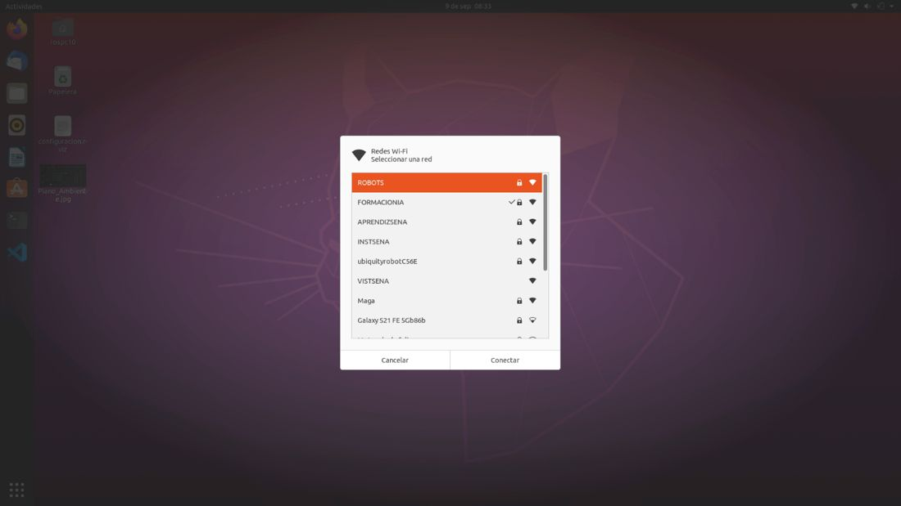
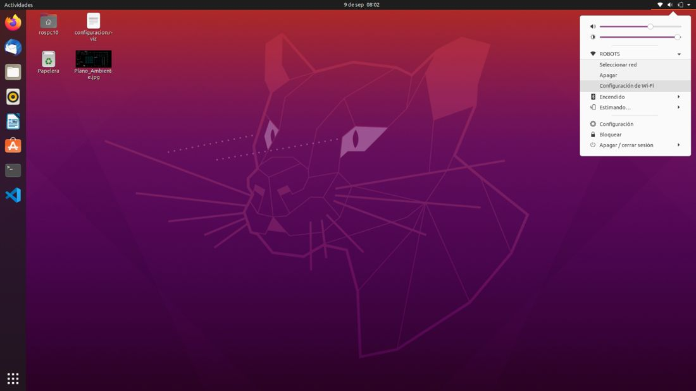
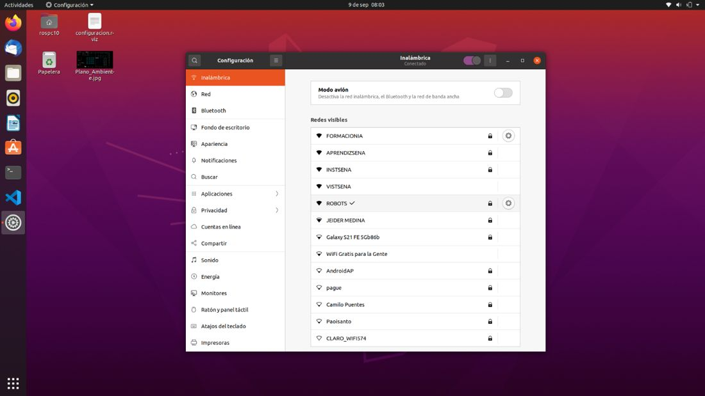
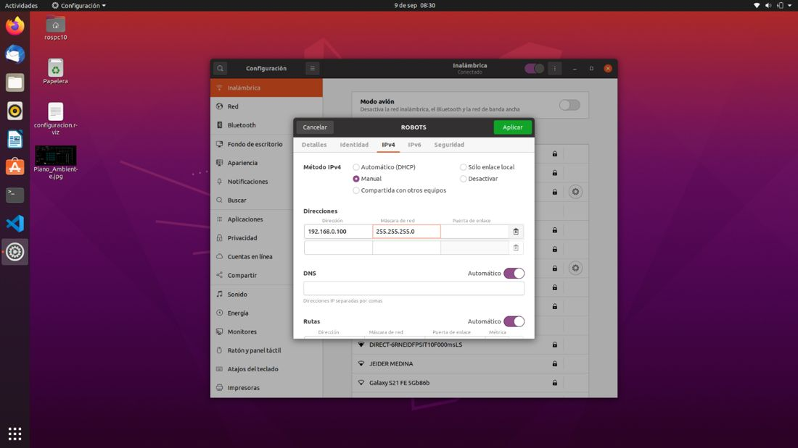
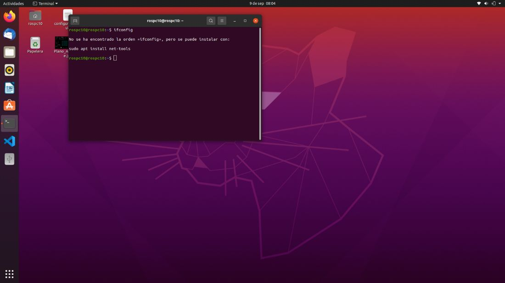
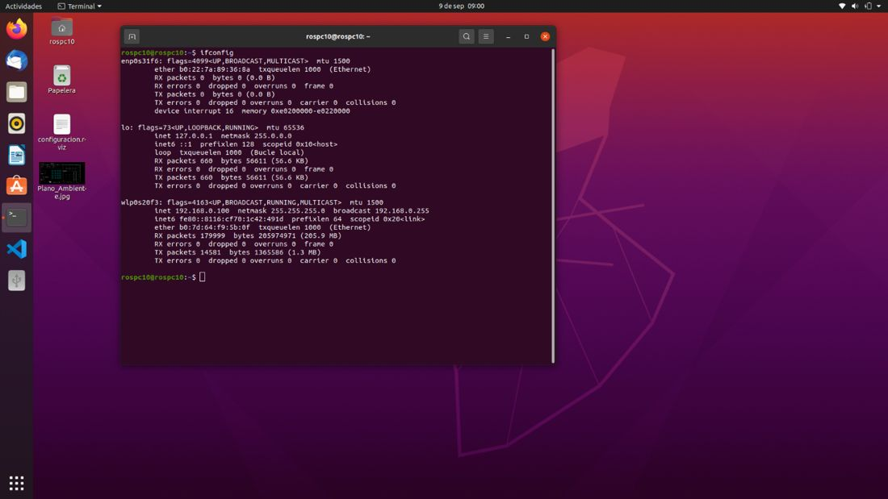
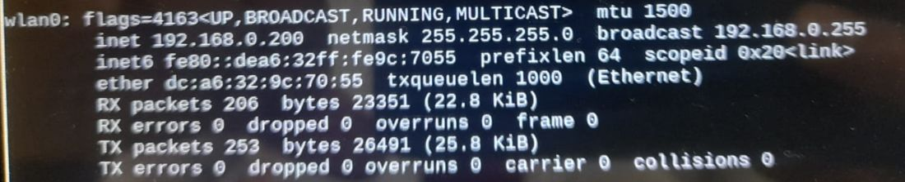
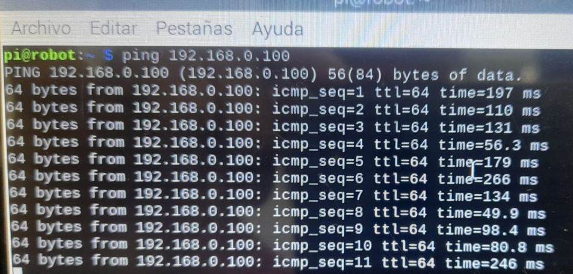

# Documento de Apoyo No. 13.1 – Configuración de la red local de robots.

> Versión en Markdown del documento [13.1. Configuración de la red local - Robots.docx](13.1.%20Configuración%20de%20la%20red%20local%20-%20Robots.docx) para consultar y copiar comandos desde GitHub. El documento de Word es la versión oficial (formato GFPI-F-135).

**Duración Estimada:** 30 minutos.

**Sesión:** Día 2 – 03/11/2026, bloque 4 (5:00 p.m. – 6:00 p.m.) y repaso al inicio del Día 3.

**Relación con la Guía de Aprendizaje:** Actividad 3.3.2 – carpeta «13. CONFIGURACIÓN DE LA RED Y VARIABLES DE ENTORNO».

**Diseñado por:** Julián René Cháux Cedeño.

## 1. PLAN DE DIRECCIONES

Se usa la red «ROBOTS», sin DHCP y con direcciones fijas. La clave la entrega el instructor (no se publica en este documento). La tabla incluye el ROS\_DOMAIN\_ID de cada pareja PC–robot (DA-13.2).

*Tabla 1. Direcciones de la red ROBOTS (máscara 255.255.255.0 = /24; puerta de enlace 192.168.0.1).*

| **Equipo** | **IP del PC** | **IP del robot** | **ROS\_DOMAIN\_ID** |
|---|---|---|---|
| 1 | 192.168.0.101 | 192.168.0.201 | 21 |
| 2 | 192.168.0.102 | 192.168.0.202 | 22 |
| 3 | 192.168.0.103 | 192.168.0.203 | 23 |
| 4 | 192.168.0.104 | 192.168.0.204 | 24 |
| 5 | 192.168.0.105 | 192.168.0.205 | 25 |
| 6 | 192.168.0.106 | 192.168.0.206 | 26 |
| Celda cobot | — | 192.168.0.30 (AGX del cobot) | mismo del robot que la atiende |



*Figura 1. Red del laboratorio.*

## 2. PC (UBUNTU 22.04)

Conéctese a «ROBOTS» y en *Configuración → Wi-Fi → ⚙ → IPv4* elija *Manual*: dirección según la tabla, máscara 255.255.255.0 y puerta de enlace 192.168.0.1. Desconecte y conecte la red para aplicar.



*Figura 2. Menú de red en la esquina superior derecha: Seleccionar red.*



*Figura 3. Conectarse a la red ROBOTS.*



*Figura 4. Abrir la configuración de la red Wi-Fi.*



*Figura 5. Configuración → Wi-Fi: el piñón junto a ROBOTS abre los ajustes.*



*Figura 6. Configuración IPv4 manual en Ubuntu.*



*Figura 7. Si ifconfig no está instalado, instalarlo con sudo apt install net-tools (o usar ip -4 addr).*



*Figura 8. Comprobación de la IP fija tras desconectar y reconectar la red.*

## 3. ROBOT (JETSON NANO, AGX ORIN O RASPBERRY PI) POR TERMINAL

Sin pantalla, la forma más reproducible es `nmcli` (NetworkManager, presente en JetPack y en Ubuntu Desktop); en Ubuntu Server se usa netplan [1]:

**Terminal – robot**

```bash
nmcli device wifi list
sudo nmcli device wifi connect ROBOTS password "<clave del instructor>"
sudo nmcli connection modify ROBOTS ipv4.method manual ipv4.addresses 192.168.0.201/24 \
     ipv4.gateway 192.168.0.1 ipv4.dns 8.8.8.8 connection.autoconnect yes
sudo nmcli connection up ROBOTS
# (ifconfig requiere: sudo apt install net-tools)
ip -4 addr show wlan0
```



*Figura 9. IP fija 192.168.0.200 verificada en la interfaz wlan0 del robot.*

## 4. NOMBRES Y PRUEBA

```bash
# /etc/hosts en el PC y en el robot (agregar las dos lineas)
192.168.0.101  pc1
192.168.0.201  robot1
ping -c 3 robot1      # desde el PC
ping -c 3 pc1         # desde el robot
```



*Figura 10. Prueba de conectividad con ping.*

> **Router del laboratorio:**
>
> Muchos puntos de acceso tienen activado el «aislamiento de clientes» (*AP/client isolation*), que impide que dos equipos Wi-Fi se vean entre sí, o bloquean la multidifusión. ROS 2 la necesita para el descubrimiento (DA-13.2). Si `ping` funciona pero `ros2 topic list` no muestra los tópicos del otro equipo, revise esa opción del router.

## REFERENCIAS

**[1]** Canonical, *Netplan documentation*. [En línea]. Disponible: [https://netplan.readthedocs.io/](https://netplan.readthedocs.io/)

**[2]** J. R. Cháux Cedeño, *Robótica básica – Semana 2: construcción y programación de un robot móvil (documentos de apoyo 8 a 18)*, SENA, 2022–2025.
