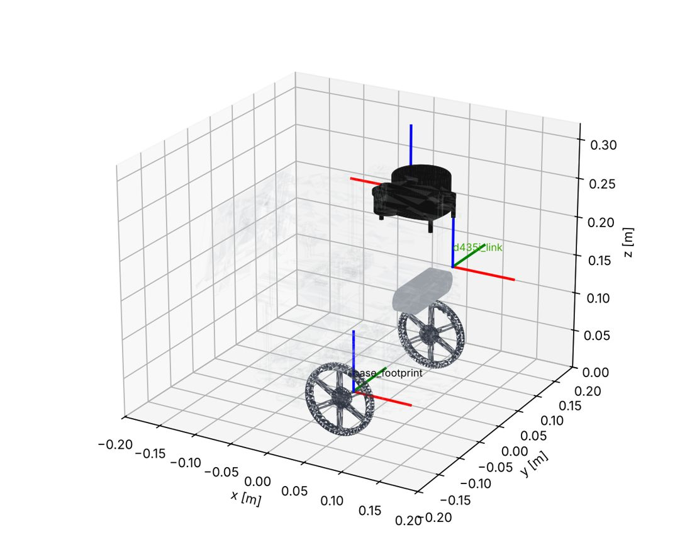
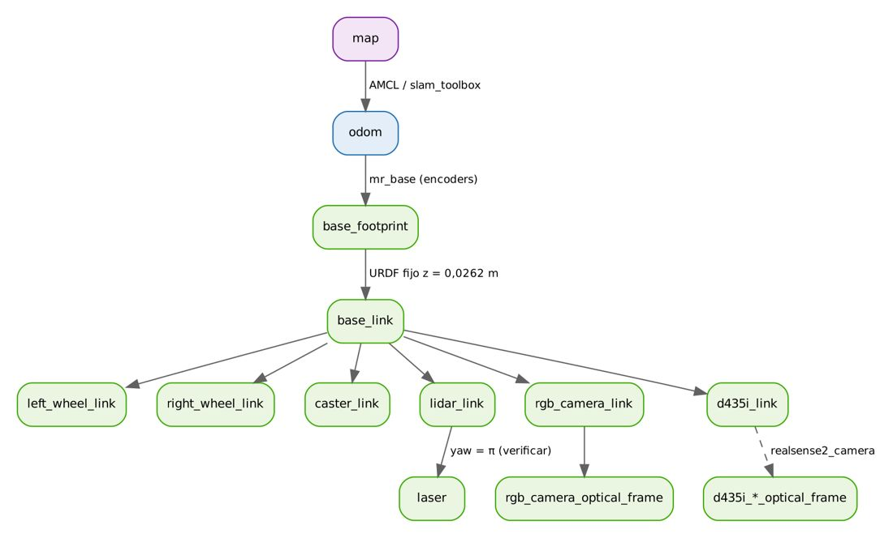
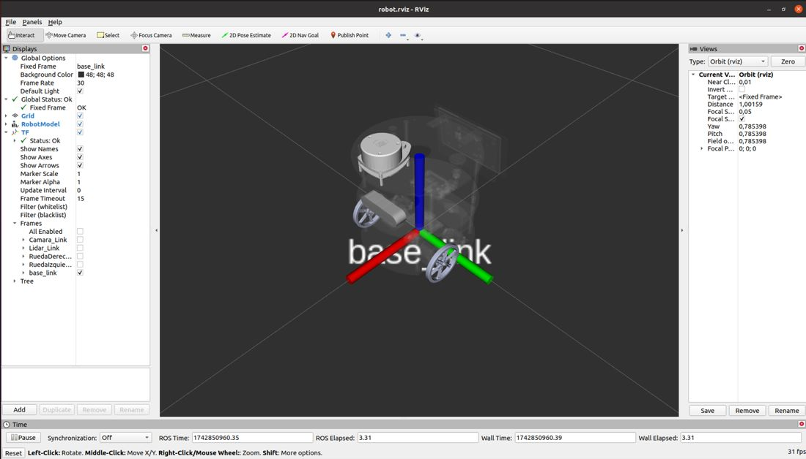

# Documento de Apoyo No. 14.1 – Modelo URDF/Xacro del robot y visualización en RViz2.

> Versión en Markdown del documento de apoyo, para consultar y copiar comandos desde GitHub. El documento de Word (formato GFPI-F-135) no se publica en el repositorio.

**Duración Estimada:** 1,5 horas.

**Sesión:** Día 3 – 04/11/2026, bloque 2 (2:00 p.m. – 6:00 p.m.).

**Relación con la Guía de Aprendizaje:** Actividad 3.3.4 – carpeta «14. ROBOT EN RVIZ».

**Diseñado por:** Julián René Cháux Cedeño.

## 1. DEL PAQUETE EXPORTADO DE SOLIDWORKS A MR_DESCRIPTION

El modelo parte del diseño en SolidWorks exportado con sw\_urdf\_exporter [7], con sus mallas y medidas (ruedas de 90 mm en y = ±100,8 mm, lidar en x = 77,8 mm, z = 215 mm, cámara al frente); en mr\_description [8] está organizado para cumplir REP 105 [1] y REP 103 [2]:

*Tabla 1. Cambios del modelo respecto al paquete exportado.*

| **Problema del URDF exportado** | **Corrección en mr\_robot.urdf.xacro** |
|---|---|
| Sin `base_footprint` (el origen de la malla queda 26,2 mm sobre el piso) | `base_footprint` en el suelo y `base_link` a z = r − z\_eje = 0,0262 m |
| Ejes de rueda girados (rpy de exportación): velocidad positiva no siempre es avance | Ejes `0 1 0`; la rotación de la malla va solo en `<visual>` |
| Colisión con las mallas STL (11 MB la base) | Primitivas (caja, cilindros, esfera) para colisión |
| Marco del lidar sin el plano de barrido | `lidar_link` (malla) + `laser` (frame\_id del driver) con `lidar_yaw` |
| Cámara sin marco óptico | `rgb_camera_optical_frame` (z adelante, x a la derecha) |
| Sin RealSense | `d435i_link` (el driver publica sus marcos internos a partir de él) |



*Figura 1. Modelo mr_robot (mallas del CAD, base semitransparente) con los marcos base_footprint, laser y d435i_link. Render generado a partir del xacro.*



*Figura 2. Árbol de transformaciones del robot.*

## 2. PROCEDIMIENTO

### Paso 1. Visualizar el modelo (en el PC)

**Terminal – PC**

```bash
cd ~/robots_ws && colcon build --packages-select mr_description && source install/setup.bash
# RViz2 + deslizadores de las ruedas
ros2 launch mr_description display.launch.py
ros2 launch mr_description display.launch.py use_realsense:=false lidar_yaw:=0.0
```

La configuración de RViz2 (`rviz/robot.rviz`) ya incluye *RobotModel* leyendo el tópico `/robot_description`, *TF*, *LaserScan* y *Map*; el *Fixed Frame* es `base_footprint`.



*Figura 3. Modelo del robot en RViz.*

### Paso 2. Inspeccionar el árbol TF

**Terminal – PC**

```bash
# genera frames_<fecha>.pdf
ros2 run tf2_tools view_frames
# traslacion [0.078, 0, 0.276] y rotacion
ros2 run tf2_ros tf2_echo base_footprint laser
```

### Paso 3. Ajustar el modelo a su robot

Con las medidas del DA-8.1 edite las propiedades al inicio de `urdf/mr_robot.urdf.xacro` (`wheel_radius`, `wheel_y`, la pose de `d435i_joint` y la altura del plano del lidar) y verifique con `check_urdf`:

**Terminal – PC**

```bash
xacro src/mr_description/urdf/mr_robot.urdf.xacro > /tmp/mr.urdf && check_urdf /tmp/mr.urdf
# 2 pruebas
colcon test --packages-select mr_description && colcon test-result --verbose
```

### Paso 4. Gazebo Fortress (opcional, requiere GPU)

`mr_robot.gazebo.xacro` agrega el sistema *DiffDrive*, un `gpu_lidar` y una cámara para Gazebo Fortress, la versión emparejada con Humble [5], [6]. El mundo `laboratorio.sdf` se genera a partir de la misma lista de obstáculos que el mapa del robot virtual:

**Terminal – PC**

```bash
sudo apt install ros-humble-ros-gz
ros2 launch mr_bringup gazebo.launch.py
ros2 run teleop_twist_keyboard teleop_twist_keyboard
```

> **Simulación sin GPU:**
>
> En el entorno de preparación del material no había GPU, por lo que el lidar y la cámara de Gazebo no se pudieron renderizar. Para practicar SLAM y Nav2 sin GPU use `virtual.launch.py` (emulador del RoboClaw + lidar 2D por trazado de rayos), validado en este curso.

> **Insertar imagen:**
>
> *Captura de RViz2 con el modelo de su robot y el árbol TF (*`view_frames`*).*

## REFERENCIAS

**[1]** W. Meeussen, *REP 105 – Coordinate Frames for Mobile Platforms*. [En línea]. Disponible: [https://www.ros.org/reps/rep-0105.html](https://www.ros.org/reps/rep-0105.html)

**[2]** T. Foote y M. Purvis, *REP 103 – Standard Units of Measure and Coordinate Conventions*. [En línea]. Disponible: [https://www.ros.org/reps/rep-0103.html](https://www.ros.org/reps/rep-0103.html)

**[3]** T. Foote, "tf: The transform library," en *Proc. IEEE Int. Conf. Technologies for Practical Robot Applications (TePRA)*, 2013, pp. 1–6, doi: 10.1109/TePRA.2013.6556373.

**[4]** Open Robotics, *ROS 2 Documentation: Humble Hawksbill*. [En línea]. Disponible: [https://docs.ros.org/en/humble/](https://docs.ros.org/en/humble/)

**[5]** Open Robotics, *Gazebo – Installing Gazebo with ROS* (Humble ↔ Gazebo Fortress). [En línea]. Disponible: [https://gazebosim.org/docs/all/ros_installation](https://gazebosim.org/docs/all/ros_installation)

**[6]** N. Koenig y A. Howard, "Design and use paradigms for Gazebo, an open-source multi-robot simulator," en *Proc. IEEE/RSJ IROS*, 2004, pp. 2149–2154, doi: 10.1109/IROS.2004.1389727.

**[7]** J. R. Cháux Cedeño, *Robótica básica – Semana 2: construcción y programación de un robot móvil (documentos de apoyo 8 a 18)*, SENA, 2022–2025.

**[8]** J. R. Cháux Cedeño, *robots\_ws – paquetes ROS 2 del curso (repositorio en GitHub, licencia Apache-2.0), 2026. [En línea]. Disponible: https://github.com/jchauxdev/robots\_ws*
