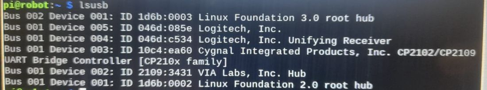
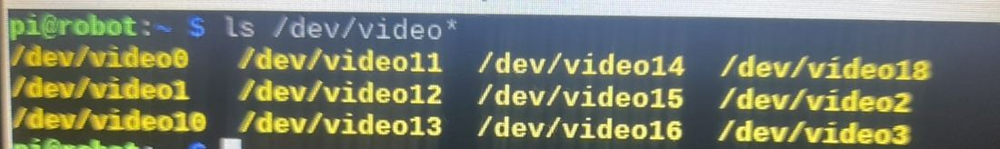
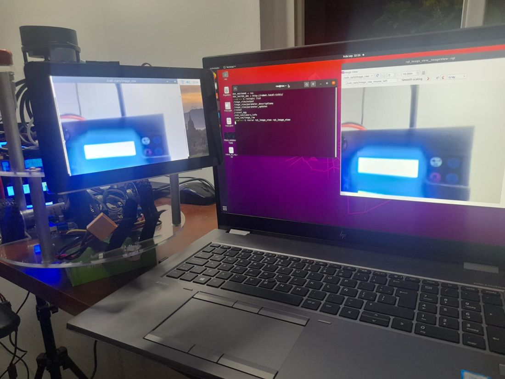

# Documento de Apoyo No. 15.1 – Cámara RGB USB en ROS 2.

> Versión en Markdown del documento de apoyo, para consultar y copiar comandos desde GitHub. El documento de Word (formato GFPI-F-135) no se publica en el repositorio.

**Duración Estimada:** 1 hora.

**Sesión:** Día 3 – 04/11/2026, bloque 2 (2:00 p.m. – 6:00 p.m.).

**Relación con la Guía de Aprendizaje:** Actividad 3.3.4 – carpeta «15. INSTALACIÓN Y CONFIGURACIÓN CÁMARA WEB».

**Diseñado por:** Julián René Cháux Cedeño.

## 1. OPCIONES DE DRIVER

*Tabla 1. Drivers de cámara usados en el curso.*

| **Driver** | **Dónde** | **Instalación** | **Tópicos** |
|---|---|---|---|
| `usb_cam` 0.8.1 | PC, AGX Orin, Raspberry Pi (Humble por apt) | `sudo apt install ros-humble-usb-cam` | `/rgb_camera/image_raw` (+ `/compressed` con image\_transport) |
| `mr_perception/camera_node` | Jetson Nano (contenedor) o cualquier equipo | Paquete mr\_perception (Paso 0) | `/rgb_camera/image_raw`, `/rgb_camera/image_raw/compressed` |

En Humble el paquete `usb_cam` [1] es la opción estándar; en la Nano, donde no hay paquetes apt de Humble, `camera_node` de `mr_perception` [4] usa OpenCV (V4L2, formato MJPG) y publica también la imagen JPEG comprimida, que consume una fracción del ancho de banda Wi-Fi de la imagen cruda (640 × 480 × 3 bytes ≈ 0,9 MB por cuadro).

## 2. PROCEDIMIENTO

**Paso 0.** Incorpore el paquete mr\_perception a robots\_ws en el PC y en el computador del robot (en la Jetson Nano, con el segundo bloque):

| **Paquete / carpeta** | **Para qué sirve** | **Qué contiene** | **Dónde se usa** |
|---|---|---|---|
| `src/mr_perception` | Nodo de cámara USB con OpenCV: publica la imagen sin necesitar usb\_cam, que en la Jetson Nano no está disponible. | camera\_node (V4L2, formato MJPG), que publica rgb\_camera/image\_raw y rgb\_camera/image\_raw/compressed. | Computador del robot con la cámara conectada (indispensable en la Jetson Nano). En el PC, para ver la imagen. |

Se agrega con estos comandos:

**Terminal – PC y robot**

```bash
cd ~/robots_ws && git sparse-checkout add src/mr_perception
# instala las dependencias de los paquetes agregados
rosdep install --from-paths ~/robots_ws/src --ignore-src -r -y --skip-keys "mr_navigation jc_driver"
cd ~/robots_ws
colcon build --symlink-install --packages-select mr_perception
source install/setup.bash
```

**Terminal – Jetson Nano**

```bash
cd ~/robots_ws && printf '/src/mr_perception/\n' >> .git/info/sparse-checkout && git read-tree -mu HEAD
cd ~/robots_ws/docker && ./run_nano.sh /root/robots_ws/docker/build_ws_nano.sh mr_perception
```

**Terminal – robot**

```bash
# identificar /dev/videoN
lsusb && v4l2-ctl --list-devices
# MJPG / YUYV, resoluciones y FPS
v4l2-ctl -d /dev/video0 --list-formats-ext | head -30
# cualquiera de los dos drivers:
# camera_driver:=opencv (defecto)
ros2 launch mr_bringup robot.launch.py camera:=true
# AGX / Pi (o PC con la cámara conectada)
ros2 launch mr_bringup robot.launch.py camera:=true camera_driver:=usb_cam
```

**Terminal – PC**

```bash
ros2 topic hz /rgb_camera/image_raw/compressed
ros2 run rqt_image_view rqt_image_view /rgb_camera/image_raw/compressed
```



*Figura 1. lsusb: la cámara Logitech aparece entre los dispositivos USB del robot.*



*Figura 2. Dispositivos de video disponibles (ls /dev/video\*).*

*Tabla 2. Desempeño de la cámara por Wi-Fi (diligenciar).*

| **Tópico** | **Resolución** | **FPS medidos (**`ros2 topic hz`**)** | **Ancho de banda (**`ros2 topic bw`**)** |
|---|---|---|---|
| `/rgb_camera/image_raw` | 640 × 480 |  |  |
| `/rgb_camera/image_raw/compressed` | 640 × 480 |  |  |

Para calibrar la cámara (matriz intrínseca y distorsión) siga el procedimiento del DA-09 de la transferencia del cobot (`camera_calibration`, tablero de ajedrez) y guarde el archivo en `~/.ros/camera_info/`.



*Figura 3. Resultado esperado: el video de la cámara del robot visto en la pantalla del robot y en el portátil.*

> **Insertar imagen:**
>
> *Captura de rqt\_image\_view en el PC con el video del robot.*

## REFERENCIAS

**[1]** ROS Drivers, *usb\_cam* (v0.8.1 para Humble). [En línea]. Disponible: [https://github.com/ros-drivers/usb_cam](https://github.com/ros-drivers/usb_cam)

**[2]** Open Robotics, *ROS 2 Documentation: Humble Hawksbill*. [En línea]. Disponible: [https://docs.ros.org/en/humble/](https://docs.ros.org/en/humble/)

**[3]** J. R. Cháux Cedeño, *Robótica básica – Semana 2: construcción y programación de un robot móvil (documentos de apoyo 8 a 18)*, SENA, 2022–2025.

**[4]** J. R. Cháux Cedeño, *robots\_ws – paquetes ROS 2 del curso (repositorio en GitHub, licencia Apache-2.0), 2026. [En línea]. Disponible: https://github.com/jchauxdev/robots\_ws*
