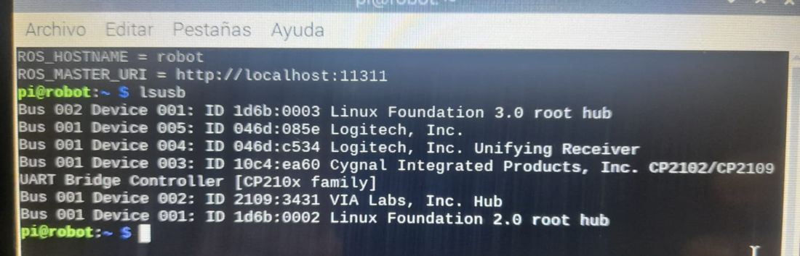
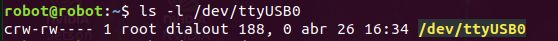
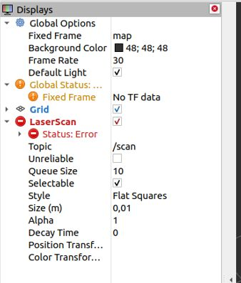
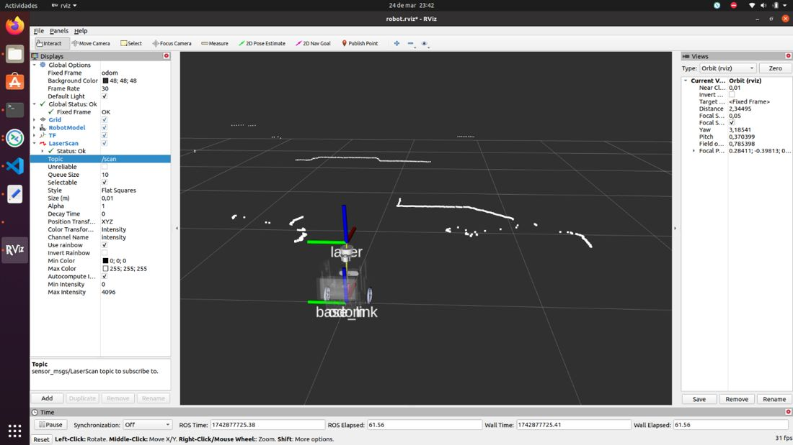
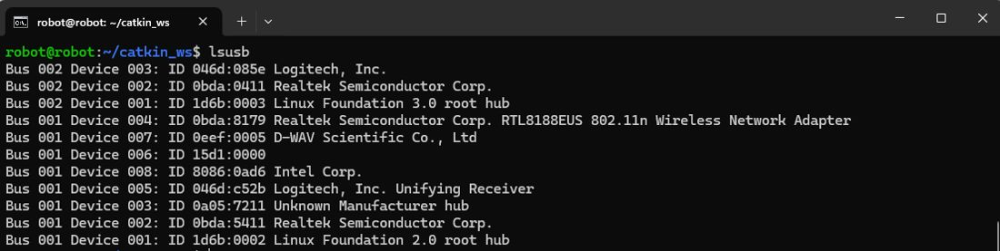
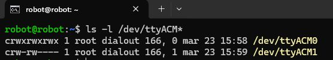
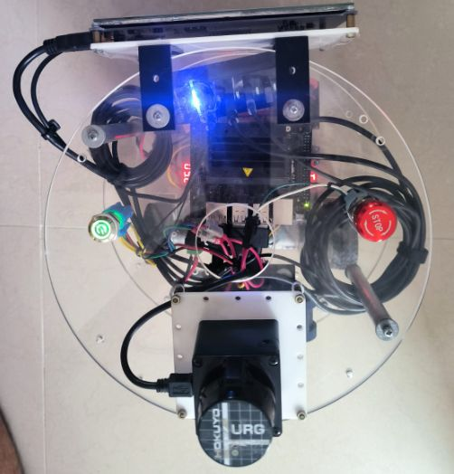

# Documento de Apoyo No. 16.1 – Lidar RPLidar A1 en ROS 2 (y Hokuyo URG-04LX como alternativa).

> Versión en Markdown del documento [16.1. RPLidar A1 en ROS 2.docx](16.1.%20RPLidar%20A1%20en%20ROS%202.docx) para consultar y copiar comandos desde GitHub. El documento de Word es la versión oficial (formato GFPI-F-135).

**Duración Estimada:** 1,5 horas.

**Sesión:** Día 3 – 04/11/2026, bloque 2 (2:00 p.m. – 6:00 p.m.).

**Relación con la Guía de Aprendizaje:** Actividad 3.3.4 – carpeta «16. INSTALACIÓN Y CONFIGURACIÓN LIDAR».

**Diseñado por:** Julián René Cháux Cedeño.

## 1. FUNDAMENTOS

El RPLidar A1M8 mide distancias por triangulación láser girando 360°: 0,15–12 m (revisión R5; las R4 y anteriores alcanzan 6 m), al menos 8000 muestras/s y 5,5 Hz típicos de barrido, con resolución angular de 1° o mejor [1]. En ROS 2 publica `sensor_msgs/LaserScan` en `/scan` con `frame_id = laser` mediante `rplidar_ros` (rama `ros2`, versión 2.1.4, disponible también como paquete apt de Humble) [2], [4].

*Tabla 1. Velocidades por modelo según los archivos de lanzamiento de rplidar_ros (ros2).*

| **Modelo** | **Archivo de lanzamiento del paquete** | **Baudios** |
|---|---|---|
| A1 / A2M8 | `rplidar_a1_launch.py` / `rplidar_a2m8_launch.py` | 115200 |
| A2M12, A3, S1 | `rplidar_a2m12_launch.py`, `rplidar_a3_launch.py`, `rplidar_s1_launch.py` | 256000 |
| C1 | `rplidar_c1_launch.py` | 460800 |

### 1.1 La transformación base → laser

Para que RViz, SLAM y Nav2 usen el barrido, debe existir la cadena TF hasta `laser` [6]. La publica `robot_state_publisher` a partir del URDF (DA-14.1), con las medidas del CAD.

### 1.2 Orientación del cero del lidar

El driver convierte el ángulo del dispositivo con θ\_ROS = π − θ\_dispositivo (código fuente de `rplidar_node`): el eje x del marco `laser` queda opuesto al 0° del sensor. Por eso, según cómo esté montado, el URDF puede requerir `lidar_yaw = π` (valor por defecto) o `0`. **Verifíquelo** con el Paso 3; un error de 180° hace que el mapa se construya «al revés» y que AMCL no converja.

## 2. PROCEDIMIENTO

### Paso 1. Instalación y permisos

**Terminal – robot**

```bash
# PC / AGX / Pi (en la Nano ya esta en la imagen Docker)
sudo apt install ros-humble-rplidar-ros
# regla udev del DA-12.3 (CP210x 10c4:ea60)
ls -l /dev/rplidar
```



*Figura 1. lsusb: el adaptador CP210x del RPLidar aparece entre los dispositivos USB.*



*Figura 2. Puerto serie del RPLidar (/dev/ttyUSB0) y sus permisos.*

### Paso 2. Lanzar el lidar

**Terminal – robot**

```bash
# base + lidar + modelo
ros2 launch mr_bringup robot.launch.py
# solo el lidar:  ros2 launch rplidar_ros view_rplidar_a1_launch.py serial_port:=/dev/rplidar
# ~5-10 Hz
ros2 topic hz /scan
ros2 topic echo /scan --field ranges --once | head
```

### Paso 3. Verificar la orientación

1. Coloque una caja a 0,5 m **delante** del robot y nada más cerca.
1. En RViz2 (`ros2 launch mr_bringup rviz.launch.py config:=robot`) la nube de puntos de la caja debe aparecer delante del modelo (sobre el eje x rojo).
1. Si aparece detrás, lance con `lidar_yaw:=0.0` (o cambie el valor por defecto en el xacro) y repita.
1. Gire el robot a mano: los puntos de las paredes deben quedarse quietos si el *Fixed Frame* es `odom`.



*Figura 3. Error típico «No TF data» en el LaserScan cuando falta la transformación.*



*Figura 4. Robot y barrido láser en RViz con el lidar Hokuyo.*

### Paso 4. Filtrar el propio robot (si es necesario)

Si las columnas o la bandeja (DA-21.1) quedan dentro del plano de barrido, aparecerán como obstáculos permanentes junto al robot. Elimine esos ángulos con `range_min` mayor, con el paquete `laser_filters` (*LaserScanAngularBoundsFilterInPlace*) o reubicando la pieza por debajo del plano.

## ANEXO. HOKUYO URG-04LX-UG01

Algunos robots del laboratorio tienen el lidar Hokuyo URG-04LX-UG01. En Humble existe `urg_node` 1.1.2 por apt [3], [4]; con la regla udev el puerto es `/dev/hokuyo`:

**Terminal – robot**

```bash
sudo apt install ros-humble-urg-node
ros2 run urg_node urg_node_driver --ros-args -p serial_port:=/dev/hokuyo -p laser_frame_id:=laser
```



*Figura 5. lsusb con el Hokuyo conectado.*



*Figura 6. Puerto del Hokuyo (/dev/ttyACM\*).*



*Figura 7. Robot con lidar Hokuyo URG-04LX.*

> **Insertar imagen:**
>
> *Captura de RViz2 con la caja delante del robot (prueba de orientación).*

## REFERENCIAS

**[1]** Shanghai Slamtec Co., *RPLIDAR A1 – Low Cost 360 Degree Laser Range Scanner: Introduction and Datasheet* (A1M8). [En línea]. Disponible: [https://www.farnell.com/datasheets/3176118.pdf](https://www.farnell.com/datasheets/3176118.pdf)

**[2]** Shanghai Slamtec Co., *rplidar\_ros* (rama ros2, v2.1.4). [En línea]. Disponible: [https://github.com/Slamtec/rplidar_ros/tree/ros2](https://github.com/Slamtec/rplidar_ros/tree/ros2)

**[3]** ROS Drivers, *urg\_node* (Humble 1.1.2, Hokuyo SCIP 2.0). [En línea]. Disponible: [https://github.com/ros-drivers/urg_node](https://github.com/ros-drivers/urg_node)

**[4]** Open Robotics, *rosdistro – humble/distribution.yaml* (versiones liberadas de cada paquete). [En línea]. Disponible: [https://github.com/ros/rosdistro/blob/master/humble/distribution.yaml](https://github.com/ros/rosdistro/blob/master/humble/distribution.yaml)

**[5]** W. Meeussen, *REP 105 – Coordinate Frames for Mobile Platforms*. [En línea]. Disponible: [https://www.ros.org/reps/rep-0105.html](https://www.ros.org/reps/rep-0105.html)

**[6]** T. Foote, "tf: The transform library," en *Proc. IEEE Int. Conf. Technologies for Practical Robot Applications (TePRA)*, 2013, pp. 1–6, doi: 10.1109/TePRA.2013.6556373.

**[7]** J. R. Cháux Cedeño, *Robótica básica – Semana 2: construcción y programación de un robot móvil (documentos de apoyo 8 a 18)*, SENA, 2022–2025.

**[8]** J. R. Cháux Cedeño, *mr\_ws – espacio de trabajo ROS 2 del robot móvil diferencial* (material de esta transferencia, licencia Apache-2.0), 2026.
