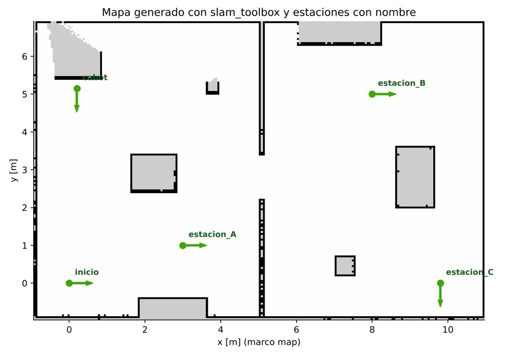
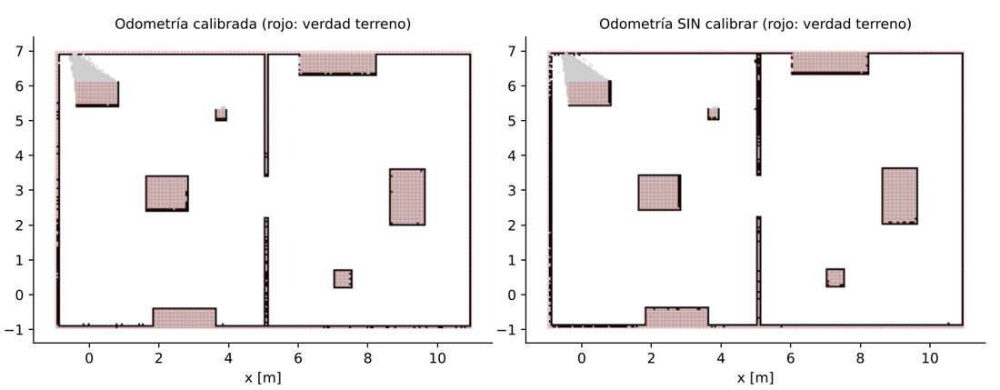

# Documento de Apoyo No. 17.1 – Generación del mapa del entorno con slam_toolbox.

> Versión en Markdown del documento [17.1. Generación del mapa con slam_toolbox.docx](17.1.%20Generación%20del%20mapa%20con%20slam_toolbox.docx) para consultar y copiar comandos desde GitHub. El documento de Word es la versión oficial (formato GFPI-F-135).

**Duración Estimada:** 2 horas.

**Sesión:** Día 4 – 05/11/2026, bloque 1 (8:00 a.m. – 12:00 m.).

**Relación con la Guía de Aprendizaje:** Actividad 3.3.5 – carpeta «17. GENERACIÓN DE MAPA».

**Diseñado por:** Julián René Cháux Cedeño.

## 1. FUNDAMENTOS

SLAM (*Simultaneous Localization and Mapping*) estima a la vez el mapa y la trayectoria del robot. Un método clásico es GMapping, un filtro de partículas Rao-Blackwellizado [1], que no tiene versión oficial en ROS 2. En Humble la herramienta de referencia de Nav2 es **slam\_toolbox** [3], [6]: construye un **grafo de poses** con emparejamiento de barridos (*scan matching*) y lo optimiza al detectar cierres de lazo con el método *Sparse Pose Adjustment* [2]. Publica `/map` (`nav_msgs/OccupancyGrid`) y la transformación `map → odom`.

*Tabla 1. Parámetros adaptados de mapper_params_online_async.yaml (slam_toolbox 2.6).*

| **Parámetro (config/slam\_toolbox.yaml)** | **Valor** | **Justificación** |
|---|---|---|
| `base_frame` / `odom_frame` / `map_frame` | base\_footprint / odom / map | REP 105 (DA-14.1) |
| `scan_topic` | scan | Relativo: funciona también con espacio de nombres (DA-21.1) |
| `resolution` | 0,05 m | Compromiso detalle / memoria |
| `max_laser_range` | 12,0 m | Alcance del RPLidar A1M8 R5 (DA-16.1) |
| `minimum_travel_distance` / `heading` | 0,2 m / 0,2 rad | Robot pequeño en interiores: más nodos del grafo |
| `map_update_interval` | 2,0 s | Refresco del mapa en RViz2 |
| `do_loop_closing` | true | Corrige la deriva al regresar a zonas conocidas |

## 2. PROCEDIMIENTO

### Paso 1. Lanzar el robot y la SLAM

**Terminal – robot**

```bash
# Nano en contenedor o AGX; sin hardware use en el PC: ros2 launch mr_bringup virtual.launch.py
ros2 launch mr_bringup robot.launch.py
```

**Terminal – PC (o AGX)**

```bash
# RViz2: Fixed Frame = map, displays Map y LaserScan
ros2 launch mr_bringup slam.launch.py rviz:=true
```

### Paso 2. Recorrer el entorno

Teleopere (DA-19.1) a 0,15–0,2 m/s, con giros suaves. Recorra todo el recinto, acérquese a ~1 m de las paredes y **vuelva a pasar por el punto de partida** para que se cierre el lazo. Las zonas no exploradas quedan grises (desconocidas) y no se pueden usar como meta de navegación.

### Paso 3. Guardar el mapa

**Terminal – PC (o AGX, donde corre la SLAM)**

```bash
mkdir -p ~/mapas
# laboratorio.pgm + laboratorio.yaml
ros2 run nav2_map_server map_saver_cli -f ~/mapas/laboratorio
# grafo para continuar el mapa luego
ros2 service call /slam_toolbox/serialize_map slam_toolbox/srv/SerializePoseGraph \
     "{filename: '$HOME/mapas/laboratorio_posegraph'}"
```

El origen del marco `map` es la pose donde arrancó la SLAM; anote dónde estaba el robot (será la estación `inicio` del DA-18.2).

## 3. RESULTADOS DE VALIDACIÓN (ROBOT VIRTUAL)

En el robot virtual del curso [8] se recorrieron 40 m en un recinto de 12 × 8 m con deslizamiento aleatorio del 1 % por rueda. El mapa se comparó celda a celda con la verdad terreno:



*Figura 1. Mapa obtenido con slam_toolbox (0,05 m/píxel) y estaciones definidas en el DA-18.2.*

*Tabla 2. Distancia de cada celda ocupada del mapa al obstáculo real más cercano.*

| **Odometría** | **Celdas ocupadas** | **Error medio** | **P95** | **Máximo** |
|---|---|---|---|---|
| Calibrada (DA-12.2) | 1597 | 1,4 cm | 4,0 cm | 6,0 cm |
| Sin calibrar (+2,9 % en distancia, ~6 % en giro) | 1706 | 1,6 cm | 4,0 cm | 10,0 cm |



*Figura 2. Mapas con odometría calibrada y sin calibrar sobre la verdad terreno (rojo).*

En este recinto, rico en paredes y obstáculos, el emparejamiento de barridos corrigió casi por completo el error de la odometría sin calibrar. Esto no hace innecesaria la calibración: en pasillos largos sin rasgos, con lidar de menor alcance o cuando AMCL y el controlador de Nav2 dependen de la odometría entre barridos (DA-18.1), un error sistemático del 3–6 % sí degrada el resultado [5].

> **Insertar imagen:**
>
> *Su mapa (*`laboratorio.pgm`*) y una captura de RViz2 durante el mapeo.*

> **Reto:**
>
> Repita el mapeo sin volver al punto de partida (sin cierre de lazo) y compare visualmente ambos mapas.

## REFERENCIAS

**[1]** G. Grisetti, C. Stachniss y W. Burgard, "Improved techniques for grid mapping with Rao-Blackwellized particle filters," *IEEE Trans. Robotics*, vol. 23, no. 1, pp. 34–46, 2007, doi: 10.1109/TRO.2006.889486.

**[2]** K. Konolige, G. Grisetti, R. Kümmerle, W. Burgard, B. Limketkai y R. Vincent, "Efficient sparse pose adjustment for 2D mapping," en *Proc. IEEE/RSJ IROS*, 2010, pp. 22–29, doi: 10.1109/IROS.2010.5649043.

**[3]** S. Macenski e I. Jambrecic, "SLAM Toolbox: SLAM for the dynamic world," *Journal of Open Source Software*, vol. 6, no. 61, p. 2783, 2021, doi: 10.21105/joss.02783.

**[4]** S. Macenski, *slam\_toolbox* (rama humble, v2.6.10). [En línea]. Disponible: [https://github.com/SteveMacenski/slam_toolbox](https://github.com/SteveMacenski/slam_toolbox)

**[5]** S. Thrun, W. Burgard y D. Fox, *Probabilistic Robotics*. Cambridge, MA, USA: MIT Press, 2005.

**[6]** Open Navigation LLC, *Nav2 Documentation* (Humble). [En línea]. Disponible: [https://docs.nav2.org/](https://docs.nav2.org/)

**[7]** J. R. Cháux Cedeño, *Robótica básica – Semana 2: construcción y programación de un robot móvil (documentos de apoyo 8 a 18)*, SENA, 2022–2025.

**[8]** J. R. Cháux Cedeño, *mr\_ws – espacio de trabajo ROS 2 del robot móvil diferencial* (material de esta transferencia, licencia Apache-2.0), 2026.
