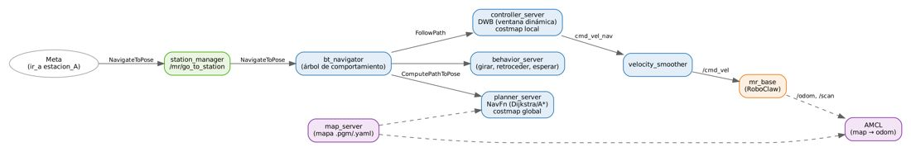
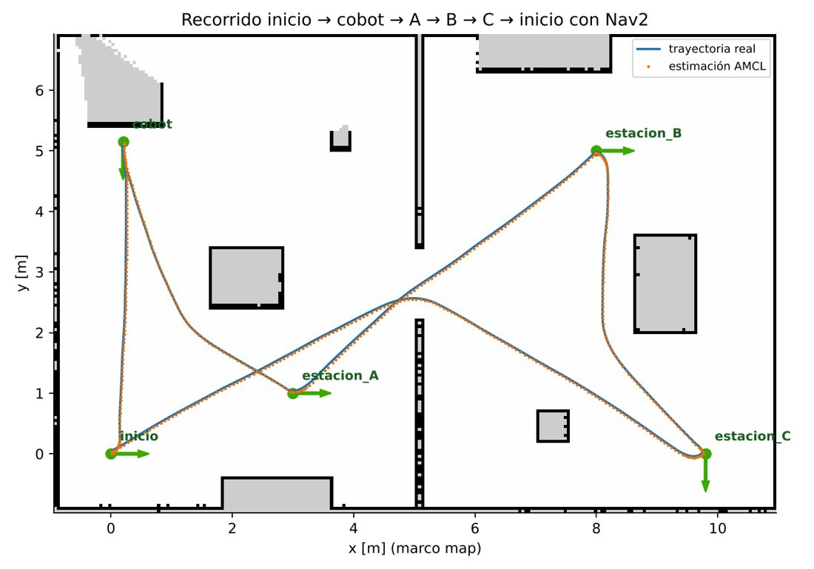

# Documento de Apoyo No. 18.1 – Navegación autónoma con Nav2: localización AMCL y seguimiento de trayectorias.

> Versión en Markdown del documento [18.1. Navegación autónoma con Nav2.docx](18.1.%20Navegación%20autónoma%20con%20Nav2.docx) para consultar y copiar comandos desde GitHub. El documento de Word es la versión oficial (formato GFPI-F-135).

**Duración Estimada:** 2 horas.

**Sesión:** Día 4 – 05/11/2026, bloque 2 (2:00 p.m. – 4:00 p.m.).

**Relación con la Guía de Aprendizaje:** Actividad 3.3.5 – carpeta «18. SEGUIMIENTO DE TRAYECTORIAS».

**Diseñado por:** Julián René Cháux Cedeño.

## 1. FUNDAMENTOS

**Nav2 es la pila de navegación de ROS 2 [1], [2].** Un árbol de comportamiento (*behavior tree*) coordina servidores especializados:



*Figura 1. Componentes de Nav2 usados por el robot.*

- **AMCL** localiza el robot en el mapa con un filtro de partículas (Monte Carlo) [3] con tamaño adaptativo KLD [4]; publica `map → odom`.
- **planner\_server** (NavFn) calcula la ruta global sobre el *costmap* global con Dijkstra o A\* [6], [7].
- **controller\_server** (DWB) sigue la ruta evaluando trayectorias en la ventana dinámica de velocidades admisibles [8] y evita obstáculos del *costmap* local.
- **velocity\_smoother** limita velocidades y aceleraciones; **behavior\_server** ejecuta recuperaciones (girar, retroceder, esperar).

## 2. CONFIGURACIÓN PARA ESTE ROBOT (CONFIG/NAV2_PARAMS.YAML)

*Tabla 1. Parámetros principales adaptados del archivo por defecto de nav2_bringup (Humble).*

| **Grupo** | **Valor** | **Motivo** |
|---|---|---|
| Marco del robot | `base_footprint` en todos los servidores | REP 105 |
| Huella | [[0,145, 0,135], [0,145, −0,135], [−0,175, −0,135], [−0,175, 0,135]] | Base de 0,29 × 0,25 m + 1–2 cm |
| Inflado | 0,35 m, factor 4,0 | Pasa por puertas de 1 m |
| Velocidad máx. (DWB, suavizador) | 0,25 m/s; 1,0 rad/s | Dentro de `max_linear_speed` de mr\_base |
| Aceleración | 0,6 m/s²; 2,0 rad/s² | Igual a la rampa del RoboClaw (DA-12.1) |
| Tolerancia de llegada | 5 cm; 0,08 rad (4,6°) | Atraque frente al cobot (DA-21.1) |
| AMCL | α₁₋₄ = 0,1; 180 haces; z\_hit 0,9; σ\_hit 0,05 m; 800–3000 partículas | Odometría calibrada y mapa preciso |
| Lidar | alcance 12 m; obstáculos hasta 5,5 m | RPLidar A1M8 R5 |

## 3. PROCEDIMIENTO

***Paso 0.*** *Incorpore a robots\_ws los paquetes mr\_interfaces (mensajes, servicios y acciones del curso) y mr\_navigation (puntos con nombre, que usan navigation.launch.py y el DA-18.2), en el PC y en el computador del robot (con la Jetson Nano, solo en el PC):*

**Terminal – PC y robot (con la Jetson Nano, solo PC)**

```bash
cd ~/robots_ws && git sparse-checkout add src/mr_interfaces src/mr_navigation
# instala las dependencias de los paquetes agregados
rosdep install --from-paths ~/robots_ws/src --ignore-src -r -y --skip-keys "mr_navigation jc_driver"
cd ~/robots_ws
colcon build --symlink-install --packages-select mr_interfaces mr_navigation
source install/setup.bash
```

**Terminal – robot**

```bash
ros2 launch mr_bringup robot.launch.py
```

**Terminal – PC (o AGX)**

```bash
# mapa guardado en el DA-17.1
ros2 launch mr_bringup navigation.launch.py map:=$HOME/mapas/laboratorio.yaml rviz:=true
```

1. Si el robot no arrancó en el origen del mapa, en RViz2 use **2D Pose Estimate** para indicar su pose aproximada; mueva el robot unos centímetros hasta que la nube de partículas converja.
1. Use **Nav2 Goal** para enviar una meta: el robot planifica, sigue la ruta y se detiene dentro de la tolerancia.
1. Coloque una caja en la ruta: el costmap local la marca y el controlador la rodea o replanifica.
1. Registre en la Tabla 3 el error de llegada medido con cinta en tres metas.

## 4. RESULTADOS DE VALIDACIÓN (ROBOT VIRTUAL)



*Figura 2. Recorrido real del robot virtual entre las estaciones con Nav2 (azul) y estimación de AMCL (naranja).*

*Tabla 2. Precisión de llegada medida con la verdad terreno del simulador (deslizamiento 1 %). Con los parámetros AMCL por defecto de nav2_bringup y tolerancia de 8 cm, el error medio había sido 9,2 cm (máx. 12,6 cm).*

| **Ensayo** | **Metas** | **Logradas** | **Error real medio** | **Error real máximo** | **Orientación** |
|---|---|---|---|---|---|
| 1 (6 metas) | cobot, A, B, C, cobot, inicio | 6/6 | 4,5 cm | 6,8 cm | ±4° |
| 2 (5 metas, con grabación) | cobot, A, B, C, inicio | 5/5 | 4,8 cm | 6,7 cm | ±4° |

*Tabla 3. Ensayos en el robot real (diligenciar).*

| **Meta** | **Error medido con cinta [cm]** | **Orientación [°]** | **Tiempo [s]** | **Observaciones** |
|---|---|---|---|---|
|  |  |  |  |  |
|  |  |  |  |  |
|  |  |  |  |  |

> **Arranque de Nav2:**
>
> Si al arrancar Nav2 aparece «failed to send response to /controller\_server/change\_state (timeout)» y las metas son rechazadas, el gestor de ciclo de vida no completó la activación (sucede en equipos lentos o con mucha carga). Detenga y vuelva a lanzar `navigation.launch.py`.

## REFERENCIAS

**[1]** S. Macenski, F. Martín, R. White y J. Ginés Clavero, "The Marathon 2: A navigation system," en *Proc. IEEE/RSJ IROS*, 2020, pp. 2718–2725, doi: 10.1109/IROS45743.2020.9341207.

**[2]** Open Navigation LLC, *Nav2 Documentation* (Humble). [En línea]. Disponible: [https://docs.nav2.org/](https://docs.nav2.org/)

**[3]** D. Fox, W. Burgard, F. Dellaert y S. Thrun, "Monte Carlo localization: Efficient position estimation for mobile robots," en *Proc. 16th National Conf. Artificial Intelligence (AAAI)*, 1999, pp. 343–349.

**[4]** D. Fox, "Adapting the sample size in particle filters through KLD-sampling," *The International Journal of Robotics Research*, vol. 22, no. 12, pp. 985–1003, 2003, doi: 10.1177/0278364903022012001.

**[5]** S. Thrun, W. Burgard y D. Fox, *Probabilistic Robotics*. Cambridge, MA, USA: MIT Press, 2005.

**[6]** E. W. Dijkstra, "A note on two problems in connexion with graphs," *Numerische Mathematik*, vol. 1, pp. 269–271, 1959, doi: 10.1007/BF01386390.

**[7]** P. E. Hart, N. J. Nilsson y B. Raphael, "A formal basis for the heuristic determination of minimum cost paths," *IEEE Trans. Systems Science and Cybernetics*, vol. 4, no. 2, pp. 100–107, 1968, doi: 10.1109/TSSC.1968.300136.

**[8]** D. Fox, W. Burgard y S. Thrun, "The dynamic window approach to collision avoidance," *IEEE Robotics & Automation Magazine*, vol. 4, no. 1, pp. 23–33, 1997, doi: 10.1109/100.580977.

**[9]** J. R. Cháux Cedeño, *Robótica básica – Semana 2: construcción y programación de un robot móvil (documentos de apoyo 8 a 18)*, SENA, 2022–2025.

**[10]** J. R. Cháux Cedeño, *robots\_ws – paquetes ROS 2 del curso (repositorio en GitHub, licencia Apache-2.0), 2026. [En línea]. Disponible: https://github.com/jchauxdev/robots\_ws*
