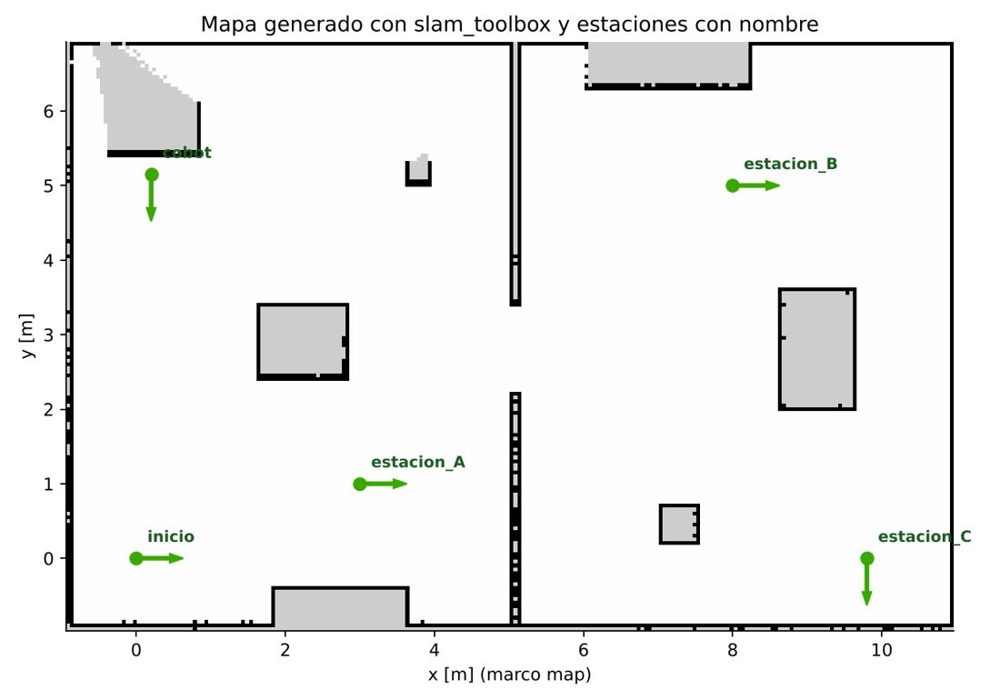

# Documento de Apoyo No. 18.2 – Puntos con nombre en el mapa y orden «ir al punto X».

> Versión en Markdown del documento [18.2. Puntos con nombre y orden ir al punto X.docx](18.2.%20Puntos%20con%20nombre%20y%20orden%20ir%20al%20punto%20X.docx) para consultar y copiar comandos desde GitHub. El documento de Word es la versión oficial (formato GFPI-F-135).

**Duración Estimada:** 1,5 horas.

**Sesión:** Día 4 – 05/11/2026, bloque 3 (4:00 p.m. – 5:30 p.m.).

**Relación con la Guía de Aprendizaje:** Actividad 3.3.5 – carpeta «18. SEGUIMIENTO DE TRAYECTORIAS».

**Diseñado por:** Julián René Cháux Cedeño.

## 1. DISEÑO

El nodo `station_manager` de `mr_navigation` [4] guarda poses con nombre (x, y, yaw en el marco `map`) en un archivo YAML y traduce «ir a X» en una meta `NavigateToPose` de Nav2 [1]. Así, el resto del sistema (terminal, App web, gestor de pedidos) habla en términos de **estaciones** y no de coordenadas.

*Tabla 1. Interfaces del gestor de estaciones.*

| **Interfaz** | **Tipo** | **Uso** |
|---|---|---|
| `/mr/go_to` | servicio `mr_interfaces/GoTo` | Enviar a una estación sin esperar (App web, pruebas) |
| `/mr/go_to_station` | acción `mr_interfaces/GoToStation` | Enviar y esperar el resultado con realimentación (gestor de pedidos) |
| `/mr/save_point` | servicio `mr_interfaces/SavePoint` | Guardar la pose actual del robot con un nombre |
| `/mr/list_points`, `/mr/cancel` | servicios `std_srvs/Trigger` | Listar estaciones; cancelar la navegación |
| `/mr/stations_markers` | `visualization_msgs/MarkerArray` | Flechas y nombres en RViz2 |
| `/mr/nav_state` | `std_msgs/String` | Estado legible (NAVEGANDO, EXITO, error final) |

**mr_bringup/config/estaciones.yaml**

```
# config/estaciones.yaml (marco map; yaw en grados, antihorario positivo - REP 103)
frame_id: map
estaciones:
  inicio:     {x: 0.00, y: 0.00, yaw_deg: 0.0,   descripcion: "Base / carga de bateria"}
  cobot:      {x: 0.20, y: 5.15, yaw_deg: -90.0, descripcion: "Atraque de espaldas a la celda del JetCobot"}
  estacion_A: {x: 3.00, y: 1.00, yaw_deg: 0.0,   descripcion: "Estacion de entrega A"}
  estacion_B: {x: 8.00, y: 5.00, yaw_deg: 0.0,   descripcion: "Estacion de entrega B"}
  estacion_C: {x: 9.80, y: 0.00, yaw_deg: -90.0, descripcion: "Estacion de entrega C"}
```

## 2. PROCEDIMIENTO

### Paso 1. Definir estaciones

Hay tres formas, todas válidas:

1. **Conducir y guardar:** teleopere el robot a la posición deseada (con Nav2 corriendo y localizado) y ejecute `ros2 run mr_navigation guardar_punto estacion_D`.
1. **Desde RViz2:** con la herramienta *Publish Point* lea las coordenadas en `/clicked_point` (`ros2 topic echo /clicked_point`) y escríbalas en el YAML.
1. **Editar el YAML** a mano con coordenadas medidas en el mapa (el origen es la pose inicial de la SLAM).

### Paso 2. Ir a un punto, recorridos y cancelación

**Terminal – PC (o AGX, donde corre Nav2)**

```bash
ros2 launch mr_bringup navigation.launch.py map:=$HOME/mapas/laboratorio.yaml \
     stations:=$HOME/robots_ws/src/mr_bringup/config/estaciones.yaml
# lista
ros2 run mr_navigation estaciones
# espera el resultado: "EXITO en estacion_A | error final 4.0 cm"
ros2 run mr_navigation ir_a estacion_A
ros2 run mr_navigation recorrido cobot estacion_B estacion_C inicio --vueltas 2
# sin esperar
ros2 service call /mr/go_to mr_interfaces/srv/GoTo "{name: estacion_B}"
ros2 service call /mr/cancel std_srvs/srv/Trigger
```



*Figura 1. Estaciones del laboratorio sobre el mapa.*

### Paso 3. Programar sus propias órdenes (Python)

**mi_recorrido.py**

```
import rclpy
from rclpy.action import ActionClient
from mr_interfaces.action import GoToStation
rclpy.init()
node = rclpy.create_node('mi_orden')
cli = ActionClient(node, GoToStation, '/mr/go_to_station')
cli.wait_for_server()
for estacion in ['estacion_A', 'estacion_B', 'inicio']:
    goal = cli.send_goal_async(GoToStation.Goal(name=estacion))
    rclpy.spin_until_future_complete(node, goal)
    result = goal.result().get_result_async()
    rclpy.spin_until_future_complete(node, result)
    print(estacion, result.result().result.message)
```

Para recorridos sin detenerse en cada punto Nav2 ofrece además `NavigateThroughPoses` y `waypoint_follower` [2].

> **Insertar imagen:**
>
> *Salida de* `recorrido` *en su robot y captura de RViz2 con los marcadores de las estaciones.*

## REFERENCIAS

**[1]** Open Navigation LLC, *Nav2 Documentation* (Humble). [En línea]. Disponible: [https://docs.nav2.org/](https://docs.nav2.org/)

**[2]** S. Macenski, F. Martín, R. White y J. Ginés Clavero, "The Marathon 2: A navigation system," en *Proc. IEEE/RSJ IROS*, 2020, pp. 2718–2725, doi: 10.1109/IROS45743.2020.9341207.

**[3]** T. Foote y M. Purvis, *REP 103 – Standard Units of Measure and Coordinate Conventions*. [En línea]. Disponible: [https://www.ros.org/reps/rep-0103.html](https://www.ros.org/reps/rep-0103.html)

**[4]** J. R. Cháux Cedeño, *robots\_ws – paquetes ROS 2 del curso (repositorio en GitHub, licencia Apache-2.0), 2026. [En línea]. Disponible: https://github.com/jchauxdev/robots\_ws*
