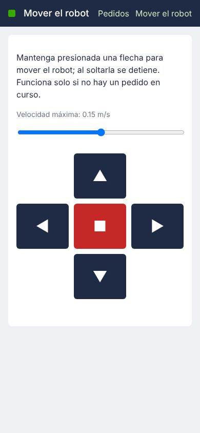

# Documento de Apoyo No. 19.1 – Teleoperación del robot: teclado y celular (App web).

> Versión en Markdown del documento [19.1. Teleoperación del robot (teclado y celular).docx](19.1.%20Teleoperación%20del%20robot%20(teclado%20y%20celular).docx) para consultar y copiar comandos desde GitHub. El documento de Word es la versión oficial (formato GFPI-F-135).

**Duración Estimada:** 1 hora.

**Sesión:** Día 4 – 05/11/2026, bloque 4 (5:30 p.m. – 6:00 p.m.) y durante el mapeo (DA-17.1).

**Relación con la Guía de Aprendizaje:** Actividad 3.3.5 – carpeta «19. TELEOPERACIÓN ROBOT ROS 2».

**Diseñado por:** Julián René Cháux Cedeño.

## 1. OPCIONES DE TELEOPERACIÓN

El robot se puede mover desde el teclado del PC, desde el celular con una página web servida por el propio sistema (funciona en cualquier navegador, sin instalar nada) o con un mando USB. La Tabla 1 resume las opciones.

*Tabla 1. Opciones de teleoperación en ROS 2.*

| **Opción** | **Equipo** | **Ventajas** | **Cuidados** |
|---|---|---|---|
| `teleop_twist_keyboard` | PC o terminal SSH | Estándar, ajusta velocidades con q/z | La terminal debe tener el foco |
| App web `mr_logistics` (página «Mover el robot») | Celular / PC | Sin instalar nada; bloqueada si hay un pedido en curso | Solo en la red del laboratorio; token opcional |
| Mando USB (`teleop_twist_joy`) | PC o robot | Control fino | Requiere configurar el botón de habilitación |

## 2. TECLADO

**Terminal – PC**

```bash
ros2 run teleop_twist_keyboard teleop_twist_keyboard
# robot con namespace mr
ros2 run teleop_twist_keyboard teleop_twist_keyboard --ros-args -r cmd_vel:=/mr/cmd_vel
```

`teleop_twist_keyboard` [1] publica `geometry_msgs/Twist` en `cmd_vel`. `mr_base` limita velocidades (DA-12.1) y frena si deja de recibir órdenes durante 0,5 s.

## 3. CELULAR: APP WEB

`web_app` (Flask [3]) forma parte de la App logística del DA-21.1 [5]. La página «Mover el robot» envía la orden mientras se mantiene presionada una flecha (10 veces por segundo) y, al soltarla, envía cero. El servidor limita la velocidad (0,25 m/s y 1 rad/s) y rechaza la teleoperación si hay un pedido activo.

**Paso 0.** Incorpore la App (paquete mr\_logistics) a robots\_ws en el equipo que la ejecuta (PC o AGX Orin); usa mr\_interfaces y mr\_navigation, incorporados en el DA-18.1:

**Terminal – PC (o AGX)**

```bash
cp -r ~/mr_reserva/mr_ws/src/mr_logistics ~/robots_ws/src/
cd ~/robots_ws
colcon build --symlink-install --packages-select mr_logistics
source install/setup.bash
```

**Terminal – PC (o AGX)**

```bash
# en el PC o en la AGX Orin
ros2 launch mr_logistics logistica.launch.py
# IP del equipo, p. ej. 192.168.0.101
hostname -I
# En el celular conectado a la red ROBOTS:  http://192.168.0.101:8080/teleop
```



*Figura 1. Página «Mover el robot» en un celular (captura del sistema en ejecución).*

Validación: en el robot virtual, dos segundos de «avanzar» a 0,15 m/s desplazaron el robot 0,375 m (incluye la rampa de frenado); el botón «Detener robot» canceló una navegación en curso.

> **Seguridad:**
>
> La App no exige usuario ni contraseña por defecto: úsela solo en la red del laboratorio o defina el parámetro `access_token` (DA-21.1). El paro de emergencia físico del robot sigue siendo la protección principal.

> **Insertar imagen:**
>
> *Captura de su celular controlando el robot.*

## REFERENCIAS

**[1]** ROS 2, *teleop\_twist\_keyboard* (Humble 2.4.1). [En línea]. Disponible: [https://github.com/ros2/teleop_twist_keyboard](https://github.com/ros2/teleop_twist_keyboard)

**[2]** N. Rottmann, N. Studt, F. Ernst y E. Rueckert, "ROS-Mobile: An Android application for the Robot Operating System," arXiv: 2011.02781, 2020. Repositorio: [https://github.com/ROS-Mobile/ROS-Mobile-Android](https://github.com/ROS-Mobile/ROS-Mobile-Android)

**[3]** Pallets Projects, *Flask Documentation*. [En línea]. Disponible: [https://flask.palletsprojects.com/](https://flask.palletsprojects.com/)

**[4]** J. R. Cháux Cedeño, *Robótica básica – Semana 2: construcción y programación de un robot móvil (documentos de apoyo 8 a 18)*, SENA, 2022–2025.

**[5]** J. R. Cháux Cedeño, *mr\_ws – espacio de trabajo ROS 2 del robot móvil diferencial* (material de esta transferencia, licencia Apache-2.0), 2026.
