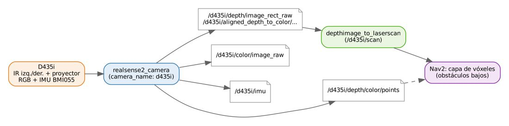

# Documento de Apoyo No. 20.1 – Cámara de profundidad Intel RealSense D435i en el robot móvil.

> Versión en Markdown del documento [20.1. RealSense D435i en el robot móvil.docx](20.1.%20RealSense%20D435i%20en%20el%20robot%20móvil.docx) para consultar y copiar comandos desde GitHub. El documento de Word es la versión oficial (formato GFPI-F-135).

**Duración Estimada:** 2 horas.

**Sesión:** Día 4 – 05/11/2026, bloque 3 (alterno a 18.2) o Día 5 – 06/11/2026, bloque 1.

**Relación con la Guía de Aprendizaje:** Actividad 3.3.6 – carpeta «20. CÁMARA DE PROFUNDIDAD REALSENSE D435i».

**Diseñado por:** Julián René Cháux Cedeño.

## 1. FUNDAMENTOS

La D435i es una cámara de **estéreo activo**: dos cámaras infrarrojas de obturador global y un proyector de patrón calculan la profundidad por disparidad; suma una cámara RGB y una IMU BMI055. Rango ideal 0,3–3 m, profundidad hasta 1280 × 720 a 90 FPS, campo de visión 87° × 58°, RGB 1920 × 1080 a 30 FPS y conexión USB-C 3.1 [1]. La profundidad se obtiene por triangulación [2]:

$$Z=\frac{f B}{d}  ⇒  \Delta Z≈\frac{{Z}^{2}}{f B} \Delta d \qquad (1)$$

con f la focal en píxeles, B la línea base entre las cámaras IR y d la disparidad: el error crece con el cuadrado de la distancia, por eso se usa sobre todo a corto alcance.

### 1.1 ¿Para qué en el robot móvil?

- El RPLidar ve un solo plano (~0,28 m de altura): no detecta mesas por debajo de su tablero, escalones ni objetos bajos. La D435i cubre el volumen frente al robot.
- Su profundidad puede convertirse en un *LaserScan* virtual para los costmaps de Nav2, o usarse como nube de puntos en la capa de vóxeles.
- La IMU puede fusionarse con la odometría (p. ej. `robot_localization`) en trabajos de profundización.



*Figura 1. Flujo de datos de la D435i en el robot.*

## 2. INSTALACIÓN SEGÚN EL COMPUTADOR

*Tabla 1. Instalación de la D435i.*

| **Computador** | **Instalación** | **Observación** |
|---|---|---|
| PC o Jetson AGX Orin (Ubuntu 22.04) | `sudo apt install ros-humble-librealsense2* ros-humble-realsense2-*` | Paquetes de ROS (realsense2\_camera 4.59.1 en Humble) [7] |
| Jetson Nano (JetPack 4.6.x) | Compilar librealsense con el backend RSUSB y realsense-ros dentro del contenedor | Los paquetes Debian de RealSense para Jetson requieren JetPack ≥ 5.0.2 [4]; la Nano quedó en JetPack 4.6.6 [8] |

> **¿Nano o AGX?:**
>
> Recomendación del curso: use la D435i con la Jetson AGX Orin (USB 3, más memoria y GPU). En la Nano es posible, pero la compilación es larga y la Nano queda al límite de CPU con lidar, cámara y profundidad a la vez. La guía de librealsense remite para la Nano a un procedimiento comunitario (Humble).

## 3. PROCEDIMIENTO (AGX ORIN O PC)

### Paso 1. Verificar la cámara

**Terminal – robot**

```bash
sudo apt install ros-humble-librealsense2-tools 2>/dev/null || true
# modelo D435I, firmware, puerto USB 3.2
rs-enumerate-devices | head -20
# (con escritorio) ver profundidad, color e IMU
realsense-viewer
```

### Paso 2. Lanzar con el robot

`robot.launch.py realsense:=true` incluye `rs_launch.py` de `realsense2_camera` [3] con `camera_name:=d435i` (marcos `d435i_link`, `d435i_depth_optical_frame`…), 640 × 480 a 15 FPS, profundidad alineada al color e IMU unificada (`unite_imu_method: 2`, interpolación lineal):

**Terminal – robot**

```bash
ros2 launch mr_bringup robot.launch.py realsense:=true
ros2 topic list | grep d435i
#   /d435i/color/image_raw  /d435i/depth/image_rect_raw  /d435i/aligned_depth_to_color/image_raw
#   /d435i/imu  /d435i/depth/camera_info ...
ros2 topic hz /d435i/depth/image_rect_raw
ros2 run tf2_ros tf2_echo base_footprint d435i_depth_optical_frame
```

### Paso 3. Profundidad → LaserScan para Nav2

`depthimage_to_laserscan` [5] toma una franja de filas de la imagen de profundidad y la convierte en `/d435i/scan` en el marco `d435i_depth_frame` [9]:

**Terminal – robot**

```bash
sudo apt install ros-humble-depthimage-to-laserscan
ros2 launch mr_bringup realsense_scan.launch.py range_min:=0.3 range_max:=3.0 scan_height:=10
ros2 topic echo /d435i/scan --field ranges --once | head
```

Agregue la fuente a la capa de obstáculos de los dos costmaps en `nav2_params.yaml` [6]:

**Fragmento para config/nav2_params.yaml**

```
      voxel_layer:          # (local_costmap)  igual en obstacle_layer del global_costmap
        observation_sources: scan d435i
        d435i:
          topic: /d435i/scan
          data_type: "LaserScan"
          marking: True
          clearing: True
          obstacle_max_range: 2.5
          raytrace_max_range: 3.0
```

### Paso 4. Prueba

1. Coloque bajo la ruta del robot un objeto de 10–15 cm de alto (que el lidar no detecta).
1. Sin la fuente `d435i` el robot choca con él (pruebe a baja velocidad y con el paro de emergencia a mano).
1. Con la fuente activa, el objeto aparece en el costmap local y el robot lo rodea.

*Tabla 2. Resultados (diligenciar).*

| **Prueba** | **Sin D435i** | **Con D435i** | **Observaciones** |
|---|---|---|---|
| Objeto bajo en la ruta |  |  |  |
| Borde de mesa (tablero sobre el lidar) |  |  |  |

> **Validación:**
>
> Esta integración no se pudo validar con la cámara física durante la preparación del material (se verificaron los nombres de parámetros y tópicos en el código fuente de realsense-ros 4.59.1 y de depthimage\_to\_laserscan). Ajuste la altura y la inclinación de la cámara del DA-8.1 a su robot.

## REFERENCIAS

**[1]** Intel RealSense, *Intel® RealSense™ Depth Camera D435i* (especificaciones). [En línea]. Disponible: [https://store.intelrealsense.com/buy-intel-realsense-depth-camera-d435i.html](https://store.intelrealsense.com/buy-intel-realsense-depth-camera-d435i.html)

**[2]** L. Keselman, J. I. Woodfill, A. Grunnet-Jepsen y A. Bhowmik, "Intel RealSense stereoscopic depth cameras," en *Proc. IEEE CVPR Workshops*, 2017, pp. 1267–1276, doi: 10.1109/CVPRW.2017.167.

**[3]** RealSense, *realsense-ros – ROS 2 wrapper* (rama ros2-master, v4.59.1). [En línea]. Disponible: [https://github.com/realsenseai/realsense-ros](https://github.com/realsenseai/realsense-ros)

**[4]** RealSense, *librealsense – NVIDIA Jetson installation guide*. [En línea]. Disponible: [https://github.com/realsenseai/librealsense/blob/master/doc/installation_jetson.md](https://github.com/realsenseai/librealsense/blob/master/doc/installation_jetson.md)

**[5]** ROS Perception, *depthimage\_to\_laserscan* (Humble 2.5.1). [En línea]. Disponible: [https://github.com/ros-perception/depthimage_to_laserscan](https://github.com/ros-perception/depthimage_to_laserscan)

**[6]** Open Navigation LLC, *Nav2 Documentation* (Humble). [En línea]. Disponible: [https://docs.nav2.org/](https://docs.nav2.org/)

**[7]** Open Robotics, *rosdistro – humble/distribution.yaml* (versiones liberadas de cada paquete). [En línea]. Disponible: [https://github.com/ros/rosdistro/blob/master/humble/distribution.yaml](https://github.com/ros/rosdistro/blob/master/humble/distribution.yaml)

**[8]** NVIDIA, *Announcing End of Life for NVIDIA JetPack 4 with the release of JetPack 4.6.6* (22/11/2024; Jetson Linux R32.7.6). [En línea]. Disponible: [https://forums.developer.nvidia.com/t/announcing-end-of-life-for-nvidia-jetpack-4-with-the-release-of-jetpack-4-6-6/314302](https://forums.developer.nvidia.com/t/announcing-end-of-life-for-nvidia-jetpack-4-with-the-release-of-jetpack-4-6-6/314302)

**[9]** J. R. Cháux Cedeño, *mr\_ws – espacio de trabajo ROS 2 del robot móvil diferencial* (material de esta transferencia, licencia Apache-2.0), 2026.
