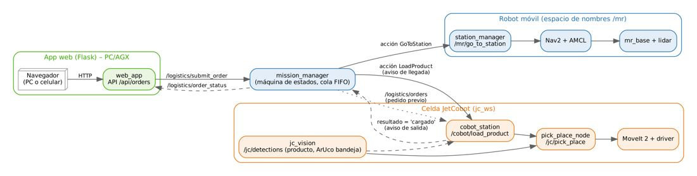
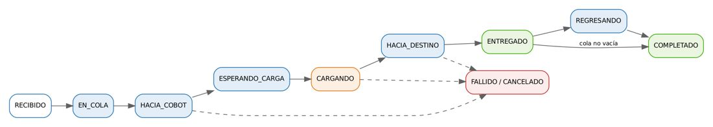
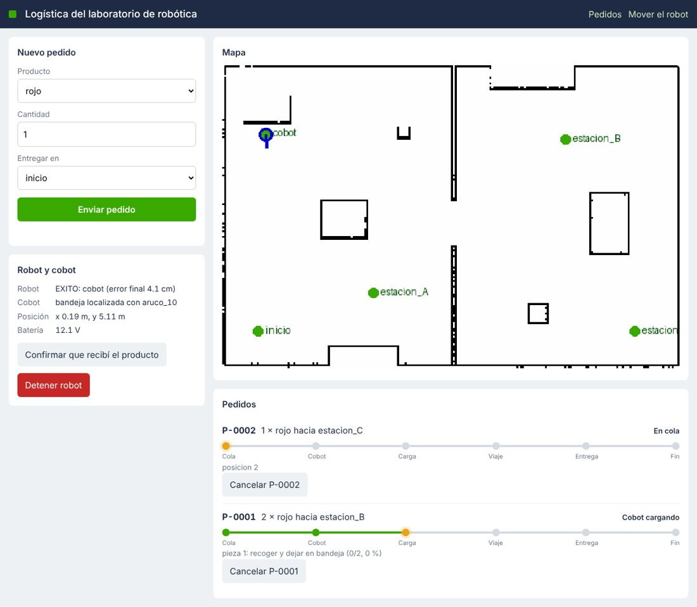
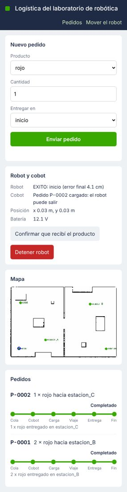

# Documento de Apoyo No. 21.1 – Integración robot móvil – cobot con una App web de logística.

> Versión en Markdown del documento [21.1. Integración robot móvil - cobot con App de logística.docx](21.1.%20Integración%20robot%20móvil%20-%20cobot%20con%20App%20de%20logística.docx) para consultar y copiar comandos desde GitHub. El documento de Word es la versión oficial (formato GFPI-F-135).

**Duración Estimada:** 4 horas.

**Sesión:** Día 5 – 06/11/2026, bloques 1 y 2 (8:00 a.m. – 3:00 p.m.).

**Relación con la Guía de Aprendizaje:** Actividad 3.4.1 (transferencia) – carpeta «21. INTEGRACIÓN ROBOT MÓVIL - COBOT».

**Diseñado por:** Julián René Cháux Cedeño.

## 1. EL ESCENARIO

Un operador crea un pedido en la App web (p. ej. «2 piezas rojas para la estación B»). El cobot recibe el pedido de inmediato y verifica con su visión que el producto está en la mesa. El robot móvil va a la estación del cobot y le **avisa** que llegó. El cobot detecta el producto, lo recoge y lo deja sobre la bandeja del robot; al terminar, **avisa** al robot, que sale hacia la estación de destino, espera la descarga y regresa.



*Figura 1. Arquitectura de la integración. Las acciones ROS 2 llevan el aviso de llegada (meta LoadProduct) y el aviso de salida (resultado de la acción).*

## 2. DISEÑO

### 2.1 Interfaces (mr_interfaces)

*Tabla 1. Interfaces ROS 2 de la integración.*

| **Interfaz** | **Tipo** | **Quién la ofrece** | **Quién la usa** |
|---|---|---|---|
| `/logistics/submit_order` | servicio `SubmitOrder` (Order) | mission\_manager | App web, CLI `pedido` |
| `/logistics/cancel_order`, `/logistics/confirm_delivery` | servicios | mission\_manager | App web |
| `/logistics/orders` | tópico `Order` (latched) | mission\_manager | cobot\_station (pedido previo) |
| `/logistics/order_status` | tópico `OrderStatus` (latched ×50) | mission\_manager | App web |
| `/mr/go_to_station` | acción `GoToStation` | station\_manager (DA-18.2) | mission\_manager |
| `/cobot/load_product` | acción `LoadProduct` (product, quantity) | cobot\_station | mission\_manager |
| `/jc/pick_place` | acción `PickPlace` (jc\_ws) | pick\_place\_node del cobot | cobot\_station |
| `/jc/detections` | tópico `DetectedObjectArray` (jc\_ws) | visión del cobot | pick\_place\_node, cobot\_station |

### 2.2 Máquina de estados del pedido



*Figura 2. Estados de un pedido en mission_manager (un pedido a la vez, cola FIFO).*

### 2.3 Decisiones de integración

- **Espacio de nombres** `mr` **para el robot.** El JetCobot ([8]) y el robot móvil tienen un enlace `base_link` y cada uno publica `robot_description` y `joint_states`. En el mismo `ROS_DOMAIN_ID` [3] sus árboles TF chocarían. Con `namespace:=mr` todos los tópicos del robot quedan en `/mr/...` (incluida su TF en `/mr/tf`), sin tocar el código del cobot [4].
- **Bandeja localizada por visión.** Nav2 deja al robot a ±5–7 cm de la estación (DA-18.1), más que la tolerancia de un *pick & place*. La bandeja lleva un marcador ArUco (`aruco_10`); `cobot_station` lo busca con la cámara del cobot y deposita sobre él. Si no lo ve, usa la pose nominal `tray_pose`.
- **Alcance del brazo.** El JetCobot (myCobot 280) alcanza ~0,28 m. La estación debe dejar la bandeja dentro de su espacio de trabajo: mesa baja del cobot (~0,30 m) o bandeja elevada, robot atracado de espaldas (`yaw = −90°` en la estación `cobot`) con la bandeja en la parte trasera, **por debajo del plano del lidar**.
- **Seguridad.** El cobot solo se mueve con el robot detenido y atracado; las velocidades del brazo son las reducidas de la celda. Para una aplicación industrial aplican ISO 10218 (robots y celdas) [6] e ISO 3691-4 (vehículos sin conductor) [7].

## 3. PROCEDIMIENTO

### Paso 1. Preparar la celda del cobot (equipo del cobot)

**Terminal – equipo del cobot**

```bash
# equipo del cobot: robots_ws con los paquetes jc_* (transferencia del cobot) y la reserva mr_ws (DA-9.1, Paso 2)
# Paso 0: incorporar mr_interfaces y mr_cobot_bridge
cp -rn ~/mr_reserva/mr_ws/src/mr_interfaces ~/mr_reserva/mr_ws/src/mr_cobot_bridge ~/robots_ws/src/
# solo si este equipo aún no tiene jc_interfaces
cp -rn ~/jc_reserva/jc_ws/src/jc_interfaces ~/robots_ws/src/
cd ~/robots_ws
colcon build --packages-select jc_interfaces mr_interfaces mr_cobot_bridge && source install/setup.bash
# celda real (DA-17 del cobot)
ros2 launch jc_bringup real.launch.py camera:=true handeye:=true rviz:=false
# vision + pick_place_node
ros2 launch jc_apps celda.launch.py mode:=real detector:=color
# estacion logistica
ros2 launch mr_cobot_bridge cobot_station.launch.py
```

Ajuste en `mr_cobot_bridge/config/cobot_station.yaml` la pose nominal de la bandeja (`tray_pose`, en el marco `world` de la celda) moviendo el brazo con el robot atracado, y pegue en la bandeja un marcador ArUco id 10 del mismo diccionario y tamaño que usa `jc_vision`.

### Paso 2. Robot móvil y navegación (robot y PC/AGX)

**Terminal – robot**

```bash
ros2 launch mr_bringup robot.launch.py namespace:=mr
```

**Terminal – PC (o AGX)**

```bash
ros2 launch mr_bringup navigation.launch.py namespace:=mr map:=$HOME/mapas/laboratorio.yaml
# (si hace falta) atraque frente al cobot
ros2 run mr_navigation guardar_punto cobot --ros-args -r __ns:=/mr
```

### Paso 3. App logística

**Terminal – PC (o AGX)**

```bash
ros2 launch mr_logistics logistica.launch.py namespace:=mr
# Navegador:  http://<IP>:8080        Terminal:  ros2 run mr_logistics pedido rojo 2 estacion_B
```

La App ([5]) muestra el formulario de pedido, el estado del robot y del cobot, el mapa con la pose del robot y las estaciones, y cada pedido con su recorrido Cola → Cobot → Carga → Viaje → Entrega → Fin.



*Figura 3. App logística durante la carga del pedido P-0001 (P-0002 en cola). Captura del sistema en ejecución (robot virtual y cobot en MoveIt 2 simulado).*



*Figura 4. La misma App en un celular, con los dos pedidos completados.*

## 4. VALIDACIÓN EXTREMO A EXTREMO (SIMULACIÓN)

Se ejecutó todo el sistema en el entorno de pruebas [9]: robot virtual con namespace `mr` (emulador del RoboClaw + lidar simulado, deslizamiento 1 %), Nav2, la App, `cobot_station` y la celda del JetCobot en MoveIt 2 con hardware simulado (`jc_bringup mock.launch.py` + `pick_place_node`), con detecciones sintéticas de tres piezas «rojo» y del marcador de la bandeja. Se enviaron por HTTP un pedido inválido y dos válidos:

*Tabla 2. Registro de la segunda corrida completa (la primera dio el mismo resultado, con errores de llegada de 2,7 cm y 5,2 cm).*

| **t [s]** | **Pedido** | **Estado** | **Detalle** |
|---|---|---|---|
| 0 | — | rechazado | Producto desconocido «pera» |
| 0 | P-0001 | HACIA\_COBOT | navegando a cobot (P-0002 EN\_COLA, posición 2) |
| 55 | P-0001 | ESPERANDO\_CARGA | robot en la estación del cobot: avisando al cobot |
| 57 | P-0001 | CARGANDO | bandeja localizada con aruco\_10; pieza 1 y pieza 2 |
| 174 | P-0001 | HACIA\_DESTINO | cobot terminó: 2 × rojo en la bandeja |
| 217–226 | P-0001 | ENTREGADO → COMPLETADO | en estacion\_B, error real 2,5 cm; inicia P-0002 |
| 272–301 | P-0002 | ESPERANDO\_CARGA → CARGANDO → HACIA\_DESTINO | 1 × rojo |
| 352 | P-0002 | ENTREGADO | estacion\_C, error real 5,4 cm |
| 360–415 | P-0002 | REGRESANDO → COMPLETADO | regreso a inicio (error 4,1 cm) |

Con el robot real, el tiempo de carga depende de la velocidad configurada del brazo; los tiempos de navegación, de la distancia entre estaciones (0,25 m/s máximo).

## 5. EXTENSIONES PROPUESTAS (PROYECTO)

- Productos detectados con YOLO (frutas COCO: `apple`, `orange`, `banana`) en lugar de colores (DA-11 del cobot).
- Varias estaciones de carga o varios robots (un espacio de nombres por robot).
- Confirmación de entrega con un botón físico o con la cámara del robot (¿hay producto en la bandeja?).
- Base de datos de pedidos (SQLite) e informes de tiempos de ciclo en la App.

*Tabla 3. Lista de verificación de la integración (diligenciar con el sistema real).*

| **Prueba** | **Resultado esperado** | **OK** |
|---|---|---|
| Pedido con producto inexistente | La App muestra «Producto desconocido» |  |
| Dos pedidos seguidos | El segundo queda EN\_COLA y se atiende al terminar el primero |  |
| Cancelar un pedido en viaje | Estado CANCELADO y el robot se detiene |  |
| Bandeja sin marcador | El cobot usa la pose nominal (mensaje en «Cobot») |  |
| Botón «Confirmar que recibí» | El robot regresa antes del tiempo de espera |  |

> **Insertar imagen:**
>
> *Video del ciclo completo con el robot y el cobot reales, y captura de la App con el pedido completado.*

## REFERENCIAS

**[1]** S. Macenski, T. Foote, B. Gerkey, C. Lalancette y W. Woodall, "Robot Operating System 2: Design, architecture, and uses in the wild," *Science Robotics*, vol. 7, no. 66, eabm6074, 2022, doi: 10.1126/scirobotics.abm6074.

**[2]** Open Navigation LLC, *Nav2 Documentation* (Humble). [En línea]. Disponible: [https://docs.nav2.org/](https://docs.nav2.org/)

**[3]** Open Robotics, *The ROS\_DOMAIN\_ID* (ROS 2 Humble, Concepts). [En línea]. Disponible: [https://docs.ros.org/en/humble/Concepts/Intermediate/About-Domain-ID.html](https://docs.ros.org/en/humble/Concepts/Intermediate/About-Domain-ID.html)

**[4]** W. Meeussen, *REP 105 – Coordinate Frames for Mobile Platforms*. [En línea]. Disponible: [https://www.ros.org/reps/rep-0105.html](https://www.ros.org/reps/rep-0105.html)

**[5]** Pallets Projects, *Flask Documentation*. [En línea]. Disponible: [https://flask.palletsprojects.com/](https://flask.palletsprojects.com/)

**[6]** International Organization for Standardization, *ISO 10218-1:2025 y ISO 10218-2:2025, Robotics — Safety requirements*. Ginebra: ISO, 2025.

**[7]** International Organization for Standardization, *ISO 3691-4:2023, Industrial trucks — Safety requirements and verification — Part 4: Driverless industrial trucks and their systems*. Ginebra: ISO, 2023.

**[8]** J. R. Cháux Cedeño, *jc\_ws – espacio de trabajo ROS 2 de la celda JetCobot* (material de esta transferencia, licencia Apache-2.0), 2026.

**[9]** J. R. Cháux Cedeño, *mr\_ws – espacio de trabajo ROS 2 del robot móvil diferencial* (material de esta transferencia, licencia Apache-2.0), 2026.
