# Documento de Apoyo No. 8.1 – Construcción del robot móvil de tracción diferencial.

> Versión en Markdown del documento [8.1. Construcción del robot.docx](8.1.%20Construcción%20del%20robot.docx) para consultar y copiar comandos desde GitHub. El documento de Word es la versión oficial (formato GFPI-F-135).

**Duración Estimada:** 3 horas.

**Sesión:** Día 2 – 03/11/2026, bloque 1 (8:00 a.m. – 11:00 a.m.).

**Relación con la Guía de Aprendizaje:** Actividad 3.3.1 (contextualización y apropiación) – carpeta «8. CONSTRUCCIÓN DEL ROBOT».

**Diseñado por:** Julián René Cháux Cedeño.

## 1. OBJETIVOS DE APRENDIZAJE

- Identificar cada componente del robot, su función y su especificación eléctrica a partir de la hoja de datos.
- Ensamblar la base, los motores, el controlador RoboClaw, la Jetson y los sensores en el orden correcto.
- Cablear potencia, encoders y comunicaciones según el diagrama del Anexo, con interruptor y paro de emergencia.
- Verificar tensiones y polaridades con multímetro y diligenciar la lista de chequeo antes del primer encendido.

## 2. DESCRIPCIÓN DEL ROBOT

El robot tiene una estructura mecánica diseñada en SolidWorks [1]: una base circular de acrílico con dos niveles superiores sobre separadores metálicos de 10 cm, dos ruedas motrices de 90 mm a los lados y una rueda loca de bola en la parte trasera. Es un robot de **tracción diferencial**: avanza cuando ambas ruedas giran igual y gira cuando giran distinto [2]. Usa como computador una Jetson Nano o una Jetson AGX Orin, ROS 2 Humble como software y una cámara de profundidad Intel RealSense D435i.

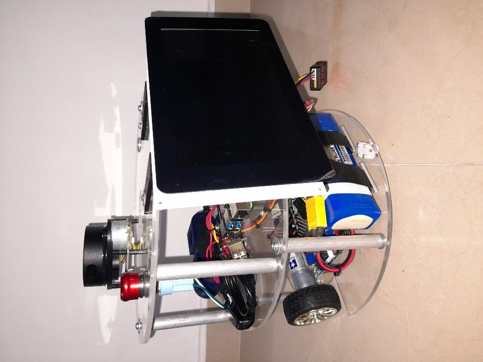

*Figura 1. Robot construido.*

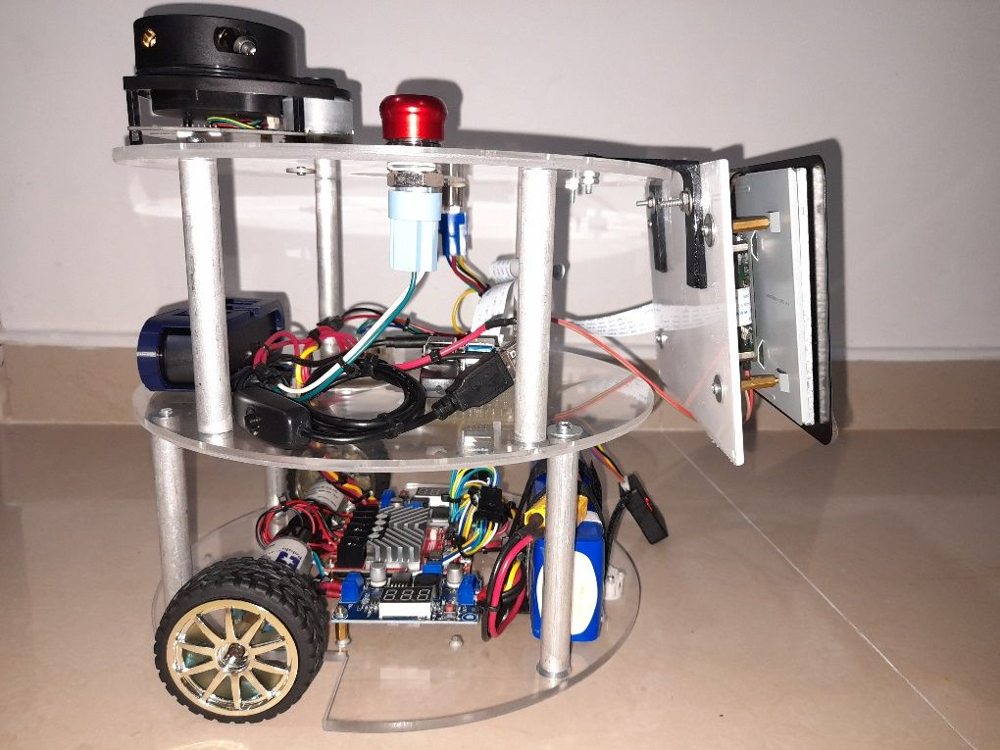

*Figura 2. Vista lateral del robot: niveles, rueda motriz y rueda loca.*

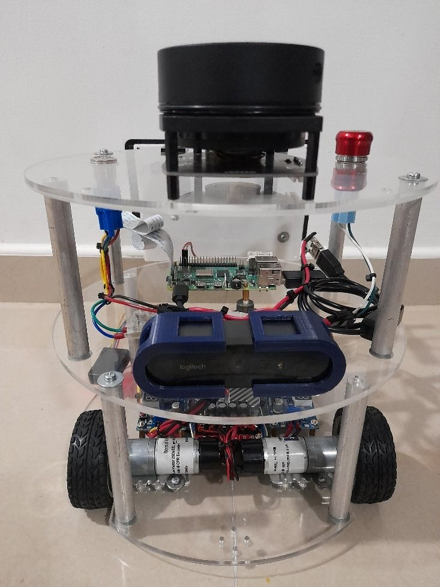

*Figura 3. Vista superior del robot ensamblado: motores, controlador, computador, lidar e interruptores.*

### 2.1 Lista de componentes

*Tabla 1. Componentes del robot (verifique cada referencia contra su kit).*

| **Componente** | **Referencia / especificación** | **Función** |
|---|---|---|
| Motorreductores (2) | Pololu 25D 47:1 HP 12 V con encoder 48 CPR (#4846: 46,85:1, 2248,86 cuentas por vuelta de la salida) [3], o Pololu 37D con encoder 64 CPR (p. ej. 131,25:1 → 8400 cuentas) [4] | Tracción y medición de giro (odometría) |
| Ruedas y acoples (2) | Rueda Pololu 90 × 10 mm; acople de aluminio para eje de 6 mm (medidas del modelo CAD) | Contacto con el piso |
| Soportes de motor (2) | Soportes Pololu para 25D o 37D (figuras siguientes) | Fijación a la base |
| Rueda loca | Rueda de bola (caster) | Tercer punto de apoyo |
| Controlador de motores | RoboClaw 2x15A: 2 canales, 15 A continuos y 30 A pico por canal, 6–34 V, decodificadores de cuadratura integrados [5]. Las unidades del laboratorio son versión V5 (el programa de configuración las identifica como «RC15AV5») | Control de velocidad en lazo cerrado (PID) y lectura de encoders |
| Computador embebido | Jetson Nano 4 GB (alimentación por conector cilíndrico 5 V / 4 A con el puente J48) [7] o Jetson AGX Orin 32 GB (la misma del cobot) | ROS 2: drivers, odometría y (en la AGX) navegación |
| Lidar 2D | Slamtec RPLidar A1M8: 0,15–12 m (revisión R5), ≥ 8000 muestras/s, 5,5 Hz típicos, resolución angular ≤ 1° [8] | Mapeo y localización |
| Cámara RGB | Cámara USB UVC (el modelo CAD usa una Logitech Brio) | Video para teleoperación y visión |
| Cámara de profundidad | Intel RealSense D435i: estéreo activa, 0,3–3 m ideal, profundidad hasta 1280 × 720, FOV 87° × 58°, IMU BMI055, USB-C 3.1 [9] | Obstáculos 3D y percepción (DA-20.1) |
| Reguladores DC-DC | Uno para motores (12 V) y uno para la Jetson (5 V); ver la advertencia de corriente en 4.2 | Adecuación de tensión |
| Batería | LiPo del kit (verifique el número de celdas y la tensión en la etiqueta) | Fuente de energía |
| Interruptor y paro de emergencia | Interruptor metálico con LED de 16 mm y hongo de emergencia de 16 mm | Seguridad |

### 2.2 Arquitectura eléctrica

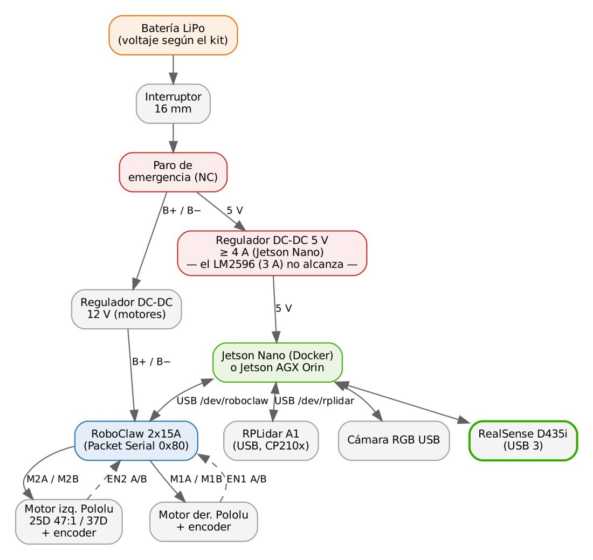

*Figura 4. Diagrama de potencia (líneas sólidas) y señales (líneas punteadas y USB). El motor izquierdo va a M2 y el derecho a M1; el driver ROS 2 lo configura con el parámetro left_motor: 2 (DA-12.1).*

## 3. MATERIALES Y HERRAMIENTAS

- Kit del robot (Tabla 1), tornillería M3 y separadores.
- Destornilladores, llaves Allen, pelacables, cautín y termoencogible.
- Multímetro (obligatorio).
- Conectores aéreos o terminales para conexiones desmontables (recomendado).

## 4. PROCEDIMIENTO DE ENSAMBLE

### 4.1 Base y tracción

1. Ensamble los acoples (*wheel mounting hubs*) en las ruedas.
1. Coloque y ajuste los soportes de motor sobre la base (figuras siguientes).
1. Fije los motores a los soportes y monte las ruedas sobre el eje con el tornillo prisionero contra la cara plana del eje en D.
1. Instale la rueda loca. Compruebe que el robot apoya en los tres puntos sin cabecear.
1. Mida con calibrador la **separación entre los centros de las ruedas** y el **diámetro real** de cada rueda; anótelos en la tabla de la sección 6. Son los valores iniciales de la calibración del DA-12.2 (el modelo CAD da 201,6 mm y 90 mm).

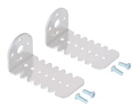

*Figura 5. Soportes para motores 25D …*

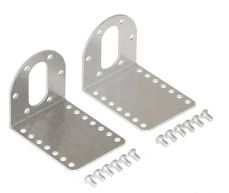

*Figura 6. … y para motores 37D.*

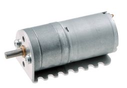

*Figura 7. Motor 25D fijado a su soporte.*

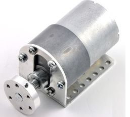

*Figura 8. Motor 37D fijado a su soporte, con el acople de la rueda.*

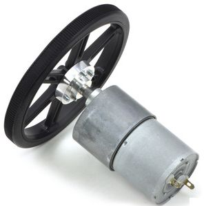

*Figura 9. Rueda de 90 mm con acople montada en el motorreductor.*

### 4.2 Electrónica de la base

1. Fije el RoboClaw y los dos reguladores DC-DC sobre separadores (nunca directamente sobre la base).
1. Ajuste **en vacío** la salida de cada regulador con el multímetro antes de conectar cualquier carga: 12 V para motores y 5,0–5,1 V para la Jetson Nano (figura siguiente).
1. Conecte batería → interruptor → paro de emergencia (contacto NC) → reguladores, según los Anexos A y B.
1. Conecte los motores y los encoders al RoboClaw (Anexo C).
1. Instale los separadores de 10 cm y la tapa intermedia; monte la Jetson sobre separadores y la cámara RGB al frente.
1. Instale la tapa superior, el RPLidar centrado y sin obstáculos en los 360° de su plano de barrido, y la pantalla si aplica.
1. Monte la RealSense D435i al frente, **por debajo del plano del lidar**, mirando hacia adelante con una leve inclinación al piso si se quieren detectar obstáculos bajos. Mida su posición respecto al centro entre ruedas (sección 6).

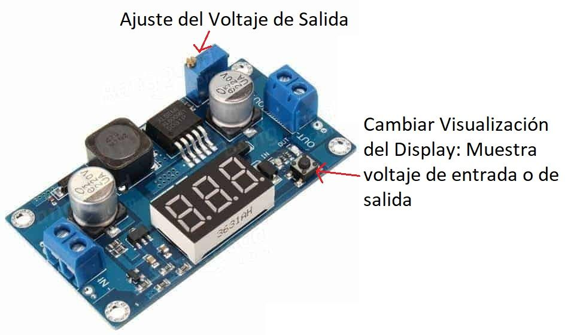

*Figura 10. Regulador DC-DC con visualizador: ajuste de la tensión de salida.*

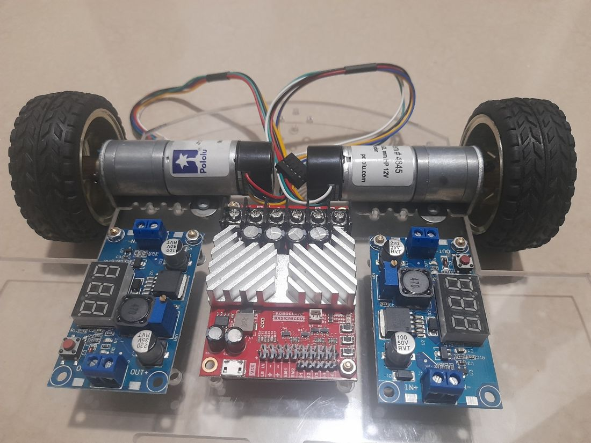

*Figura 11. RoboClaw (centro) y los dos reguladores DC-DC fijados sobre separadores en la base.*

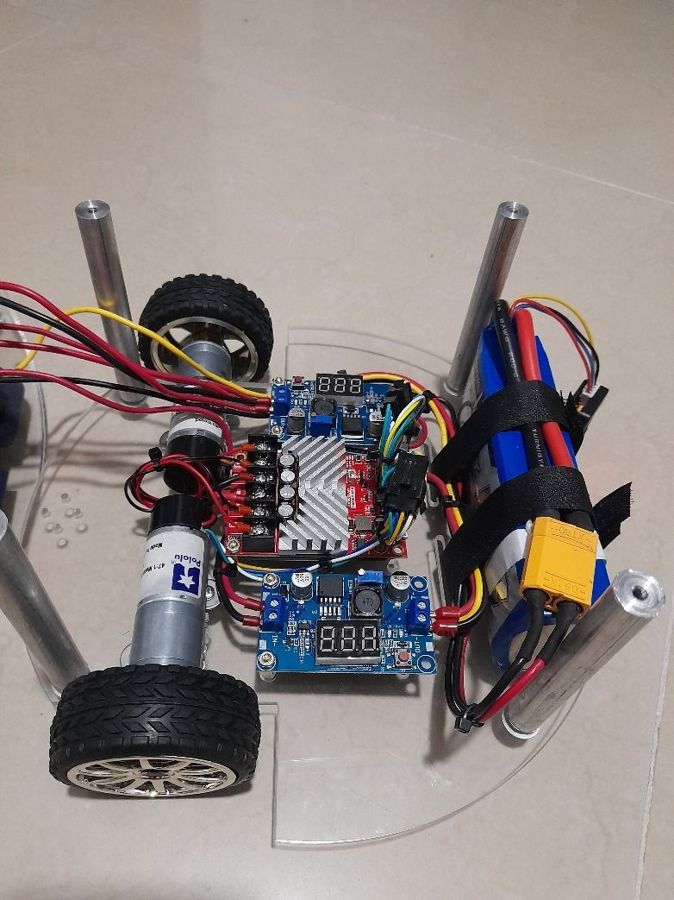

*Figura 12. Cableado de la base: batería, RoboClaw, reguladores y motores.*

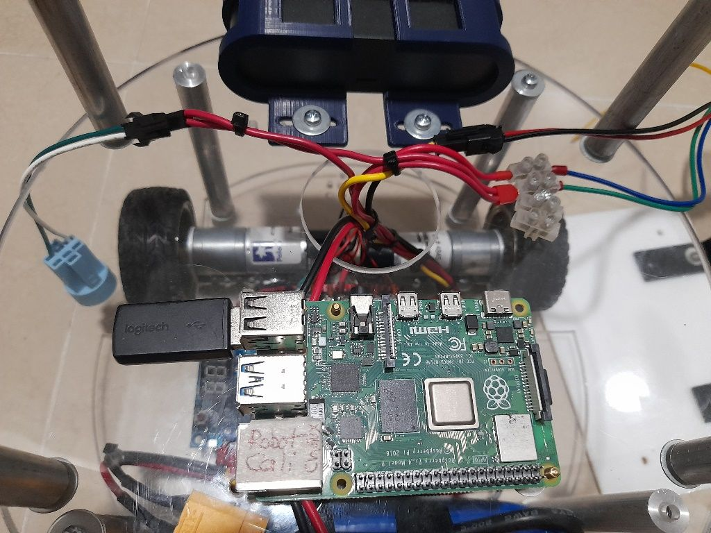

*Figura 13. Nivel intermedio: computador sobre separadores y su alimentación (la fotografía muestra una Raspberry Pi 4; en este robot va la Jetson).*

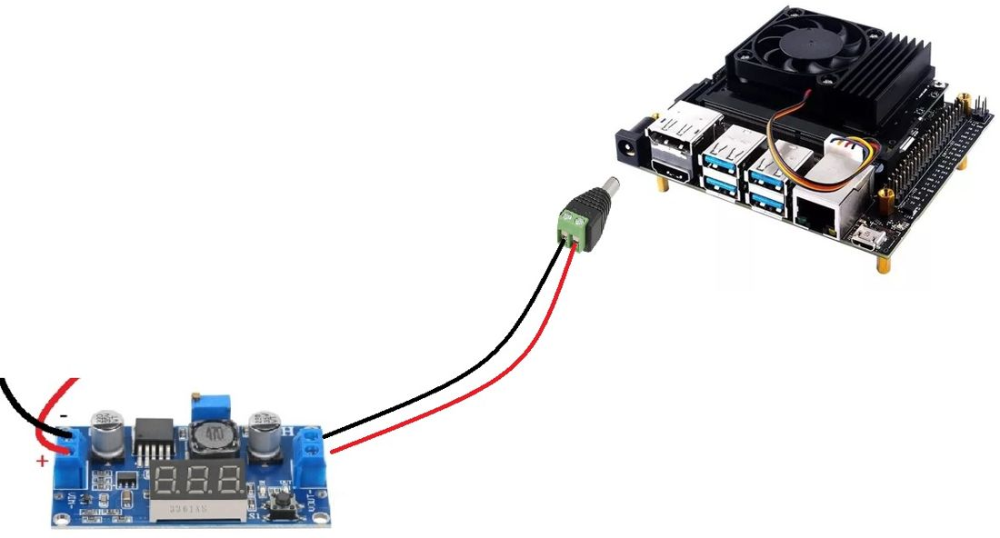

*Figura 14. Alimentación del computador desde la salida del regulador de 5 V con conector jack.*

> **Corriente del regulador de 5 V:**
>
> Los módulos con el regulador LM2596 entregan como máximo 3 A. La Jetson Nano en modo de 10 W requiere una fuente de 5 V / 4 A por el conector cilíndrico (NVIDIA, guía de inicio del kit) [7]; con un LM2596 la tensión cae bajo carga y la Jetson se reinicia. Use un convertidor de 5 A o más, o limite la Jetson al modo de 5 W (`sudo nvpmodel -m 1`). Registre la tensión medida con el robot moviéndose y con la CPU cargada (Tabla 2).

> **Regeneración:**
>
> El RoboClaw es un controlador regenerativo: al frenar devuelve energía a la fuente. El manual advierte que la mayoría de fuentes lineales y conmutadas no absorben esa energía y que debe existir siempre un camino de retorno a la batería; con fuentes se requiere un circuito de enclavamiento de tensión (*voltage clamp*) [6]. Si su kit alimenta el RoboClaw a través de un convertidor DC-DC, revise esa sección con el instructor; cuando la tensión de los motores lo permita, conéctelo directamente a la batería.

### 4.3 Presupuesto de energía (diligenciar)

*Tabla 2. Presupuesto de energía del robot. Las celdas vacías se completan con la hoja de datos del componente y con la medición del grupo.*

| **Consumidor** | **Tensión** | **Corriente de la hoja de datos** | **Corriente medida** | **Observación** |
|---|---|---|---|---|
| Jetson Nano (10 W) | 5 V | 4 A (fuente recomendada) |  |  |
| Jetson AGX Orin | según su fuente | ver guía del kit |  | Normalmente con su propia fuente/batería |
| 2 × motores Pololu | 12 V | ver hoja de datos (corriente de bloqueo) |  | Medir en arranque y en giro |
| RPLidar A1 | 5 V (USB) | ver hoja de datos |  |  |
| RealSense D435i | 5 V (USB 3) | ver hoja de datos |  | Conectar a un puerto USB 3 |
| Cámara RGB | 5 V (USB) |  |  |  |

## 5. LISTA DE CHEQUEO ANTES DEL PRIMER ENCENDIDO

*Tabla 3. Lista de chequeo eléctrica (la firma el instructor).*

| **#** | **Verificación** | **OK** |
|---|---|---|
| 1 | Polaridad de la batería y de cada regulador medida con multímetro |  |
| 2 | Paro de emergencia en serie y en contacto NC: al presionarlo se corta la alimentación |  |
| 3 | Salida del regulador de 5 V entre 5,0 y 5,1 V en vacío |  |
| 4 | Motores en M1/M2 y encoders en EN1/EN2 según el Anexo C; sin cables sueltos cerca de las ruedas |  |
| 5 | Ruedas levantadas del piso para la primera prueba de motores (DA-10.1 y DA-12.1) |  |
| 6 | Lidar con campo de visión libre en 360°; ningún cable cruza su plano |  |
| 7 | Fotografía del cableado tomada (evidencia) |  |

> **Seguridad:**
>
> NO realice conexiones eléctricas definitivas sin la verificación previa del instructor. Antes de energizar: polaridad de la batería, interruptor y paro de emergencia en serie, regulador ajustado al voltaje de la Jetson y ruedas levantadas en la primera prueba de motores.

## 6. MEDIDAS DEL ROBOT (DILIGENCIAR)

*Tabla 4. Medidas que alimentan el modelo URDF y la calibración.*

| **Magnitud** | **Modelo CAD** | **Medido** | **Uso en el software** |
|---|---|---|---|
| Diámetro de rueda izquierda / derecha [mm] | 90,0 / 90,0 |  | `wheel_diameter` (DA-12.1) |
| Separación entre centros de rueda b [mm] | 201,6 |  | `wheel_separation` (DA-12.2) |
| Eje de ruedas respecto al frente de la base [mm] | — |  | URDF (DA-14.1) |
| Centro del lidar (x, z) respecto a `base_link` [mm] | 77,8; 215 + 35 |  | `lidar_joint` / `laser_joint` |
| Centro de la D435i (x, z) [mm] | 135; 165 (propuesto) |  | `d435i_joint` |
| Masa total [kg] | 1,48 (sin batería) |  | Referencia |

## ANEXO A. INTERRUPTORES

Se usan un interruptor metálico autoenclavado de 16 mm con LED y un paro de emergencia de 16 mm. La función de los cables del interruptor es la siguiente:

*Tabla 5. Cables del interruptor con LED.*

| **Color** | **Función** |
|---|---|
| Rojo | Positivo (+) del LED |
| Negro | Negativo (−) del LED |
| Azul | Común del interruptor |
| Verde | Normalmente abierto (NO) |
| Amarillo | Normalmente cerrado (NC) |

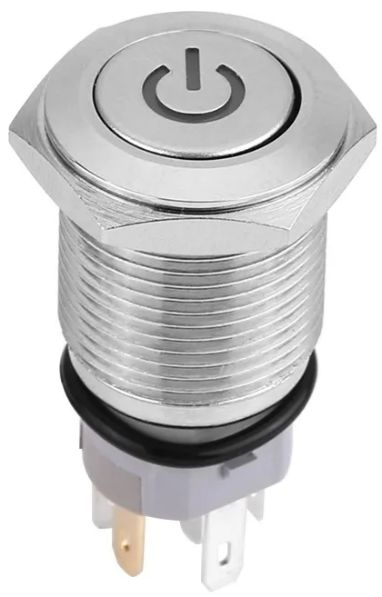

*Figura 15. Interruptor metálico autoenclavado de 16 mm con LED.*

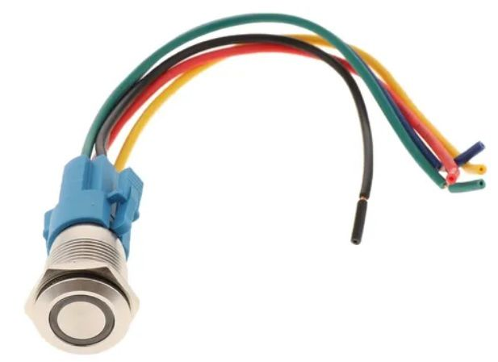

*Figura 16. Interruptor de 16 mm con LED y su arnés.*

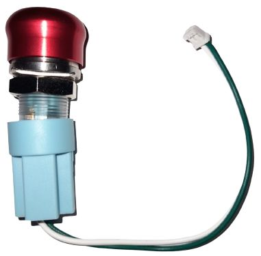

*Figura 17. Paro de emergencia: si es necesario, reubique la base para usar el contacto NC.*

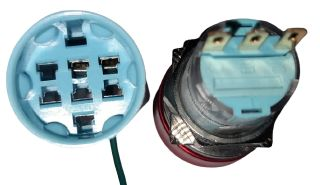

*Figura 18. Contactos del paro de emergencia: normalmente cerrado (NC), normalmente abierto (NO) y común.*

*Figura 19. Interruptores conectados con conectores aéreos para facilitar el montaje y desmontaje.*

## ANEXO B. CONEXIÓN DE LA BATERÍA A LOS INTERRUPTORES

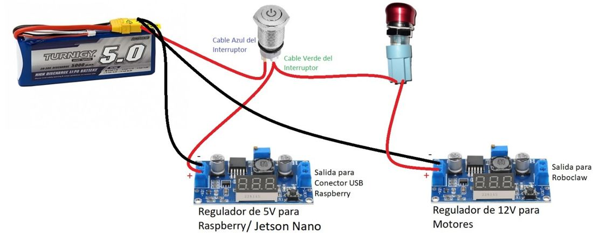

*Figura 20. Batería → interruptor → paro de emergencia → reguladores.*

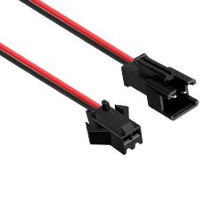

*Figura 21. Conector aéreo de dos pines recomendado para conexiones desmontables.*

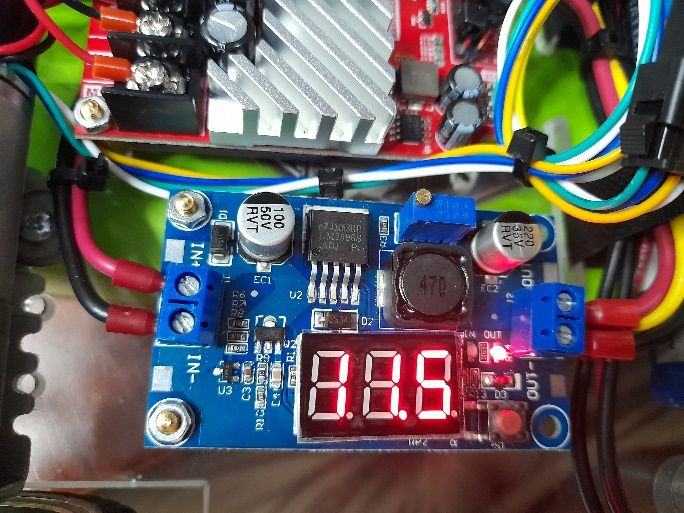

*Figura 22. Regulador de 12 V conectado con terminales.*

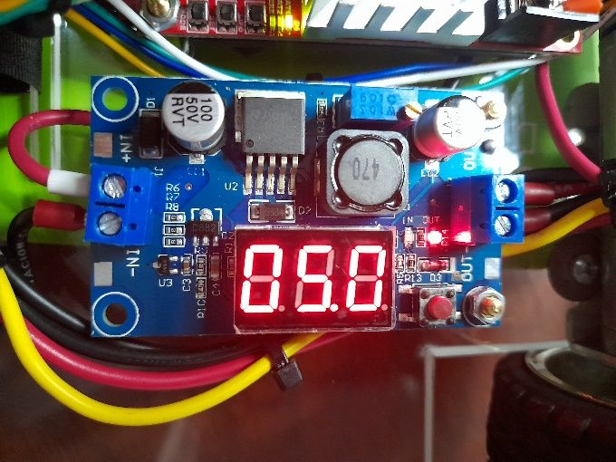

*Figura 23. Regulador de 5 V conectado con terminales.*

## ANEXO C. CONEXIÓN DE LOS MOTORES AL ROBOCLAW

Cada motor tiene dos grupos de conexiones: **potencia** (dos cables gruesos al bloque M1A/M1B o M2A/M2B) y **encoder** (alimentación y canales A/B al conector EN1 o EN2). Si al hacer *Autotune* en Motion Studio aparece «Encoder direction is reversed relative to motor direction», intercambie físicamente los canales A y B de ese encoder (DA-10.1).

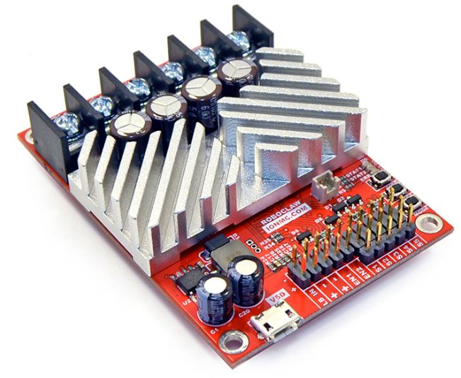

*Figura 24. Controlador RoboClaw 2x15A.*

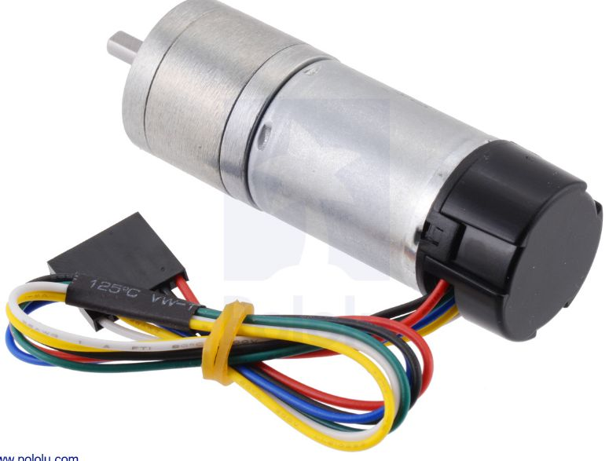

*Figura 25. Motorreductor Pololu 25D con encoder.*

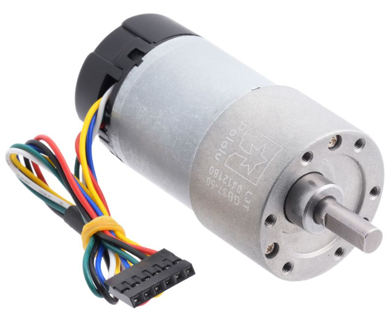

*Figura 26. Motorreductor Pololu 37D con encoder.*

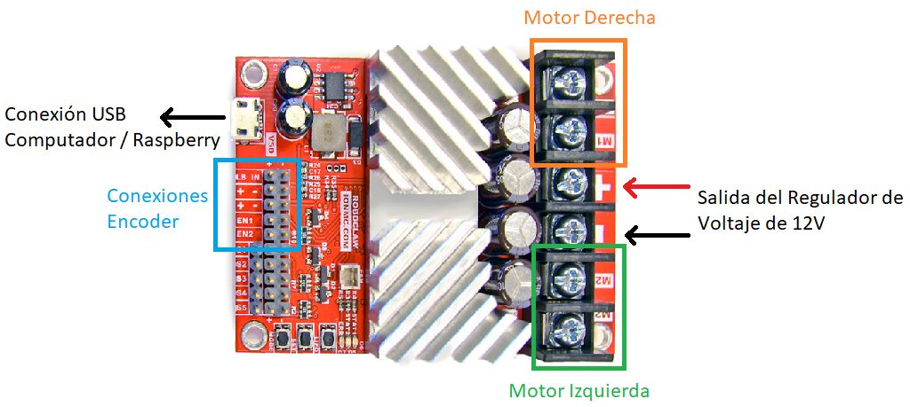

*Figura 27. Conexiones del RoboClaw: USB al computador, encoders, entrada desde el regulador de 12 V y bornes de los motores derecho e izquierdo.*

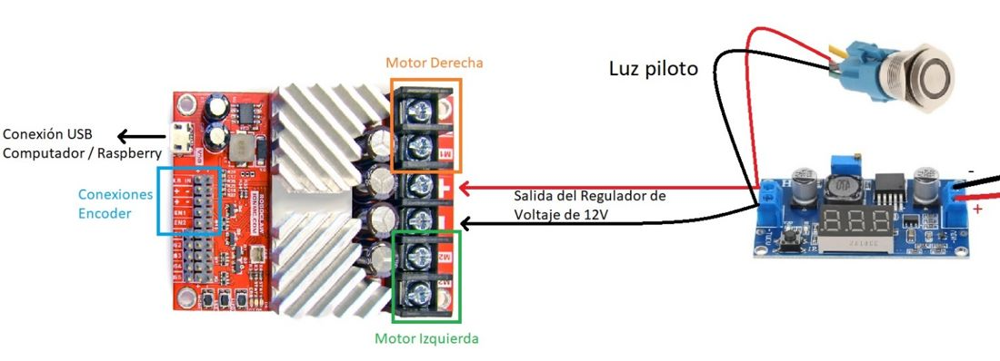

*Figura 28. Conexión del RoboClaw con el regulador de 12 V y la luz piloto del interruptor.*

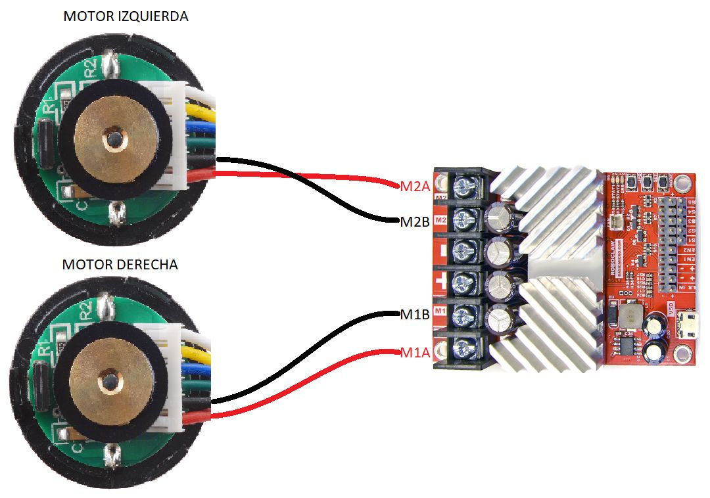

*Figura 29. Conexión de motores y encoders al RoboClaw.*

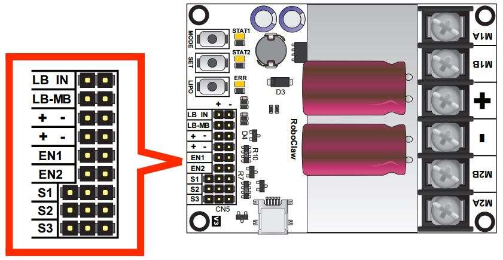

*Figura 30. Pines de señales del RoboClaw (LB IN, LB-MB, +, −, EN1, EN2, S1–S3) y bornes de potencia.*

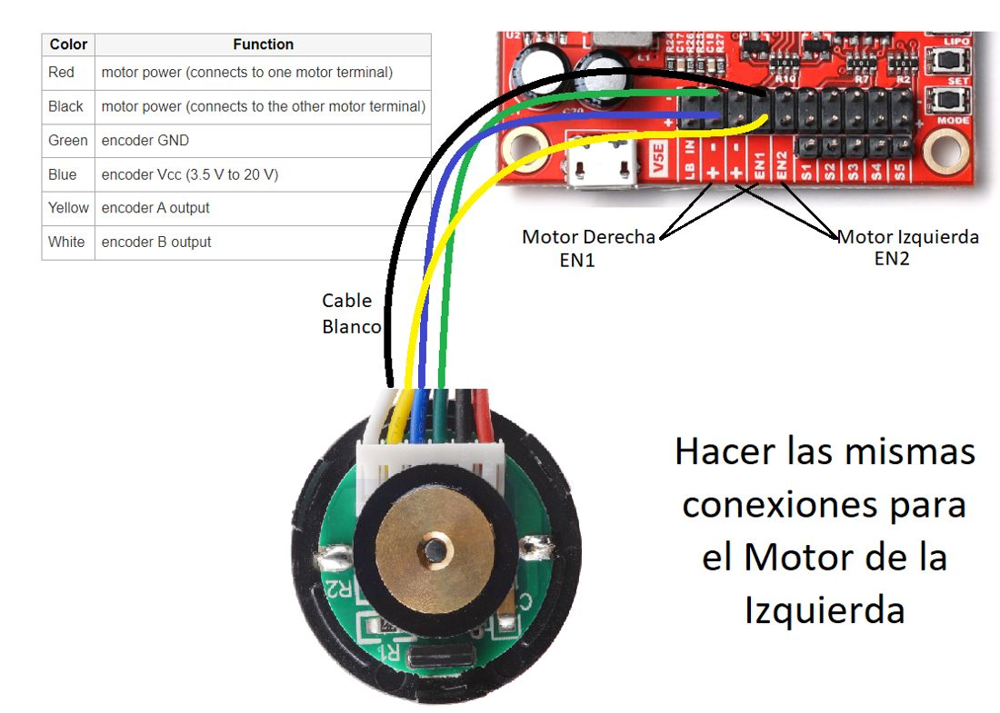

*Figura 31. Detalle de las conexiones del encoder del motor derecho (EN1); el motor izquierdo se conecta igual en EN2.*

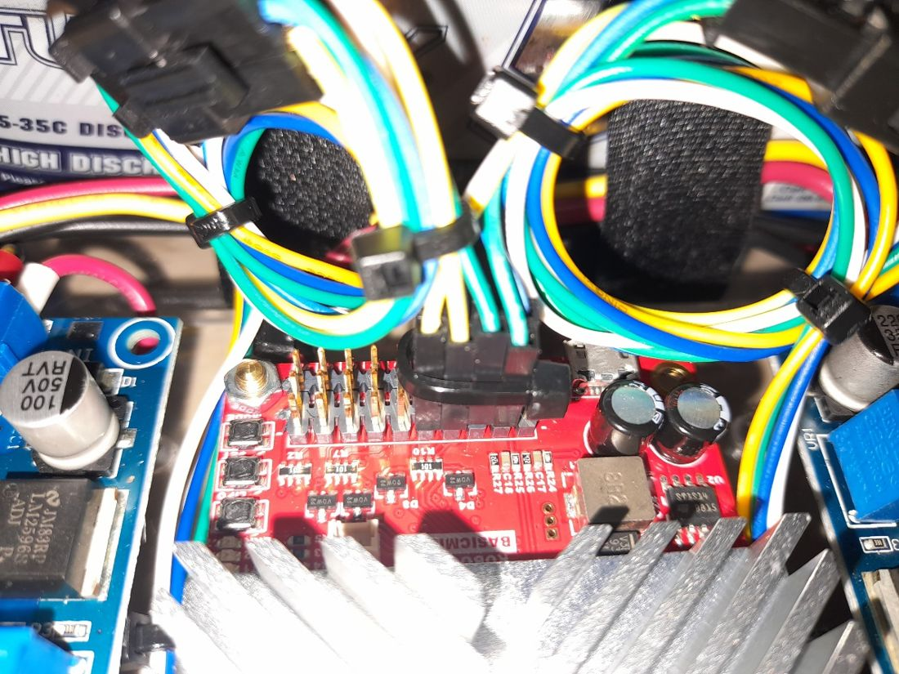

*Figura 32. Conexión real de los cables de los encoders al RoboClaw.*

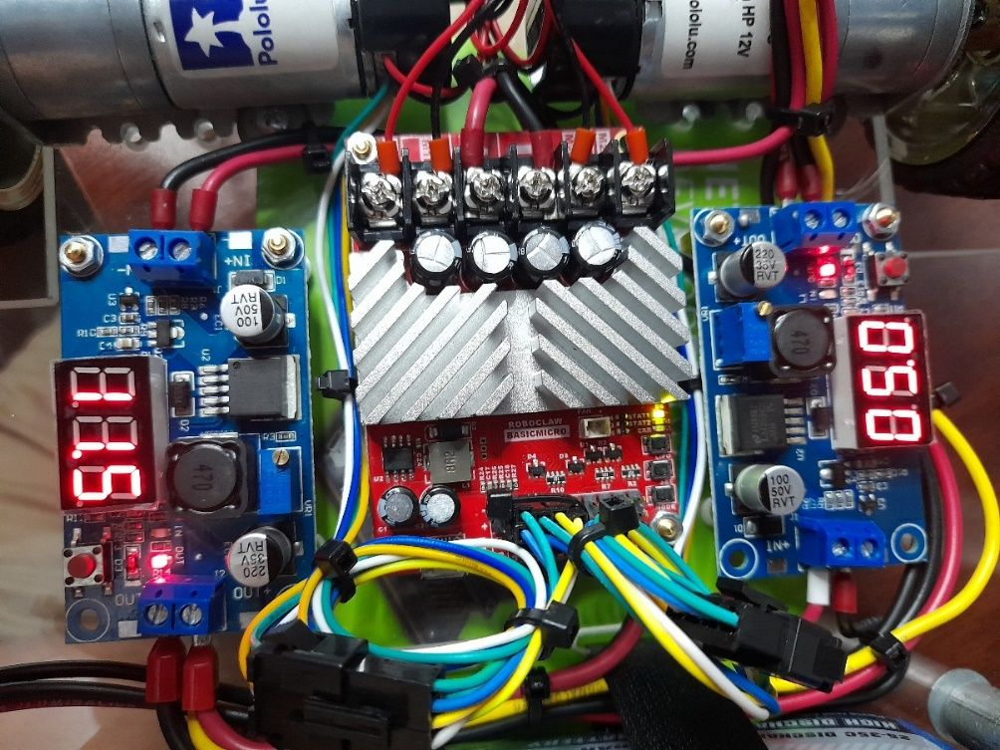

*Figura 33. Montaje real: RoboClaw entre los reguladores de 5 V y 12 V, con los cables de los motores.*

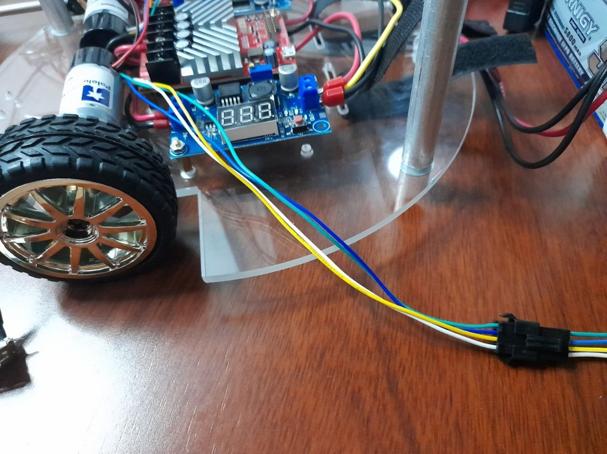

*Figura 34. Conectores aéreos en los cables de los motores para conexiones desmontables.*

## ANEXO D. CONEXIÓN DE SENSORES Y COMPUTADOR

El RoboClaw, el lidar y las cámaras se conectan por USB a la Jetson. La RealSense debe ir a un puerto **USB 3** (azul). En la Nano los cuatro puertos USB 3.0 comparten un concentrador; si el video se interrumpe, retire la cámara RGB o baje la resolución de la RealSense (DA-20.1).

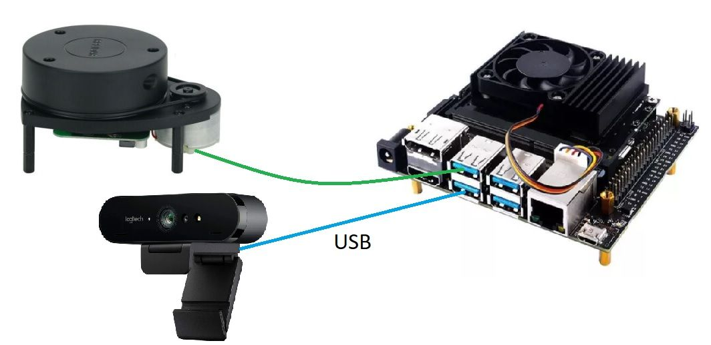

*Figura 35. Conexión del lidar y la cámara al computador (en este robot, a la Jetson).*

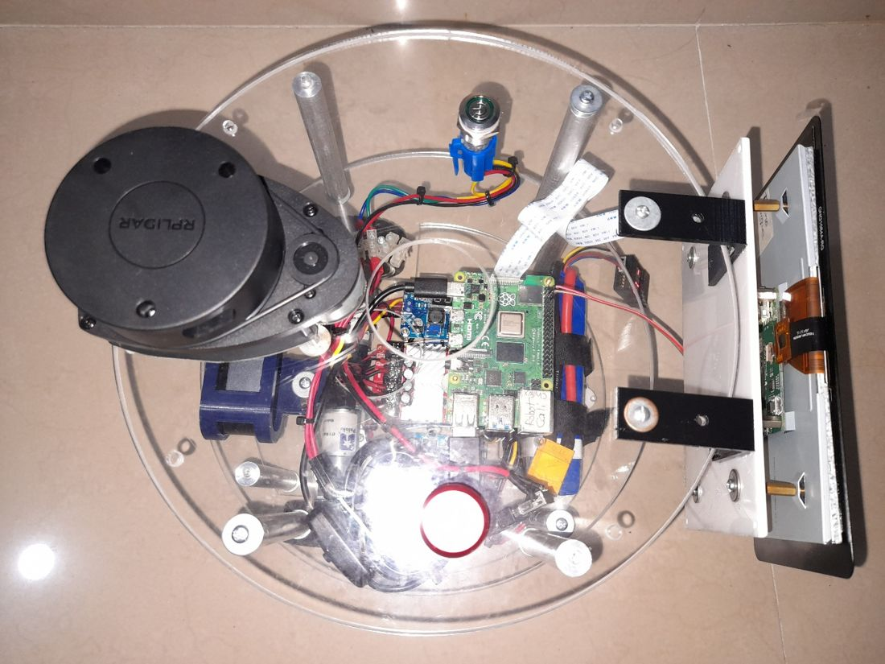

> **Reto:**
>
> Calcule, con la Tabla 1, la velocidad lineal máxima teórica del robot si el motor gira a 185 rpm (valor medido por Autotune en un robot del laboratorio: 6937 cuentas/s) con ruedas de 90 mm. Compárela con el límite `max_linear_speed` del DA-12.1 y justifique el margen.

## REFERENCIAS

**[1]** J. R. Cháux Cedeño, *Robótica básica – Semana 2: construcción y programación de un robot móvil (documentos de apoyo 8 a 18)*, SENA, 2022–2025.

**[2]** R. Siegwart, I. R. Nourbakhsh y D. Scaramuzza, *Introduction to Autonomous Mobile Robots*, 2nd ed. Cambridge, MA, USA: MIT Press, 2011.

**[3]** Pololu Corporation, *47:1 Metal Gearmotor 25Dx67L mm HP 12V with 48 CPR Encoder* (item #4846; relación 46,85:1; 2248,86 cuentas/vuelta). [En línea]. Disponible: [https://www.pololu.com/product/4846](https://www.pololu.com/product/4846)

**[4]** Pololu Corporation, *131:1 Metal Gearmotor 37Dx73L mm 12V with 64 CPR Encoder (Helical Pinion)* (item #4756; 8400 cuentas/vuelta). [En línea]. Disponible: [https://www.pololu.com/product/4756](https://www.pololu.com/product/4756)

**[5]** Pololu Corporation, *RoboClaw 2x15A Motor Controller (V6B/V6F)* (item #3683; 2 × 15 A continuos, 30 A pico, 6–34 V). [En línea]. Disponible: [https://www.pololu.com/product/3683/specs](https://www.pololu.com/product/3683/specs)

**[6]** Basicmicro Motion Control, *RoboClaw Series Brushed DC Motor Controllers – User Manual*, rev. 5.6 (firmware 4.1.20 y posteriores). Copia incluida en «10. CONFIGURACIÓN ROBOCLAW/PROGRAMAS/BASIC MICRO/Legacy version Funcional».

**[7]** NVIDIA, *Get Started With Jetson Nano Developer Kit*. [En línea]. Disponible: [https://developer.nvidia.com/embedded/learn/get-started-jetson-nano-devkit](https://developer.nvidia.com/embedded/learn/get-started-jetson-nano-devkit)

**[8]** Shanghai Slamtec Co., *RPLIDAR A1 – Low Cost 360 Degree Laser Range Scanner: Introduction and Datasheet* (A1M8). [En línea]. Disponible: [https://www.farnell.com/datasheets/3176118.pdf](https://www.farnell.com/datasheets/3176118.pdf)

**[9]** Intel RealSense, *Intel® RealSense™ Depth Camera D435i* (especificaciones). [En línea]. Disponible: [https://store.intelrealsense.com/buy-intel-realsense-depth-camera-d435i.html](https://store.intelrealsense.com/buy-intel-realsense-depth-camera-d435i.html)

**[10]** International Organization for Standardization, *ISO 3691-4:2023, Industrial trucks — Safety requirements and verification — Part 4: Driverless industrial trucks and their systems*. Ginebra: ISO, 2023.

**[11]** J. R. Cháux Cedeño, *mr\_ws – espacio de trabajo ROS 2 del robot móvil diferencial* (material de esta transferencia, licencia Apache-2.0), 2026.
