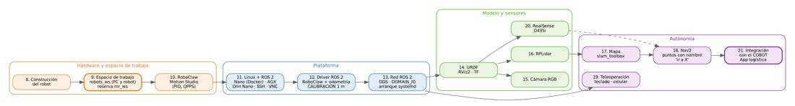
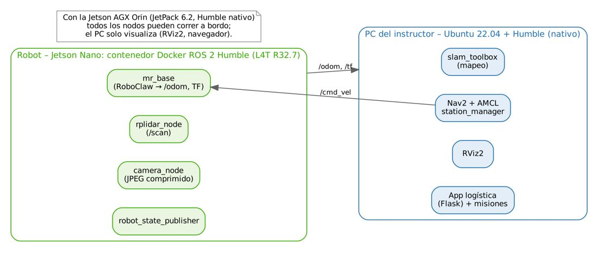

# FORMATO GUÍA DE APRENDIZAJE

> Versión en Markdown del documento [Guia_Aprendizaje_Robot_Movil_ROS2.docx](Guia_Aprendizaje_Robot_Movil_ROS2.docx) para consultar y copiar comandos desde GitHub. El documento de Word es la versión oficial (formato GFPI-F-135).

## 1. IDENTIFICACIÓN DE LA GUIA DE APRENDIZAJE

- Denominación del Programa de Formación: **TRANSFERENCIA DE CONOCIMIENTO: DISEÑO, CONSTRUCCIÓN Y PROGRAMACIÓN DE UN ROBOT MÓVIL DE TRACCIÓN DIFERENCIAL CON ROS 2 E INTEGRACIÓN CON UN COBOT**
- Código del Programa de Formación: **[POR DILIGENCIAR]**
- Nombre del Proyecto Formativo (si aplica): **ROBOT MÓVIL AUTÓNOMO PARA LOGÍSTICA INTERNA INTEGRADO CON UNA CELDA ROBÓTICA COLABORATIVA (ROS 2 HUMBLE – NVIDIA JETSON)**
- Fase del Proyecto (si aplica): **EJECUCIÓN**
- Actividad de Proyecto Formativo (si aplica): **CONSTRUIR, CALIBRAR Y PROGRAMAR UN ROBOT MÓVIL QUE NAVEGUE DE FORMA AUTÓNOMA ENTRE ESTACIONES Y COOPERE CON EL COBOT EN UN FLUJO LOGÍSTICO, Y TRANSFERIR EL CONOCIMIENTO AL CENTRO.**
- Resultados de Aprendizaje:

**RAP 1.** ENSAMBLAR LA PLATAFORMA MÓVIL Y PREPARAR SU ENTORNO DE CÓMPUTO Y COMUNICACIONES CON ROS 2 (JETSON NANO EN CONTENEDOR O JETSON AGX ORIN). (DÍA 2)

**RAP 2.** CONFIGURAR EL CONTROL DE MOTORES, CALIBRAR LA ODOMETRÍA E INTEGRAR EL MODELO Y LOS SENSORES DEL ROBOT EN ROS 2. (DÍA 3)

**RAP 3.** GENERAR EL MAPA DEL ENTORNO Y NAVEGAR DE FORMA AUTÓNOMA ENTRE PUNTOS CON NOMBRE, INCLUYENDO PERCEPCIÓN DE PROFUNDIDAD. (DÍA 4)

**RAP 4.** INTEGRAR EL ROBOT MÓVIL CON LA CELDA DEL COBOT MEDIANTE UNA APLICACIÓN WEB DE LOGÍSTICA, SUSTENTARLA Y PLANEAR SU TRANSFERENCIA. (DÍA 5)

- Duración de la Guía de Aprendizaje: **36 horas**

Horas de trabajo directo: 30 horas (4 jornadas)

Horas de trabajo independiente: 6 horas

Fecha de Inicio: 03/11/2026

Fecha Fin: 06/11/2026

## 2. PRESENTACIÓN

Esta guía orienta la transferencia sobre el diseño, la construcción y la programación de un **robot móvil de tracción diferencial** con dos motorreductores Pololu (25D o 37D), un controlador RoboClaw 2x15A, una Jetson Nano o una Jetson AGX Orin, cámara RGB, RPLidar A1 y, como novedad, una cámara de profundidad **Intel RealSense D435i**. Se desarrolla en paralelo con la transferencia de la celda del JetCobot y termina integrando ambos robots.

La guía se organiza en las secciones 8 a 21 del portafolio y trabaja con ROS 2 Humble: el driver del RoboClaw (mr\_base) controla los motores y publica la odometría, que se calibra con un procedimiento cuantitativo para que una orden de 1 m produzca 1 m; el mapeo se hace con slam\_toolbox y la navegación con Nav2, con puntos **con nombre** y la orden «ir al punto X». Las secciones 19 (RealSense D435i) y 20 (integración con el cobot) completan el recorrido; en la 20, un pedido hecho en una App web en Python hace que el robot vaya al cobot, el cobot detecte y cargue el producto, y el robot lo entregue en la estación indicada.

Todo el software (mr\_ws) se compiló y probó antes de la formación. Para practicar sin hardware ni GPU se incluye un **robot virtual**: un emulador del RoboClaw que habla el mismo protocolo serie y un lidar simulado. Cada documento de apoyo indica los resultados de validación y sus límites. La Jetson Nano solo admite Ubuntu 18.04 (JetPack 4.6.6, último de la serie), por lo que en ella ROS 2 Humble corre en un contenedor Docker de NVIDIA; con la AGX Orin todo corre de forma nativa.

*Figura 1. Ruta de aprendizaje: carpetas 8 a 21.*

*Figura 2. Reparto de nodos entre el robot y el PC del instructor.*

Agenda de la semana:

*Tabla 1. Agenda de la transferencia del robot móvil.*

| **Día / fecha** | **Mañana** | **Tarde** | **Documentos de apoyo** |
|---|---|---|---|
| Día 2 03/11/2026 | Reflexión y diagnóstico; construcción del robot; configuración del RoboClaw (Motion Studio, PID) | Linux y ROS 2 en Jetson Nano (Docker) / AGX Orin; SSH y VNC; red local y red ROS 2; arranque automático | 8.1, 9.1, 10.1, 11.x, 13.x |
| Día 3 04/11/2026 | Driver ROS 2 del RoboClaw; calibración de la odometría (prueba de 1 m y 360°); reglas udev | Modelo URDF y RViz2; cámara RGB; RPLidar y TF | 12.1–12.3, 14.1, 15.1, 16.1 |
| Día 4 05/11/2026 | Mapeo con slam\_toolbox | Nav2; estaciones con nombre y «ir a X»; teleoperación; RealSense D435i | 17.1, 18.1, 18.2, 19.1, 20.1 |
| Día 5 06/11/2026 | Integración robot móvil – cobot con la App de logística | Pruebas, sustentación, evaluación y plan de transferencia | 21.1 |

Documentos de apoyo (formato GFPI-F-135, ubicados en la carpeta de cada sección):

*Tabla 2. Relación de documentos de apoyo.*

| **Código** | **Documento de apoyo** | **Actividad** |
|---|---|---|
| 8.1 | Construcción del robot móvil de tracción diferencial | 3.3.1 |
| 9.1 | Espacio de trabajo ROS 2 robots\_ws: creación paso a paso y material de reserva | 3.3.1 |
| 10.1 | Configuración del RoboClaw 2x15A con Basicmicro Motion Studio | 3.3.1 |
| 11.1 / 11.2 | JetPack 4.6.6 en la Jetson Nano / ROS 2 Humble en la Nano con Docker | 3.3.2 |
| 11.1 | Ubuntu 22.04 y ROS 2 en Raspberry Pi 4 (alternativa); Jetson AGX Orin como computador del robot; Jetson Orin Nano DK 8 GB | 3.3.2 |
| 11.1 | SSH y VS Code; escritorio remoto con x11vnc y TightVNC | 3.3.2 |
| 12.1 | Driver ROS 2 del RoboClaw (mr\_base): odometría y pruebas | 3.3.3 |
| 12.2 | Calibración de la odometría: que 1 metro sea 1 metro | 3.3.3 |
| 12.3 | Reglas udev: permisos y nombres fijos de los puertos | 3.3.3 |
| 13.1 – 13.3 | Red local; red ROS 2 (DDS, ROS\_DOMAIN\_ID); arranque automático con systemd | 3.3.2 |
| 14.1 | Modelo URDF/Xacro y visualización en RViz2 | 3.3.4 |
| 15.1 | Cámara RGB USB en ROS 2 | 3.3.4 |
| 16.1 | RPLidar A1 en ROS 2 (anexo Hokuyo URG-04LX) | 3.3.4 |
| 17.1 | Generación del mapa con slam\_toolbox | 3.3.5 |
| 18.1 | Navegación autónoma con Nav2 | 3.3.5 |
| 18.2 | Puntos con nombre y orden «ir al punto X» | 3.3.5 |
| 19.1 | Teleoperación (teclado y celular) | 3.3.5 |
| 20.1 | Intel RealSense D435i en el robot móvil | 3.3.6 |
| 21.1 | Integración robot móvil – cobot con App de logística | 3.4.1, 3.4.2 |
| mr\_ws | Material de reserva con todo el código (repositorio del curso, carpeta 12/REPOSITORIOS y raíz del portafolio). El espacio de trabajo robots\_ws se construye paso a paso desde el DA-9.1 | Todas |

Prerrequisitos: Linux a nivel de usuario, Python, nociones de electrónica (tensión, corriente, polaridad) y haber cursado o cursar en paralelo la transferencia de ROS 2 del cobot. Trabajo en equipos de 2–3 personas por robot.

## 3. FORMULACIÓN DE LAS ACTIVIDADES DE APRENDIZAJE

### 3.1 Actividades de reflexión inicial:

**3.1.1. Del robot teleoperado al robot logístico autónomo.**

Los participantes analizan qué necesita un robot móvil para pasar de ser teleoperado a navegar solo entre estaciones y cooperar con un cobot.

**Descripción de la actividad:**

1. Observar el robot del laboratorio y un video de un robot móvil logístico (AMR).
1. Discutir: ¿qué pasa si el robot cree que avanzó 1 m pero avanzó 0,97 m? ¿cómo sabe dónde está? ¿qué riesgos aparecen al compartir el espacio con personas?
1. Registrar la meta del equipo para la semana.

**Ambiente requerido:** Ambiente de aprendizaje tipo aula-laboratorio tecnológico. Para garantizar el bienestar integral de los aprendices e instructores, este espacio debe operar bajo estrictos estándares de seguridad industrial, salud ocupacional y medio ambiente. Esto exige la implementación de condiciones ergonómicas óptimas en el mobiliario para mitigar el riesgo biomecánico, iluminación y climatización adecuadas, señalización clara de rutas de evacuación y disposición de equipos de emergencia. Adicionalmente: laboratorio de robótica con un robot móvil diferencial por equipo (RoboClaw 2x15A, Jetson Nano o Jetson AGX Orin, RPLidar A1, cámara RGB y RealSense D435i), área de pruebas despejada de al menos 6 × 4 m con obstáculos móviles, banco de electrónica con multímetro y fuente, celda del JetCobot, red Wi-Fi del laboratorio sin aislamiento de clientes y acceso a Internet para la instalación de paquetes.

**Estrategias o técnicas didácticas activas:** Aprendizaje basado en problemas, discusión guiada.

**Materiales de formación:** Robot móvil, video, tablero.

**Material de apoyo:** 8.1, 21.1 (escenario).

**Duración de la actividad:** 0,5 horas (Día 2).

### 3.2 Actividades de contextualización e identificación de conocimientos necesarios para el aprendizaje:

**3.2.1. Diagnóstico de saberes, del hardware y del computador del robot.**

Se identifica el punto de partida de cada equipo y el estado de su robot (motores, RoboClaw, Jetson).

**Descripción de la actividad:**

1. Cuestionario diagnóstico breve (cinemática diferencial, TF, ROS 2, electrónica básica).
1. Inventario del kit con la Tabla 1 del DA-8.1 (modelo de motor, versión del RoboClaw, Jetson).
1. Trabajo independiente previo: grabar la microSD de la Nano (DA-11.1) o verificar ROS 2 en la AGX.

**Ambiente requerido:** Ambiente de aprendizaje tipo aula-laboratorio tecnológico. Para garantizar el bienestar integral de los aprendices e instructores, este espacio debe operar bajo estrictos estándares de seguridad industrial, salud ocupacional y medio ambiente. Esto exige la implementación de condiciones ergonómicas óptimas en el mobiliario para mitigar el riesgo biomecánico, iluminación y climatización adecuadas, señalización clara de rutas de evacuación y disposición de equipos de emergencia. Adicionalmente: laboratorio de robótica con un robot móvil diferencial por equipo (RoboClaw 2x15A, Jetson Nano o Jetson AGX Orin, RPLidar A1, cámara RGB y RealSense D435i), área de pruebas despejada de al menos 6 × 4 m con obstáculos móviles, banco de electrónica con multímetro y fuente, celda del JetCobot, red Wi-Fi del laboratorio sin aislamiento de clientes y acceso a Internet para la instalación de paquetes.

**Estrategias o técnicas didácticas activas:** Evaluación diagnóstica, trabajo colaborativo.

**Materiales de formación:** Kit del robot, multímetro, cuestionario.

**Material de apoyo:** 8.1, 11.1.

**Duración de la actividad:** 0,5 horas (Día 2) + 2 horas de trabajo independiente previo.

### 3.3 Actividades de apropiación:

**3.3.1 Construcción del robot y configuración del controlador de motores.**

Se ensambla y cablea la plataforma y se configura el lazo de velocidad del RoboClaw.

**Descripción de la actividad:**

1. Ensamblar base, motores, electrónica, Jetson y sensores; verificar tensiones con la lista de chequeo.
1. Medir diámetros de rueda y separación entre ruedas.
1. Configurar Packet Serial (128, 38 400) y ejecutar el Autotune de velocidad en Motion Studio (Legacy para V5).
1. Crear el espacio de trabajo robots\_ws en Ubuntu 22.04, con mr\_ws como reserva (DA-9.1), y verificar el RoboClaw desde Linux con check\_roboclaw (DA-10.1, punto 5).

**Ambiente requerido:** Ambiente de aprendizaje tipo aula-laboratorio tecnológico. Para garantizar el bienestar integral de los aprendices e instructores, este espacio debe operar bajo estrictos estándares de seguridad industrial, salud ocupacional y medio ambiente. Esto exige la implementación de condiciones ergonómicas óptimas en el mobiliario para mitigar el riesgo biomecánico, iluminación y climatización adecuadas, señalización clara de rutas de evacuación y disposición de equipos de emergencia. Adicionalmente: laboratorio de robótica con un robot móvil diferencial por equipo (RoboClaw 2x15A, Jetson Nano o Jetson AGX Orin, RPLidar A1, cámara RGB y RealSense D435i), área de pruebas despejada de al menos 6 × 4 m con obstáculos móviles, banco de electrónica con multímetro y fuente, celda del JetCobot, red Wi-Fi del laboratorio sin aislamiento de clientes y acceso a Internet para la instalación de paquetes.

**Estrategias o técnicas didácticas activas:** Práctica de taller, trabajo colaborativo, protocolo de seguridad eléctrica.

**Materiales de formación:** Kit del robot, herramientas, multímetro, PC Windows con Motion Studio, PC con Ubuntu 22.04 y ROS 2 Humble, robots\_ws (reserva mr\_ws).

**Material de apoyo: 8.1, 9.1, 10.1.**

**Duración de la actividad:** 4 horas (Día 2).

**3.3.2 Linux, ROS 2 y comunicaciones del robot.**

Se prepara el computador del robot y la comunicación ROS 2 con el PC.

**Descripción de la actividad:**

1. Instalar JetPack 4.6.6 y el contenedor ROS 2 Humble en la Nano, o los paquetes del robot en la AGX Orin.
1. Verificar la instalación de ROS 2 con printenv ROS\_DISTRO (debe mostrar humble) y printenv ROS\_VERSION (2); en la Nano, dentro del contenedor.
1. Configurar SSH (y VNC si se requiere); considerar la limitación de VS Code Remote-SSH en Ubuntu 18.04.
1. Asignar IP fija, ROS\_DOMAIN\_ID y probar talker/listener y turtlesim entre el robot y el PC.
1. Configurar el arranque automático de los drivers con systemd.

**Ambiente requerido:** Ambiente de aprendizaje tipo aula-laboratorio tecnológico. Para garantizar el bienestar integral de los aprendices e instructores, este espacio debe operar bajo estrictos estándares de seguridad industrial, salud ocupacional y medio ambiente. Esto exige la implementación de condiciones ergonómicas óptimas en el mobiliario para mitigar el riesgo biomecánico, iluminación y climatización adecuadas, señalización clara de rutas de evacuación y disposición de equipos de emergencia. Adicionalmente: laboratorio de robótica con un robot móvil diferencial por equipo (RoboClaw 2x15A, Jetson Nano o Jetson AGX Orin, RPLidar A1, cámara RGB y RealSense D435i), área de pruebas despejada de al menos 6 × 4 m con obstáculos móviles, banco de electrónica con multímetro y fuente, celda del JetCobot, red Wi-Fi del laboratorio sin aislamiento de clientes y acceso a Internet para la instalación de paquetes.

**Estrategias o técnicas didácticas activas:** Demostración guiada, práctica dirigida.

**Materiales de formación:** Jetson, PC Ubuntu 22.04, red ROBOTS, mr\_ws.

**Material de apoyo:** 11.x, 13.1–13.3.

**Duración de la actividad:** 2,5 horas (Día 2).

**3.3.3 Driver ROS 2 del RoboClaw y calibración de la odometría.**

Se comanda el robot con cmd\_vel, se obtiene su odometría y se calibra hasta cumplir la tolerancia.

**Descripción de la actividad:**

1. Instalar las reglas udev; verificar sentidos y encoders con `check_roboclaw --probar`.
1. Configurar `mr_base.yaml` (motor, ruedas, mapeo de motores) y teleoperar.
1. Calibrar con `mover lineal 1.0` y `mover angular 360` (en ese orden) hasta |error| ≤ 1 % y ≤ 2°.
1. Analizar el driver mr\_base y el modelo cinemático.

**Ambiente requerido:** Ambiente de aprendizaje tipo aula-laboratorio tecnológico. Para garantizar el bienestar integral de los aprendices e instructores, este espacio debe operar bajo estrictos estándares de seguridad industrial, salud ocupacional y medio ambiente. Esto exige la implementación de condiciones ergonómicas óptimas en el mobiliario para mitigar el riesgo biomecánico, iluminación y climatización adecuadas, señalización clara de rutas de evacuación y disposición de equipos de emergencia. Adicionalmente: laboratorio de robótica con un robot móvil diferencial por equipo (RoboClaw 2x15A, Jetson Nano o Jetson AGX Orin, RPLidar A1, cámara RGB y RealSense D435i), área de pruebas despejada de al menos 6 × 4 m con obstáculos móviles, banco de electrónica con multímetro y fuente, celda del JetCobot, red Wi-Fi del laboratorio sin aislamiento de clientes y acceso a Internet para la instalación de paquetes.

**Estrategias o técnicas didácticas activas:** Laboratorio experimental con protocolo de medición, análisis de datos.

**Materiales de formación:** Robot, cinta métrica, cinta de enmascarar, mr\_ws (incluye robot virtual).

**Material de apoyo:** 12.1, 12.2, 12.3.

**Duración de la actividad:** 4 horas (Día 3).

**3.3.4 Modelo del robot y sensores en ROS 2.**

Se integra el modelo URDF con el árbol TF y se publican la cámara y el lidar.

**Descripción de la actividad:**

1. Visualizar `mr_description` en RViz2 y ajustar sus medidas.
1. Publicar la cámara (OpenCV o usb\_cam) y medir FPS y ancho de banda por Wi-Fi.
1. Lanzar el RPLidar, verificar la orientación del haz y la TF `base_footprint → laser`.

**Ambiente requerido:** Ambiente de aprendizaje tipo aula-laboratorio tecnológico. Para garantizar el bienestar integral de los aprendices e instructores, este espacio debe operar bajo estrictos estándares de seguridad industrial, salud ocupacional y medio ambiente. Esto exige la implementación de condiciones ergonómicas óptimas en el mobiliario para mitigar el riesgo biomecánico, iluminación y climatización adecuadas, señalización clara de rutas de evacuación y disposición de equipos de emergencia. Adicionalmente: laboratorio de robótica con un robot móvil diferencial por equipo (RoboClaw 2x15A, Jetson Nano o Jetson AGX Orin, RPLidar A1, cámara RGB y RealSense D435i), área de pruebas despejada de al menos 6 × 4 m con obstáculos móviles, banco de electrónica con multímetro y fuente, celda del JetCobot, red Wi-Fi del laboratorio sin aislamiento de clientes y acceso a Internet para la instalación de paquetes.

**Estrategias o técnicas didácticas activas:** Práctica dirigida, verificación experimental.

**Materiales de formación:** Robot con sensores, PC, mr\_ws.

**Material de apoyo:** 14.1, 15.1, 16.1.

**Duración de la actividad:** 3,5 horas (Día 3).

**3.3.5 Mapeo, navegación autónoma y estaciones con nombre.**

Se construye el mapa del laboratorio y se navega de forma autónoma entre estaciones.

**Descripción de la actividad:**

1. Mapear con slam\_toolbox y guardar el mapa; evaluar su calidad.
1. Configurar Nav2 (AMCL, costmaps, DWB) y navegar con metas de RViz2, midiendo el error de llegada.
1. Definir estaciones con nombre y ejecutar `ir_a` y `recorrido`; programar una orden propia en Python.
1. Teleoperar desde el celular con la App web.

**Ambiente requerido:** Ambiente de aprendizaje tipo aula-laboratorio tecnológico. Para garantizar el bienestar integral de los aprendices e instructores, este espacio debe operar bajo estrictos estándares de seguridad industrial, salud ocupacional y medio ambiente. Esto exige la implementación de condiciones ergonómicas óptimas en el mobiliario para mitigar el riesgo biomecánico, iluminación y climatización adecuadas, señalización clara de rutas de evacuación y disposición de equipos de emergencia. Adicionalmente: laboratorio de robótica con un robot móvil diferencial por equipo (RoboClaw 2x15A, Jetson Nano o Jetson AGX Orin, RPLidar A1, cámara RGB y RealSense D435i), área de pruebas despejada de al menos 6 × 4 m con obstáculos móviles, banco de electrónica con multímetro y fuente, celda del JetCobot, red Wi-Fi del laboratorio sin aislamiento de clientes y acceso a Internet para la instalación de paquetes.

**Estrategias o técnicas didácticas activas:** Aprendizaje basado en problemas, experimentación.

**Materiales de formación:** Robot, área de pruebas con obstáculos, PC, celular.

**Material de apoyo:** 17.1, 18.1, 18.2, 19.1.

**Duración de la actividad:** 6 horas (Día 4) + 2 horas de trabajo independiente (estaciones y orden propia).

**3.3.6 Percepción de profundidad con la RealSense D435i.**

Se integra la cámara de profundidad para detectar obstáculos fuera del plano del lidar.

**Descripción de la actividad:**

1. Instalar y verificar la D435i (AGX Orin recomendada).
1. Publicar profundidad, color e IMU con `camera_name: d435i`.
1. Convertir la profundidad en un LaserScan y agregarla a los costmaps; probar con un obstáculo bajo.

**Ambiente requerido:** Ambiente de aprendizaje tipo aula-laboratorio tecnológico. Para garantizar el bienestar integral de los aprendices e instructores, este espacio debe operar bajo estrictos estándares de seguridad industrial, salud ocupacional y medio ambiente. Esto exige la implementación de condiciones ergonómicas óptimas en el mobiliario para mitigar el riesgo biomecánico, iluminación y climatización adecuadas, señalización clara de rutas de evacuación y disposición de equipos de emergencia. Adicionalmente: laboratorio de robótica con un robot móvil diferencial por equipo (RoboClaw 2x15A, Jetson Nano o Jetson AGX Orin, RPLidar A1, cámara RGB y RealSense D435i), área de pruebas despejada de al menos 6 × 4 m con obstáculos móviles, banco de electrónica con multímetro y fuente, celda del JetCobot, red Wi-Fi del laboratorio sin aislamiento de clientes y acceso a Internet para la instalación de paquetes.

**Estrategias o técnicas didácticas activas:** Experimentación, comparación con/sin sensor.

**Materiales de formación:** RealSense D435i, robot con AGX Orin.

**Material de apoyo:** 20.1.

**Duración de la actividad:** 1,5 horas (Día 4) + 2 horas de trabajo independiente.

### 3.4 Actividades de Transferencia de Conocimiento:

**3.4.1. Integración robot móvil – cobot con una App web de logística.**

Los equipos integran el robot móvil y la celda del JetCobot en un flujo de pedido, carga y entrega.

**Descripción de la actividad:**

1. Ejecutar el sistema completo en simulación (robot virtual + cobot simulado) y verificar los estados del pedido.
1. Preparar la estación del cobot: pose nominal de la bandeja y marcador ArUco; robot con `namespace:=mr`.
1. Ejecutar pedidos reales desde la App web; completar la lista de verificación del DA-21.1.
1. Proponer y desarrollar una extensión (YOLO, varias estaciones, confirmación de entrega).

**Ambiente requerido:** Ambiente de aprendizaje tipo aula-laboratorio tecnológico. Para garantizar el bienestar integral de los aprendices e instructores, este espacio debe operar bajo estrictos estándares de seguridad industrial, salud ocupacional y medio ambiente. Esto exige la implementación de condiciones ergonómicas óptimas en el mobiliario para mitigar el riesgo biomecánico, iluminación y climatización adecuadas, señalización clara de rutas de evacuación y disposición de equipos de emergencia. Adicionalmente: laboratorio de robótica con un robot móvil diferencial por equipo (RoboClaw 2x15A, Jetson Nano o Jetson AGX Orin, RPLidar A1, cámara RGB y RealSense D435i), área de pruebas despejada de al menos 6 × 4 m con obstáculos móviles, banco de electrónica con multímetro y fuente, celda del JetCobot, red Wi-Fi del laboratorio sin aislamiento de clientes y acceso a Internet para la instalación de paquetes.

**Estrategias o técnicas didácticas activas:** Aprendizaje basado en proyectos, trabajo colaborativo entre equipos (robot móvil y cobot).

**Materiales de formación:** Robot móvil, celda del JetCobot, PC/AGX con la App, celular.

**Material de apoyo:** 21.1.

**Duración de la actividad:** 5 horas (Día 5).

**3.4.2. Sustentación, evaluación y plan de transferencia al centro.**

Cada equipo demuestra su sistema y se construye el plan de transferencia.

**Descripción de la actividad:**

1. Demostración en vivo de un pedido completo y de la parada segura.
1. Sustentación técnica (10 min) con los registros de calibración, mapa y precisión de navegación.
1. Encuesta de evaluación y plan de transferencia al centro de formación.

**Ambiente requerido:** Ambiente de aprendizaje tipo aula-laboratorio tecnológico. Para garantizar el bienestar integral de los aprendices e instructores, este espacio debe operar bajo estrictos estándares de seguridad industrial, salud ocupacional y medio ambiente. Esto exige la implementación de condiciones ergonómicas óptimas en el mobiliario para mitigar el riesgo biomecánico, iluminación y climatización adecuadas, señalización clara de rutas de evacuación y disposición de equipos de emergencia. Adicionalmente: laboratorio de robótica con un robot móvil diferencial por equipo (RoboClaw 2x15A, Jetson Nano o Jetson AGX Orin, RPLidar A1, cámara RGB y RealSense D435i), área de pruebas despejada de al menos 6 × 4 m con obstáculos móviles, banco de electrónica con multímetro y fuente, celda del JetCobot, red Wi-Fi del laboratorio sin aislamiento de clientes y acceso a Internet para la instalación de paquetes.

**Estrategias o técnicas didácticas activas:** Exposición, coevaluación, socialización.

**Materiales de formación:** Proyector, robots, formatos de evaluación.

**Material de apoyo:** 21.1 y registros.

**Duración de la actividad:** 2,5 horas (Día 5).

## 4. PLANTEAMIENTO DE EVIDENCIAS DE APRENDIZAJE PARA LA EVALUACIÓN EN EL PROCESO FORMATIVO.

| **Fase del proyecto formativo** | **Actividad del proyecto formativo** | **Actividad de Aprendizaje** | **Evidencias de Aprendizaje** | **Criterios de Evaluación** | **Técnicas e Instrumentos de Evaluación** |
|---|---|---|---|---|---|
| EJECUCIÓN | CONSTRUIR, CALIBRAR Y PROGRAMAR UN ROBOT MÓVIL AUTÓNOMO INTEGRADO CON EL COBOT EN UN FLUJO LOGÍSTICO. | 3.3.1, 3.3.2 (Día 2) | Producto: robot ensamblado con lista de chequeo firmada; Autotune guardado. Desempeño: comunicación ROS 2 robot ↔ PC. | Ensambla y cablea según el diagrama verificando tensiones y polaridades. Configura el entorno ROS 2 del robot y la red. | Técnica: Observación directa, valoración de producto y formulación de preguntas. Instrumento: Lista de chequeo de desempeño, lista de verificación de producto, cuestionario. |
| EJECUCIÓN | CONSTRUIR, CALIBRAR Y PROGRAMAR UN ROBOT MÓVIL AUTÓNOMO INTEGRADO CON EL COBOT EN UN FLUJO LOGÍSTICO. | 3.3.3, 3.3.4 (Día 3) | Producto: archivo de calibración y tabla de registro (12.2). Desempeño: teleoperación y sensores en RViz2. | Calibra la odometría con \|error\| ≤ 1 % en 1 m y ≤ 2° en 360°. Verifica el modelo, la TF y la orientación del lidar. | Técnica: Observación directa, valoración de producto y formulación de preguntas. Instrumento: Lista de chequeo de desempeño, lista de verificación de producto, cuestionario. |
| EJECUCIÓN | CONSTRUIR, CALIBRAR Y PROGRAMAR UN ROBOT MÓVIL AUTÓNOMO INTEGRADO CON EL COBOT EN UN FLUJO LOGÍSTICO. | 3.3.5, 3.3.6 (Día 4) | Producto: mapa (.pgm/.yaml) y archivo de estaciones. Desempeño: navegación a estaciones con nombre. | Genera un mapa consistente con el entorno. Llega a cada estación dentro de la tolerancia configurada y registra el error. | Técnica: Observación directa, valoración de producto y formulación de preguntas. Instrumento: Lista de chequeo de desempeño, lista de verificación de producto, cuestionario. |
| EJECUCIÓN | CONSTRUIR, CALIBRAR Y PROGRAMAR UN ROBOT MÓVIL AUTÓNOMO INTEGRADO CON EL COBOT EN UN FLUJO LOGÍSTICO. | 3.4.1, 3.4.2 (Día 5) | Producto: sistema integrado, video y lista de verificación (21.1). Desempeño: demostración y sustentación; plan de transferencia. | Completa pedidos de la App web con carga por el cobot y entrega en la estación. Sustenta con datos y plantea la transferencia. | Técnica: Valoración de producto y observación directa. Instrumento: Lista de verificación del DA-21.1 y lista de chequeo. |

## 5. GLOSARIO DE TÉRMINOS

**AMCL:** Localización Monte Carlo adaptativa: filtro de partículas que estima la pose del robot en un mapa conocido.

**Atraque:** Posicionamiento del robot en una estación con una tolerancia definida para interactuar con otro equipo.

**Cinemática diferencial:** Modelo que relaciona las velocidades de las dos ruedas con la velocidad lineal y angular del robot.

**Costmap:** Mapa de costos usado por Nav2 para planificar y evitar obstáculos (global y local).

**Cuadratura (encoder):** Dos señales desfasadas 90° que permiten contar pulsos y conocer el sentido de giro.

**DDS:** Middleware publicador/suscriptor sobre el que se construye ROS 2; descubre los nodos sin maestro.

**Docker:** Plataforma de contenedores; permite ejecutar ROS 2 Humble sobre el Ubuntu 18.04 de la Jetson Nano.

**Espacio de nombres (namespace):** Prefijo de nombres de nodos y tópicos que permite que varios robots compartan una red ROS 2.

**Estación:** Punto con nombre en el mapa (x, y, orientación) al que se envía el robot.

**Estéreo activo:** Medición de profundidad por disparidad entre dos cámaras con un patrón infrarrojo proyectado.

**JetPack:** SDK de NVIDIA para Jetson (sistema operativo, CUDA, TensorRT); la Nano llega hasta JetPack 4.6.6.

**Nav2:** Pila de navegación de ROS 2: localización, planificación, control y recuperación.

**Odometría:** Estimación de la pose del robot integrando el giro de sus ruedas; acumula error.

**Packet Serial:** Protocolo binario del RoboClaw con dirección, comando, datos y CRC-16.

**PID de velocidad:** Controlador interno del RoboClaw que mantiene la velocidad pedida de cada motor.

**QPPS:** Velocidad máxima de un motor en pulsos de cuadratura por segundo, medida por el Autotune.

**REP 105:** Convención de ROS de marcos para robots móviles: map, odom, base\_footprint, base\_link.

**ROS\_DOMAIN\_ID:** Número que separa grupos de nodos ROS 2 en la misma red.

**SLAM:** Localización y mapeo simultáneos.

**slam\_toolbox:** Paquete de SLAM 2D por grafo de poses usado con Nav2.

**systemd:** Gestor de servicios de Linux usado para arrancar los drivers al encender el robot.

**TF:** Árbol de transformaciones entre marcos de referencia de ROS.

**Ticks por metro:** Pulsos de encoder que corresponden a un metro recorrido por la rueda; parámetro clave de la odometría.

**udev:** Subsistema de Linux que asigna permisos y nombres a los dispositivos (p. ej. /dev/roboclaw).

**UMBmark:** Prueba de calibración de odometría con trayectorias cuadradas en ambos sentidos.

**URDF / Xacro:** Formato XML de descripción de robots y su preprocesador con macros.

## 6. REFERENTES BIBLIOGRÁFICOS

**[1]** S. Macenski, T. Foote, B. Gerkey, C. Lalancette y W. Woodall, "Robot Operating System 2: Design, architecture, and uses in the wild," *Science Robotics*, vol. 7, no. 66, eabm6074, 2022, doi: 10.1126/scirobotics.abm6074.

**[2]** Open Robotics, *ROS 2 Documentation: Humble Hawksbill*. [En línea]. Disponible: [https://docs.ros.org/en/humble/](https://docs.ros.org/en/humble/)

**[3]** Open Robotics, *REP 2000 – ROS 2 Releases and Target Platforms*. [En línea]. Disponible: [https://www.ros.org/reps/rep-2000.html](https://www.ros.org/reps/rep-2000.html)

**[4]** T. Foote y M. Purvis, *REP 103 – Standard Units of Measure and Coordinate Conventions*. [En línea]. Disponible: [https://www.ros.org/reps/rep-0103.html](https://www.ros.org/reps/rep-0103.html)

**[5]** W. Meeussen, *REP 105 – Coordinate Frames for Mobile Platforms*. [En línea]. Disponible: [https://www.ros.org/reps/rep-0105.html](https://www.ros.org/reps/rep-0105.html)

**[6]** R. Siegwart, I. R. Nourbakhsh y D. Scaramuzza, *Introduction to Autonomous Mobile Robots*, 2nd ed. Cambridge, MA, USA: MIT Press, 2011.

**[7]** S. Thrun, W. Burgard y D. Fox, *Probabilistic Robotics*. Cambridge, MA, USA: MIT Press, 2005.

**[8]** J. Borenstein y L. Feng, "Measurement and correction of systematic odometry errors in mobile robots," *IEEE Trans. Robotics and Automation*, vol. 12, no. 6, pp. 869–880, 1996, doi: 10.1109/70.544770.

**[9]** D. Fox, W. Burgard, F. Dellaert y S. Thrun, "Monte Carlo localization: Efficient position estimation for mobile robots," en *Proc. 16th National Conf. Artificial Intelligence (AAAI)*, 1999, pp. 343–349.

**[10]** G. Grisetti, C. Stachniss y W. Burgard, "Improved techniques for grid mapping with Rao-Blackwellized particle filters," *IEEE Trans. Robotics*, vol. 23, no. 1, pp. 34–46, 2007, doi: 10.1109/TRO.2006.889486.

**[11]** K. Konolige, G. Grisetti, R. Kümmerle, W. Burgard, B. Limketkai y R. Vincent, "Efficient sparse pose adjustment for 2D mapping," en *Proc. IEEE/RSJ IROS*, 2010, pp. 22–29, doi: 10.1109/IROS.2010.5649043.

**[12]** S. Macenski e I. Jambrecic, "SLAM Toolbox: SLAM for the dynamic world," *Journal of Open Source Software*, vol. 6, no. 61, p. 2783, 2021, doi: 10.21105/joss.02783.

**[13]** S. Macenski, F. Martín, R. White y J. Ginés Clavero, "The Marathon 2: A navigation system," en *Proc. IEEE/RSJ IROS*, 2020, pp. 2718–2725, doi: 10.1109/IROS45743.2020.9341207.

**[14]** Open Navigation LLC, *Nav2 Documentation* (Humble). [En línea]. Disponible: [https://docs.nav2.org/](https://docs.nav2.org/)

**[15]** D. Fox, W. Burgard y S. Thrun, "The dynamic window approach to collision avoidance," *IEEE Robotics & Automation Magazine*, vol. 4, no. 1, pp. 23–33, 1997, doi: 10.1109/100.580977.

**[16]** P. E. Hart, N. J. Nilsson y B. Raphael, "A formal basis for the heuristic determination of minimum cost paths," *IEEE Trans. Systems Science and Cybernetics*, vol. 4, no. 2, pp. 100–107, 1968, doi: 10.1109/TSSC.1968.300136.

**[17]** L. Keselman, J. I. Woodfill, A. Grunnet-Jepsen y A. Bhowmik, "Intel RealSense stereoscopic depth cameras," en *Proc. IEEE CVPR Workshops*, 2017, pp. 1267–1276, doi: 10.1109/CVPRW.2017.167.

**[18]** Pololu Corporation, *47:1 Metal Gearmotor 25Dx67L mm HP 12V with 48 CPR Encoder* (item #4846; relación 46,85:1; 2248,86 cuentas/vuelta). [En línea]. Disponible: [https://www.pololu.com/product/4846](https://www.pololu.com/product/4846)

**[19]** Pololu Corporation, *RoboClaw 2x15A Motor Controller (V6B/V6F)* (item #3683; 2 × 15 A continuos, 30 A pico, 6–34 V). [En línea]. Disponible: [https://www.pololu.com/product/3683/specs](https://www.pololu.com/product/3683/specs)

**[20]** Basicmicro Motion Control, *RoboClaw Series Brushed DC Motor Controllers – User Manual*, rev. 5.6 (firmware 4.1.20 y posteriores). Copia incluida en «10. CONFIGURACIÓN ROBOCLAW/PROGRAMAS/BASIC MICRO/Legacy version Funcional».

**[21]** Basicmicro Motion Control, *basicmicro\_python – Python 3 library for Basicmicro packet serial* (v2.0.10, licencia MIT). [En línea]. Disponible: [https://github.com/basicmicro/basicmicro_python](https://github.com/basicmicro/basicmicro_python)

**[22]** Shanghai Slamtec Co., *RPLIDAR A1 – Low Cost 360 Degree Laser Range Scanner: Introduction and Datasheet* (A1M8). [En línea]. Disponible: [https://www.farnell.com/datasheets/3176118.pdf](https://www.farnell.com/datasheets/3176118.pdf)

**[23]** Shanghai Slamtec Co., *rplidar\_ros* (rama ros2, v2.1.4). [En línea]. Disponible: [https://github.com/Slamtec/rplidar_ros/tree/ros2](https://github.com/Slamtec/rplidar_ros/tree/ros2)

**[24]** Intel RealSense, *Intel® RealSense™ Depth Camera D435i* (especificaciones). [En línea]. Disponible: [https://store.intelrealsense.com/buy-intel-realsense-depth-camera-d435i.html](https://store.intelrealsense.com/buy-intel-realsense-depth-camera-d435i.html)

**[25]** RealSense, *realsense-ros – ROS 2 wrapper* (rama ros2-master, v4.59.1). [En línea]. Disponible: [https://github.com/realsenseai/realsense-ros](https://github.com/realsenseai/realsense-ros)

**[26]** NVIDIA, *Announcing End of Life for NVIDIA JetPack 4 with the release of JetPack 4.6.6* (22/11/2024; Jetson Linux R32.7.6). [En línea]. Disponible: [https://forums.developer.nvidia.com/t/announcing-end-of-life-for-nvidia-jetpack-4-with-the-release-of-jetpack-4-6-6/314302](https://forums.developer.nvidia.com/t/announcing-end-of-life-for-nvidia-jetpack-4-with-the-release-of-jetpack-4-6-6/314302)

**[27]** D. Franklin (NVIDIA), *jetson-containers – paquete ros (imágenes dustynv/ros:humble-*-l4t-r32.7.1)\*. [En línea]. Disponible: [https://github.com/dusty-nv/jetson-containers/tree/master/packages/physicalAI/ros](https://github.com/dusty-nv/jetson-containers)

**[28]** NVIDIA, *JetPack SDK 6.2* (Jetson Linux 36.4.3, Ubuntu 22.04). [En línea]. Disponible: [https://developer.nvidia.com/embedded/jetpack-sdk-62](https://developer.nvidia.com/embedded/jetpack-sdk-62)

**[29]** Pallets Projects, *Flask Documentation*. [En línea]. Disponible: [https://flask.palletsprojects.com/](https://flask.palletsprojects.com/)

**[30]** International Organization for Standardization, *ISO 3691-4:2023, Industrial trucks — Safety requirements and verification — Part 4: Driverless industrial trucks and their systems*. Ginebra: ISO, 2023.

**[31]** International Organization for Standardization, *ISO 10218-1:2025 y ISO 10218-2:2025, Robotics — Safety requirements*. Ginebra: ISO, 2025.

**[32]** J. R. Cháux Cedeño, *Robótica básica – Semana 2: construcción y programación de un robot móvil (documentos de apoyo 8 a 18)*, SENA, 2022–2025.

**[33]** J. R. Cháux Cedeño, *jc\_ws – espacio de trabajo ROS 2 de la celda JetCobot* (material de esta transferencia, licencia Apache-2.0), 2026.

**[34]** J. R. Cháux Cedeño, *mr\_ws – espacio de trabajo ROS 2 del robot móvil diferencial* (material de esta transferencia, licencia Apache-2.0), 2026.

## 7. CONTROL DEL DOCUMENTO

|  | **Nombre** | **Cargo** | **Dependencia** | **Fecha** |
|---|---|---|---|---|
| **Autor (es)** | **Julián René Cháux Cedeño** | **Instructor** | **Centro de la Industria, la Empresa y los Servicios** | **26/10/2026** |

## 8. CONTROL DE CAMBIOS (diligenciar únicamente si realiza ajustes a la guía)

|  | **Nombre** | **Cargo** | **Dependencia** | **Fecha** | **Razón del Cambio** |
|---|---|---|---|---|---|
| **Autor (es)** | **Julián René Cháux Cedeño** | **Instructor** | **CIES** | **26/10/2026** | **Elaboración de la guía para ROS 2 Humble (secciones 8 a 21)** |
