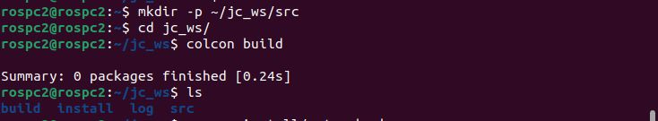

# Documento de Apoyo No. DA-02 – Entorno de desarrollo ROS 2 Humble en el PC.

> Versión en Markdown del documento [DA-02_Entorno_ROS2_Humble_PC.docx](DA-02_Entorno_ROS2_Humble_PC.docx) para consultar y copiar comandos desde GitHub. El documento de Word es la versión oficial (formato GFPI-F-135).

**Nombre del Proyecto Formativo:** CELDA ROBÓTICA COLABORATIVA CON VISIÓN ARTIFICIAL INTEGRADA EN ROS 2 (JETCOBOT – NVIDIA JETSON AGX ORIN)

**Actividad de Proyecto Formativo:** IMPLEMENTAR UNA CELDA ROBÓTICA COLABORATIVA CON VISIÓN ARTIFICIAL Y ROS 2, DE LA SIMULACIÓN AL ROBOT REAL, Y TRANSFERIR EL CONOCIMIENTO AL CENTRO DE FORMACIÓN.

**Actividad de Aprendizaje:** Instalar y configurar el entorno ROS 2 Humble (espacio de trabajo, paquetes y herramientas de desarrollo) en el PC de simulación, verificando su funcionamiento con pruebas reproducibles.

**Parte de la transferencia:** Parte A – Simulación en el PC.

**Equipo de trabajo:** PC con Ubuntu 22.04 y ROS 2 Humble. No se usa la Jetson ni se energiza el robot.

**Duración Estimada:** 2 horas en sesión + 1 hora de trabajo independiente previo (Pasos 1 a 4).

**Sesión:** Día 1 – 03/11/2026, 10:00 a.m. – 12:00 m.

**Relación con la Guía de Aprendizaje:** Actividad 3.3.1 (apropiación).

> **PARTE A · TRABAJO EN EL PC (SIMULACIÓN):**
>
> Todo el trabajo de este documento se hace en el **PC** con Ubuntu 22.04 y ROS 2 Humble, con el robot simulado (mock y Gazebo) y, cuando se indique, una cámara USB conectada al PC. **No se usa la Jetson ni se energiza el robot.** Cada bloque de comandos indica **Terminal (PC)**.

Trabajo en equipos de dos o tres participantes. Cada equipo dispone de un computador de escritorio para simulación. Todos los comandos se ejecutan en una terminal de Linux (bash). En este documento, en la guía y en el resto de los documentos, **ROS** significa siempre **ROS 2**.

## 1. OBJETIVOS DE APRENDIZAJE

- Justificar técnicamente la elección de ROS 2 Humble y Ubuntu 22.04 para la celda.
- Instalar ROS 2 Humble desde los repositorios oficiales siguiendo el procedimiento vigente (paquete `ros2-apt-source`).
- Instalar los paquetes de la transferencia: ros2\_control, MoveIt 2, Gazebo Fortress (`ros_gz`), cv\_bridge y calibración de cámara.
- Crear el espacio de trabajo robots\_ws (vacío, se construye paso a paso en los documentos siguientes) y dejar el material completo de reserva en `~/jc_reserva`.
- Verificar la instalación con pruebas objetivas (`printenv`, demo talker/listener, `ros2 doctor`).

## 2. FUNDAMENTOS Y DECISIONES DE PLATAFORMA

### 2.1 ¿Por qué ROS 2 Humble?

ROS 2 es un *middleware* (capa de software que comunica programas entre sí) para robótica construido sobre DDS (*Data Distribution Service*), estándar del Object Management Group [5], que aporta descubrimiento distribuido, calidad de servicio (QoS) configurable y comunicación sin un nodo maestro central [4]. La distribución **Humble Hawksbill** es de soporte extendido (LTS): se publicó el 23 de mayo de 2022, su fin de soporte está previsto para mayo de 2027 y su plataforma de primer nivel (*Tier 1*) es **Ubuntu 22.04 (Jammy)** en arquitecturas amd64 y arm64 [1].

Se usa Humble en el PC porque es la misma distribución que correrá en la Jetson AGX Orin en la Parte B: JetPack 6.2 se basa en Ubuntu 22.04 [3]. Así, todo lo que se desarrolle y pruebe en simulación en el PC funcionará sin cambios en el robot real. ROS 2 Jazzy (LTS hasta 2029) exige Ubuntu 24.04, que no es la base de JetPack 6; por eso no se usa en esta celda.

### 2.2 Las dos partes de la transferencia

*Tabla 1. Organización de la transferencia en dos partes.*

|  | **Parte A – Simulación en el PC** | **Parte B – Robot real con la Jetson** |
|---|---|---|
| Documentos | DA-02 a DA-12 | DA-13 a DA-17 |
| Equipos | Solo el PC (Ubuntu 22.04) | Jetson AGX Orin + JetCobot + cámara, y el PC en red |
| Robot | Modelo simulado: *mock* (sin física) y Gazebo (con física) | JetCobot real mediante su driver |
| Configuración de red | `ROS_LOCALHOST_ONLY=1`: el PC no comparte datos ROS con la red | `ROS_LOCALHOST_ONLY=0` y el mismo `ROS_DOMAIN_ID` en la Jetson y el PC (DA-13) |

Como los nodos usan las mismas interfaces ROS 2 en simulación y con el robot real, el paso de la Parte A a la Parte B no exige reescribir el código: solo cambia el lanzador y el equipo donde se ejecutan los nodos.

### 2.3 Material de software de la transferencia (espacio de trabajo jc_ws)

Para que todas las prácticas sean reproducibles se entrega el espacio de trabajo **jc\_ws** [7], con prefijo `jc_` en los paquetes para no colisionar con los paquetes `jetcobot_*` de la imagen de Yahboom. Todos los paquetes fueron compilados y probados en ROS 2 Humble con MoveIt 2.5.9 y Gazebo Fortress (ver DA-17, sección de validación).

El espacio de trabajo **no se copia completo al inicio**: se entrega comprimido (`jc_ws.zip`) y se descomprime como **reserva** en `~/jc_reserva`. El `~/robots_ws` de cada equipo empieza vacío y cada documento de apoyo, en su **Paso 0**, incorpora solo los paquetes que va a usar, los compila y los explora. Así cada paquete se entiende cuando se necesita, y la reserva sirve para comparar o restaurar un archivo que se haya dañado. La última columna de la Tabla 2 indica en qué documento se incorpora cada paquete.

*Tabla 2. Paquetes del espacio de trabajo jc_ws entregado con este portafolio.*

| **Paquete** | **Tipo** | **Contenido principal** | **Se incorpora en** |
|---|---|---|---|
| jc\_interfaces | ament\_cmake | Mensajes `DetectedObject(Array)`, servicios `MoveToPose`, `MoveToNamed`, `SetGripper`, acciones `Countdown`, `PickPlace`. | DA-03 |
| jc\_apps | ament\_python | Nodos didácticos (tópicos, servicios, acciones, parámetros), FK/IK numérica, trayectorias y `pick_place_node`. | DA-03 |
| jc\_description | ament\_cmake | URDF/Xacro del JetCobot con pinza, TCP, cámara en mano, ros2\_control y Gazebo. | DA-03 (Paso 7) |
| jc\_moveit\_config | ament\_cmake | SRDF, cinemática KDL, OMPL, límites y controladores de MoveIt 2. | DA-05 |
| jc\_motion | ament\_cmake (C++) | `motion_server` (servicios sobre MoveGroupInterface) y `pose_goal_demo`. | DA-05 |
| jc\_bringup | ament\_cmake | Lanzadores `mock` y `sim` (Gazebo) para la Parte A y `real` para la Parte B; mundo `celda.sdf`. | DA-05 |
| jc\_vision | ament\_python | Cámara, detector color/forma, ArUco, YOLO, calibración mano-ojo; pruebas unitarias. | DA-09 |
| jc\_driver | ament\_python | `jetcobot_bridge` (ROS 2 ↔ pymycobot), `joint_state_follower`, `check_robot`, regla udev. | DA-14 (Jetson) |
| tools/ | scripts | Cámara sintética, detecciones simuladas y calibración mano-ojo automática en Gazebo. | DA-06 |
| practicas/ | scripts | OpenCV (`dia2_vision`) y PyTorch/YOLO (`dia3_deep_learning`) sin dependencia de ROS. | DA-08, DA-11 |

## 3. MATERIALES Y REQUISITOS PREVIOS

- PC con Ubuntu 22.04 (nativo; se desaconseja máquina virtual para Gazebo por el rendimiento gráfico) y GPU con OpenGL ≥ 3.3 recomendada para Gazebo y RViz2.
- Acceso a Internet para descargar el archivo `jc_ws.zip` del repositorio del curso, https://github.com/jchauxdev/JetCobot (carpeta `Portafolio_Transferencia_2026`).
- Usuario con permisos `sudo` y conexión a Internet. Tiempo estimado de descarga: 2–4 GB.

> **Nota:**
>
> Para ahorrar tiempo en la sesión, el **trabajo independiente previo** consiste en ejecutar los Pasos 1 a 4 antes del 03/11/2026. En la sesión se verifica y se resuelven incidencias.

## 4. PROCEDIMIENTO PASO A PASO

### Paso 1. Verificar la versión del sistema del PC

**Terminal (PC)**

```bash
# Ubuntu 22.04.x LTS (jammy)
lsb_release -a
# x86_64
uname -m
# Python 3.10.x
python3 --version
# OpenGL >= 3.3
sudo apt install -y mesa-utils && glxinfo -B | grep -E "OpenGL (renderer|version)"
```

> **Resultado esperado:**
>
> Ubuntu 22.04 / x86\_64 / Python 3.10 / OpenGL 3.3 o superior. Si el PC no tiene aceleración gráfica, Gazebo funcionará sin cámara (ver DA-06).

### Paso 2. Configurar idioma (UTF-8) y repositorios de ROS 2

Se sigue el procedimiento oficial vigente para Humble, que instala las claves y la fuente APT mediante el paquete `ros2-apt-source` [2]. También puede seguir la instalación en el siguiente repositorio: https://github.com/jchauxdev/todo\_sobre\_ROS2\_e\_ISAAC\_Sim

**Terminal (PC)**

```bash
# verificar UTF-8
locale
sudo apt update && sudo apt install -y locales
sudo locale-gen en_US en_US.UTF-8
sudo update-locale LC_ALL=en_US.UTF-8 LANG=en_US.UTF-8
export LANG=en_US.UTF-8
sudo apt install -y software-properties-common
sudo add-apt-repository universe
sudo apt update && sudo apt install -y curl
export ROS_APT_SOURCE_VERSION=$(curl -s https://api.github.com/repos/ros-infrastructure/ros-apt-source/releases/latest | grep -F "tag_name" | awk -F'"' '{print $4}')
curl -L -o /tmp/ros2-apt-source.deb "https://github.com/ros-infrastructure/ros-apt-source/releases/download/${ROS_APT_SOURCE_VERSION}/ros2-apt-source_${ROS_APT_SOURCE_VERSION}.$(. /etc/os-release && echo ${UBUNTU_CODENAME:-${VERSION_CODENAME}})_all.deb"
sudo dpkg -i /tmp/ros2-apt-source.deb
```

> **Precaución:**
>
> En Ubuntu 22.04 es obligatorio actualizar el sistema (`sudo apt upgrade`) **antes** de instalar ROS 2: la documentación oficial advierte que, sin actualizar `systemd` y `udev`, la instalación de dependencias puede eliminar paquetes críticos del sistema [2].

### Paso 3. Instalar ROS 2 Humble y las herramientas de desarrollo

**Terminal (PC)**

```bash
sudo apt update && sudo apt upgrade -y
sudo apt install -y ros-humble-desktop ros-dev-tools
```

`ros-humble-desktop` incluye ROS, RViz2, demos y tutoriales; `ros-dev-tools` incluye `colcon`, `rosdep` y `vcstool`.

### Paso 3.1. Verificar la instalación de ROS 2

Antes de continuar, compruebe que ROS 2 quedó instalado y que la terminal reconoce la distribución. Abra una terminal nueva y cargue el entorno manualmente (en el Paso 5 quedará automático en `~/.bashrc`):

**Terminal (PC)**

```bash
source /opt/ros/humble/setup.bash
# debe mostrar: humble
printenv ROS_DISTRO
# debe mostrar: 2
printenv ROS_VERSION
# debe mostrar: 3
printenv ROS_PYTHON_VERSION
# todas las variables de ROS cargadas
printenv | grep -i ^ros
# demo_nodes_cpp y demo_nodes_py
ros2 pkg list | grep demo_nodes
# distribution name: humble
ros2 doctor --report | grep -A4 "ROS 2 INFORMATION"
```

Si `printenv ROS_DISTRO` no muestra nada, el entorno no está cargado: verifique que existe `/opt/ros/humble/setup.bash` (`ls /opt/ros/`) y vuelva a ejecutar `source`. Si el archivo no existe, la instalación del Paso 3 falló y debe repetirse revisando los mensajes de `apt`. La prueba funcional completa (talker/listener y `ros2 doctor`) se hace en el Paso 8.

### Paso 4. Instalar los paquetes específicos de la transferencia

**Terminal (PC)**

```bash
sudo apt install -y \
  ros-humble-xacro ros-humble-joint-state-publisher-gui ros-humble-tf2-tools \
  ros-humble-ros2-control ros-humble-ros2-controllers \
  ros-humble-moveit \
  ros-humble-ros-gz ros-humble-ign-ros2-control \
  ros-humble-cv-bridge ros-humble-camera-calibration ros-humble-v4l2-camera ros-humble-usb-cam \
  ros-humble-rqt-graph ros-humble-rqt-image-view ros-humble-rqt-tf-tree liburdfdom-tools \
  ros-humble-image-transport-plugins \
  python3-pip python3-opencv python3-yaml v4l-utils tree unzip
```

`ros-humble-ros-gz` instala automáticamente **Gazebo Fortress**, la combinación recomendada para Humble según la tabla de compatibilidad oficial de Gazebo [6]. La biblioteca del robot (`pymycobot`) no se necesita en el PC: se instala en la Jetson en la Parte B (DA-13).

> **Nota:**
>
> OpenCV: Ubuntu 22.04 trae `python3-opencv` 4.5.4, cuya API de ArUco es la antigua; JetPack 6 incluye OpenCV 4.8. Los nodos de `jc_vision` detectan la versión y usan la API correcta en ambos casos.

### Paso 5. Configurar el entorno de la terminal

Abra el archivo ~/.bashrc con un editor de texto y agregue al final (reemplace `N` por el número de su equipo, de 1 a 30):

**Terminal (PC)**

```bash
# en el escritorio (si no está instalado: sudo apt install gedit)
gedit ~/.bashrc
# por SSH o sin escritorio
nano ~/.bashrc
```

Pegue al final del archivo las líneas del recuadro siguiente (solo las que no tenga ya), guarde (Ctrl + S en gedit; Ctrl + O, Enter y Ctrl + X en nano) y cierre el editor. Estas líneas no se escriben en la terminal: se cargan solas en cada terminal nueva.

**Contenido para ~/.bashrc (PC) – se pega en el editor, no en la terminal**

```bash
# --- ROS 2 Humble - Celda JetCobot (Parte A: simulacion en el PC) ---
source /opt/ros/humble/setup.bash
source /usr/share/colcon_argcomplete/hook/colcon-argcomplete.bash
export ROS_DOMAIN_ID=N            # dominio del equipo
export ROS_LOCALHOST_ONLY=1       # Parte A: solo este PC (en la Parte B se cambia a 0, DA-13)
[ -f ~/robots_ws/install/setup.bash ] && source ~/robots_ws/install/setup.bash
```

**Terminal (PC)**

```bash
source ~/.bashrc
# humble, N, 1
printenv | grep -E "ROS_DISTRO|ROS_DOMAIN_ID|ROS_LOCALHOST_ONLY"
```

#### ¿Qué hace cada línea?

`~/.bashrc` se ejecuta cada vez que se abre una terminal; por eso lo que se escribe en él queda configurado en todas las terminales nuevas sin repetirlo a mano.

*Tabla 3. Configuración de la terminal en ~/.bashrc.*

| **Línea** | **Qué hace** |
|---|---|
| `source /opt/ros/humble/setup.bash` | Carga ROS 2 Humble en la terminal: agrega `ros2`, las bibliotecas y variables como `ROS_DISTRO=humble`. Sin ella aparece `ros2: command not found`. |
| `source .../colcon-argcomplete.bash` | Comodidad: autocompletado con la tecla Tab para `colcon`. |
| `export ROS_DOMAIN_ID=N` | Canal de comunicación del equipo (se explica abajo). |
| `export ROS_LOCALHOST_ONLY=1` | Limita la comunicación de ROS 2 a este PC: nada sale a la red. |
| `[ -f ~/robots_ws/install/setup.bash ] && source ...` | Carga los paquetes del workspace (*overlay*), **solo si ya existe**: `[ -f archivo ]` pregunta si el archivo existe y `&&` ejecuta el `source` únicamente si la respuesta es sí. Hoy el workspace aún no existe y la línea no hace nada (ni da error); desde el Paso 7, cuando se compile `~/robots_ws`, cada terminal nueva lo cargará sola. Se escribe ahora para no volver a editar `~/.bashrc`. |

`ROS_DOMAIN_ID`**: el canal del equipo.** ROS 2 no tiene un servidor central: los nodos se descubren solos enviando mensajes por la red mediante DDS (*Data Distribution Service*, el sistema de comunicación sobre el que funciona ROS 2). `ROS_DOMAIN_ID` es un número que funciona como un **canal**: solo se ven y se comunican los nodos con el mismo número. Con números distintos, para un nodo el otro no existe, aunque estén en el mismo computador o en la misma red [2]. Internamente, DDS calcula con ese número los puertos de red que usa: el de descubrimiento es aproximadamente 7400 + 250 × N (equipo 5 → puerto 8650; equipo 12 → puerto 10400), de modo que el tráfico de un dominio no llega al otro.

**¿Por qué un número por equipo?** En el aula todos los equipos tienen el mismo robot simulado y los mismos nombres de tópicos (`/joint_states`, `/jc/pick_place`, …). Si compartieran el dominio:

- el RViz2 del equipo 3 mostraría el robot del equipo 7;
- un `ros2 action send_goal` movería el robot de otro equipo;
- `ros2 topic list` mostraría mezclados los tópicos de todos.

**¿Por qué de 1 a 30?** No se usa el **0** porque es el valor por defecto: cualquier PC o Jetson sin la variable configurada cae en él, y quien lo usara quedaría mezclado con esos equipos. El límite de **30** es solo el tamaño previsto del aula (un número por equipo). En Linux se puede usar con seguridad de 0 a 101 sin conflictos con otros puertos del sistema; el máximo teórico es 232, porque números mayores producirían puertos que no existen.

`ROS_DOMAIN_ID` **y** `ROS_LOCALHOST_ONLY` **juntos:**

*Tabla 4. Papel de cada variable en las dos partes de la transferencia.*

|  | **Parte A – simulación en el PC** | **Parte B – robot real con la Jetson** |
|---|---|---|
| `ROS_LOCALHOST_ONLY` | 1: la comunicación no sale del PC; el aislamiento ya es total. | 0: el PC y la Jetson se comunican por la red (DA-13). |
| `ROS_DOMAIN_ID` | Protección adicional; se crea el hábito de configurarlo. | Imprescindible: PC y Jetson **del mismo equipo** con el **mismo N**; cada equipo con un N distinto. |

> **Precaución:**
>
> En la Parte B, si el `ROS_DOMAIN_ID` del PC y el de la Jetson no coinciden, el PC no verá los tópicos de la Jetson. Es el error más frecuente de DA-13. Compruébelo en una terminal nueva con `printenv ROS_DOMAIN_ID` (debe mostrar el número del equipo).

### Paso 6. Inicializar rosdep

**Terminal (PC)**

```bash
# solo la primera vez en el equipo
sudo rosdep init
rosdep update
```

### Paso 7. Crear el espacio de trabajo robots_ws y dejar la reserva

Un *workspace* es una carpeta con subcarpeta `src` que contiene paquetes. `colcon` compila cada paquete y genera `build/`, `install/` y `log/`. Al hacer `source install/setup.bash`, el workspace se **superpone** (*overlay*) a la instalación base `/opt/ros/humble` (*underlay*): si un paquete existe en ambos, prevalece el del overlay.

Primero descargue del repositorio del curso **solo** el archivo `jc_ws.zip` (no hace falta clonar todo el repositorio). Luego descomprímalo como reserva, **fuera** del workspace, e instale de una vez todas las dependencias que declaran sus paquetes (así no hay que volver a usar `rosdep` en cada documento):

**Terminal (PC)**

```bash
mkdir -p ~/jc_reserva && cd ~/jc_reserva
REPO=https://raw.githubusercontent.com/jchauxdev/JetCobot/main
wget $REPO/Portafolio_Transferencia_2026/jc_ws.zip
unzip jc_ws.zip
# README.md  practicas  src  tools
ls ~/jc_reserva/jc_ws
rosdep install --from-paths ~/jc_reserva/jc_ws/src --ignore-src -r -y
```

Luego cree el workspace del equipo, **vacío**, y compílelo para comprobar que `colcon` funciona:

**Terminal (PC)**

```bash
mkdir -p ~/robots_ws/src
cd ~/robots_ws
colcon build
# build  install  log  src
ls
source install/setup.bash
```

> **Resultado esperado:**
>
> `Summary: 0 packages finished` y las carpetas `build/`, `install/` y `log/` creadas. Es lo esperado: el workspace aún no tiene paquetes. En DA-03 se incorporan los primeros (`jc_interfaces` y `jc_apps`) y se crea el paquete propio `mi_celda`.

> **Precaución:**
>
> No compile dentro de `~/jc_reserva` ni la agregue a `~/.bashrc`: es solo una copia de consulta. Si dos copias del mismo paquete quedan en el entorno, el *overlay* puede ocultar la que usted está editando. Para restaurar un archivo: `cp ~/jc_reserva/jc_ws/src/<paquete>/<archivo> ~/robots_ws/src/<paquete>/<archivo>`.



### Paso 7.1. ¿Qué espacio de trabajo está activo? (equivalente de roscd)

**Un solo espacio de trabajo.** Se llama robots\_ws porque es común a las dos transferencias: si el equipo también trabaja el robot móvil, sus paquetes mr\_\* se agregan a este mismo ~/robots\_ws (DA-9.1 del portafolio del robot móvil), sin crear otro espacio de trabajo.

En ROS 1, roscd llevaba a la carpeta del espacio de trabajo activo. En ROS 2 el espacio de trabajo activo es el que se cargó con source …/install/setup.bash en esa terminal (directamente o desde ~/.bashrc). Para consultarlo y moverse por él:

```bash
# una sola vez: activar colcon_cd en ~/.bashrc
echo 'source /usr/share/colcon_cd/function/colcon_cd.sh' >> ~/.bashrc
echo 'export _colcon_cd_root=~/robots_ws' >> ~/.bashrc
source ~/.bashrc
# ¿qué espacios de trabajo están cargados? (vacío = solo /opt/ros/humble)
printenv COLCON_PREFIX_PATH
# todas las rutas de paquetes, en orden: overlay primero, /opt/ros/humble al final
printenv AMENT_PREFIX_PATH | tr ':' '\n'
# ¿de dónde sale un paquete? (cuando ya esté incorporado, p. ej. jc_interfaces en DA-03)
ros2 pkg prefix jc_interfaces
# ir a la raíz del espacio de trabajo (como roscd) o a un paquete (como roscd <paquete>)
colcon_cd
colcon_cd jc_interfaces
```

**Resultado esperado:** hoy printenv COLCON\_PREFIX\_PATH muestra /home/&lt;usuario&gt;/robots\_ws/install (el espacio de trabajo vacío ya compilado) y colcon\_cd lleva a ~/robots\_ws; ros2 pkg prefix y colcon\_cd &lt;paquete&gt; funcionarán desde el DA-03, cuando se incorpore el primer paquete. Si COLCON\_PREFIX\_PATH muestra varias carpetas (por ejemplo un espacio de trabajo viejo), deje una sola línea source de espacio de trabajo en ~/.bashrc: si no, ros2 puede usar una copia distinta del paquete que usted edita.

### Paso 8. Verificar la instalación

1. Demo C++ ↔ Python: en una terminal `ros2 run demo_nodes_cpp talker`; en otra `ros2 run demo_nodes_py listener`. Debe verse `Publishing: 'Hello World: n'` y `I heard: [Hello World: n]`.
1. Diagnóstico: `ros2 doctor --report` debe terminar con `All <n> checks passed`. Si muestra advertencias de paquetes desactualizados, ejecute `sudo apt update && sudo apt upgrade`.
1. Paquetes instalados: `ros2 pkg list | grep -E "moveit_ros_move_group|ros_gz_sim|ign_ros2_control"` debe mostrar los tres.

Las pruebas unitarias del material se ejecutan cuando se incorpora cada paquete: las de `jc_apps` en DA-03 y las de `jc_vision` en DA-09.

### Paso 9. Herramientas de desarrollo

*Tabla 5. Herramientas de desarrollo y diagnóstico.*

| **Herramienta** | **Uso en la celda** | **Comando** |
|---|---|---|
| VS Code | Edición Python/C++, terminal integrada, depuración | `code ~/robots_ws` |
| rqt\_graph | Grafo de nodos y tópicos | `ros2 run rqt_graph rqt_graph` |
| rqt\_tf\_tree / tf2\_tools | Árbol de marcos de referencia | `ros2 run tf2_tools view_frames` |
| RViz2 | Visualización 3D (modelo, TF, MoveIt, imágenes) | `rviz2` |
| ros2 bag | Grabación y reproducción de datos | `ros2 bag record -a` |
| Git | Control de versiones del workspace | `git init && git add src && git commit` |

## 5. VERIFICACIÓN Y EVIDENCIAS

*Tabla 6. Lista de verificación de la actividad.*

| **#** | **Criterio verificable** | **Evidencia** | **Cumple (S/N)** |
|---|---|---|---|
| 1 | Ubuntu 22.04 y OpenGL ≥ 3.3 confirmados en el PC | Salida del Paso 1 |  |
| 2 | ROS 2 Humble instalado; `ROS_DISTRO=humble` | Salida de `printenv ROS_DISTRO` y `ROS_VERSION` (Paso 3.1) |  |
| 3 | Paquetes de la transferencia instalados | `ros2 pkg list \| grep -E "moveit_ros_move_group\|ros_gz_sim\|ign_ros2_control"` |  |
| 4 | Reserva descomprimida en `~/jc_reserva` y dependencias instaladas con `rosdep` | `ls ~/jc_reserva/jc_ws` |  |
| 5 | Workspace `~/robots_ws` vacío creado y compilado (0 paquetes) | Captura de `colcon build` |  |
| 6 | Talker y listener se comunican en el PC | Captura de ambas terminales |  |

## 6. SOLUCIÓN DE PROBLEMAS FRECUENTES

*Tabla 7. Problemas frecuentes de instalación.*

| **Síntoma** | **Causa probable** | **Solución** |
|---|---|---|
| `E: Unable to locate package ros-humble-...` | Repositorio no configurado o sistema no es 22.04 | Repita el Paso 2; verifique `lsb_release -a`. |
| `ros2: command not found` | No se cargó el entorno | `source /opt/ros/humble/setup.bash` (o revise `~/.bashrc`). |
| `wget` responde `404 Not Found` | URL mal escrita (distingue mayúsculas y minúsculas) | Copie la URL exacta del Paso 7; verifique en el navegador que el archivo existe. |
| `unzip: cannot find or open jc_ws.zip` | No se ejecutó `unzip` dentro de `~/jc_reserva` | `cd ~/jc_reserva && ls` debe mostrar `jc_ws.zip`; si no está, repita el `wget`. |
| El listener no recibe | Terminales con `ROS_DOMAIN_ID` distinto | Abrir terminales nuevas tras editar `~/.bashrc`; revisar `printenv`. |
| `rosdep: cannot locate rosdep definition` | `rosdep update` no ejecutado | `rosdep update` y repetir. |
| Gazebo no abre ventana | Controlador gráfico sin aceleración | Instalar el controlador propietario de la GPU; probar `ign gazebo shapes.sdf`. |

## REFERENCIAS

**[1]** Open Robotics, *REP 2000 – ROS 2 Releases and Target Platforms*. [En línea]. Disponible: [https://www.ros.org/reps/rep-2000.html](https://www.ros.org/reps/rep-2000.html)

**[2]** Open Robotics, *ROS 2 Documentation: Humble Hawksbill*. [En línea]. Disponible: [https://docs.ros.org/en/humble/](https://docs.ros.org/en/humble/)

**[3]** NVIDIA, *JetPack SDK 6.2* (Jetson Linux 36.4.3, Ubuntu 22.04, CUDA 12.6, cuDNN 9.3, TensorRT 10.3). [En línea]. Disponible: [https://developer.nvidia.com/embedded/jetpack-sdk-62](https://developer.nvidia.com/embedded/jetpack-sdk-62)

**[4]** S. Macenski, T. Foote, B. Gerkey, C. Lalancette y W. Woodall, "Robot Operating System 2: Design, architecture, and uses in the wild," *Science Robotics*, vol. 7, no. 66, eabm6074, 2022, doi: 10.1126/scirobotics.abm6074.

**[5]** Object Management Group, *Data Distribution Service (DDS), v1.4*, 2015. [En línea]. Disponible: [https://www.omg.org/spec/DDS/1.4](https://www.omg.org/spec/DDS/1.4)

**[6]** Open Robotics, *Gazebo – Installing Gazebo with ROS* (tabla de compatibilidad ROS 2/Gazebo). [En línea]. Disponible: [https://gazebosim.org/docs/all/ros_installation](https://gazebosim.org/docs/all/ros_installation)

**[7]** J. R. Cháux Cedeño, *jc\_ws – espacio de trabajo ROS 2 de la celda JetCobot* (material de esta transferencia, licencia Apache-2.0), 2026.
