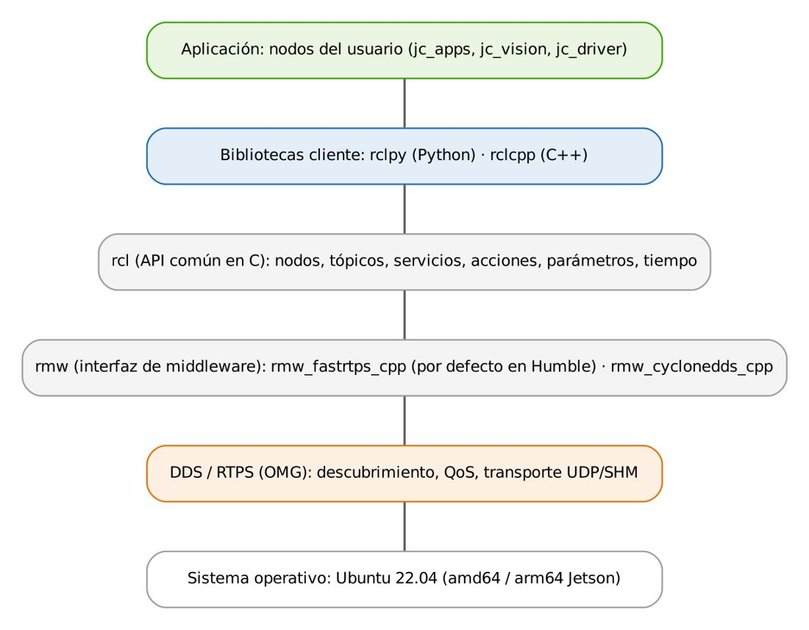
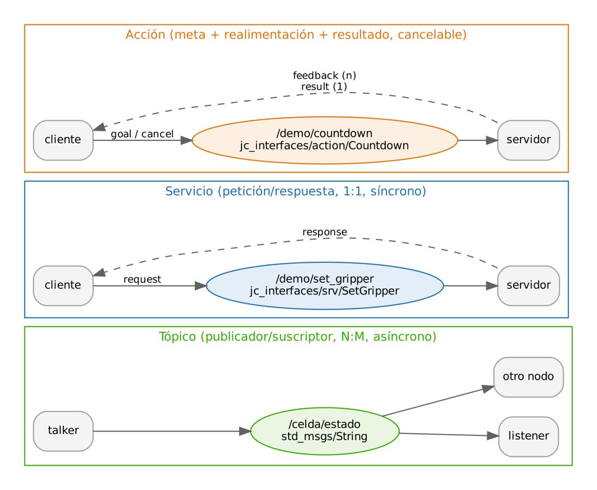
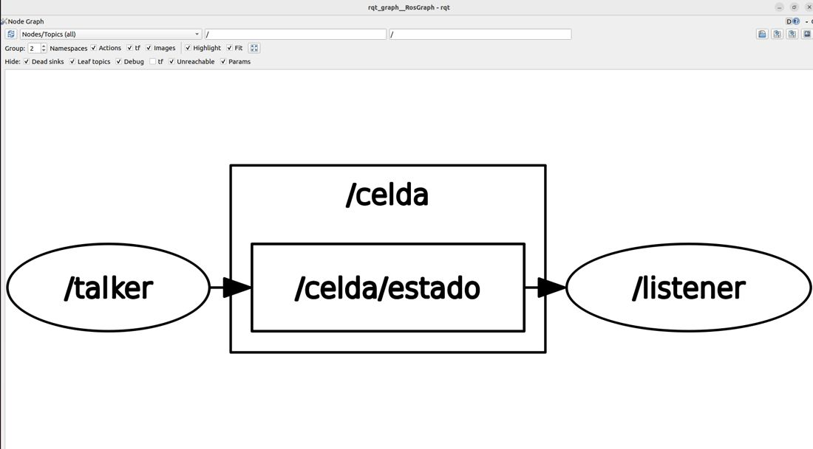
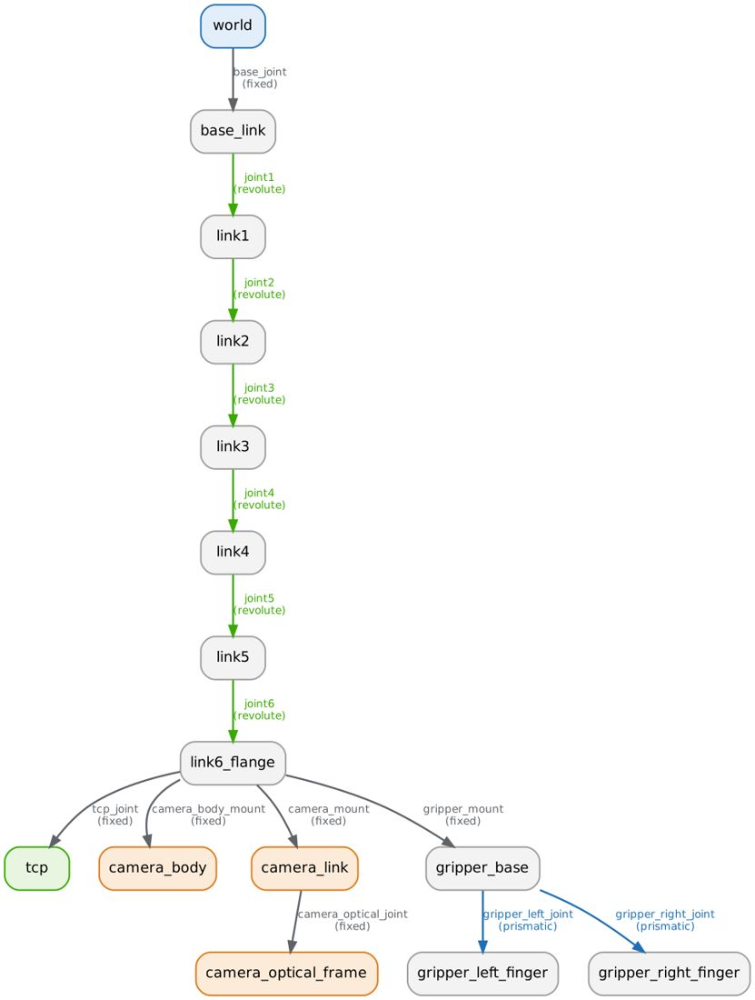

# Documento de Apoyo No. DA-03 – Arquitectura de ROS 2: nodos, tópicos, servicios, acciones, mensajes y parámetros.

> Versión en Markdown del documento [DA-03_Arquitectura_ROS2.docx](DA-03_Arquitectura_ROS2.docx) para consultar y copiar comandos desde GitHub. El documento de Word es la versión oficial (formato GFPI-F-135).

**Nombre del Proyecto Formativo:** CELDA ROBÓTICA COLABORATIVA CON VISIÓN ARTIFICIAL INTEGRADA EN ROS 2 (JETCOBOT – NVIDIA JETSON AGX ORIN)

**Actividad de Proyecto Formativo:** IMPLEMENTAR UNA CELDA ROBÓTICA COLABORATIVA CON VISIÓN ARTIFICIAL Y ROS 2, DE LA SIMULACIÓN AL ROBOT REAL, Y TRANSFERIR EL CONOCIMIENTO AL CENTRO DE FORMACIÓN.

**Actividad de Aprendizaje:** Explicar y aplicar los mecanismos de comunicación de ROS 2 (tópicos, servicios, acciones, parámetros, interfaces y lanzadores), seleccionando el patrón adecuado para cada función de una celda robótica.

**Parte de la transferencia:** Parte A – Simulación en el PC.

**Equipo de trabajo:** PC con Ubuntu 22.04 y ROS 2 Humble. No se usa la Jetson ni se energiza el robot.

**Duración Estimada:** 2 horas.

**Sesión:** Día 1 – 03/11/2026, 1:30 p.m. – 3:30 p.m.

**Relación con la Guía de Aprendizaje:** Actividad 3.3.2 (apropiación).

> **PARTE A · TRABAJO EN EL PC (SIMULACIÓN):**
>
> Todo el trabajo de este documento se hace en el **PC** con Ubuntu 22.04 y ROS 2 Humble, con el robot simulado (mock y Gazebo) y, cuando se indique, una cámara USB conectada al PC. **No se usa la Jetson ni se energiza el robot.** Cada bloque de comandos indica **Terminal (PC)**.

## 1. OBJETIVOS DE APRENDIZAJE

- Describir las capas de ROS 2 (rclpy/rclcpp, rcl, rmw, DDS) y el grafo computacional.
- Distinguir tópicos, servicios y acciones por su semántica temporal y elegir el patrón correcto para el cobot.
- Definir interfaces propias (`.msg`, `.srv`, `.action`) y usarlas desde Python.
- Declarar, validar y modificar parámetros en tiempo de ejecución.
- Inspeccionar un sistema en marcha con la CLI de ROS 2, `rqt_graph` y TF2.
- Crear un paquete Python propio y un archivo de lanzamiento (*launch*).

## 2. FUNDAMENTOS

### 2.1 Capas y grafo computacional

ROS 2 organiza el software en **nodos**: procesos (o componentes) con una responsabilidad acotada que se comunican por medio de un *middleware* publicador/suscriptor basado en DDS [3]. A diferencia de ROS 1, no existe un maestro central: el descubrimiento es distribuido, lo que habilita sistemas multi-computador (en la Parte B, la Jetson y el PC) y políticas de calidad de servicio por canal [1]. La Figura 1 resume la pila de software.



*Figura 1. Capas de ROS 2. El código del usuario solo interactúa con rclpy/rclcpp; la implementación DDS se elige con la variable RMW_IMPLEMENTATION. Fuente: elaboración propia a partir de [1], [2].*

El **grafo de ROS** es el conjunto de nodos y de los canales que los conectan en un instante dado. Cada canal tiene un **nombre** (p. ej. `/joint_states`) y un **tipo de interfaz** (p. ej. `sensor_msgs/msg/JointState`). Dos extremos solo se conectan si coinciden nombre, tipo y perfiles QoS compatibles.

### 2.2 Patrones de comunicación



*Figura 2. Tópicos, servicios y acciones con las interfaces didácticas de jc_apps.*

*Tabla 1. Comparación de los mecanismos de comunicación de ROS 2.*

| **Patrón** | **Semántica** | **Cuándo usarlo en la celda** | **Ejemplo en robots\_ws** |
|---|---|---|---|
| Tópico | Flujo continuo, asíncrono, N publicadores : M suscriptores; sin confirmación. | Datos periódicos de sensores y estado. | `/joint_states`, `/camera/image_raw`, `/jc/detections` |
| Servicio | Petición–respuesta, 1:1; el cliente espera el resultado. | Operaciones cortas y atómicas. | `/jc/set_gripper`, `/jetcobot_bridge/power_on` |
| Acción | Meta de larga duración con realimentación periódica, resultado final y **cancelación**. | Movimientos del robot y tareas compuestas. | `/arm_controller/follow_joint_trajectory`, `/jc/pick_place` |
| Parámetro | Configuración con nombre y tipo, propia de cada nodo; modificable en caliente. | Puertos, velocidades, umbrales. | `port`, `baud`, `velocity_scaling`, `plane_z` |

Una acción se implementa internamente con tres servicios (enviar meta, cancelar, obtener resultado) y dos tópicos (realimentación y estado) [2]. Por eso el robot real puede ser comandado por MoveIt 2 y cancelado en mitad de una trayectoria: el puente `jetcobot_bridge` atiende la cancelación con `stop()` del robot.

### 2.3 Calidad de servicio (QoS)

*Tabla 2. Políticas QoS más relevantes.*

| **Política** | **Opciones** | **Uso recomendado** |
|---|---|---|
| Reliability | `reliable` / `best_effort` | Comandos y estado: reliable. Imágenes y sensores de alta tasa: best\_effort (`qos_profile_sensor_data`). |
| Durability | `volatile` / `transient_local` | `/robot_description` usa transient\_local para que nodos que arrancan tarde reciban el URDF. |
| History / Depth | `keep_last(N)` / `keep_all` | Profundidad pequeña (1–10) para datos en tiempo real. |
| Deadline, Lifespan, Liveliness | Períodos y vencimientos | Supervisión de sensores críticos (avanzado). |

> **Precaución:**
>
> Un publicador `best_effort` **no** es compatible con un suscriptor `reliable`: la conexión no se establece y no aparece error explícito. Diagnóstico: `ros2 topic info -v /topico`.

### 2.4 Interfaces: mensajes, servicios y acciones

Las interfaces se describen en archivos de texto y `rosidl` genera el código para C++ y Python. El paquete `jc_interfaces` define las interfaces propias de la celda; por ejemplo:

**jc_interfaces/action/PickPlace.action**

```
# Accion de la celda (Dia 5): recoger el objeto 'label' y dejarlo en 'place_pose'.
string label
geometry_msgs/PoseStamped place_pose
bool use_place_pose         # false => el servidor usa el contenedor asignado a la clase
---
bool success
string message
---
string stage
float32 progress
```

Las tres secciones separadas por `---` son **meta**, **resultado** y **realimentación**. Los paquetes de interfaces deben ser `ament_cmake` y declarar `rosidl_default_generators` (ver `CMakeLists.txt` del paquete).

### 2.5 Marcos de referencia y TF2

TF2 mantiene un árbol de transformaciones entre marcos con marca de tiempo [4]. ROS sigue la convención de REP 103: unidades SI (m, rad, s) y marcos dextrógiros con x adelante, y a la izquierda, z arriba; para cámaras, el marco *óptico* tiene z hacia adelante, x a la derecha e y hacia abajo [5]. `robot_state_publisher` publica el árbol del robot a partir del URDF y de `/joint_states`.

## 3. PROCEDIMIENTO PASO A PASO

### Paso 0. Incorporar al robots_ws el material de este documento

El espacio de trabajo `~/robots_ws` se construye a medida que avanza la transferencia: cada documento incorpora **solo** el material que usa. Agregue desde el repositorio robots\_ws (DA-02, Paso 7) lo siguiente y revise su contenido antes de ejecutarlo:

| **Se incorpora** | **Qué contiene** |
|---|---|
| `src/jc_interfaces` | Mensajes, servicios y acciones propios de la celda (`msg/`, `srv/`, `action/`). Paquete `ament_cmake`: las interfaces se generan en C++ y Python al compilar. |
| `src/jc_apps` | Nodos didácticos en Python: `talker`, `listener`, `param_demo`, `gripper_service_demo`, `countdown_*`. También trae los nodos que se usan más adelante (cinemática, trayectorias, `pick_place_node`). |

**Terminal (PC)**

```bash
cd ~/robots_ws && git sparse-checkout add src/jc_interfaces
cd ~/robots_ws && git sparse-checkout add src/jc_apps
# instala las dependencias de los paquetes agregados
rosdep install --from-paths ~/robots_ws/src --ignore-src -r -y --skip-keys "mr_navigation jc_driver"
cd ~/robots_ws
colcon build --symlink-install --packages-select jc_interfaces jc_apps
source install/setup.bash
# explore la estructura
tree -L 2 src/
# paquetes del workspace hasta ahora
ros2 pkg list | grep -E "jc_|mi_celda"
```

> **Resultado esperado:**
>
> `Summary: 2 packages finished` (primero `jc_interfaces`, porque `jc_apps` depende de él). Compruebe la interfaz generada con `ros2 interface show jc_interfaces/srv/SetGripper`: debe mostrar `float64 opening`, `---`, `bool success` y `string message`.

Revise `jc_apps/setup.py`: la sección `entry_points` asocia cada ejecutable (`talker`, `listener`, …) con la función `main` de su módulo. Es lo mismo que hará en el Paso 5 con su propio paquete.

### Paso 1. Primer contacto con el grafo

**Terminal (PC)**

```bash
# Terminal 1
ros2 run jc_apps talker --ros-args -p rate_hz:=2.0
# Terminal 2
ros2 run jc_apps listener
# Terminal 3: introspección
ros2 node list
ros2 node info /talker
ros2 topic list -t
ros2 topic info -v /celda/estado
ros2 topic hz /celda/estado
ros2 topic echo /celda/estado --once
ros2 run rqt_graph rqt_graph
```

> **Resultado esperado:**
>
> `ros2 topic hz` reporta ≈ 2,0 Hz. `rqt_graph` muestra `/talker → /celda/estado → /listener`.



Revise el código fuente de `jc_apps/talker.py` (fragmento):

**jc_apps/talker.py**

```
class Talker(Node):
    def __init__(self):
        super().__init__("talker")
        self.declare_parameter("rate_hz", 1.0)
        self.pub = self.create_publisher(String, "/celda/estado", 10)   # profundidad QoS = 10
        self.n = 0
        self.timer = self.create_timer(1.0 / self.get_parameter("rate_hz").value, self.tick)
    def tick(self):
        self.n += 1
        self.pub.publish(String(data=f"celda OK #{self.n}"))
```

### Paso 2. Servicio con interfaz propia

**Terminal (PC)**

```bash
ros2 run jc_apps gripper_service_demo
ros2 service list -t | grep demo
ros2 service call /demo/set_gripper jc_interfaces/srv/SetGripper "{opening: 0.5}"
# debe rechazarse
ros2 service call /demo/set_gripper jc_interfaces/srv/SetGripper "{opening: 1.7}"
```

> **Resultado esperado:**
>
> `success: true, message: 'Pinza al 50 % (valor pymycobot 50)'`
>
> Con 1.7: `success: false, message: 'opening debe estar en [0, 1]'` (validación en el servidor).

### Paso 3. Acción con realimentación y cancelación

**Terminal (PC)**

```bash
ros2 run jc_apps countdown_server
ros2 action list -t
ros2 action send_goal --feedback /demo/countdown jc_interfaces/action/Countdown "{seconds: 5}"
# cliente en Python; pruebe Ctrl+C para cancelar
ros2 run jc_apps countdown_client 8
```

Analice en `countdown_server.py` el uso de `gh.publish_feedback()`, `gh.is_cancel_requested`, `gh.canceled()` y `gh.succeed()`, y por qué se usa un `MultiThreadedExecutor`: mientras la meta se ejecuta, el servidor debe seguir atendiendo la petición de cancelación.

### Paso 4. Parámetros

**Terminal (PC)**

```bash
ros2 run jc_apps param_demo
ros2 param list /param_demo
ros2 param describe /param_demo velocidad
# aceptado
ros2 param set /param_demo velocidad 0.5
# rechazado: fuera de [0.01, 1.0]
ros2 param set /param_demo velocidad 2.0
# aceptado por la validación del callback
ros2 param set /param_demo modo real
# exporta a YAML
ros2 param dump /param_demo > param_demo.yaml
```

### Paso 5. Crear su propio paquete

**Terminal (PC)**

```bash
cd ~/robots_ws/src
ros2 pkg create --build-type ament_python mi_celda --dependencies rclpy sensor_msgs
# editar mi_celda/mi_celda/monitor.py (ver abajo) y registrar en setup.py:
#   entry_points={'console_scripts': ['monitor = mi_celda.monitor:main']}
cd ~/robots_ws && colcon build --packages-select mi_celda && source install/setup.bash
```

**mi_celda/mi_celda/monitor.py**

```
import math
import rclpy
from rclpy.node import Node
from sensor_msgs.msg import JointState
class Monitor(Node):
    """Avisa cuando alguna articulacion se acerca a menos de 'margen_deg' de su limite."""
    LIM = {"joint1": 168, "joint2": 135, "joint3": 150, "joint4": 145, "joint5": 155, "joint6": 180}
    def __init__(self):
        super().__init__("monitor_limites")
        self.margen = self.declare_parameter("margen_deg", 10.0).value
        self.create_subscription(JointState, "/joint_states", self.cb, 10)
    def cb(self, msg):
        for n, q in zip(msg.name, msg.position):
            if n in self.LIM and abs(math.degrees(q)) > self.LIM[n] - self.margen:
                self.get_logger().warn(f"{n} a {math.degrees(q):.1f} grados: cerca del limite",
                                       throttle_duration_sec=1.0)
def main():
    rclpy.init()
    rclpy.spin(Monitor())
```

### Paso 6. Archivo de lanzamiento

**mi_celda/launch/demo.launch.py**

```
from launch import LaunchDescription
from launch_ros.actions import Node
def generate_launch_description():
    return LaunchDescription([
        Node(package="jc_apps", executable="talker", parameters=[{"rate_hz": 5.0}]),
        Node(package="jc_apps", executable="listener"),
        Node(package="mi_celda", executable="monitor", parameters=[{"margen_deg": 15.0}]),
    ])
```

Agregue en `setup.py` la instalación de la carpeta `launch` (`('share/' + package_name + '/launch', glob('launch/*.py'))`), compile y ejecute `ros2 launch mi_celda demo.launch.py`.

### Paso 7. TF2 con el modelo del robot

Este paso necesita el modelo del robot. Incorpore ahora `jc_description` (se estudia a fondo en DA-04) y ejecute las pruebas unitarias de `jc_apps`, que usan ese modelo:

**Terminal (PC)**

```bash
cd ~/robots_ws && git sparse-checkout add src/jc_description
# instala las dependencias de los paquetes agregados
rosdep install --from-paths ~/robots_ws/src --ignore-src -r -y --skip-keys "mr_navigation jc_driver"
cd ~/robots_ws
colcon build --symlink-install --packages-select jc_description
source install/setup.bash
colcon test --packages-select jc_apps && colcon test-result --verbose
```

> **Resultado esperado:**
>
> 3 pruebas de `jc_apps` aprobadas (cinemática directa en cero y en `ready`, ida y vuelta FK→IK, yaw del TCP por simetría). El workspace tiene ahora `jc_interfaces`, `jc_apps`, `jc_description` y `mi_celda`.

**Terminal (PC)**

```bash
# RViz2 + sliders articulares
ros2 launch jc_description display.launch.py
# pose del TCP mientras mueve los sliders
ros2 run tf2_ros tf2_echo world tcp
# genera frames_<fecha>.pdf
ros2 run tf2_tools view_frames
```



*Figura 3. Árbol TF del JetCobot generado a partir del URDF de jc_description (verde: articulaciones de revolución; azul: prismáticas de la pinza; gris: fijas).*

## 4. VERIFICACIÓN Y EVIDENCIAS

*Tabla 3. Lista de verificación de la actividad.*

| **#** | **Criterio verificable** | **Evidencia** |
|---|---|---|
| 1 | Identifica nodos, tópicos, tipos y QoS de un sistema en marcha | Salida de `ros2 topic info -v` |
| 2 | Usa correctamente servicios y acciones (incluida la cancelación) | Registro de terminal |
| 3 | Parámetro con validación funcionando | Respuesta de `ros2 param set` rechazada/aceptada |
| 4 | Paquete `mi_celda` compilado con nodo y launch propios | Árbol del paquete + ejecución |
| 5 | Interpreta el árbol TF del robot | PDF de `view_frames` |

## 5. PREGUNTAS DE COMPRENSIÓN

1. ¿Por qué el movimiento del robot se modela como acción y no como servicio? Considere la duración, la realimentación y la cancelación.
1. Un nodo de visión publica imágenes a 30 Hz con QoS `best_effort`. ¿Qué ocurre si `rqt_image_view` se suscribe con `reliable`?
1. ¿Qué ventaja aporta que `/robot_description` use durabilidad `transient_local`?
1. Proponga el diseño de interfaces (tópicos, servicios, acciones) para agregar una banda transportadora a la celda.

## 6. SOLUCIÓN DE PROBLEMAS

*Tabla 4. Problemas frecuentes.*

| **Síntoma** | **Causa probable** | **Solución** |
|---|---|---|
| `Package 'jc_apps' not found` | No se cargó el overlay | `source ~/robots_ws/install/setup.bash` |
| El suscriptor no recibe mensajes | QoS incompatible o dominio distinto | `ros2 topic info -v`; revisar `ROS_DOMAIN_ID` |
| `ros2 action send_goal` queda esperando | Servidor no iniciado / nombre distinto | `ros2 action list -t` |
| Cambios en Python no surten efecto | Compilación sin `--symlink-install` | Recompilar con `--symlink-install` |

## REFERENCIAS

**[1]** S. Macenski, T. Foote, B. Gerkey, C. Lalancette y W. Woodall, "Robot Operating System 2: Design, architecture, and uses in the wild," *Science Robotics*, vol. 7, no. 66, eabm6074, 2022, doi: 10.1126/scirobotics.abm6074.

**[2]** Open Robotics, *ROS 2 Documentation: Humble Hawksbill*. [En línea]. Disponible: [https://docs.ros.org/en/humble/](https://docs.ros.org/en/humble/)

**[3]** Object Management Group, *Data Distribution Service (DDS), v1.4*, 2015. [En línea]. Disponible: [https://www.omg.org/spec/DDS/1.4](https://www.omg.org/spec/DDS/1.4)

**[4]** T. Foote, "tf: The transform library," en *Proc. IEEE Int. Conf. Technologies for Practical Robot Applications (TePRA)*, 2013, pp. 1–6, doi: 10.1109/TePRA.2013.6556373.

**[5]** T. Foote y M. Purvis, *REP 103 – Standard Units of Measure and Coordinate Conventions*. [En línea]. Disponible: [https://www.ros.org/reps/rep-0103.html](https://www.ros.org/reps/rep-0103.html)

**[6]** J. R. Cháux Cedeño, *robots\_ws – paquetes ROS 2 del curso (repositorio en GitHub, licencia Apache-2.0), 2026. [En línea]. Disponible: https://github.com/jchauxdev/robots\_ws*
