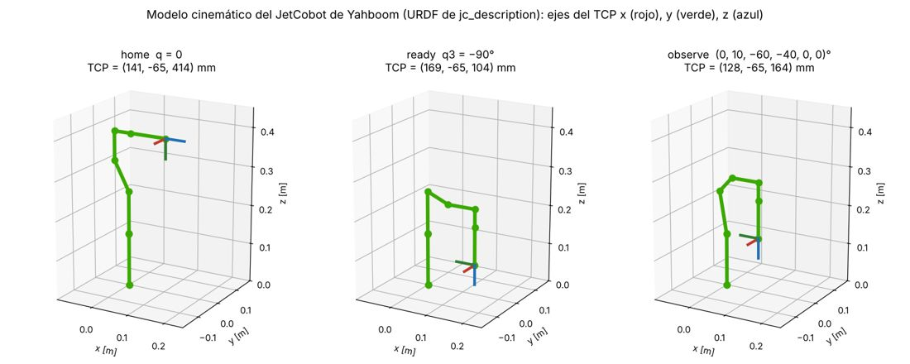
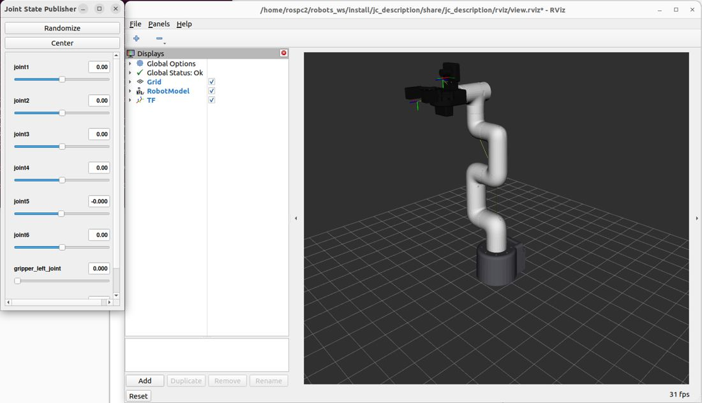

# Documento de Apoyo No. DA-04 – Modelado del cobot con URDF/Xacro y visualización en RViz2.

> Versión en Markdown del documento de apoyo, para consultar y copiar comandos desde GitHub. El documento de Word (formato GFPI-F-135) no se publica en el repositorio.

**Actividad de Aprendizaje:** Construir y validar el modelo cinemático-geométrico del cobot en URDF/Xacro, visualizándolo en RViz2 y verificando su cinemática directa con TF2.

**Parte de la transferencia:** Parte A – Simulación en el PC.

**Equipo de trabajo:** PC con Ubuntu 22.04 y ROS 2 Humble. No se usa la Jetson ni se energiza el robot.

**Duración Estimada:** 1,5 horas.

**Sesión:** Día 1 – 03/11/2026, 3:30 p.m. – 5:00 p.m.

**Relación con la Guía de Aprendizaje:** Actividad 3.3.3 (apropiación).

> **PARTE A · TRABAJO EN EL PC (SIMULACIÓN):**
>
> Todo el trabajo de este documento se hace en el **PC** con Ubuntu 22.04 y ROS 2 Humble, con el robot simulado (mock y Gazebo) y, cuando se indique, una cámara USB conectada al PC. **No se usa la Jetson ni se energiza el robot.** Cada bloque de comandos indica **Terminal (PC)**.

## 1. OBJETIVOS DE APRENDIZAJE

- Describir los elementos de URDF (eslabones, articulaciones, inercias, geometrías visual y de colisión).
- Parametrizar un modelo con Xacro (propiedades, macros, argumentos, condicionales).
- Generar, validar y visualizar el URDF del JetCobot y su árbol de marcos.
- Relacionar la transformación de cada articulación con la cinemática directa.
- Modificar el modelo (TCP, cámara, accesorios) y verificar el efecto con TF2.

## 2. FUNDAMENTOS

### 2.1 URDF

URDF (*Unified Robot Description Format*) describe un robot como un árbol de **eslabones** (`<link>`) unidos por **articulaciones** (`<joint>`) [1]. Cada articulación define el marco del hijo respecto al padre mediante `<origin xyz rpy>` (traslación en metros y rotación roll-pitch-yaw fija X-Y-Z en radianes), el eje de movimiento `<axis>` y sus límites `<limit lower upper velocity effort>`. Para una articulación de revolución con variable *q*, la transformación padre→hijo es:

$${T}_{p}^{h}\left( q \right)=Trans\left( x,y,z \right){R}_{z}\left( ψ \right){R}_{y}\left( \theta  \right){R}_{x}\left( ϕ \right)Rot\left( \bar{a},q \right) \qquad (1)$$

donde (φ, θ, ψ) = `rpy` y **â** = `axis`. Encadenando (1) desde `world` hasta `tcp` se obtiene la cinemática directa (DA-05) [6], [7]. A diferencia de la convención de Denavit–Hartenberg, URDF permite ubicar libremente cada marco, por lo que el modelo del fabricante puede usarse sin reescribirlo.

*Tabla 1. Tipos de articulación URDF usados.*

| **Tipo de articulación** | **Movimiento** | **Uso en el JetCobot** |
|---|---|---|
| revolute | Rotación con límites | joint1 … joint6 |
| prismatic | Traslación con límites | Dedos de la pinza simplificada |
| fixed | Ninguno (unión rígida) | base, pinza, TCP, cámara, marco óptico |
| continuous | Rotación sin límites | — |

Cada eslabón puede tener `<visual>` (lo que se dibuja), `<collision>` (lo que usa el verificador de colisiones de MoveIt y el motor físico de Gazebo) e `<inertial>` (masa, centro de masa y tensor de inercia, imprescindibles en Gazebo). Para un cilindro sólido de masa *m*, radio *r* y longitud *h* sobre su eje *z*:

$${I}_{xx}={I}_{yy}=\frac{m\left( 3{r}^{2}+{h}^{2} \right)}{12},{I}_{zz}=\frac{m{r}^{2}}{2} \qquad (2)$$

### 2.2 Xacro

Xacro es un preprocesador XML que agrega propiedades (`xacro:property`), expresiones `${...}`, macros (`xacro:macro`), argumentos (`xacro:arg`) y condicionales (`xacro:if`). Permite un único archivo fuente que genera variantes: en `jc_description` el argumento `sim_mode` produce el URDF para **mock**, **gazebo** o **real**.

### 2.3 El modelo de la celda del JetCobot (jc_description)

El modelo cinemático-geométrico del cobot corresponde exclusivamente al Yahboom JetCobot (brazo robótico colaborativo de 6 GDL equipado con pinza paralela y cámara en mano eye-in-hand). Se emplean las mallas STL oficiales del fabricante Yahboom (base\_link.STL, 1\_Link.STL … 6\_Link.STL, jiazhua\_Link.STL y camera\_Link.STL), ubicadas en jc\_description/meshes/yahboom/, lo que garantiza una correspondencia visual y dimensional exacta con el manipulador físico real. Las articulaciones siguen la convención del robot: 0 rad en el modelo URDF corresponde a 0° en los comandos de bajo nivel. Los límites angulares y cinemáticos siguen las especificaciones reales de los servomotores inteligentes del JetCobot. Para la verificación de colisiones y cálculo dinámico en Gazebo/MoveIt2, las geometrías de colisión e inercia se parametrizan en torno a cada eslabón. Se integran además: el mecanismo de pinza paralela Yahboom, el punto central de la herramienta (TCP) a 95 mm de la brida y el ensamble de cámara oficial Yahboom (camera\_body, camera\_link y camera\_optical\_frame bajo REP 103).

Las mallas de Yahboom no se publican en el repositorio robots\_ws, porque son archivos del fabricante: cada equipo las instala con importar\_modelo\_yahboom.sh (DA-03, Paso 7). El argumento modelo del Xacro elige cómo se dibuja el robot: modelo:=yahboom usa las mallas y modelo:=simple usa cilindros y cajas, sin archivos externos. La cinemática y las geometrías de colisión son las mismas en los dos. display.launch.py y los lanzadores de la celda eligen solos: yahboom si las mallas están instaladas y simple si no.



*Figura 1. Modelo cinemático del JetCobot de Yahboom en tres configuraciones con nombre (calculado con la FK del URDF).*

*Tabla 2. Estructura del paquete jc_description.*

| **Archivo** | **Contenido** |
|---|---|
| urdf/jetcobot\_macro.xacro | Macro jetcobot: eslabones con mallas STL Yahboom, articulaciones, pinza, TCP y cámara. |
| urdf/jetcobot.ros2\_control.xacro | Interfaces de comando/estado; hardware mock o Gazebo según `sim_mode`. |
| urdf/jetcobot.gazebo.xacro | Plugin `ign_ros2_control`, fricción de dedos y sensor de cámara. |
| urdf/jetcobot.urdf.xacro | Archivo principal: world + macros del JetCobot + argumentos. |
| config/ros2\_controllers.yaml | Controladores: joint\_state\_broadcaster, arm\_controller, gripper\_controller. |
| launch/display.launch.py | robot\_state\_publisher + joint\_state\_publisher\_gui + RViz2. |

En jc\_description, el JetCobot está modelado de forma estándar en ROS 2 Humble empleando las mallas STL originales del fabricante y la nomenclatura estándar (joint1 … joint6), garantizando plena compatibilidad tanto en simulación (PC) como en despliegue distribuido sobre la Jetson Orin Nano (Parte B).

## 3. PROCEDIMIENTO PASO A PASO

> **Nota:**
>
> El paquete `jc_description` ya está en su `~/robots_ws`: se incorporó en DA-03, Paso 7. En este documento se estudia por dentro. Explore su estructura con `tree ~/robots_ws/src/jc_description` (carpetas `urdf/`, `launch/`, `rviz/` y `config/`).

### Paso 0. Actualizar robots_ws

Antes de empezar, traiga lo nuevo del repositorio robots\_ws y vuelva a compilar:

**Terminal 1 (PC)**

```bash
# trae lo nuevo del repositorio (correcciones y mejoras)
cd ~/robots_ws && git pull
colcon build --symlink-install
source install/setup.bash
```

### Paso 1. Leer el macro de una articulación

**jc_description/urdf/jetcobot_macro.xacro (fragmento)**

```
<xacro:cyl_link name="${prefix}link2" r="0.024" h="0.1104" xyz="-0.0552 0 0" rpy="0 ${PI/2} 0" m="0.12" color="blanco"
    modelo="${modelo}" mesh="2_Link.STL" mxyz="-0.00006 -0.00003 0.03500" mrpy="-1.57080 0.00000 1.57080"/>
<joint name="${prefix}joint2" type="revolute">
  <parent link="${prefix}link1"/>
  <child link="${prefix}link2"/>
  <origin xyz="0 0 -0.001" rpy="0 ${PI/2} ${-PI/2}"/>
  <axis xyz="0 0 1"/>
  <limit lower="${-135*DEG}" upper="${135*DEG}" effort="${EFF}" velocity="${VEL}"/>
</joint>
```

Identifique: marco padre/hijo, traslación, rotación fija, eje, límites en radianes (−135° … 135°), la referencia a la malla de Yahboom (mesh="2\_Link.STL", que solo se dibuja con modelo:=yahboom) y cómo la macro `cyl_link` calcula la inercia con la ecuación (2).

### Paso 2. Generar y validar el URDF

En la Terminal 1 genere el URDF con las mallas de Yahboom, valídelo y dibuje su árbol:

**Terminal 1 (PC)**

```bash
cd ~/robots_ws && source install/setup.bash
xacro src/jc_description/urdf/jetcobot.urdf.xacro sim_mode:=mock modelo:=yahboom > /tmp/jetcobot.urdf
check_urdf /tmp/jetcobot.urdf
# genera /tmp/jetcobot.pdf
urdf_to_graphviz /tmp/jetcobot.urdf /tmp/jetcobot
```

**Salida obtenida en la validación del material**

```
robot name is: jetcobot
---------- Successfully Parsed XML ---------------
root Link: world has 1 child(ren)
    child(1):  base_link
        child(1):  link1
            child(1):  link2
                child(1):  link3
                    child(1):  link4
                        child(1):  link5
                            child(1):  link6_flange
                                child(1):  camera_body
                                child(2):  camera_link
                                    child(1):  camera_optical_frame
                                child(3):  gripper_base
                                    child(1):  gripper_left_finger
                                    child(2):  gripper_right_finger
                                child(4):  tcp
```

> **Nota:**
>
> camera\_body es el eslabón que dibuja la cámara de Yahboom y solo existe con modelo:=yahboom. Con modelo:=simple el árbol es el mismo sin camera\_body.

### Paso 3. Visualizar en RViz2

Abra la Terminal 2, lance el modelo en RViz2 con los deslizadores de las articulaciones y déjela ejecutando hasta el final del Paso 4:

**Terminal 2 (PC) – déjela ejecutando**

```bash
ros2 launch jc_description display.launch.py
```

1. En RViz2 verifique *Fixed Frame* = `world`; active **RobotModel** y **TF**.
1. Mueva los deslizadores de `joint_state_publisher_gui` y observe el árbol TF.
1. Lleve el robot a q = (0, 0, −90°, 0, 0, 0) y compruebe en una Terminal 3 con ros2 run tf2\_ros tf2\_echo world tcp (Ctrl + C para salir) que el TCP está en (0,169; −0,065; 0,104) m apuntando hacia abajo.

> **Resultado esperado:**
>
> RViz2 muestra el JetCobot de Yahboom con sus mallas (base, eslabones, pinza y cámara). En ready, tf2\_echo world tcp muestra Translation: [0.169, -0.065, 0.104]. En la Terminal 2 aparece [jc\_description] Sin mallas de Yahboom si no están instaladas: entonces el brazo se dibuja con cilindros y cajas (importar\_modelo\_yahboom.sh, DA-03, Paso 7).



### Paso 4. Cálculo de la cinemática directa en q = 0

Usando únicamente los &lt;origin&gt; del URDF (Tabla 3), calcule a mano o con el script de NumPy la posición de link6\_flange y del tcp para q = 0 y compárela con TF.

*Tabla 3. Parámetros cinemáticos del JetCobot de Yahboom (tomados del URDF).*

| **Articulación** | **xyz [m]** | **rpy [rad]** | **Eje** |
|---|---|---|---|
| joint1 | (0, 0, 0,13546) | (0, 0, 0) | z |
| joint2 | (0, 0, −0,001) | (0, π/2, −π/2) | z |
| joint3 | (−0,1104, 0, 0) | (0, 0, 0) | z |
| joint4 | (−0,096, 0, 0,06462) | (0, 0, −π/2) | z |
| joint5 | (0, −0,07318, 0) | (π/2, −π/2, 0) | z |
| joint6 | (0, 0,0456, 0) | (−π/2, 0, 0) | z |
| tcp (fija) | (0, 0, 0,095) | (0, 0, 0) | — |

Este script es Python: guárdelo como ~/fk\_q0.py y ejecútelo en la Terminal 1 (no lo pegue en bash):

**Terminal 1 (PC)**

```bash
gedit ~/fk_q0.py
python3 ~/fk_q0.py
```

**Python (PC) – fk_q0.py, se ejecuta con python3**

```
import numpy as np
def rot_z(q):
    c, s = np.cos(q), np.sin(q)
    return np.array([[c, -s, 0, 0], [s, c, 0, 0], [0, 0, 1, 0], [0, 0, 0, 1]])
def rot_y(q):
    c, s = np.cos(q), np.sin(q)
    return np.array([[c, 0, s, 0], [0, 1, 0, 0], [-s, 0, c, 0], [0, 0, 0, 1]])
def rot_x(q):
    c, s = np.cos(q), np.sin(q)
    return np.array([[1, 0, 0, 0], [0, c, -s, 0], [0, s, c, 0], [0, 0, 0, 1]])
def trans(x, y, z):
    T = np.eye(4); T[0:3, 3] = [x, y, z]; return T
def rpy(r, p, y):
    return rot_z(y) @ rot_y(p) @ rot_x(r)
pi = np.pi
# encadenamiento de transformaciones en q = 0 (Tabla 3)
T1 = trans(0, 0, 0.13546) @ rpy(0, 0, 0)
T2 = trans(0, 0, -0.001) @ rpy(0, pi/2, -pi/2)
T3 = trans(-0.1104, 0, 0) @ rpy(0, 0, 0)
T4 = trans(-0.096, 0, 0.06462) @ rpy(0, 0, -pi/2)
T5 = trans(0, -0.07318, 0) @ rpy(pi/2, -pi/2, 0)
T6 = trans(0, 0.0456, 0) @ rpy(-pi/2, 0, 0)
T_tcp = trans(0, 0, 0.095)
T_flange = T1 @ T2 @ T3 @ T4 @ T5 @ T6
T_total = T_flange @ T_tcp
print("link6_flange (mm):", np.round(T_flange[:3, 3] * 1000, 1))
print("tcp (mm):         ", np.round(T_total[:3, 3] * 1000, 1))
```

Luego, en la Terminal 2 pulse Center en la ventana de los deslizadores (todas las articulaciones en 0) y, en la Terminal 3, compare con TF:

**Terminal 3 (PC)**

```bash
ros2 run tf2_ros tf2_echo world link6_flange
ros2 run tf2_ros tf2_echo world tcp
```

> **Resultado esperado:**
>
> El script imprime link6\_flange (mm): [45.6 -64.6 414. ] y tcp (mm): [140.6 -64.6 414. ]. tf2\_echo muestra los mismos valores en metros: [0.046, -0.065, 0.414] y [0.141, -0.065, 0.414]. Al terminar, cierre RViz2 con Ctrl + C en la Terminal 2.

### Paso 5. Modificar el modelo

1. En la Terminal 1, regenere el modelo con otro desplazamiento del TCP (`xacro ... tcp_offset:=0.100`) y verifique el cambio con `tf2_echo link6_flange tcp`. En la Parte B (DA-14) medirá con calibrador el valor real sobre el robot.
1. Ajuste la posición nominal de la cámara (`cam_x`, `cam_y`, `cam_z` del macro; valores nominales del JetCobot de Yahboom: cam\_x = 0, cam\_y = −34 mm y cam\_z = 34 mm respecto a la brida) y compruebe el cambio con tf2\_echo link6\_flange camera\_link. El valor definitivo se obtiene con la calibración mano-ojo: en simulación en DA-09 y con el robot real en DA-16.
1. Agregue al `world` un eslabón fijo `mesa` (caja de 0,8 × 0,8 × 0,02 m con su superficie en z = 0) y visualícelo.

**Ejercicio 3 (agregar en jetcobot.urdf.xacro)**

```
<link name="mesa">
  <visual><origin xyz="0.1 0 -0.01"/><geometry><box size="0.8 0.8 0.02"/></geometry></visual>
  <collision><origin xyz="0.1 0 -0.01"/><geometry><box size="0.8 0.8 0.02"/></geometry></collision>
</link>
<joint name="mesa_joint" type="fixed"><parent link="world"/><child link="mesa"/></joint>
```

> **Nota:**
>
> En robots\_ws la mesa se agrega a MoveIt como objeto de colisión desde `motion_server` (parámetro `add_table`), lo que evita modificar el URDF. Si la agrega también al URDF, deshabilite la colisión `mesa`–`base_link` en el SRDF.

## 4. VERIFICACIÓN Y EVIDENCIAS

*Tabla 4. Evidencias de la actividad.*

| **#** | **Criterio** | **Evidencia** |
|---|---|---|
| 1 | URDF generado y validado con `check_urdf` | Salida de terminal |
| 2 | Modelo y TF visualizados en RViz2 | Captura |
| 3 | FK manual en q = 0 coincide con TF (error &lt; 1 mm) | Cálculo + `tf2_echo` |
| 4 | Efecto de cambiar el TCP y la cámara verificado con TF | Salida de `tf2_echo` y diff del xacro |

## 5. SOLUCIÓN DE PROBLEMAS

*Tabla 5. Problemas frecuentes.*

| **Síntoma** | **Causa probable** | **Solución** |
|---|---|---|
| RViz2: *No transform from [link] to [world]* | No hay `/joint_states` (falta JSP) | Lanzar `joint_state_publisher_gui` |
| `xacro: error: No such file` | Rutas `$(find ...)` sin overlay | `source install/setup.bash` |
| El modelo se ve sin colores | Materiales no definidos antes de usarse | Declarar `<material>` dentro del macro |
| Gazebo hace 'explotar' el modelo | Inercias nulas o irreales | Usar ecuación (2) y masas &gt; 0 |
| El brazo se ve con cilindros y cajas en RViz2 | No están instaladas las mallas de Yahboom | importar\_modelo\_yahboom.sh --descargar (DA-03, Paso 7) y colcon build --symlink-install --packages-select jc\_description |
| import: command not found al ejecutar el script del Paso 4 | Se pegó código Python en bash | Guárdelo en ~/fk\_q0.py y ejecútelo con python3 |

## REFERENCIAS

**[1]** Open Robotics, *ROS 2 Documentation: Humble Hawksbill*. [En línea]. Disponible: [https://docs.ros.org/en/humble/](https://docs.ros.org/en/humble/)

**[2]** T. Foote y M. Purvis, *REP 103 – Standard Units of Measure and Coordinate Conventions*. [En línea]. Disponible: [https://www.ros.org/reps/rep-0103.html](https://www.ros.org/reps/rep-0103.html)

**[3]** Elephant Robotics, *mycobot\_ros2* (rama humble; modelo mycobot\_280\_jn). [En línea]. Disponible: [https://github.com/elephantrobotics/mycobot_ros2](https://github.com/elephantrobotics/mycobot_ros2)

**[4]** Yahboom Technology, *JetCobot – repositorio de cursos (incl. JetCobot-JetPack6.2: ROS 2 Humble, URDF, MoveIt 2)*. [En línea]. Disponible: [https://github.com/YahboomTechnology/JetCobot](https://github.com/YahboomTechnology/JetCobot)

**[5]** Elephant Robotics, *pymycobot – MyCobot 280 Python API* (v4.0.x). [En línea]. Disponible: [https://github.com/elephantrobotics/pymycobot/blob/main/docs/MyCobot_280_en.md](https://github.com/elephantrobotics/pymycobot/blob/main/docs/MyCobot_280_en.md)

**[6]** B. Siciliano, L. Sciavicco, L. Villani y G. Oriolo, *Robotics: Modelling, Planning and Control*. London, U.K.: Springer, 2009, doi: 10.1007/978-1-84628-642-1.

**[7]** K. M. Lynch y F. C. Park, *Modern Robotics: Mechanics, Planning, and Control*. Cambridge, U.K.: Cambridge University Press, 2017.

**[8]** T. Foote, "tf: The transform library," en *Proc. IEEE Int. Conf. Technologies for Practical Robot Applications (TePRA)*, 2013, pp. 1–6, doi: 10.1109/TePRA.2013.6556373.

**[9]** J. R. Cháux Cedeño, *robots\_ws – paquetes ROS 2 del curso (repositorio en GitHub, licencia Apache-2.0), 2026. [En línea]. Disponible: https://github.com/jchauxdev/robots\_ws*
