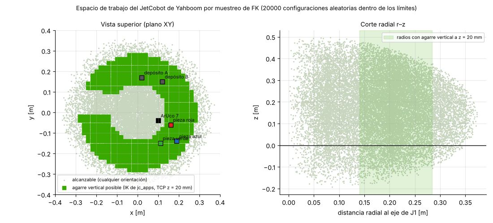
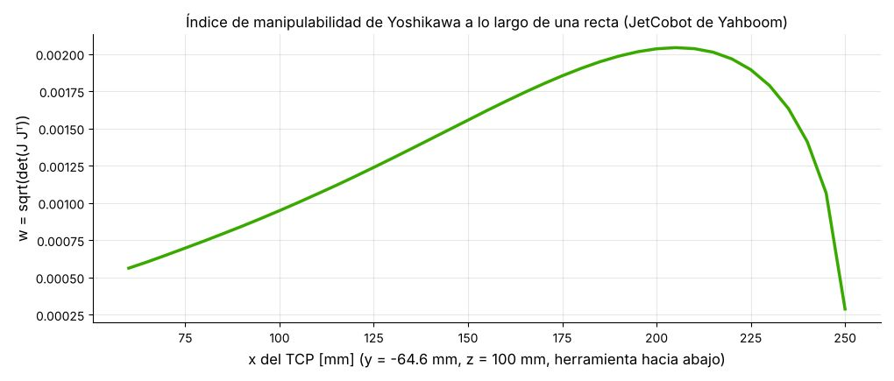
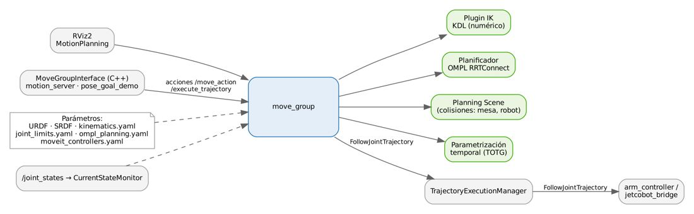
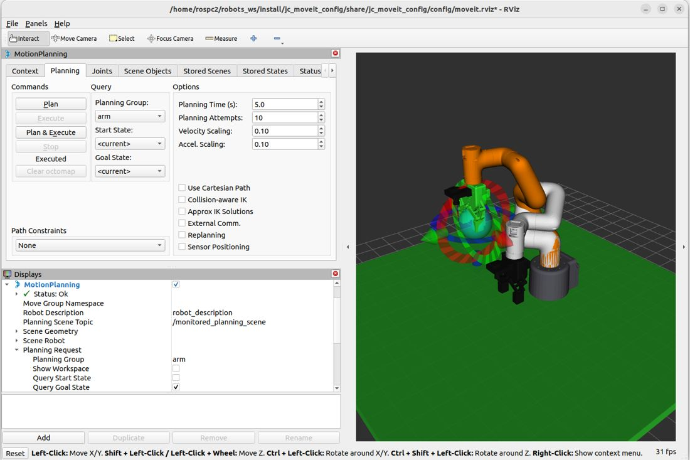

# Documento de Apoyo No. DA-05 – Cinemática directa e inversa y planificación de movimientos con MoveIt 2.

> Versión en Markdown del documento de apoyo, para consultar y copiar comandos desde GitHub. El documento de Word (formato GFPI-F-135) no se publica en el repositorio.

**Actividad de Aprendizaje:** Calcular la cinemática directa e inversa del JetCobot de Yahboom, integrar MoveIt 2 con su modelo y planificar movimientos libres de colisión con MoveIt 2, interpretando los resultados (multiplicidad de soluciones, singularidades, alcance).

**Parte de la transferencia:** Parte A – Simulación en el PC.

**Equipo de trabajo:** PC con Ubuntu 22.04 y ROS 2 Humble. No se usa la Jetson ni se energiza el robot.

**Duración Estimada:** 2 horas.

**Sesión:** Día 2 – 04/11/2026, 8:00 a.m. – 10:00 a.m.

**Relación con la Guía de Aprendizaje:** Actividad 3.3.4 (apropiación).

> **PARTE A · TRABAJO EN EL PC (SIMULACIÓN):**
>
> Todo el trabajo de este documento se hace en el **PC** con Ubuntu 22.04 y ROS 2 Humble, con el robot simulado (mock y Gazebo) y, cuando se indique, una cámara USB conectada al PC. **No se usa la Jetson ni se energiza el robot.** Cada bloque de comandos indica **Terminal (PC)**.

## 1. OBJETIVOS DE APRENDIZAJE

- Formular la cinemática directa (FK) como producto de transformaciones homogéneas y calcular el Jacobiano geométrico.
- Resolver la cinemática inversa (IK) de forma numérica (mínimos cuadrados amortiguados) y analizar su multiplicidad.
- Evaluar la manipulabilidad y el espacio de trabajo útil del cobot.
- Describir la arquitectura de MoveIt 2 (move\_group, SRDF, IK, OMPL, escena de planificación, ejecución).
- Integrar MoveIt 2 con el JetCobot de Yahboom: modelo (URDF y mallas), SRDF, IK, planificador y controladores, y reconocer qué cambia entre la simulación y el robot real.
- Planificar y ejecutar movimientos articulares, de pose y cartesianos desde RViz2, la CLI, Python y C++.

## 2. FUNDAMENTOS

### 2.1 Cinemática directa

**FK e IK en pocas palabras.** La cinemática directa (FK, forward kinematics) responde: «si las seis articulaciones tienen estos ángulos, ¿dónde queda la pinza?». Recibe los ángulos y entrega la pose del TCP (posición x, y, z y orientación). Siempre tiene una sola respuesta. Ejemplo con el JetCobot de Yahboom: en ready, q = (0; 0; −90; 0; 0; 0)°, el TCP queda en (0,1692; −0,0646; 0,1043) m con la pinza apuntando hacia abajo.

La cinemática inversa (IK, inverse kinematics) es la pregunta contraria: «quiero la pinza en esta pose, ¿qué ángulos deben tener las articulaciones?». Es la que se necesita para recoger una pieza, porque la cámara entrega dónde está la pieza, no los ángulos del brazo. Puede tener varias respuestas (codo arriba o abajo) o ninguna (punto fuera del alcance). MoveIt resuelve la IK para saber a dónde ir y usa la FK para revisar dónde queda la pinza en cada punto de la trayectoria.

Para un manipulador serie de *n* articulaciones, la pose del efector final respecto a la base es el producto de las transformaciones de cada articulación (ecuación (1) de DA-04) [2], [1]:

$${T}_{world}^{tcp}\left( q \right)={T}_{world}^{0}\left( \prod_{i=1}^{6} {T}_{i-1}^{i}\left( {q}_{i} \right) \right){T}_{6}^{tcp}=\left[  \right] \qquad (1)$$

El **Jacobiano geométrico** relaciona velocidades articulares con la velocidad espacial del TCP. Para articulaciones de revolución con eje unitario **z**ᵢ y origen **o**ᵢ expresados en la base:

$$\left[  \right]=J\left( q \right)\bar{q},{J}_{i}=\left[  \right] \qquad (2)$$

En una **singularidad** J pierde rango y el robot pierde movilidad en alguna dirección. El índice de manipulabilidad de Yoshikawa cuantifica la distancia a la singularidad [4]:

$$w\left( q \right)=\sqrt{det\left( J{J}^{T} \right)} \qquad (3)$$

### 2.2 Cinemática inversa

En RViz2 se ve directamente: al mover el marcador de la pinza (Paso 2), MoveIt resuelve la IK en cada posición; si hay solución el brazo naranja la sigue, y si no la hay el brazo se pone rojo.

La IK busca **q** tal que **T**(**q**) = **T**d. Para el JetCobot de Yahboom (eje de muñeca no esférica y desplazamientos laterales) se usan métodos numéricos. El método de mínimos cuadrados amortiguados (DLS) itera [5]:

$$\Delta q={J}^{T}{\left( J{J}^{T}+{λ}^{2}I \right)}^{-1}e,e=\left[  \right] \qquad (4)$$

El amortiguamiento λ evita velocidades enormes cerca de singularidades a costa de un pequeño error. En `jc_apps/kinematics.py` se implementan (1)–(4) en ~100 líneas de NumPy a partir del URDF (el error de orientación se calcula con la forma eje-ángulo, equivalente a (4) para errores pequeños). MoveIt 2 usa por defecto el plugin **KDL** [6], también numérico (Newton–Raphson con reinicios aleatorios dentro de un tiempo límite). Consecuencias prácticas:

- **Multiplicidad:** una misma pose admite varias configuraciones (codo arriba/abajo, muñeca girada). Con el modelo del JetCobot de Yahboom, la IK de jc\_apps devolvió para (0,18; −0,06; 0,12) m con el TCP hacia abajo la solución q = (1,5; −5,5; −74,9; −9,7; 0; 1,5)°, distinta de la configuración ready; /compute\_ik puede devolver otra (Paso 3).
- **Incompletitud:** un solver numérico puede no encontrar una solución que existe. Al barrer la mesa con la IK (varias semillas por punto) quedan celdas sin solución en el borde de la zona alcanzable (Figura 1); aumentar el tiempo, usar semillas o un solver alternativo (p. ej. pick\_ik) mitiga el problema.



*Figura 1. Espacio de trabajo del JetCobot de Yahboom: nube de FK (gris) y celdas de la mesa donde existe agarre vertical con el TCP a 20 mm de altura según la IK de jc_apps (verde). Se marcan las piezas y depósitos del mundo de simulación.*

La zona de agarre vertical es una corona entre ≈ 0,14 m y 0,28 m del eje de J1: demasiado cerca, el codo no puede plegarse; demasiado lejos, el brazo no alcanza con la herramienta vertical. **Diseñe la celda (piezas, depósitos, cámara) dentro de esa corona.**



*Figura 2. Manipulabilidad (3) a lo largo de una recta con la herramienta vertical, calculada con la IK DLS de jc_apps sobre el modelo del JetCobot de Yahboom.*

### 2.3 MoveIt 2

MoveIt es el marco de manipulación más usado en ROS [7]. En ROS 2 el nodo central es `move_group` (Figura 3), que combina la descripción del robot (URDF + SRDF), un plugin de IK, el planificador OMPL, la escena de planificación (colisiones), la parametrización temporal y la ejecución mediante controladores `FollowJointTrajectory` [8].



*Figura 3. Arquitectura de MoveIt 2 tal como se configura en jc_moveit_config.*

*Tabla 1. Configuración de MoveIt 2 del JetCobot de Yahboom.*

| **Elemento** | **Archivo en jc\_moveit\_config** | **Contenido** |
|---|---|---|
| SRDF | config/jetcobot.srdf | Grupos `arm` (cadena base\_link→tcp) y `gripper`; estados `home`, `ready`, `observe`, `open`, `close`; matriz de colisiones deshabilitadas. |
| IK | config/kinematics.yaml | KDL, resolución 0,005, timeout 0,05 s. |
| Límites | config/joint\_limits.yaml | 1,5 rad/s y 3 rad/s² por articulación; escalado por defecto 30 %. |
| Planificador | config/ompl\_planning.yaml | RRTConnect por defecto [10]; RRT\*, PRM disponibles [9]; adaptadores con TOTG [11]. |
| Controladores | config/moveit\_controllers.yaml | `arm_controller`, `gripper_controller` (FollowJointTrajectory). |

> **Nota:**
>
> En un proyecto nuevo esta configuración se genera con el *MoveIt Setup Assistant* (`ros2 launch moveit_setup_assistant setup_assistant.launch.py`). En robots\_ws se escribió a mano para controlar cada parámetro; compare ambos enfoques como ejercicio.

### 2.4 Integración de MoveIt 2 con el JetCobot de Yahboom

Integrar MoveIt 2 con un cobot es conectar cinco piezas: el modelo del robot, la semántica (qué articulaciones forman el brazo y la pinza), el solver de IK, el planificador y los controladores que ejecutan la trayectoria. La Tabla 2 muestra cómo quedó cada una para el JetCobot de Yahboom.

*Tabla 2. Integración de MoveIt 2 con el JetCobot de Yahboom.*

| **Capa** | **Qué se configuró para el JetCobot de Yahboom** | **Paquete / archivo** |
|---|---|---|
| Modelo | URDF/Xacro con la cinemática del JetCobot (ejes del myCobot 280, J1 a 135,46 mm de la base, TCP a 95 mm de la brida) y las mallas de Yahboom para la vista; colisiones con primitivas, más livianas para planificar. | jc\_description (urdf/, meshes/yahboom/) |
| Semántica | Grupo arm (cadena base\_link → tcp, joint1 a joint6), grupo gripper (dedos prismáticos), estados home, ready y observe, y pares de eslabones que nunca chocan. | jc\_moveit\_config/config/jetcobot.srdf |
| Cinemática inversa | KDL: muñeca no esférica, sin solución cerrada; resolución 0,005 y 0,05 s por intento. | config/kinematics.yaml |
| Planificación y tiempo | OMPL (RRTConnect) y parametrización temporal TOTG con límites de 1,5 rad/s y 3 rad/s². | config/ompl\_planning.yaml, joint\_limits.yaml |
| Ejecución | Controladores FollowJointTrajectory arm\_controller y gripper\_controller. Solo cambia el hardware de ros2\_control: mock (este documento), Gazebo (DA-06) o el robot real a través de jc\_driver y pymycobot (DA-14). | config/moveit\_controllers.yaml, jc\_bringup |
| Servicios de la celda | motion\_server ofrece /jc/move\_to\_named, /jc/move\_to\_pose y /jc/set\_gripper para el resto de la aplicación. | jc\_motion |

La misma configuración sirve para los tres modos de la celda, porque MoveIt solo ve los nombres de las articulaciones y las acciones de los controladores. Los nombres joint1 a joint6 coinciden con los que usa el puente del robot real, de modo que 0 rad en el modelo es 0° en el JetCobot. La imagen de fábrica de Yahboom trae su propio paquete de MoveIt con otros nombres de articulaciones; en el curso se usa jc\_moveit\_config para que simulación, aplicación y robot real compartan el mismo modelo.

## 3. PROCEDIMIENTO PASO A PASO

En este documento se trabaja con tres terminales en el PC. Ábralas con Ctrl + Alt + T (o Ctrl + Mayús + T para una pestaña nueva) y no las cierre hasta que el paso lo indique:

**Terminal 1:** compilar y ejecutar Python (Pasos 0, 1 y 7).

**Terminal 2:** la celda en modo mock (mock.launch.py, que abre RViz2). Se deja ejecutando desde el Paso 2 hasta el Paso 6, porque los demás pasos le hacen preguntas o le piden movimientos.

**Terminal 3:** consultas y demostraciones (Pasos 3 a 6).

> **Nota:**
>
> Cada terminal nueva carga sola el workspace por la línea de ~/.bashrc (DA-02). Si compila en la Terminal 1 mientras otra terminal ya estaba abierta, en esa otra ejecute source ~/robots\_ws/install/setup.bash o ábrala de nuevo.

### Paso 0. Incorporar al robots_ws el material de este documento

El espacio de trabajo `~/robots_ws` se construye a medida que avanza la transferencia: cada documento incorpora **solo** el material que usa. Agregue desde el repositorio robots\_ws (DA-02, Paso 7) lo siguiente y revise su contenido antes de ejecutarlo:

| **Paquete / carpeta** | **Para qué sirve** | **Qué contiene** | **Dónde se usa** |
|---|---|---|---|
| `src/jc_moveit_config` | Configuración de MoveIt 2 para planificar movimientos del brazo sin chocar. | SRDF (grupos arm y gripper, poses home, ready y observe), kinematics.yaml (KDL), OMPL, límites de articulaciones y controladores; escrita a mano. | PC (Parte A). En la Parte B también en la Jetson AGX Orin (DA-13). |
| `src/jc_motion` | Nodos en C++ que mueven el brazo con MoveIt (MoveGroupInterface) y los ofrecen como servicios al resto de la celda. | motion\_server (servicios /jc/move\_to\_pose, /jc/move\_to\_named y /jc/set\_gripper), pose\_goal\_demo y trajectory\_client. | PC (Parte A). En la Parte B también en la Jetson AGX Orin (DA-13). |
| `src/jc_bringup` | Arranque de la celda completa: un launch por situación (sin hardware, simulación en Gazebo y robot real). | launch/ mock.launch.py (este documento), sim.launch.py (Gazebo, DA-06) y real.launch.py (Parte B); config/celda.yaml; mundos y modelos de Gazebo. | PC (Parte A). En la Parte B también en la Jetson AGX Orin (DA-13). |

**Terminal 1 (PC)**

```bash
# trae lo nuevo del repositorio (correcciones y mejoras)
cd ~/robots_ws && git pull
cd ~/robots_ws && git sparse-checkout add src/jc_moveit_config
cd ~/robots_ws && git sparse-checkout add src/jc_motion
cd ~/robots_ws && git sparse-checkout add src/jc_bringup
# instala las dependencias de los paquetes agregados
rosdep install --from-paths ~/robots_ws/src --ignore-src -r -y --skip-keys "mr_navigation jc_driver"
cd ~/robots_ws
colcon build --symlink-install
source install/setup.bash
# explore la estructura
tree -L 2 src/
# paquetes del workspace hasta ahora
ros2 pkg list | grep -E "jc_|mi_celda"
```

> **Resultado esperado:**
>
> `Summary: 3 packages finished`. `jc_motion` es C++ y es el que más tarda (1–3 minutos); si el PC se queda sin memoria use `--parallel-workers 2`. `jc_bringup` declara también `jc_driver`, que se incorpora en la Parte B (DA-14): no hace falta para los lanzadores `mock` y `sim`.

### Paso 1. FK, Jacobiano e IK con Python (sin MoveIt)

Este código es Python, no son comandos de terminal: si se pega directamente en la terminal, bash responde con errores como «import: command not found». Hay dos formas de ejecutarlo:

**Terminal 1 (PC)**

```bash
# forma A: intérprete interactivo (pegue el código en el indicador >>> y salga con exit())
cd ~/robots_ws && source install/setup.bash
python3
# forma B: guarde el código en un archivo y ejecútelo
gedit ~/paso1_cinematica.py
python3 ~/paso1_cinematica.py
```

**Python (PC) – se ejecuta con python3, no en la terminal**

```
import subprocess, numpy as np
from ament_index_python.packages import get_package_share_directory as share
from jc_apps.kinematics import SerialChain
urdf = subprocess.check_output(["xacro", share("jc_description") + "/urdf/jetcobot.urdf.xacro",
                                "sim_mode:=real"]).decode()
ch = SerialChain(urdf, "world", "tcp")
q = np.radians([0, 0, -90, 0, 0, 0])
T = ch.fk(q);  print(np.round(T, 4))                 # TCP (0.1692, -0.0646, 0.1043), z hacia abajo
print("w =", ch.manipulability(q))                   # 1.79e-03
q_sol, ok, err = ch.ik(T, np.radians([10, 5, -80, -5, 0, 0]))
print(ok, err, np.degrees(q_sol).round(2))
```

> **Resultado esperado:**
>
> FK: TCP = (0,1692; −0,0646; 0,1043) m con eje z = (0, 0, −1). La IK converge (ok = True) con error &lt; 0,1 mm. Estos mismos valores verifican las pruebas unitarias de jc\_apps.

> **Nota:**
>
> Si aparece ModuleNotFoundError: No module named 'jc\_apps', el workspace no está cargado en esa terminal: ejecute source ~/robots\_ws/install/setup.bash. Este paso no necesita RViz2 ni MoveIt, y el robot no se mueve: solo se calculan la FK, el Jacobiano y la IK con NumPy.

### Paso 2. Celda en modo mock y RViz2 MotionPlanning

Abra la Terminal 2 y lance la celda sin hardware. El lanzador arranca el modelo del robot, ros2\_control con controladores simulados (mock), move\_group, motion\_server y RViz2 con el panel MotionPlanning. Deje la Terminal 2 ejecutando: los Pasos 3 a 6 la necesitan.

**Terminal 2 (PC) – déjela ejecutando**

```bash
ros2 launch jc_bringup mock.launch.py
```

> **Nota:**
>
> Si en RViz2 el brazo se ve con cilindros y cajas, faltan las mallas del JetCobot de Yahboom: ejecute ~/robots\_ws/src/jc\_description/scripts/importar\_modelo\_yahboom.sh --descargar y colcon build --symlink-install --packages-select jc\_description (DA-04). La planificación funciona igual con ambos modelos: la cinemática y las colisiones son las mismas.

1. En el panel *MotionPlanning → Planning*: grupo `arm`, *Goal State* = `observe`, **Plan** y luego **Execute**.
1. Mueva la pinza con el marcador interactivo: en la barra superior de RViz2 seleccione la herramienta Interact (sin ella el marcador no se ve ni se puede arrastrar). En Displays → MotionPlanning → Planning Request deje marcado Query Goal State y, si el marcador es muy pequeño, suba Interactive Marker Size a 0,15. Arrastre las flechas para trasladar la pinza y los anillos para girarla: el robot naranja solo sigue las poses con solución de IK y se pone rojo cuando no la hay. Para volver a empezar, elija ready u observe en Goal State.
1. En *Options* cambie *Velocity Scaling* (0,1 → 0,5) y compare la duración de la trayectoria.
1. En *Context* cambie el planificador (RRTConnect, RRTstar, PRM) y registre tiempo de planificación y longitud del camino (Tabla 3).



> **Resultado esperado:**
>
> RViz2 muestra el JetCobot de Yahboom y en MotionPlanning el grupo arm. Al pulsar Plan se ve la trayectoria animada y con Execute el robot se mueve a observe. En la Terminal 2 aparecen mensajes de move\_group; un ERROR sobre /recognize\_objects es normal en este modo y no afecta.

*Tabla 3. Comparación de planificadores (diligenciar; 5 repeticiones, reportar media).*

| **Planificador** | **Tiempo de planificación [s]** | **Duración de la trayectoria [s]** | **Observaciones** |
|---|---|---|---|
| RRTConnect |  |  |  |
| RRTstar |  |  |  |
| PRM |  |  |  |

### Paso 3. Servicios de IK y FK de MoveIt desde la CLI

**Qué hace:** move\_group, además de planificar, ofrece dos servicios de cálculo. /compute\_ik recibe una pose del TCP y devuelve los ángulos de las articulaciones (IK); /compute\_fk recibe ángulos y devuelve la pose del TCP (FK). Con ros2 service call se les hace la pregunta desde la terminal, sin escribir un programa. Solo calculan: el robot no se mueve.

En la primera llamada se pide el TCP en (0,18; −0,06; 0,12) m respecto a world, con la pinza hacia abajo, para el grupo arm, evitando colisiones y con 1 s de tiempo límite. En la segunda se dan los ángulos de ready en radianes (−1,5708 rad = −90°) y se pide la pose del eslabón tcp.

**Qué debe tener abierto:** la Terminal 2 con mock.launch.py ejecutando (Paso 2). Abra la Terminal 3 y compruebe que los servicios existen con ros2 service list | grep compute; luego ejecute los dos comandos.

**Terminal 3 (PC)**

```bash
ros2 service call /compute_ik moveit_msgs/srv/GetPositionIK "{ik_request: {group_name: arm, ik_link_name: tcp,
  avoid_collisions: true, timeout: {sec: 1}, pose_stamped: {header: {frame_id: world}, pose: {
  position: {x: 0.18, y: -0.06, z: 0.12}, orientation: {x: 0.7071, y: -0.7071, z: 0.0, w: 0.0}}}}}"
ros2 service call /compute_fk moveit_msgs/srv/GetPositionFK "{header: {frame_id: world}, fk_link_names: [tcp],
  robot_state: {joint_state: {name: [joint1, joint2, joint3, joint4, joint5, joint6],
  position: [0.0, 0.0, -1.5708, 0.0, 0.0, 0.0]}}}"
```

> **Precaución:**
>
> En ROS 2, un `geometry_msgs/Quaternion` creado sin valores es (0, 0, 0, **1**). Si solo asigna x e y, el cuaternión resultante es incorrecto y la IK falla con `NO_IK_SOLUTION (−31)`. Asigne siempre los cuatro componentes. Este error se reprodujo durante la validación del material.

La orientación (0,7071; −0,7071; 0; 0) corresponde a roll = π, pitch = 0, yaw = −π/2: herramienta vertical hacia abajo (ver `motion_client.top_down_quat`). Repita la IK varias veces: ¿obtiene siempre la misma configuración? Compárela con la de kinematics.py (Sección 2.2) y explique.

> **Resultado esperado:**
>
> /compute\_ik: solution.joint\_state con los nombres joint1…joint6 (y los de la pinza) y sus ángulos en radianes, y error\_code: val: 1 (1 = SUCCESS). La solución puede no coincidir con la de kinematics.py, (1,5; −5,5; −74,9; −9,7; 0; 1,5)°, porque KDL arranca de semillas aleatorias. /compute\_fk: pose\_stamped con position (0,1692; −0,0646; 0,1043) y orientation (−0,7071; 0,7071; 0; 0), que es la misma orientación que (0,7071; −0,7071; 0; 0), porque q y −q representan la misma rotación; error\_code: val: 1. Si recibe val: −31 (NO\_IK\_SOLUTION), revise el cuaternión o que la pose esté dentro de la corona de la Figura 1.

### Paso 4. Servicios de alto nivel de la celda (motion_server)

**Qué hace:** motion\_server (paquete jc\_motion, lo arranca mock.launch.py) envuelve MoveIt en tres servicios sencillos, que son los que usa el resto de la aplicación (visión, pick and place): /jc/move\_to\_named lleva el brazo a un estado del SRDF (home, ready, observe); /jc/set\_gripper abre o cierra la pinza (0 = cerrada, 1 = abierta); /jc/move\_to\_pose lleva el TCP a una pose (cartesian: false planifica libremente con OMPL; cartesian: true exige una línea recta). Cada llamada planifica y ejecuta, así que el robot sí se mueve en RViz2. velocity\_scaling: 0.3 limita la velocidad al 30 %.

square\_demo es un nodo de Python (jc\_apps) que usa esos mismos servicios: va a ready, a la esquina (0,17; −0,08; 0,14) m y recorre en línea recta un cuadrado de 4 cm, para volver a ready.

**Qué debe tener abierto:** la Terminal 2 con mock.launch.py y RViz2 a la vista. Ejecute los comandos en la Terminal 3, uno a la vez, esperando la respuesta de cada uno.

**Terminal 3 (PC)**

```bash
ros2 service call /jc/move_to_named jc_interfaces/srv/MoveToNamed "{name: observe, velocity_scaling: 0.3}"
ros2 service call /jc/set_gripper jc_interfaces/srv/SetGripper "{opening: 0.3}"
ros2 service call /jc/move_to_pose jc_interfaces/srv/MoveToPose "{cartesian: false, velocity_scaling: 0.3,
  target: {header: {frame_id: world}, pose: {position: {x: 0.17, y: -0.08, z: 0.14},
  orientation: {x: 0.7071, y: -0.7071, z: 0.0, w: 0.0}}}}"
# cuadrado de 4 cm con trayectorias cartesianas
ros2 run jc_apps square_demo
```

> **Resultado esperado:**
>
> Cada servicio responde response: ...(success=True, message='OK') y el robot se mueve en RViz2: va a observe, la pinza se abre al 30 % y el TCP llega a la pose pedida. square\_demo imprime ready: (True, 'OK'), inicio: (True, 'OK'), cuatro líneas lado -&gt; (...): (True, 'OK (cartesiana)') y de nuevo ready; en RViz2 la pinza dibuja el cuadrado.

### Paso 5. Interfaz C++ (MoveGroupInterface)

**Qué hace:** pose\_goal\_demo es un programa en C++ que usa MoveIt directamente con la clase MoveGroupInterface, la misma que usa por dentro motion\_server. Hace cuatro movimientos seguidos: (1) va a ready con setNamedTarget; (2) lleva el TCP a (0,18; −0,06; 0,14) m con la pinza hacia abajo con setPoseTarget; (3) recorre en línea recta un cuadrado de 4 cm con computeCartesianPath; (4) vuelve a ready. En cada uno planifica (plan) y, si el plan salió bien, ejecuta (execute). Al terminar, el programa se cierra solo.

**Qué debe tener abierto:** la Terminal 2 con mock.launch.py (pose\_goal\_demo es un cliente: no arranca move\_group, le pide los planes al que ya está corriendo) y RViz2 a la vista. Ejecute el lanzador en la Terminal 3.

**Terminal 3 (PC)**

```bash
ros2 launch jc_motion pose_goal_demo.launch.py
```

Estudie `jc_motion/src/pose_goal_demo.cpp`: `setNamedTarget`, `setPoseTarget`, `plan`, `execute` y `computeCartesianPath(waypoints, eef_step = 0.005, jump_threshold = 0.0, trajectory)`, que devuelve la fracción del camino lograda (en la validación: 100 %). En `motion_server.cpp` observe además cómo se re-parametriza en el tiempo la trayectoria cartesiana con TOTG [11] para respetar el escalado de velocidad.

> **Resultado esperado:**
>
> En la Terminal 3: Plan 'ready': OK, Plan 'pose': OK, Trayectoria cartesiana: 100.0 % alcanzable y Plan 'ready': OK; luego process has finished cleanly. En RViz2 el brazo hace los cuatro movimientos. Si la trayectoria cartesiana no llega al 95 %, el programa no la ejecuta y pasa al último movimiento.

### Paso 6. Validar la FK propia contra TF

Con la Terminal 2 todavía ejecutando mock.launch.py, ejecute en la Terminal 3:

**Terminal 3 (PC)**

```bash
# con la celda (mock o Gazebo) en marcha
ros2 run jc_apps fk_check
```

> **Resultado esperado:**
>
> `|dif| = 0.000 mm` entre la FK de kinematics.py y la TF de robot\_state\_publisher; también imprime w.

### Paso 7. Integración con el MoveIt Setup Assistant

jc\_moveit\_config se escribió a mano. Para entender la integración, genere la configuración del JetCobot de Yahboom con el asistente de MoveIt y compárela con la del curso (no reemplace jc\_moveit\_config):

Detenga la celda: en la Terminal 2 pulse Ctrl + C (se cierra RViz2). Cierre la Terminal 3. En la Terminal 1 ejecute:

**Terminal 1 (PC)**

```bash
# URDF del JetCobot de Yahboom (con mallas) para el asistente
xacro $(ros2 pkg prefix jc_description)/share/jc_description/urdf/jetcobot.urdf.xacro sim_mode:=mock modelo:=yahboom > ~/jetcobot.urdf
ros2 launch moveit_setup_assistant setup_assistant.launch.py
```

1. Create New MoveIt Configuration Package y cargue ~/jetcobot.urdf.

2. Self-Collisions: genere la matriz y compárela con los disable\_collisions de jetcobot.srdf.

3. Planning Groups: arm como cadena base\_link → tcp con el solver KDL; gripper con gripper\_left\_joint y gripper\_right\_joint.

4. Robot Poses: home, ready y observe con los valores del SRDF del curso.

5. End Effectors, ros2\_control y MoveIt Controllers: pinza en tcp y controladores FollowJointTrajectory arm\_controller y gripper\_controller.

6. Guarde el paquete en ~/jetcobot\_msa\_config (fuera de robots\_ws) y compárelo: diff -r ~/jetcobot\_msa\_config/config ~/robots\_ws/src/jc\_moveit\_config/config.

> **Resultado esperado:**
>
> Los grupos, los estados y los controladores coinciden con jc\_moveit\_config; la matriz de colisiones del asistente puede deshabilitar más pares, porque se calcula muestreando posturas. Anote las diferencias en la evidencia.

## 4. VERIFICACIÓN Y EVIDENCIAS

*Tabla 4. Evidencias de la actividad.*

| **#** | **Criterio** | **Evidencia** |
|---|---|---|
| 1 | FK/IK/Jacobiano calculados y contrastados con TF | Salida del Paso 1 y Paso 6 |
| 2 | Planificación y ejecución a estados con nombre y poses en RViz2 | Captura |
| 3 | Comparación de planificadores | Tabla 3 |
| 4 | Uso de /compute\_ik y explicación de la multiplicidad | Registro + respuesta escrita |
| 5 | Trayectoria cartesiana ejecutada (cuadrado) | Registro de `square_demo` |
| 6 | Configuración generada con el MoveIt Setup Assistant y comparada con jc\_moveit\_config | Salida de diff -r y respuesta escrita |

## 5. PREGUNTAS DE ANÁLISIS

1. ¿Por qué el agarre vertical es imposible muy cerca de la base aunque esos puntos estén dentro del alcance?
1. ¿Qué ocurre con w en la configuración `home` (brazo extendido verticalmente)? Verifíquelo con kinematics.py.
1. ¿Cuándo preferir una trayectoria cartesiana sobre una planificada con OMPL? Mencione dos riesgos de la cartesiana.
1. ¿Qué cambia en la integración de MoveIt 2 entre el modo mock, Gazebo y el JetCobot real? ¿Qué se mantiene igual?

## 6. SOLUCIÓN DE PROBLEMAS

*Tabla 5. Problemas frecuentes.*

| **Síntoma** | **Causa probable** | **Solución** |
|---|---|---|
| `NO_IK_SOLUTION (−31)` | Pose inalcanzable, cuaternión mal formado o timeout corto | Ver Figura 1; asignar x,y,z,w; aumentar timeout |
| Plan OK pero ejecución falla | Controlador no activo / nombres de acción distintos | `ros2 control list_controllers`; revisar moveit\_controllers.yaml |
| Cartesiana &lt; 95 % | Cruce por singularidad o límite articular | Cambiar la orientación o dividir el camino |
| `No 3D sensor plugin(s) defined for octomap updates` | Mensaje informativo (no hay sensores 3D configurados) | Ninguna; es esperado |
| El brazo se ve con cilindros y cajas en RViz2 o Gazebo | No están instaladas las mallas de Yahboom | importar\_modelo\_yahboom.sh --descargar y compilar jc\_description (DA-04) |
| RViz2 abre pero no aparece el robot y la lista Planning Group está vacía; en el log: max\_velocity … setting it to string is not allowed | Sistema en español: los decimales se leen con coma y los límites quedan como texto | git pull y compilar (los launch fijan LC\_NUMERIC=C); además agregue export LC\_NUMERIC=en\_US.UTF-8 al final de ~/.bashrc y abra terminales nuevas |
| «PluginlibFactory: The plugin for class moveit\_rviz\_plugin/MotionPlanning failed to load» | Falta el plugin de MoveIt para RViz2 | sudo apt install -y ros-humble-moveit |
| No se ve el marcador interactivo de la pinza | No está seleccionada la herramienta Interact o Query Goal State está desmarcado | Seleccione Interact en la barra superior; git pull (moveit.rviz ya la incluye); Interactive Marker Size 0,15 |
| import: command not found al ejecutar el Paso 1 | Se pegó código Python en bash | Ejecútelo con python3 (Paso 1, formas A o B) |
| pose\_goal\_demo o square\_demo esperan sin moverse | La Terminal 2 no está ejecutando mock.launch.py | Lance la celda en la Terminal 2 (Paso 2) y repita |

## REFERENCIAS

**[1]** K. M. Lynch y F. C. Park, *Modern Robotics: Mechanics, Planning, and Control*. Cambridge, U.K.: Cambridge University Press, 2017.

**[2]** B. Siciliano, L. Sciavicco, L. Villani y G. Oriolo, *Robotics: Modelling, Planning and Control*. London, U.K.: Springer, 2009, doi: 10.1007/978-1-84628-642-1.

**[3]** J. J. Craig, *Introduction to Robotics: Mechanics and Control*, 4th ed. Pearson, 2018.

**[4]** T. Yoshikawa, "Manipulability of robotic mechanisms," *The International Journal of Robotics Research*, vol. 4, no. 2, pp. 3–9, 1985, doi: 10.1177/027836498500400201.

**[5]** Y. Nakamura y H. Hanafusa, "Inverse kinematic solutions with singularity robustness for robot manipulator control," *ASME J. Dynamic Systems, Measurement, and Control*, vol. 108, no. 3, pp. 163–171, 1986, doi: 10.1115/1.3143764.

**[6]** Orocos Project, *Kinematics and Dynamics Library (KDL)*. [En línea]. Disponible: [https://www.orocos.org/kdl.html](https://www.orocos.org/kdl.html)

**[7]** D. Coleman, I. A. Şucan, S. Chitta y N. Correll, "Reducing the barrier to entry of complex robotic software: a MoveIt! case study," *Journal of Software Engineering for Robotics*, vol. 5, no. 1, pp. 3–16, 2014, arXiv: 1404.3785.

**[8]** PickNik Robotics, *MoveIt 2 Documentation – Humble*. [En línea]. Disponible: [https://moveit.picknik.ai/humble/](https://moveit.picknik.ai/humble/)

**[9]** I. A. Şucan, M. Moll y L. E. Kavraki, "The Open Motion Planning Library," *IEEE Robotics & Automation Magazine*, vol. 19, no. 4, pp. 72–82, 2012, doi: 10.1109/MRA.2012.2205651.

**[10]** J. J. Kuffner y S. M. LaValle, "RRT-Connect: An efficient approach to single-query path planning," en *Proc. IEEE ICRA*, 2000, pp. 995–1001, doi: 10.1109/ROBOT.2000.844730.

**[11]** T. Kunz y M. Stilman, "Time-optimal trajectory generation for path following with bounded acceleration and velocity," en *Robotics: Science and Systems VIII*, 2012, doi: 10.15607/RSS.2012.VIII.027.

**[12]** P. Corke, *Robotics, Vision and Control: Fundamental Algorithms in Python*, 3rd ed. Cham, Switzerland: Springer, 2023, doi: 10.1007/978-3-031-06469-2.

**[13]** J. R. Cháux Cedeño, *robots\_ws – paquetes ROS 2 del curso (repositorio en GitHub, licencia Apache-2.0), 2026. [En línea]. Disponible: https://github.com/jchauxdev/robots\_ws*
