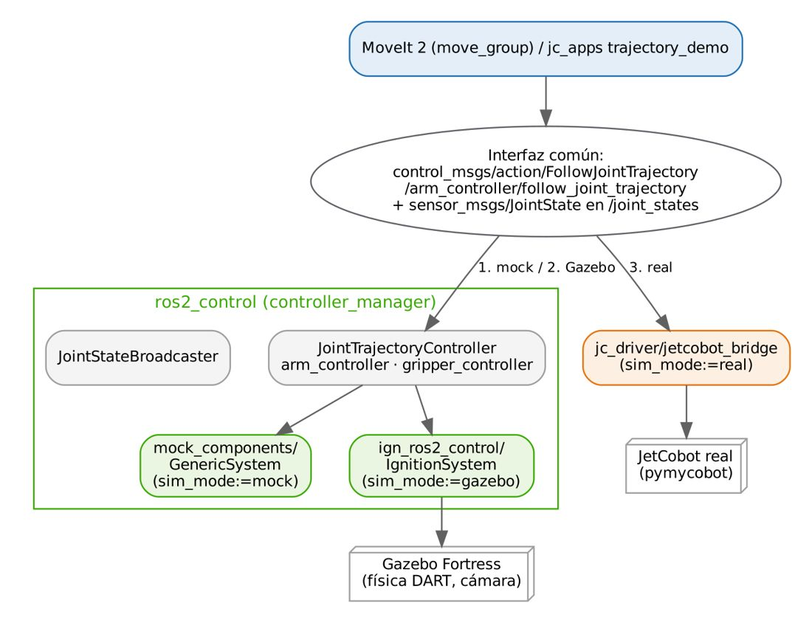

# Documento de Apoyo No. DA-06 – Simulación de la celda robótica colaborativa en Gazebo integrada con ROS 2.

> Versión en Markdown del documento de apoyo, para consultar y copiar comandos desde GitHub. El documento de Word (formato GFPI-F-135) no se publica en el repositorio.

**Nombre del Proyecto Formativo:** CELDA ROBÓTICA COLABORATIVA CON VISIÓN ARTIFICIAL INTEGRADA EN ROS 2 (JETCOBOT – NVIDIA JETSON AGX ORIN)

**Actividad de Proyecto Formativo:** IMPLEMENTAR UNA CELDA ROBÓTICA COLABORATIVA CON VISIÓN ARTIFICIAL Y ROS 2, DE LA SIMULACIÓN AL ROBOT REAL, Y TRANSFERIR EL CONOCIMIENTO AL CENTRO DE FORMACIÓN.

**Actividad de Aprendizaje:** Simular la celda robótica en Gazebo Fortress con ros2\_control y MoveIt 2, verificando que las interfaces de control sean idénticas a las del robot real.

**Parte de la transferencia:** Parte A – Simulación en el PC.

**Equipo de trabajo:** PC con Ubuntu 22.04 y ROS 2 Humble. No se usa la Jetson ni se energiza el robot.

**Duración Estimada:** 1,5 horas.

**Sesión:** Día 2 – 04/11/2026, 10:00 a.m. – 11:30 a.m.

**Relación con la Guía de Aprendizaje:** Actividad 3.3.5 (apropiación).

> **PARTE A · TRABAJO EN EL PC (SIMULACIÓN):**
>
> Todo el trabajo de este documento se hace en el **PC** con Ubuntu 22.04 y ROS 2 Humble, con el robot simulado (mock y Gazebo) y, cuando se indique, una cámara USB conectada al PC. **No se usa la Jetson ni se energiza el robot.** Cada bloque de comandos indica **Terminal (PC)**.

## 1. OBJETIVOS DE APRENDIZAJE

- Explicar la arquitectura de Gazebo (servidor de física, sistemas/plugins, SDF) y su puente con ROS 2.
- Lanzar la celda simulada: mundo, robot, controladores, cámara, MoveIt 2.
- Verificar la equivalencia de interfaces simulación ↔ robot real y ejecutar trayectorias y pick & place simulados.
- Discutir la brecha simulación–realidad (*sim-to-real gap*) y estrategias para reducirla.

## 2. FUNDAMENTOS

### 2.1 Gazebo y su versión para Humble

Gazebo es un simulador 3D de robots con motores de física y renderizado intercambiables [1]. La generación moderna (antes *Ignition*) se organiza en bibliotecas `gz-*` y en **sistemas** (plugins) que se cargan desde el mundo SDF: física, sensores, comandos de usuario, difusión de escena, etc. Gazebo *Classic* (versión 11) llegó a su fin de vida en enero de 2025, por lo que este curso usa la generación moderna.

*Tabla 1. Compatibilidad oficial ROS 2 – Gazebo para Humble [2].*

| **ROS 2** | **Gazebo Fortress (LTS)** | **Gazebo Harmonic (LTS)** | **Gazebo Ionic / Jetty** |
|---|---|---|---|
| Humble (LTS) | Recomendado | Posible, con precaución | No posible |

Con `sudo apt install ros-humble-ros-gz` se instala Gazebo Fortress (`ign gazebo`, versión 6) y los paquetes `ros_gz_sim` (lanzar/insertar entidades) y `ros_gz_bridge` (traducción de mensajes) [2]. La integración con ros2\_control para Humble la proporciona `ign_ros2_control` (`gz_ros2_control`) [3], que expone las articulaciones simuladas como interfaces de hardware [4].

### 2.2 Cómo se conecta la celda simulada



*Figura 1. La misma interfaz (FollowJointTrajectory + /joint_states) sirve a mock, Gazebo y robot real; solo cambia el hardware detrás.*

*Tabla 2. Componentes de la simulación (sim.launch.py).*

| **Elemento** | **Implementación en robots\_ws** |
|---|---|
| Mundo | `jc_bringup/worlds/celda.sdf`: mesa (plano z = 0), 3 piezas (cubos rojo y verde de 25 mm, cilindro azul de 25 × 30 mm, 15 g), marcador ArUco DICT\_4X4\_50 id 7 (30 mm), 2 zonas de depósito; paso de física 1 ms. |
| Plugin de control | `<plugin filename="libign_ros2_control-system.so" name="ign_ros2_control::IgnitionROS2ControlPlugin">` en `jetcobot.gazebo.xacro`, con `<hardware><plugin>ign_ros2_control/IgnitionSystem</plugin>`. |
| Inserción del robot | `ros_gz_sim create -topic robot_description -name jetcobot`. |
| Puente | `/clock`, `/wrist_camera/image_raw`, `/wrist_camera/camera_info` (Gazebo → ROS). |
| Cámara | Sensor `camera` 640×480 a 30 Hz, FOV horizontal 1,047 rad (60°), ruido gaussiano σ = 0,005, marco `camera_optical_frame`. |
| Controladores | `joint_state_broadcaster`, `arm_controller`, `gripper_controller` (activados en cadena tras insertar el robot). |
| Tiempo | Todos los nodos con `use_sim_time: true` (reloj publicado por Gazebo en `/clock`). |

El *factor de tiempo real* indica cuán rápido avanza la simulación respecto al reloj de pared:

$$RTF=\frac{\Delta {t}_{simulado}}{\Delta {t}_{real}} \qquad (1)$$

Con paso de 1 ms, un RTF &lt; 1 indica que el computador no alcanza a simular en tiempo real; los nodos siguen funcionando correctamente porque usan el reloj simulado.

### 2.3 Brecha simulación–realidad

Ningún simulador reproduce exactamente fricción, holguras, latencias ni la apariencia de las imágenes. Para transferir algoritmos se recomienda: (i) mantener interfaces idénticas (Figura 1); (ii) validar con márgenes (velocidades reducidas, tolerancias); (iii) para visión con aprendizaje profundo, aleatorizar texturas, iluminación y poses en simulación (*domain randomization*) [7] y re-entrenar con imágenes reales.

## 3. REQUISITOS

- PC con Ubuntu 22.04 y GPU con OpenGL ≥ 3.3 (el sensor de cámara usa el motor de render *ogre2*).
- robots\_ws con los paquetes incorporados hasta DA-05. Para equipos sin GPU use el mundo `celda_sin_camara.sdf` (física y control completos, sin imagen).

## 4. PROCEDIMIENTO PASO A PASO

### Paso 0. Incorporar al robots_ws el material de este documento

Los paquetes que usa este documento (`jc_description`, `jc_moveit_config`, `jc_motion`, `jc_bringup`) ya están en su `~/robots_ws`. Solo falta agregar desde el repositorio robots\_ws la carpeta de herramientas:

| **Se incorpora** | **Qué contiene** |
|---|---|
| `tools/` | Scripts de apoyo para la simulación (no son paquetes, no se compilan): `fake_detections.py` (detecciones simuladas, Paso 5 de este documento), `synthetic_camera.py` (cámara sintética sin GPU, DA-10) y `handeye_auto.py` (calibración mano-ojo automática en Gazebo, DA-09). |

**Terminal (PC)**

```bash
cd ~/robots_ws && git sparse-checkout add tools
```

### Paso 1. Probar Gazebo por separado

**Terminal (PC)**

```bash
# mundo de ejemplo; cierre la ventana para continuar
ign gazebo shapes.sdf
# 6.x = Fortress
ign gazebo --versions
```

### Paso 2. Lanzar la celda completa

**Terminal (PC)**

```bash
# Gazebo + RViz2 + MoveIt 2 + motion_server
ros2 launch jc_bringup sim.launch.py
# variantes:
# solo Gazebo + controladores
ros2 launch jc_bringup sim.launch.py rviz:=false moveit:=false
ros2 launch jc_bringup sim.launch.py headless:=true world:=celda_sin_camara.sdf
```

> **INSERTAR IMAGEN / CAPTURA (por el instructor):**
>
> *Captura de la ventana de Gazebo con la celda: JetCobot, piezas de colores, marcador ArUco y zonas de depósito.*

### Paso 3. Verificar la simulación

**Terminal (PC)**

```bash
# 3 controladores 'active'
ros2 control list_controllers
# joint1..6/position [claimed]
ros2 control list_hardware_interfaces
ros2 topic hz /clock
# ≈ 30 Hz (solo con celda.sdf y GPU)
ros2 topic hz /wrist_camera/image_raw
ros2 run rqt_image_view rqt_image_view /wrist_camera/image_raw
```

**Salida obtenida en la validación (Gazebo Fortress 6.16)**

```
joint_state_broadcaster joint_state_broadcaster/JointStateBroadcaster  active
arm_controller          joint_trajectory_controller/JointTrajectoryController  active
gripper_controller      joint_trajectory_controller/JointTrajectoryController  active
```

### Paso 4. Mover el robot simulado

**Terminal (PC)**

```bash
ros2 run jc_apps trajectory_demo
ros2 service call /jc/move_to_named jc_interfaces/srv/MoveToNamed "{name: observe}"
ros2 run jc_apps square_demo --ros-args -p use_sim_time:=true
```

> **Resultado esperado:**
>
> `trajectory_demo` termina con `error_code=0 (SUCCESSFUL)`, igual que en mock y con el robot real simulado: **el mismo programa funciona sin cambios en las tres plataformas**.

### Paso 5. Pick & place simulado con detecciones conocidas

Antes de integrar la visión (DA-10 y DA-12) se valida la manipulación física inyectando la posición conocida del cubo rojo:

**Terminal (PC)**

```bash
python3 ~/robots_ws/tools/fake_detections.py 0.16 -0.06 0.025 &
ros2 run jc_apps pick_place_node --ros-args -p use_sim_time:=true \
     --params-file ~/robots_ws/install/jc_bringup/share/jc_bringup/config/celda.yaml
ros2 action send_goal --feedback /jc/pick_place jc_interfaces/action/PickPlace "{label: rojo, use_place_pose: false}"
# pose final del cubo en Gazebo
ign model -m pieza_roja -p
```

> **Resultado esperado:**
>
> En la validación: `success: true, message: 'rojo depositada en (0.02, 0.17)'`.
>
> Pose del cubo en Gazebo antes: (0,160; −0,060; 0,0125) m; después: (0,0192; 0,1672; 0,0125) m, es decir, el cubo fue efectivamente agarrado por la física de la pinza y depositado a &lt; 3 mm del objetivo.

### Paso 6. Experimentos

1. Cambie la fricción de los dedos (`mu1`, `mu2` en `jetcobot.gazebo.xacro`) a 0,3 y repita el Paso 5. ¿Se resbala la pieza?
1. Aumente la masa del cubo a 0,15 kg en `celda.sdf`. ¿Qué ocurre con el agarre y con el seguimiento de la trayectoria?
1. Mida el RTF (barra inferior de Gazebo) con y sin el sensor de cámara.

*Tabla 3. Registro de experimentos (diligenciar).*

| **Experimento** | **Resultado observado** | **Explicación** |
|---|---|---|
| μ = 0,3 |  |  |
| masa 0,15 kg |  |  |
| RTF con/sin cámara |  |  |

## 5. VERIFICACIÓN Y EVIDENCIAS

*Tabla 4. Evidencias de la actividad.*

| **#** | **Criterio** | **Evidencia** |
|---|---|---|
| 1 | Celda simulada con 3 controladores activos y reloj simulado | Salida del Paso 3 |
| 2 | Trayectoria y estados con nombre ejecutados en Gazebo | Registro / video |
| 3 | Pick & place físico del cubo con posición conocida | Pose inicial/final del cubo |
| 4 | Experimentos de fricción/masa analizados | Tabla 3 |

## 6. SOLUCIÓN DE PROBLEMAS

*Tabla 5. Problemas frecuentes.*

| **Síntoma** | **Causa probable** | **Solución** |
|---|---|---|
| `Failed to load system plugin [libign_ros2_control-system.so]` | Ruta de plugins no configurada | `sim.launch.py` agrega `IGN_GAZEBO_SYSTEM_PLUGIN_PATH`; verifique `ros-humble-ign-ros2-control` |
| Gazebo se cierra al iniciar la cámara (*OGRE EXCEPTION … X display*) | Sin aceleración gráfica / sin pantalla | Usar GPU con controlador propietario o `world:=celda_sin_camara.sdf` |
| Spawners esperan indefinidamente | El robot no se insertó | Revisar `robot_description` y el log de `create` |
| Robot 'cae' o vibra | Inercias/ganancias poco realistas | Revisar `<inertial>`; reducir paso o velocidades |
| MoveIt: *start state out of bounds* | Desfase reloj/estado | Todos los nodos con `use_sim_time:=true` |

## REFERENCIAS

**[1]** N. Koenig y A. Howard, "Design and use paradigms for Gazebo, an open-source multi-robot simulator," en *Proc. IEEE/RSJ IROS*, 2004, pp. 2149–2154, doi: 10.1109/IROS.2004.1389727.

**[2]** Open Robotics, *Gazebo – Installing Gazebo with ROS* (tabla de compatibilidad ROS 2/Gazebo). [En línea]. Disponible: [https://gazebosim.org/docs/all/ros_installation](https://gazebosim.org/docs/all/ros_installation)

**[3]** ros-controls, *gz\_ros2\_control / ign\_ros2\_control (Humble)*. [En línea]. Disponible: [https://control.ros.org/humble/doc/gz_ros2_control/doc/index.html](https://control.ros.org/humble/doc/gz_ros2_control/doc/index.html)

**[4]** ros-controls, *ros2\_control Documentation (Humble)*. [En línea]. Disponible: [https://control.ros.org/humble/](https://control.ros.org/humble/)

**[5]** S. Chitta *et al.*, "ros\_control: A generic and simple control framework for ROS," *Journal of Open Source Software*, vol. 2, no. 20, p. 456, 2017, doi: 10.21105/joss.00456.

**[6]** Open Robotics, *ROS 2 Documentation: Humble Hawksbill*. [En línea]. Disponible: [https://docs.ros.org/en/humble/](https://docs.ros.org/en/humble/)

**[7]** J. Tobin *et al.*, "Domain randomization for transferring deep neural networks from simulation to the real world," en *Proc. IEEE/RSJ IROS*, 2017, pp. 23–30, doi: 10.1109/IROS.2017.8202133.

**[8]** J. R. Cháux Cedeño, *robots\_ws – paquetes ROS 2 del curso (repositorio en GitHub, licencia Apache-2.0), 2026. [En línea]. Disponible: https://github.com/jchauxdev/robots\_ws*
