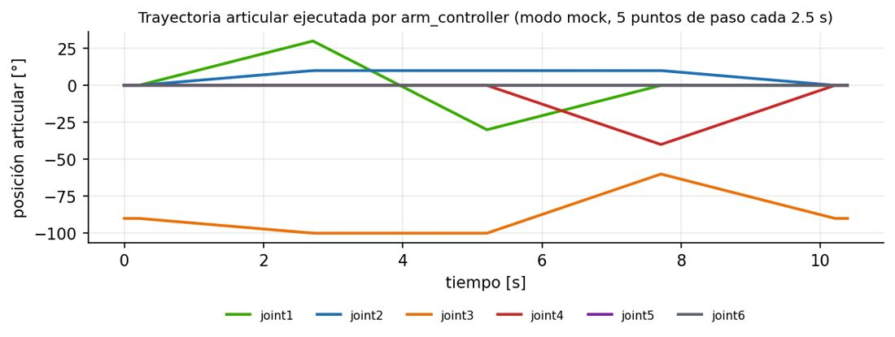

# Documento de Apoyo No. DA-07 – Práctica: programación de nodos ROS 2 (Python/C++) para trayectorias del cobot en simulación.

> Versión en Markdown del documento [DA-07_Practica_Trayectorias.docx](DA-07_Practica_Trayectorias.docx) para consultar y copiar comandos desde GitHub. El documento de Word es la versión oficial (formato GFPI-F-135).

**Nombre del Proyecto Formativo:** CELDA ROBÓTICA COLABORATIVA CON VISIÓN ARTIFICIAL INTEGRADA EN ROS 2 (JETCOBOT – NVIDIA JETSON AGX ORIN)

**Actividad de Proyecto Formativo:** IMPLEMENTAR UNA CELDA ROBÓTICA COLABORATIVA CON VISIÓN ARTIFICIAL Y ROS 2, DE LA SIMULACIÓN AL ROBOT REAL, Y TRANSFERIR EL CONOCIMIENTO AL CENTRO DE FORMACIÓN.

**Actividad de Aprendizaje:** Programar nodos ROS 2 en Python y C++ que generen y ejecuten trayectorias articulares y cartesianas sobre el cobot simulado (mock y Gazebo), dejándolas listas para su transferencia al robot real.

**Parte de la transferencia:** Parte A – Simulación en el PC.

**Equipo de trabajo:** PC con Ubuntu 22.04 y ROS 2 Humble. No se usa la Jetson ni se energiza el robot.

**Duración Estimada:** 2 horas.

**Sesión:** Día 2 – 04/11/2026, 11:30 a.m. – 12:00 m. y 1:30 p.m. – 3:00 p.m.

**Relación con la Guía de Aprendizaje:** Actividad 3.4.1 (transferencia).

> **PARTE A · TRABAJO EN EL PC (SIMULACIÓN):**
>
> Todo el trabajo de este documento se hace en el **PC** con Ubuntu 22.04 y ROS 2 Humble, con el robot simulado (mock y Gazebo) y, cuando se indique, una cámara USB conectada al PC. **No se usa la Jetson ni se energiza el robot.** Cada bloque de comandos indica **Terminal (PC)**.

## 1. OBJETIVOS DE APRENDIZAJE

- Describir una trayectoria articular (`trajectory_msgs/JointTrajectory`) y su interpolación en el controlador.
- Generar perfiles polinomiales con condiciones de frontera y verificar límites de velocidad.
- Programar clientes de la acción `FollowJointTrajectory` en Python y en C++.
- Usar los servicios de MoveIt (jc\_motion) para trayectorias de pose y cartesianas desde Python.
- Superar las etapas de simulación (1 y 2) del protocolo simulación → real con criterios de aceptación medibles.

## 2. FUNDAMENTOS

### 2.1 Trayectorias articulares

Una trayectoria es una secuencia de puntos (posiciones, opcionalmente velocidades y aceleraciones) con su instante `time_from_start`. El `JointTrajectoryController` de ros2\_control interpola entre puntos según la información disponible [3]: solo posiciones → interpolación lineal; posiciones y velocidades → polinomio cúbico por tramo; posiciones, velocidades y aceleraciones → polinomio de quinto grado. Para un tramo de duración *T* con posiciones y velocidades en los extremos (q₀, q̇₀, q\_f, q̇\_f) [1]:

$$q\left( t \right)={a}_{0}+{a}_{1}t+{a}_{2}{t}^{2}+{a}_{3}{t}^{3}, {a}_{0}={q}_{0}, {a}_{1}={\bar{q}}_{0}, {a}_{2}=\frac{3\left( {q}_{f}-{q}_{0} \right)}{{T}^{2}}-\frac{2{\bar{q}}_{0}+{\bar{q}}_{f}}{T}, {a}_{3}=\frac{-2\left( {q}_{f}-{q}_{0} \right)}{{T}^{3}}+\frac{{\bar{q}}_{0}+{\bar{q}}_{f}}{{T}^{2}} \qquad (1)$$

Con velocidades nulas en los extremos la velocidad máxima del tramo ocurre en *t* = *T*/2:

$${\bar{q}}_{max}=\frac{3}{2} \frac{\left| {q}_{f}-{q}_{0} \right|}{T} \qquad (2)$$

La ecuación (2) permite verificar *a priori* que una trayectoria respeta el límite de 1,5 rad/s definido en el modelo: por ejemplo, un giro de 50° (0,873 rad) en *T* = 2,5 s exige 0,52 rad/s. MoveIt calcula los tiempos automáticamente con TOTG respetando velocidad y aceleración máximas [5].



*Figura 1. Trayectoria de trajectory_demo (5 puntos de paso) registrada desde /joint_states durante la validación en modo mock.*

### 2.2 Del modelo al robot real

Los nodos de esta práctica solo usan la acción `/arm_controller/follow_joint_trajectory` o los servicios de `motion_server`, que existen igual en mock, Gazebo y en el robot real (puente de DA-14). En el robot real, el puente re-muestrea la trayectoria a 10 Hz y la envía con `send_angles` en modo refresco [7]; por ello, tramos muy cortos (&lt; 0,1 s) se fusionan.

*Tabla 1. Protocolo de transferencia simulación → real. En este documento se cumplen las etapas 1 y 2.*

| **Etapa** | **Plataforma** | **Lanzador** | **Criterio para avanzar** |
|---|---|---|---|
| 1 | Mock (sin física) | `ros2 launch jc_bringup mock.launch.py` | error\_code = 0; sin colisiones en RViz2 |
| 2 | Gazebo | `ros2 launch jc_bringup sim.launch.py` | error\_code = 0; sin contactos indeseados |
| 3 | Puente simulado en la Jetson (Parte B) | `real.launch.py simulate:=true` (DA-15) | Misma secuencia de estados |
| 4 | Robot real, 20 % vel. (Parte B) | `real.launch.py` en la Jetson (DA-15) | Error final ≤ 2°; observación sin riesgos |
| 5 | Robot real, vel. nominal (Parte B) | ídem (escalado ≤ 0,5) (DA-15) | Repetibilidad en 5 ciclos |

> **Nota:**
>
> Las etapas 3 a 5 se ejecutan en la Parte B (DA-15) con las reglas de seguridad de DA-14 y la evaluación de riesgos de la celda [8]. Llegue a ellas solo con trayectorias que hayan superado las etapas 1 y 2.
>
> Guarde en `mi_celda` los programas validados aquí: son los mismos que ejecutará con el robot real.

## 3. PROCEDIMIENTO PASO A PASO

### Paso 1. Cliente Python de FollowJointTrajectory (análisis)

Abra `jc_apps/jc_apps/trajectory_demo.py`. Identifique la construcción de la meta:

**jc_apps/trajectory_demo.py (fragmento)**

```
goal = FollowJointTrajectory.Goal()
goal.trajectory.joint_names = JOINTS
for k, wp in enumerate(WAYPOINTS_DEG, start=1):
    pt = JointTrajectoryPoint()
    pt.positions = [math.radians(a) for a in wp]
    t = k * self.seg
    pt.time_from_start = Duration(sec=int(t), nanosec=int((t % 1) * 1e9))
    goal.trajectory.points.append(pt)
fut = self.cli.send_goal_async(goal, feedback_callback=self.on_fb)
```

**Terminal (PC)**

```bash
# etapa 1
ros2 launch jc_bringup mock.launch.py
ros2 run jc_apps trajectory_demo --ros-args -p segment_time:=2.5
```

> **Resultado esperado:**
>
> `Resultado: error_code=0 (0 = SUCCESSFUL)` y la evolución articular de la Figura 1.

### Paso 2. Cliente C++ con perfil cúbico

El nodo `jc_motion/src/trajectory_client.cpp` hace lo mismo en C++ y agrega `velocities = 0` en cada punto, lo que activa la interpolación cúbica (1) del controlador:

**jc_motion/src/trajectory_client.cpp (fragmento)**

```
for (size_t k = 0; k < wps_deg.size(); ++k) {
  trajectory_msgs::msg::JointTrajectoryPoint p;
  for (double a : wps_deg[k]) {
    p.positions.push_back(a * M_PI / 180.0);
    p.velocities.push_back(0.0);   // perfil cubico por tramo
  }
  p.time_from_start = rclcpp::Duration::from_seconds(seg * static_cast<double>(k + 1));
  goal.trajectory.points.push_back(p);
}
auto gh_future = client->async_send_goal(goal, opts);
```

**Terminal (PC)**

```bash
ros2 run jc_motion trajectory_client --ros-args -p segment_time:=2.5
```

> **Resultado esperado:**
>
> Validación con el puente del robot (simulado): `J1 actual = 25.0 deg`, `J1 actual = -23.6 deg`, `Resultado: error_code = 0 (0 = SUCCESSFUL)`.

### Paso 3. Ejercicio: su propio generador de trayectorias

Cree en `mi_celda` (DA-03) un nodo Python `barrido.py` (registre el ejecutable `barrido` en `setup.py`) que:

1. Lea un parámetro `amplitud_deg` (por defecto 30) y `periodo_s` (por defecto 6).
1. Genere una trayectoria de J1 entre ±amplitud alrededor de la configuración `ready` con 20 puntos por ciclo y velocidades analíticas (derivada de una senoide), dos ciclos.
1. Verifique con (2) o con la derivada analítica que |q̇| &lt; 1,5 rad/s antes de enviar; si no, rechace y registre un error.
1. Envíe la meta y reporte el error final articular medido en `/joint_states`.

**Sugerencia de implementación**

```
import math
import numpy as np
def barrido(q_ready, amp_deg=30.0, periodo=6.0, n_ciclos=2, puntos_por_ciclo=20):
    """Puntos (t, q, qd) de una senoide en J1 alrededor de q_ready (rad)."""
    A, w = math.radians(amp_deg), 2 * math.pi / periodo
    t = np.linspace(0, n_ciclos * periodo, n_ciclos * puntos_por_ciclo + 1)[1:]
    q = np.tile(q_ready, (len(t), 1)); qd = np.zeros_like(q)
    q[:, 0] += A * np.sin(w * t); qd[:, 0] = A * w * np.cos(w * t)
    assert np.max(np.abs(qd)) < 1.5, "velocidad excede el limite"
    return t, q, qd
```

### Paso 4. Trayectorias de pose y cartesianas desde Python

`jc_apps/motion_client.py` encapsula los servicios de `motion_server`. Ejemplo mínimo:

**Python (fragmento)**

```
from jc_apps.motion_client import MotionClient
mc = MotionClient(node)            # node con un executor girando en otro hilo
mc.named("ready")
mc.pose(0.17, -0.08, 0.14)                       # articular hacia una pose (OMPL + IK)
mc.pose(0.21, -0.08, 0.14, cartesian=True)       # linea recta del TCP
mc.gripper(0.0)                                  # cerrar
```

**Terminal (PC)**

```bash
ros2 run jc_apps square_demo --ros-args -p side:=0.04 -p z:=0.14
```

### Paso 5. Etapa 2 completa en Gazebo y línea base para la Parte B

1. Lance la celda simulada con física: `ros2 launch jc_bringup sim.launch.py`.
1. Ejecute `trajectory_demo` con `segment_time:=4.0` y luego `square_demo` (agregue `use_sim_time:=true`).
1. Registre: `ros2 bag record /joint_states /arm_controller/follow_joint_trajectory/_action/feedback`.
1. Compare, para cada punto de paso, la posición comandada y la medida en Gazebo (Tabla 2). Esta tabla es la **línea base** con la que comparará el robot real en DA-15.

> **INSERTAR IMAGEN / CAPTURA (por el instructor):**
>
> *Captura de Gazebo y RViz2 con el JetCobot simulado ejecutando* `square_demo`*.*

*Tabla 2. Comparación comandado vs. medido en Gazebo: línea base para el robot real (diligenciar).*

| **Punto** | **q comandada [°]** | **q medida en Gazebo [°]** | **Error máx. [°]** | **Tiempo de llegada [s]** |
|---|---|---|---|---|
| 1 |  |  |  |  |
| 2 |  |  |  |  |
| 3 |  |  |  |  |
| 4 |  |  |  |  |
| 5 |  |  |  |  |

## 4. VERIFICACIÓN Y EVIDENCIAS

*Tabla 3. Evidencias de la práctica.*

| **#** | **Criterio** | **Evidencia** |
|---|---|---|
| 1 | Nodo Python y nodo C++ ejecutan trayectorias con error\_code 0 en mock y Gazebo | Registros |
| 2 | Generador propio con verificación de velocidad | Código en `mi_celda` + ejecución |
| 3 | Trayectoria cartesiana ejecutada (cuadrado) | Registro |
| 4 | Etapas 1 y 2 del protocolo superadas, con línea base medida en Gazebo | Tabla 2 + bag |

## 5. SOLUCIÓN DE PROBLEMAS

*Tabla 4. Problemas frecuentes.*

| **Síntoma** | **Causa probable** | **Solución** |
|---|---|---|
| Meta rechazada | Nombres de articulaciones distintos o lista vacía | Usar joint1…joint6 en el mismo orden |
| `PATH_TOLERANCE_VIOLATED` en Gazebo | Trayectoria muy rápida o colisión | Aumentar `segment_time`; revisar escena |
| El robot simulado 'salta' al primer punto | El primer punto no es el estado actual | Iniciar en `ready` o incluir el estado actual como primer punto |
| Nodo sin respuesta en Gazebo | Falta `use_sim_time:=true` | Agregar el parámetro a los nodos propios |

## REFERENCIAS

**[1]** B. Siciliano, L. Sciavicco, L. Villani y G. Oriolo, *Robotics: Modelling, Planning and Control*. London, U.K.: Springer, 2009, doi: 10.1007/978-1-84628-642-1.

**[2]** K. M. Lynch y F. C. Park, *Modern Robotics: Mechanics, Planning, and Control*. Cambridge, U.K.: Cambridge University Press, 2017.

**[3]** ros-controls, *ros2\_control Documentation (Humble)*. [En línea]. Disponible: [https://control.ros.org/humble/](https://control.ros.org/humble/)

**[4]** PickNik Robotics, *MoveIt 2 Documentation – Humble*. [En línea]. Disponible: [https://moveit.picknik.ai/humble/](https://moveit.picknik.ai/humble/)

**[5]** T. Kunz y M. Stilman, "Time-optimal trajectory generation for path following with bounded acceleration and velocity," en *Robotics: Science and Systems VIII*, 2012, doi: 10.15607/RSS.2012.VIII.027.

**[6]** Open Robotics, *ROS 2 Documentation: Humble Hawksbill*. [En línea]. Disponible: [https://docs.ros.org/en/humble/](https://docs.ros.org/en/humble/)

**[7]** Elephant Robotics, *pymycobot – MyCobot 280 Python API* (v4.0.x). [En línea]. Disponible: [https://github.com/elephantrobotics/pymycobot/blob/main/docs/MyCobot_280_en.md](https://github.com/elephantrobotics/pymycobot/blob/main/docs/MyCobot_280_en.md)

**[8]** International Organization for Standardization, *ISO 10218-1:2025 y ISO 10218-2:2025, Robotics — Safety requirements — Part 1: Industrial robots; Part 2: Industrial robot applications and robot cells*. Ginebra: ISO, 2025.

**[9]** J. R. Cháux Cedeño, *robots\_ws – paquetes ROS 2 del curso (repositorio en GitHub, licencia Apache-2.0), 2026. [En línea]. Disponible: https://github.com/jchauxdev/robots\_ws*
