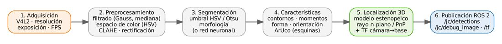
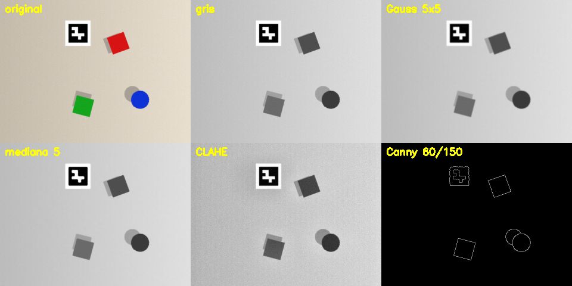
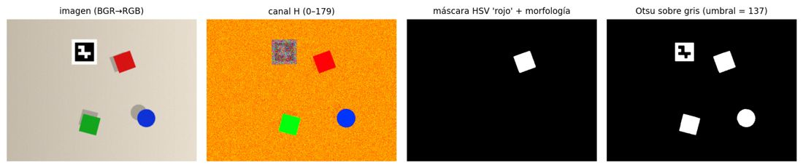
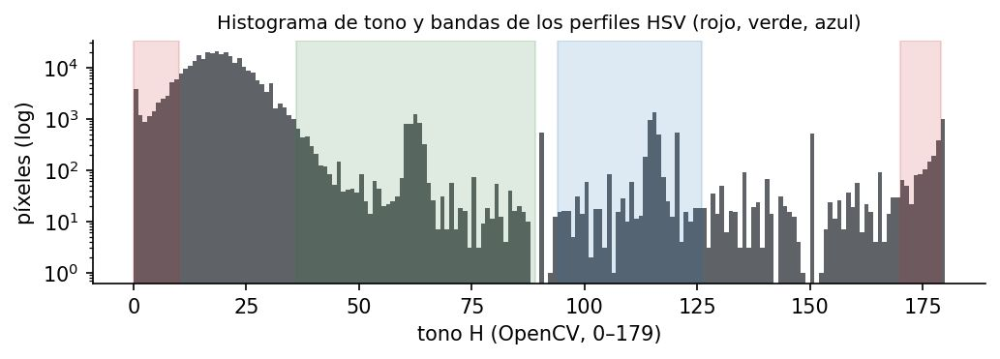

# Documento de Apoyo No. DA-08 – Fundamentos de visión artificial con OpenCV: adquisición, preprocesamiento, segmentación y extracción de características.

> Versión en Markdown del documento de apoyo, para consultar y copiar comandos desde GitHub. El documento de Word (formato GFPI-F-135) no se publica en el repositorio.

**Actividad de Aprendizaje:** Aplicar las etapas fundamentales de un sistema de visión artificial con OpenCV sobre imágenes de la celda, justificando cuantitativamente la selección de parámetros.

**Parte de la transferencia:** Parte A – Simulación en el PC.

**Equipo de trabajo:** PC con Ubuntu 22.04 y ROS 2 Humble. No se usa la Jetson ni se energiza el robot.

**Duración Estimada:** 2 horas.

**Sesión:** Día 2 – 04/11/2026, 3:00 p.m. – 5:00 p.m.

**Relación con la Guía de Aprendizaje:** Actividad 3.3.6 (apropiación).

> **PARTE A · TRABAJO EN EL PC (SIMULACIÓN):**
>
> Todo el trabajo de este documento se hace en el **PC** con Ubuntu 22.04 y ROS 2 Humble, con el robot simulado (mock y Gazebo) y, cuando se indique, una cámara USB conectada al PC. **No se usa la Jetson ni se energiza el robot.** Cada bloque de comandos indica **Terminal (PC)**.

## 1. OBJETIVOS DE APRENDIZAJE

- Adquirir imágenes con una cámara USB conectada al PC controlando resolución y tasa de cuadros, y medir el desempeño real.
- Aplicar filtros, cambios de espacio de color y realce de contraste, y explicar su efecto.
- Segmentar piezas por color (HSV) y por umbral automático (Otsu), con limpieza morfológica.
- Extraer características geométricas (área, centroide, orientación, circularidad, momentos de Hu) y clasificar formas.
- Relacionar cada etapa con la cadena completa de localización para el cobot (Figura 1).

## 2. FUNDAMENTOS



*Figura 1. Etapas de la cadena de visión implementada en la celda (jc_vision).*

### 2.1 La imagen digital y su adquisición

Una imagen en OpenCV es un arreglo NumPy de forma (alto, ancho, canales) y tipo `uint8`; el orden de canales es **BGR** [4]. En Linux, las cámaras USB se acceden por **V4L2** (`/dev/videoN`); resolución, formato (MJPG/YUYV) y FPS se negocian con el controlador, por lo que el valor solicitado no siempre es el obtenido: **mídalo** (Paso 1). Para la celda se usa 640 × 480, como en los programas del instructor (`ver_camaras.py`, `camera_stream.py`), que además leen en un hilo aparte para no bloquear la interfaz.

### 2.2 Preprocesamiento

El suavizado gaussiano atenúa ruido de alta frecuencia convolucionando con [1]:

$${G}_{σ}\left( x,y \right)=\frac{1}{2\pi {σ}^{2}}exp​\left( -\frac{{x}^{2}+{y}^{2}}{2{σ}^{2}} \right) \qquad (1)$$

El filtro de mediana elimina ruido impulsivo preservando bordes. CLAHE ecualiza el histograma por regiones con un límite de contraste, útil ante iluminación no uniforme [7]. El detector de Canny localiza bordes con gradiente, supresión de no máximos e histéresis [6]. Para segmentar por color se usa **HSV**, que separa el tono (H) de la saturación (S) y el brillo (V) y es más robusto a cambios de iluminación que RGB. En OpenCV, H ∈ [0, 179] (grados/2) y S, V ∈ [0, 255]; el rojo ocupa los dos extremos del círculo de tono, por eso requiere **dos** rangos.



*Figura 2. Salida de cv_02_preprocesamiento.py sobre la escena de la celda vista desde la pose observe: original, gris, Gauss 5×5, mediana, CLAHE y Canny.*

### 2.3 Segmentación

El método de Otsu elige automáticamente el umbral *t* que maximiza la varianza entre clases del histograma de gris [5]:

$${t}^{*}=argmax {\omega }_{0}\left( t \right) {\omega }_{1}\left( t \right) {\left[ {\mu }_{0}\left( t \right)-{\mu }_{1}\left( t \right) \right]}^{2} \qquad (2)$$

donde ω y μ son la probabilidad y la media de cada clase. La segmentación HSV aplica `cv2.inRange` con rangos por perfil; luego **apertura** (erosión + dilatación) elimina puntos aislados y **cierre** rellena huecos.



*Figura 3. Segmentación: canal H, máscara HSV del perfil 'rojo' con morfología y umbral de Otsu sobre gris (que separa marcador y piezas oscuras del fondo).*



*Figura 4. Histograma del canal H de la escena y bandas de los perfiles HSV de jc_vision/config/hsv_profiles.yaml.*

### 2.4 Extracción de características

Los contornos se obtienen por seguimiento de bordes (`findContours`, algoritmo de Suzuki y Abe) [8]. A partir de los momentos de imagen \*m\*pq = Σ x^p y^q I(x, y) se calcula el centroide:

$$\bar{x}=\frac{{m}_{10}}{{m}_{00}},  \bar{y}=\frac{{m}_{01}}{{m}_{00}} \qquad (3)$$

Los siete momentos de Hu son invariantes a traslación, escala y rotación [10]. La forma se clasifica aproximando el contorno con Douglas–Peucker (`approxPolyDP`) [9] y con la circularidad:

$$C=\frac{4\pi A}{{P}^{2}}  \left( C=1 para un círculo; C=\pi /4≈0,785 para un cuadrado \right) \qquad (4)$$

Para objetos con textura se usan puntos clave con descriptores, p. ej. ORB (binario, rápido) [11] o SIFT (invariante a escala) [12]; en piezas lisas de color, los rasgos geométricos son más robustos.

*Tabla 1. Salida real de cv_04_caracteristicas.py --tabla sobre una imagen de prueba con cinco figuras. Observe que la circularidad medida del cuadrado (0,79) coincide con π/4.*

| **Forma** | **cx [px]** | **cy [px]** | **Área [px²]** | **Perímetro [px]** | **Circularidad** | **Hu₁ (−log)** |
|---|---|---|---|---|---|---|
| triangulo | 159,7 | 380,0 | 7198 | 406,3 | 0,55 | 0,71 |
| poligono\_5 | 444,3 | 341,9 | 8998 | 379,7 | 0,78 | 0,78 |
| rectangulo | 310,0 | 100,0 | 14398 | 517,7 | 0,68 | 0,65 |
| cuadrado | 110,0 | 110,0 | 9998 | 397,7 | 0,79 | 0,78 |
| circulo | 520,0 | 110,0 | 9318 | 359,4 | 0,91 | 0,80 |

## 3. MATERIALES

- Cámara USB conectada al **PC**: la cámara de la celda (solo se conecta su cable USB al PC; el robot permanece apagado) u otra webcam.
- Piezas de colores (rojo, verde, azul) y fondo mate.
- Scripts en `~/robots_ws/practicas/dia2_vision/` (solo requieren Python 3, OpenCV, NumPy y PyYAML).

## 4. PROCEDIMIENTO PASO A PASO

### Paso 0. Incorporar al robots_ws el material de este documento

Estas prácticas no son paquetes de ROS 2: son scripts de Python que se ejecutan directamente. Agregue la carpeta desde el repositorio robots\_ws:

| **Paquete / carpeta** | **Para qué sirve** | **Qué contiene** | **Dónde se usa** |
|---|---|---|---|
| `practicas/dia2_vision` | Prácticas de visión con OpenCV sin ROS, para aprender adquisición, filtros, segmentación, características y calibración. No se compilan. | cv\_01\_adquisicion.py a cv\_04\_caracteristicas.py, calibrar\_camara.py, generar\_patrones.py y el módulo común comun.py. | PC con la cámara USB. |

**Terminal 1 (PC)**

```bash
# trae lo nuevo del repositorio (correcciones y mejoras)
cd ~/robots_ws && git pull
cd ~/robots_ws && git sparse-checkout add practicas/dia2_vision
```

### Paso 1. Adquisición y desempeño

Todo este documento se trabaja en una sola terminal, la Terminal 1, dentro de ~/robots\_ws/practicas/dia2\_vision, con la cámara USB conectada al PC. Cada script abre una ventana: ciérrela con q o Esc para volver a la terminal antes del siguiente comando.

**Terminal 1 (PC)**

```bash
cd ~/robots_ws/practicas/dia2_vision
# identificar /dev/videoN (paquete v4l-utils)
v4l2-ctl --list-devices
v4l2-ctl -d /dev/video0 --list-formats-ext | head -30
# muestra resolución y FPS medidos; 's' guarda
python3 cv_01_adquisicion.py --fuente /dev/video0
```

*Tabla 2. Desempeño de adquisición (diligenciar).*

| **Resolución solicitada** | **Formato** | **Resolución obtenida** | **FPS medidos** |
|---|---|---|---|
| 640×480 |  |  |  |
| 1280×720 |  |  |  |

Capture 5 imágenes de la mesa con las piezas (`s`), con la cámara a 20–25 cm de altura mirando hacia abajo, una geometría similar a la de la pose `observe` del robot; se usarán en los pasos siguientes.

### Paso 2. Preprocesamiento

**Terminal 1 (PC)**

```bash
python3 cv_02_preprocesamiento.py --fuente captura_001.png
```

Ajuste los umbrales de Canny con las barras. Responda: ¿qué filtro preserva mejor los bordes de las piezas? ¿qué hace CLAHE con la sombra de los cubos?

### Paso 3. Segmentación HSV y Otsu, y perfil para ROS

**Terminal 1 (PC)**

```bash
python3 cv_03_segmentacion.py --fuente /dev/video0 --nombre rojo
# ajustar barras hasta aislar las piezas rojas; 'g' guarda perfil_rojo.yaml; 'o' alterna Otsu
```

Repita para verde y azul y guarde los tres archivos `perfil_*.yaml`: en DA-09, al incorporar el paquete `jc_vision`, copiará los rangos a `~/robots_ws/src/jc_vision/config/hsv_profiles.yaml` (el detector de ROS los usará). Recuerde que el rojo necesita dos rangos (H cerca de 0 y de 179). En la Parte B (DA-16) los perfiles se recalibran con la cámara montada en el robot y la iluminación del puesto de trabajo.

> **Precaución:**
>
> Los rangos HSV dependen de la iluminación y del balance de blancos automático de la cámara. Fije la exposición y el balance si su cámara lo permite (`v4l2-ctl -c ...`) y recalibre si cambia la luz.

### Paso 4. Características y clasificación de forma

**Terminal 1 (PC)**

```bash
# en vivo (contornos + ORB)
python3 cv_04_caracteristicas.py --fuente /dev/video0
# tabla de rasgos
python3 cv_04_caracteristicas.py --fuente captura_001.png --tabla
```

> **INSERTAR IMAGEN / CAPTURA (por el instructor):**
>
> *Captura de* `cv_04_caracteristicas.py` *en vivo sobre las piezas reales de la celda.*

### Paso 5. Del píxel a la decisión

Con la tabla de rasgos, proponga una regla para distinguir el cubo del cilindro solo con circularidad y área, y estime su tasa de error sobre 20 imágenes con piezas en distintas posiciones (matriz de confusión 2×2).

## 5. VERIFICACIÓN Y EVIDENCIAS

*Tabla 3. Evidencias de la actividad.*

| **#** | **Criterio** | **Evidencia** |
|---|---|---|
| 1 | FPS y resolución medidos y comparados con lo solicitado | Tabla 2 |
| 2 | Perfiles HSV calibrados para las 3 piezas en la iluminación del aula | `hsv_profiles.yaml` actualizado |
| 3 | Tabla de rasgos de las piezas reales e interpretación de la circularidad | Salida `--tabla` + análisis |
| 4 | Regla de clasificación con matriz de confusión | Tabla y tasa de error |

## 6. SOLUCIÓN DE PROBLEMAS

*Tabla 4. Problemas frecuentes.*

| **Síntoma** | **Causa probable** | **Solución** |
|---|---|---|
| `No se pudo abrir /dev/video0` | Índice incorrecto o cámara en uso | `v4l2-ctl --list-devices`; cerrar otras apps |
| FPS bajos a 640×480 | Formato YUYV por USB 2.0 | Solicitar MJPG: `cap.set(cv2.CAP_PROP_FOURCC, cv2.VideoWriter_fourcc(*'MJPG'))` |
| La máscara roja sale vacía | Falta la segunda banda (170–179) | Usar dos rangos para el rojo |
| Contornos fragmentados | Ruido o sombras | Aumentar cierre morfológico; difusor de luz |
| Error `cv2.imshow` sin pantalla | Sesión SSH sin X | Usar VNC o guardar imágenes con `cv2.imwrite` |

## REFERENCIAS

**[1]** R. C. Gonzalez y R. E. Woods, *Digital Image Processing*, 4th ed. New York, NY, USA: Pearson, 2018.

**[2]** R. Szeliski, *Computer Vision: Algorithms and Applications*, 2nd ed. Cham, Switzerland: Springer, 2022, doi: 10.1007/978-3-030-34372-9.

**[3]** G. Bradski, "The OpenCV Library," *Dr. Dobb's Journal of Software Tools*, vol. 25, no. 11, pp. 120–125, 2000.

**[4]** OpenCV team, *OpenCV 4.x Documentation*. [En línea]. Disponible: [https://docs.opencv.org/4.x/](https://docs.opencv.org/4.x/)

**[5]** N. Otsu, "A threshold selection method from gray-level histograms," *IEEE Trans. Systems, Man, and Cybernetics*, vol. 9, no. 1, pp. 62–66, 1979, doi: 10.1109/TSMC.1979.4310076.

**[6]** J. Canny, "A computational approach to edge detection," *IEEE Trans. Pattern Analysis and Machine Intelligence*, vol. PAMI-8, no. 6, pp. 679–698, 1986, doi: 10.1109/TPAMI.1986.4767851.

**[7]** K. Zuiderveld, "Contrast limited adaptive histogram equalization," en *Graphics Gems IV*, P. S. Heckbert, Ed. San Diego, CA, USA: Academic Press, 1994, pp. 474–485.

**[8]** S. Suzuki y K. Abe, "Topological structural analysis of digitized binary images by border following," *Computer Vision, Graphics, and Image Processing*, vol. 30, no. 1, pp. 32–46, 1985, doi: 10.1016/0734-189X(85)90016-7.

**[9]** D. H. Douglas y T. K. Peucker, "Algorithms for the reduction of the number of points required to represent a digitized line or its caricature," *Cartographica*, vol. 10, no. 2, pp. 112–122, 1973, doi: 10.3138/FM57-6770-U75U-7727.

**[10]** M.-K. Hu, "Visual pattern recognition by moment invariants," *IRE Trans. Information Theory*, vol. 8, no. 2, pp. 179–187, 1962, doi: 10.1109/TIT.1962.1057692.

**[11]** E. Rublee, V. Rabaud, K. Konolige y G. Bradski, "ORB: An efficient alternative to SIFT or SURF," en *Proc. IEEE ICCV*, 2011, pp. 2564–2571, doi: 10.1109/ICCV.2011.6126544.

**[12]** D. G. Lowe, "Distinctive image features from scale-invariant keypoints," *International Journal of Computer Vision*, vol. 60, no. 2, pp. 91–110, 2004, doi: 10.1023/B:VISI.0000029664.99615.94.

**[13]** P. Corke, *Robotics, Vision and Control: Fundamental Algorithms in Python*, 3rd ed. Cham, Switzerland: Springer, 2023, doi: 10.1007/978-3-031-06469-2.

**[14]** J. R. Cháux Cedeño, *robots\_ws – paquetes ROS 2 del curso (repositorio en GitHub, licencia Apache-2.0), 2026. [En línea]. Disponible: https://github.com/jchauxdev/robots\_ws*
