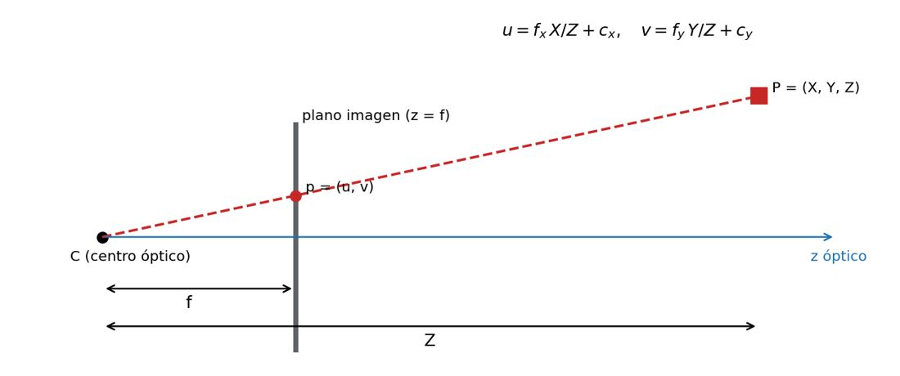
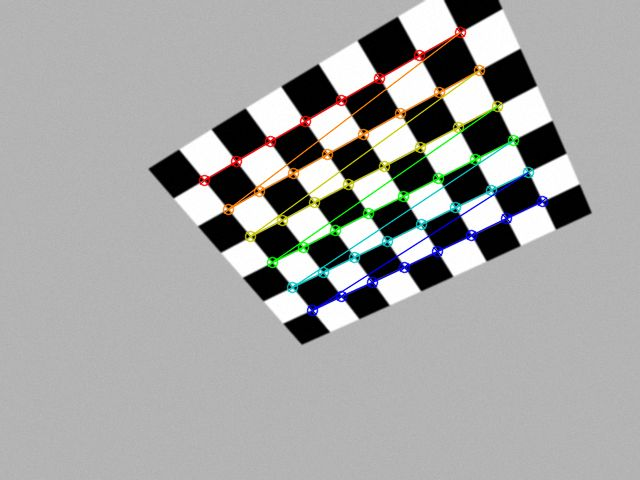
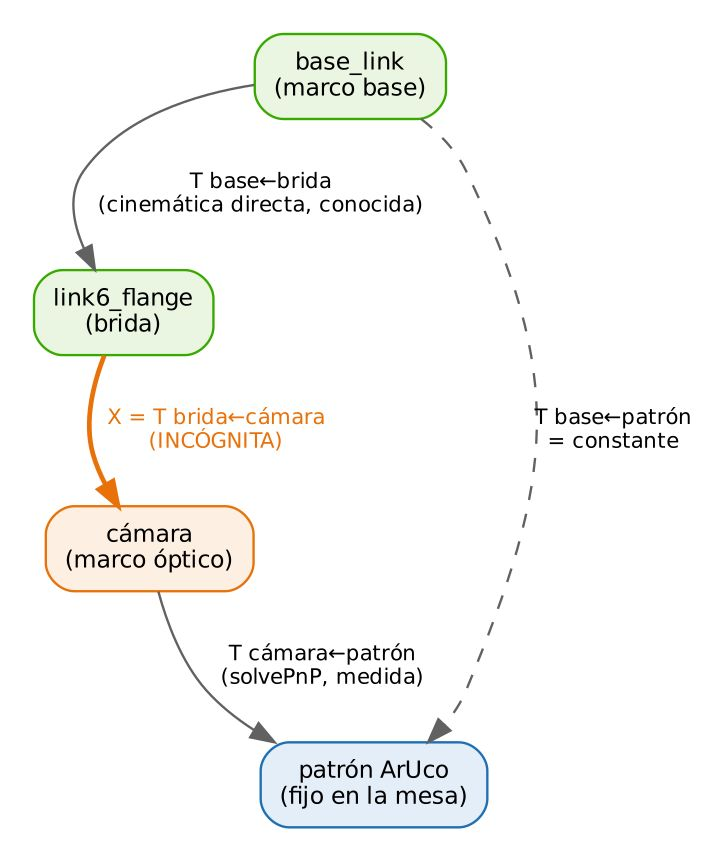
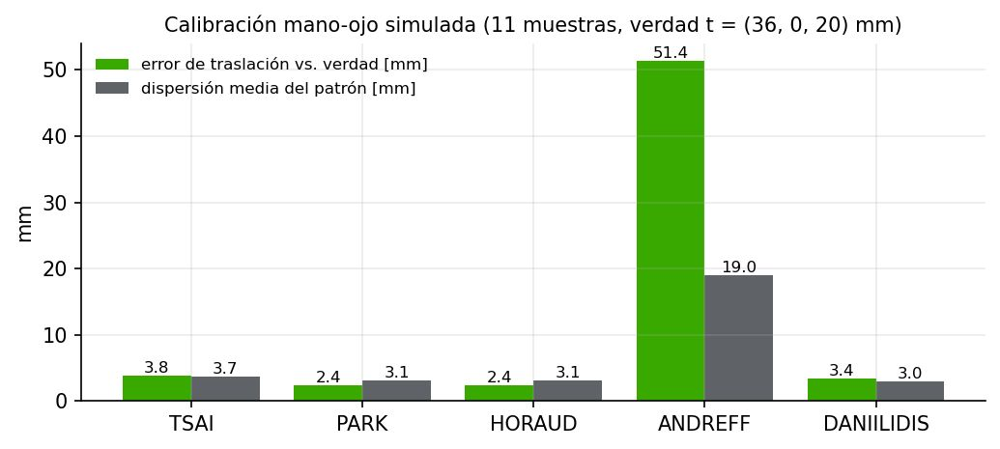

# Documento de Apoyo No. DA-09 – Integración de cámaras en ROS 2, calibración de cámara y calibración mano-ojo en simulación.

> Versión en Markdown del documento de apoyo, para consultar y copiar comandos desde GitHub. El documento de Word (formato GFPI-F-135) no se publica en el repositorio.

**Actividad de Aprendizaje:** Integrar cámaras 2D/3D en ROS 2, calibrar sus parámetros intrínsecos y obtener la transformación cámara–robot mediante calibración mano-ojo en simulación, cuantificando la incertidumbre de los resultados.

**Parte de la transferencia:** Parte A – Simulación en el PC.

**Equipo de trabajo:** PC con Ubuntu 22.04 y ROS 2 Humble. No se usa la Jetson ni se energiza el robot.

**Duración Estimada:** 1,5 horas.

**Sesión:** Día 3 – 05/11/2026, 8:00 a.m. – 9:30 a.m.

**Relación con la Guía de Aprendizaje:** Actividad 3.3.7 (apropiación).

> **PARTE A · TRABAJO EN EL PC (SIMULACIÓN):**
>
> Todo el trabajo de este documento se hace en el **PC** con Ubuntu 22.04 y ROS 2 Humble, con el robot simulado (mock y Gazebo) y, cuando se indique, una cámara USB conectada al PC. **No se usa la Jetson ni se energiza el robot.** Cada bloque de comandos indica **Terminal (PC)**.

## 1. OBJETIVOS DE APRENDIZAJE

- Modelar la cámara con el modelo estenopeico y la distorsión radial-tangencial.
- Publicar una cámara 2D en ROS 2 (`Image` + `CameraInfo`) y conocer la integración de cámaras 3D (RGB-D).
- Calibrar los parámetros intrínsecos con el método de Zhang y evaluar el error de reproyección.
- Formular la calibración mano-ojo como AX = XB, resolverla con cinco métodos en Gazebo y validarla contra la transformación verdadera del modelo.

## 2. FUNDAMENTOS

### 2.1 Modelo de cámara



*Figura 1. Modelo estenopeico: el punto P se proyecta en p a lo largo del rayo que pasa por el centro óptico C.*

Un punto **P** = (X, Y, Z) expresado en el marco óptico se proyecta en el píxel (u, v) mediante la matriz de parámetros intrínsecos **K** [1]:

$$s\left[  \right]=\left[  \right]\left[  \right],  s=Z \qquad (1)$$

Las lentes reales agregan distorsión. ROS usa el modelo `plumb_bob` (Brown–Conrady) con coeficientes **D** = (k₁, k₂, p₁, p₂, k₃) aplicados a las coordenadas normalizadas x = X/Z, y = Y/Z, con r² = x² + y²:

$${x}_{d}=x \left( 1+{k}_{1}{r}^{2}+{k}_{2}{r}^{4}+{k}_{3}{r}^{6} \right)+2{p}_{1}xy+{p}_{2}\left( {r}^{2}+2{x}^{2} \right), {y}_{d}=y \left( 1+{k}_{1}{r}^{2}+{k}_{2}{r}^{4}+{k}_{3}{r}^{6} \right)+{p}_{1}\left( {r}^{2}+2{y}^{2} \right)+2{p}_{2}xy \qquad (2)$$

Según REP 103, el marco óptico tiene z hacia adelante, x a la derecha e y hacia abajo [4]; en el URDF de la celda es `camera_optical_frame`, hijo de `camera_link`.

### 2.2 Cámaras 2D y 3D en ROS 2

*Tabla 1. Integración de cámaras en ROS 2.*

| **Tipo** | **Paquete / nodo** | **Tópicos principales** | **Uso en la celda** |
|---|---|---|---|
| USB 2D (UVC) | `jc_vision/camera_node`, `usb_cam`, `v4l2_camera` | `image_raw`, `camera_info` | Cámara en mano del JetCobot |
| Simulada | Sensor `camera` de Gazebo + `ros_gz_bridge` | `/wrist_camera/image_raw`, `/wrist_camera/camera_info` | Desarrollo en Gazebo |
| RGB-D (3D) | p. ej. `realsense2_camera` (Intel RealSense), SDK del fabricante para otras marcas | `color/image_raw`, `aligned_depth_to_color/image_raw`, `depth/color/points` | Opcional: Z medido en lugar de plano supuesto |

Con una cámara 2D, la profundidad no se mide: la celda la obtiene intersectando el rayo del píxel con el plano de la mesa (DA-10) o con la pose 6D de un marcador de tamaño conocido. Con una cámara RGB-D alineada, cada píxel trae su Z y el punto 3D se obtiene directamente invirtiendo (1); `detector_base.py` es el lugar natural para incorporar esa variante.

### 2.3 Calibración intrínseca (Zhang)

El método de Zhang estima **K** y **D** a partir de varias vistas de un patrón plano conocido (tablero de ajedrez): cada vista aporta una homografía plano–imagen; se obtiene una solución cerrada y luego se refina minimizando el error de reproyección por Levenberg–Marquardt [2]:

$$min\sum_{i=1}^{N} \sum_{j=1}^{M} {\left∥ {x}_{ij}-\pi ​\left( K,D,{R}_{i},{t}_{i},{X}_{j} \right) \right∥}^{2} \qquad (3)$$

La raíz del error cuadrático medio (RMS) de reproyección resume la calidad. Como referencia práctica, valores inferiores a ~0,5 px con 15–25 vistas bien distribuidas (inclinadas, en las esquinas de la imagen y a varias distancias) son adecuados para la celda.



*Figura 2. Esquinas internas (8 × 6) detectadas y refinadas a nivel sub-píxel en una vista de validación.*

*Tabla 2. Validación del script de calibración con 20 vistas sintéticas de parámetros conocidos (ruido σ = 2 niveles de gris).*

| **Parámetro** | **Valor verdadero (simulado)** | **Estimado por calibrar\_camara.py** |
|---|---|---|
| fx, fy [px] | 600,000 / 600,000 | 599,952 / 599,943 |
| cx, cy [px] | 322,000 / 236,000 | 322,125 / 235,931 |
| k₁, k₂ | −0,1200 / 0,0500 | −0,11987 / 0,04291 |
| p₁, p₂ | 0,0010 / −0,0005 | 0,00100 / −0,00049 |
| RMS de reproyección | — | 0,033 px (20 vistas) |

> **Nota:**
>
> La diferencia en k₂ (0,043 vs 0,050) se compensa parcialmente con k₃ (0,024): los coeficientes de alto orden están correlacionados y no son identificables por separado con un campo de visión moderado. Lo que importa es el error de reproyección y la exactitud de **K**.

### 2.4 Calibración mano-ojo (eye-in-hand)



*Figura 3. Cadena de transformaciones de la calibración mano-ojo con la cámara montada en la brida.*

Con la cámara en la mano, la transformación desconocida es **X** = **T**\_brida←cámara. Para cada pose *i* del robot se conocen **T**\_base←brida(i) (cinemática) y **T**\_cámara←patrón(i) (PnP). Como el patrón está fijo en la mesa:

$${T}_{b←g}^{\left( i \right)} X {T}_{c←t}^{\left( i \right)}={T}_{b←g}^{\left( j \right)} X {T}_{c←t}^{\left( j \right)}  ⇒  {A}_{ij}X=X{B}_{ij} \qquad (4)$$

$${A}_{ij}={\left( {T}_{b←g}^{\left( j \right)} \right)}^{-1}{T}_{b←g}^{\left( i \right)},  {B}_{ij}={T}_{c←t}^{\left( j \right)}{\left( {T}_{c←t}^{\left( i \right)} \right)}^{-1} \qquad (5)$$

La ecuación AX = XB fue planteada por Shiu y Ahmad [7] y Tsai y Lenz [8]. OpenCV implementa cinco métodos en `cv::calibrateHandEye` [6]:

*Tabla 3. Métodos de calibración mano-ojo disponibles en OpenCV.*

| **Método** | **Idea principal** | **Ref.** |
|---|---|---|
| TSAI | Desacopla rotación (ejes de rotación, parámetros de Rodrigues) y luego traslación por mínimos cuadrados. | [8] |
| PARK | Resuelve la rotación en el grupo SO(3) con el logaritmo matricial (solución en forma cerrada). | [9] |
| HORAUD | Rotación por cuaterniones unitarios; traslación lineal. | [10] |
| ANDREFF | Formulación lineal simultánea (producto de Kronecker); sensible al ruido si hay pocas poses. | [11] |
| DANIILIDIS | Rotación y traslación simultáneas con cuaterniones duales. | [12] |

Condiciones de buena calibración: rotaciones relativas grandes y alrededor de **ejes no paralelos** (la traslación es inobservable si todas las rotaciones son alrededor del mismo eje), al menos 10 poses, marcador visible y nítido, robot **detenido** al capturar (sincronía imagen–cinemática) e intrínsecos calibrados.

La pose del marcador se estima con `solvePnP` y el método IPPE para cuadrados planos [15] sobre marcadores ArUco [14]. Como medida de calidad, `handeye_calibration` reporta la **dispersión** de la posición estimada del patrón en la base (debería ser constante):

$${e}_{i}=\left∥ {p}_{i}-\bar{p} \right∥,  {p}_{i}={\left[ {T}_{b←g}^{\left( i \right)} \bar{X} {T}_{c←t}^{\left( i \right)} \right]}_{1:3,4} \qquad (6)$$

### 2.5 Resultados de validación del procedimiento (simulación)

El nodo se validó en simulación con una transformación verdadera conocida **t = (36, 0, 20) mm respecto a la brida**, moviendo el robot automáticamente por varias poses (`tools/handeye_auto.py`). Tres corridas ilustran el efecto del protocolo de captura:

*Tabla 4. Efecto del protocolo de captura en la calibración mano-ojo (resultados medidos).*

| **Corrida** | **Protocolo** | **Muestras** | **PARK t estimada [mm]** | **Error ‖Δt‖ [mm]** | **Dispersión (6) [mm]** |
|---|---|---|---|---|---|
| 1 | Rotaciones pequeñas (±10°), espera 1 s | 9 | (39,4; −1,9; 37,0) | 17,4 | 2,4 |
| 2 | Rotaciones grandes (hasta 90°), espera 1 s | 6 | (36,0; 4,4; 37,9) | 18,4 | 26,1 |
| 3 | Rotaciones moderadas (15–70°), espera 3 s | 11 | (37,0; 2,2; 20,1) | 2,4 | 3,1 |



*Figura 4. Corrida 3: error de traslación respecto a la verdad y dispersión, por método. ANDREFF es el más sensible al ruido con pocas poses.*

Lecciones: (i) con rotaciones pequeñas la componente a lo largo del eje óptico queda mal condicionada (error de 17 mm aunque la dispersión parezca baja: **dispersión baja no garantiza exactitud**); (ii) capturar con el robot aún en movimiento o con el marcador cerca del borde degrada todo; (iii) con un protocolo adecuado, PARK, HORAUD, TSAI y DANIILIDIS coinciden en ±3 mm. En la corrida 3 la rotación estimada difiere ≈ 2,7° de la verdadera.

En la simulación del curso la cámara está en la posición nominal del JetCobot de Yahboom, t = (0, −34, 34) mm respecto a la brida (cam\_x, cam\_y y cam\_z de jc\_description): sus estimaciones deben acercarse a ese valor y las lecciones anteriores se aplican igual.

## 3. PROCEDIMIENTO PASO A PASO

### Paso 0. Incorporar al robots_ws el material de este documento

El espacio de trabajo `~/robots_ws` se construye a medida que avanza la transferencia: cada documento incorpora **solo** el material que usa. Agregue desde el repositorio robots\_ws (DA-02, Paso 7) lo siguiente y revise su contenido antes de ejecutarlo:

| **Paquete / carpeta** | **Para qué sirve** | **Qué contiene** | **Dónde se usa** |
|---|---|---|---|
| `src/jc_vision` | Visión de la celda en ROS 2: publica la imagen, detecta las piezas (color y forma, ArUco, YOLO) y calcula su posición respecto al robot con la calibración mano-ojo. | camera\_node, color\_shape\_detector, aruco\_detector, yolo\_detector y handeye\_calibration; geometry\_utils.py; config/ hsv\_profiles.yaml, camera\_info.yaml y handeye\_result.yaml; pruebas en test/. | PC (Parte A, con cámara USB o simulada). En la Parte B, la Jetson AGX Orin con la cámara conectada. |

**Terminal 1 (PC)**

```bash
# trae lo nuevo del repositorio (correcciones y mejoras)
cd ~/robots_ws && git pull
cd ~/robots_ws && git sparse-checkout add src/jc_vision
# instala las dependencias de los paquetes agregados
rosdep install --from-paths ~/robots_ws/src --ignore-src -r -y --skip-keys "mr_navigation jc_driver"
cd ~/robots_ws
colcon build --symlink-install
source install/setup.bash
# explore la estructura
tree -L 2 src/jc_vision
# paquetes del workspace hasta ahora
ros2 pkg list | grep -E "jc_|mi_celda"
```

> **Resultado esperado:**
>
> `Summary: 1 package finished`.

Ejecute las pruebas unitarias del paquete antes de usarlo:

**Terminal 1 (PC)**

```bash
cd ~/robots_ws
colcon test --packages-select jc_vision && colcon test-result --verbose
```

> **Resultado esperado:**
>
> 4 pruebas aprobadas: conversión de cuaterniones, proyección de píxel al plano de la mesa, calibración mano-ojo que recupera la transformación verdadera y detector de color/forma.

Compare los rangos de partida de `~/robots_ws/src/jc_vision/config/hsv_profiles.yaml` con los `perfil_*.yaml` que obtuvo en DA-08 (Paso 3). Si incorpora los suyos, recompile con `colcon build --packages-select jc_vision` y compruebe en DA-10 que siguen detectando las piezas de Gazebo; si no, restaure el archivo original con git (cd ~/robots\_ws && git checkout -- src/jc\_vision/config/hsv\_profiles.yaml).

### Paso 1. Publicar la cámara en ROS 2

Conecte la cámara USB al PC. En la Terminal 1 lance el nodo de la cámara y déjela ejecutando:

**Terminal 1 (PC) – déjela ejecutando**

```bash
ros2 run jc_vision camera_node --ros-args -p device:=/dev/video0 -p frame_id:=camera_optical_frame
```

Abra la Terminal 2 y compruebe la imagen (ros2 topic hz mide hasta Ctrl + C):

**Terminal 2 (PC)**

```bash
ros2 topic hz /camera/image_raw
ros2 topic echo /camera/camera_info --once
ros2 run rqt_image_view rqt_image_view /camera/image_raw
```

Alternativa con un paquete mantenido por la comunidad: `ros2 run v4l2_camera v4l2_camera_node --ros-args -p video_device:=/dev/video0`.

### Paso 2. Calibración intrínseca

Genere e imprima el tablero (verifique con calibrador que cada cuadro mide 25,0 mm) y péguelo sobre una superficie rígida:

**Terminal 2 (PC)**

```bash
cd ~/robots_ws/practicas/dia2_vision
python3 generar_patrones.py --tablero 9x7 --cuadro_mm 25 --aruco 0-9 --lado_mm 30
```

**Opción A** (script OpenCV del curso):

Este script abre la cámara directamente: detenga antes el nodo de la Terminal 1 con Ctrl + C y ejecute en la Terminal 2, que ya está en la carpeta dia2\_vision:

**Terminal 2 (PC)**

```bash
python3 calibrar_camara.py capturar --fuente /dev/video0 --carpeta calib --esquinas 8x6
python3 calibrar_camara.py calibrar --carpeta calib --esquinas 8x6 --cuadro 0.025 --salida camera_info.yaml
```

**Opción B** (herramienta estándar de ROS 2, `camera_calibration`) [5]:

Esta herramienta lee la imagen de ROS 2: necesita el nodo de la cámara ejecutando en la Terminal 1 (Paso 1). En la Terminal 2:

**Terminal 2 (PC)**

```bash
ros2 run camera_calibration cameracalibrator --size 8x6 --square 0.025 \
     --ros-args -r image:=/camera/image_raw -p camera:=/camera
# mover el tablero hasta llenar las barras X, Y, Size, Skew; CALIBRATE; SAVE (/tmp/calibrationdata.tar.gz)
```

Copie el resultado a `~/robots_ws/src/jc_vision/config/camera_info.yaml`, recompile `jc_vision` y relance la cámara con `-p camera_info_file:=...`. Registre los resultados:

*Tabla 5. Intrínsecos obtenidos para la cámara del equipo (diligenciar).*

| **fx** | **fy** | **cx** | **cy** | **k₁** | **k₂** | **RMS [px]** | **N vistas** |
|---|---|---|---|---|---|---|---|
|  |  |  |  |  |  |  |  |

> **INSERTAR IMAGEN / CAPTURA (por el instructor):**
>
> *Captura de la ventana de calibración (Opción A u Opción B) con el tablero detectado.*

### Paso 3. Calibración mano-ojo en simulación (Gazebo)

En Gazebo la transformación verdadera entre la brida y la cámara es conocida (la del URDF), lo que permite medir el **error real** de cada método, algo imposible con el robot físico. El mundo `celda.sdf` incluye el marcador ArUco id 7 (DICT\_4X4\_50, 30 mm) fijo en la mesa.

1. Cierre la cámara USB (Ctrl + C en la Terminal 1, si sigue abierta). En la Terminal 1 lance la celda simulada con cámara (requiere GPU) y déjela ejecutando: `ros2 launch jc_bringup sim.launch.py`.
1. En la Terminal 2 lance el nodo de calibración con los tópicos de la cámara simulada y déjela ejecutando: `ros2 run jc_vision handeye_calibration --ros-args -p use_sim_time:=true -p image_topic:=/wrist_camera/image_raw -p camera_info_topic:=/wrist_camera/camera_info -p base_frame:=base_link -p gripper_frame:=link6_flange -p marker_length:=0.030 -p output_file:=$HOME/robots_ws/handeye_sim.yaml`
1. En la Terminal 3 ejecute la captura automática: `python3 ~/robots_ws/tools/handeye_auto.py`. El programa lleva el robot por 14 poses que varían J4, J5 y J6, **espera 3 s** en cada una, captura una muestra y al final calcula con los 5 métodos.
1. En la Terminal 3, obtenga la transformación verdadera del modelo: `ros2 run tf2_ros tf2_echo link6_flange camera_optical_frame` y complete la Tabla 6 con el error de cada método.
1. Experimento: edite la lista `POSES` de `handeye_auto.py` para usar solo rotaciones pequeñas (±10°) y repita. Compare con la corrida anterior y con la Tabla 4.

> **Resultado esperado:**
>
> Archivo `handeye_sim.yaml` con `parent_frame: link6_flange`, `child_frame: camera_calibrated_optical`, traslación, cuaternión, método, número de muestras y dispersión. Valor verdadero: t = (0, −34, 34) mm, la posición nominal de la cámara del JetCobot de Yahboom. En la validación del material, PARK obtuvo un error de 2,4 mm con 11 muestras (corrida 3 de la Tabla 4).

*Tabla 6. Resultados de la calibración mano-ojo en simulación (diligenciar).*

| **Método** | **t estimada [mm]** | **Error ‖Δt‖ vs. verdad [mm]** | **Dispersión media [mm]** |
|---|---|---|---|
| TSAI |  |  |  |
| PARK |  |  |  |
| HORAUD |  |  |  |
| ANDREFF |  |  |  |
| DANIILIDIS |  |  |  |

> **Nota:**
>
> Sin GPU, use `world:=celda_sin_camara.sdf` y la cámara sintética del material (`python3 ~/robots_ws/tools/synthetic_camera.py --ros-args -p use_sim_time:=true -p aruco_png:=...`, ver DA-10). La calibración mano-ojo con el robot y la cámara reales, y su validación independiente con regla, se hacen en la Parte B (DA-16) siguiendo exactamente este procedimiento.

> **Nota:**
>
> Alternativa con interfaz gráfica: `easy_handeye2` [13], que implementa el mismo procedimiento sobre ROS 2 usando las mismas funciones de OpenCV.

## 4. VERIFICACIÓN Y EVIDENCIAS

*Tabla 7. Evidencias de la actividad.*

| **#** | **Criterio** | **Evidencia** |
|---|---|---|
| 1 | Cámara publicada con CameraInfo calibrado | Tabla 5 + `ros2 topic echo camera_info` |
| 2 | RMS de reproyección ≤ 0,5 px con ≥ 15 vistas | Salida de la calibración |
| 3 | Calibración mano-ojo en simulación con ≥ 10 muestras y análisis de los 5 métodos | Tabla 6 + YAML |
| 4 | Error respecto a la transformación verdadera y efecto del protocolo de captura | Tabla 6 + párrafo de análisis |

## 5. SOLUCIÓN DE PROBLEMAS

*Tabla 8. Problemas frecuentes.*

| **Síntoma** | **Causa probable** | **Solución** |
|---|---|---|
| Tablero no detectado | Esquinas internas mal indicadas o reflejos | 8×6 para un tablero de 9×7 cuadros; luz difusa |
| RMS &gt; 1 px | Tablero no plano, desenfoque, pocas vistas inclinadas | Pegar en superficie rígida; más vistas variadas |
| Hand-eye con dispersión alta | Captura en movimiento o marcador en el borde | Esperar 3 s; centrar el marcador |
| Métodos discrepan mucho | Rotaciones pequeñas o en un solo eje | Variar J4, J5 y J6; ≥ 12 poses |
| `Marcador 7 no visible` | Diccionario/ID distinto o tamaño en la imagen &lt; 20 px | DICT\_4X4\_50 id 7; acercar la cámara |

## REFERENCIAS

**[1]** R. Hartley y A. Zisserman, *Multiple View Geometry in Computer Vision*, 2nd ed. Cambridge, U.K.: Cambridge University Press, 2004.

**[2]** Z. Zhang, "A flexible new technique for camera calibration," *IEEE Trans. Pattern Analysis and Machine Intelligence*, vol. 22, no. 11, pp. 1330–1334, 2000, doi: 10.1109/34.888718.

**[3]** R. Szeliski, *Computer Vision: Algorithms and Applications*, 2nd ed. Cham, Switzerland: Springer, 2022, doi: 10.1007/978-3-030-34372-9.

**[4]** T. Foote y M. Purvis, *REP 103 – Standard Units of Measure and Coordinate Conventions*. [En línea]. Disponible: [https://www.ros.org/reps/rep-0103.html](https://www.ros.org/reps/rep-0103.html)

**[5]** ROS Perception, *camera\_calibration (image\_pipeline), Humble*. [En línea]. Disponible: [https://docs.ros.org/en/humble/p/camera_calibration/](https://docs.ros.org/en/humble/p/camera_calibration/)

**[6]** OpenCV team, *OpenCV 4.x Documentation*. [En línea]. Disponible: [https://docs.opencv.org/4.x/](https://docs.opencv.org/4.x/)

**[7]** Y. C. Shiu y S. Ahmad, "Calibration of wrist-mounted robotic sensors by solving homogeneous transform equations of the form AX = XB," *IEEE Trans. Robotics and Automation*, vol. 5, no. 1, pp. 16–29, 1989, doi: 10.1109/70.88014.

**[8]** R. Y. Tsai y R. K. Lenz, "A new technique for fully autonomous and efficient 3D robotics hand/eye calibration," *IEEE Trans. Robotics and Automation*, vol. 5, no. 3, pp. 345–358, 1989, doi: 10.1109/70.34770.

**[9]** F. C. Park y B. J. Martin, "Robot sensor calibration: solving AX = XB on the Euclidean group," *IEEE Trans. Robotics and Automation*, vol. 10, no. 5, pp. 717–721, 1994, doi: 10.1109/70.326576.

**[10]** R. Horaud y F. Dornaika, "Hand-eye calibration," *The International Journal of Robotics Research*, vol. 14, no. 3, pp. 195–210, 1995, doi: 10.1177/027836499501400301.

**[11]** N. Andreff, R. Horaud y B. Espiau, "On-line hand-eye calibration," en *Proc. 2nd Int. Conf. 3-D Digital Imaging and Modeling*, 1999, pp. 430–436, doi: 10.1109/IM.1999.805374.

**[12]** K. Daniilidis, "Hand-eye calibration using dual quaternions," *The International Journal of Robotics Research*, vol. 18, no. 3, pp. 286–298, 1999, doi: 10.1177/02783649922066213.

**[13]** M. Esposito, *easy\_handeye2: automated, hardware-independent hand-eye calibration for ROS 2*. [En línea]. Disponible: [https://github.com/marcoesposito1988/easy_handeye2](https://github.com/marcoesposito1988/easy_handeye2)

**[14]** S. Garrido-Jurado, R. Muñoz-Salinas, F. J. Madrid-Cuevas y M. J. Marín-Jiménez, "Automatic generation and detection of highly reliable fiducial markers under occlusion," *Pattern Recognition*, vol. 47, no. 6, pp. 2280–2292, 2014, doi: 10.1016/j.patcog.2014.01.005.

**[15]** T. Collins y A. Bartoli, "Infinitesimal plane-based pose estimation," *International Journal of Computer Vision*, vol. 109, no. 3, pp. 252–286, 2014, doi: 10.1007/s11263-014-0725-5.

**[16]** P. Corke, *Robotics, Vision and Control: Fundamental Algorithms in Python*, 3rd ed. Cham, Switzerland: Springer, 2023, doi: 10.1007/978-3-031-06469-2.

**[17]** J. R. Cháux Cedeño, *robots\_ws – paquetes ROS 2 del curso (repositorio en GitHub, licencia Apache-2.0), 2026. [En línea]. Disponible: https://github.com/jchauxdev/robots\_ws*
