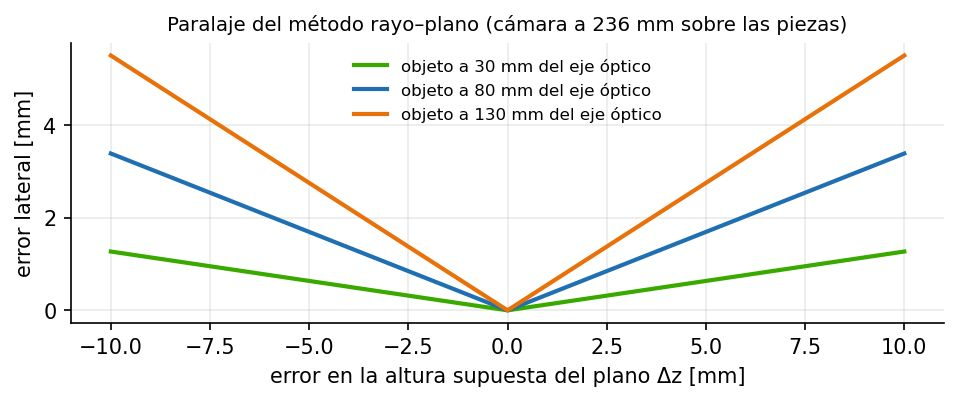
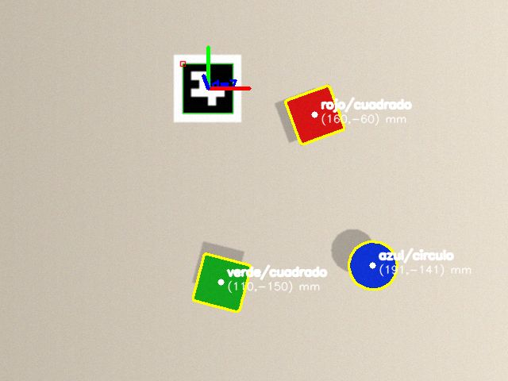

# Documento de Apoyo No. DA-10 – Práctica: detección y localización de objetos (color, forma y marcadores ArUco) en la celda simulada, publicando sus posiciones en tópicos ROS 2.

> Versión en Markdown del documento de apoyo, para consultar y copiar comandos desde GitHub. El documento de Word (formato GFPI-F-135) no se publica en el repositorio.

**Actividad de Aprendizaje:** Detectar y localizar objetos por color, forma y marcadores fiduciales en la celda simulada, publicando su posición 3D en el marco del robot mediante tópicos ROS 2, y cuantificar su exactitud y repetibilidad frente a la posición verdadera de Gazebo.

**Parte de la transferencia:** Parte A – Simulación en el PC.

**Equipo de trabajo:** PC con Ubuntu 22.04 y ROS 2 Humble. No se usa la Jetson ni se energiza el robot.

**Duración Estimada:** 1,5 horas.

**Sesión:** Día 3 – 05/11/2026, 9:30 a.m. – 11:00 a.m.

**Relación con la Guía de Aprendizaje:** Actividad 3.4.2 (transferencia).

> **PARTE A · TRABAJO EN EL PC (SIMULACIÓN):**
>
> Todo el trabajo de este documento se hace en el **PC** con Ubuntu 22.04 y ROS 2 Humble, con el robot simulado (mock y Gazebo) y, cuando se indique, una cámara USB conectada al PC. **No se usa la Jetson ni se energiza el robot.** Cada bloque de comandos indica **Terminal (PC)**.

## 1. OBJETIVOS DE APRENDIZAJE

- Transformar detecciones en píxeles a posiciones 3D en el marco de la base con TF2 y el modelo de cámara.
- Ejecutar los detectores de jc\_vision (color/forma y ArUco) sobre la cámara simulada de Gazebo (con la cámara real se hará en DA-16).
- Publicar y consumir el mensaje `jc_interfaces/DetectedObjectArray` y visualizarlo en RViz2.
- Medir exactitud, repetibilidad y latencia de la localización contra la verdad de Gazebo y analizar las fuentes de error (paralaje).

## 2. FUNDAMENTOS

### 2.1 Del píxel al marco del robot

Para un píxel (u, v), el rayo en el marco óptico es **d**\_c = **K**⁻¹(u, v, 1)ᵀ (tras corregir la distorsión) [1]. Con la transformación **T**\_base←cámara = (**R**, **o**) obtenida de TF2 [7] (cinemática + calibración mano-ojo), el punto sobre el plano horizontal z = z\_p es:

$$P=o+s R {d}_{c},  s=\frac{{z}_{p}-{o}_{z}}{{\left( R {d}_{c} \right)}_{z}} \qquad (1)$$

donde zp es la altura de la cara superior de la pieza (parámetro `plane_z`, 0,025 m para los cubos). La orientación de la pieza en la mesa se obtiene proyectando dos puntos del eje del rectángulo de área mínima (`yaw_in_base`). Si la altura real difiere en Δz, el error lateral es aproximadamente:

$${ε}_{xy}≈\frac{\left| \Delta z \right| r}{h} \qquad (2)$$

con *r* la distancia horizontal de la pieza al eje óptico y *h* la altura de la cámara sobre la pieza (Figura 1). En la pose `observe`, *h* ≈ 236 mm.



*Figura 1. Error lateral por un error en la altura supuesta del plano, ecuación (2).*

### 2.2 Marcadores ArUco

Los marcadores ArUco codifican un identificador en una rejilla binaria con distancia de Hamming mínima entre palabras del diccionario, lo que permite detección robusta y corrección de errores [3], [4]. Conocido su lado *L*, la pose 6D se estima con PnP sobre sus 4 esquinas; para cuadrados planos se usa IPPE [5] (`cv2.SOLVEPNP_IPPE_SQUARE`). El nodo `aruco_detector` publica además el marco TF `aruco_<id>`.

### 2.3 Interfaz de salida

**jc_interfaces/msg/DetectedObject.msg**

```
# Objeto detectado por un nodo de vision (jc_vision).
# header.frame_id indica el marco de 'pose' (p. ej. base_link o camera_optical_frame).
std_msgs/Header header
string label            # clase: "rojo", "aruco_7", "apple", ...
string shape            # forma geometrica: "cuadrado", "circulo", ... (vacio si no aplica)
float32 score           # confianza [0,1] (1.0 para detectores clasicos)
int32 u                 # centro en pixeles (columna)
int32 v                 # centro en pixeles (fila)
float32 width_px
float32 height_px
float32 angle_rad       # orientacion en el plano de la imagen (minAreaRect / marcador)
geometry_msgs/Pose pose # posicion 3D estimada (valida si pose_valid == true)
bool pose_valid
```

*Tabla 1. Salidas de los detectores.*

| **Tópico** | **Tipo** | **Contenido** |
|---|---|---|
| /jc/detections | jc\_interfaces/msg/DetectedObjectArray | Detecciones con pose en `world` |
| /jc/debug\_image | sensor\_msgs/msg/Image | Imagen anotada (contornos, etiquetas, ejes) |
| /jc/markers | visualization\_msgs/msg/MarkerArray | Cubos de colores en RViz2 en la pose estimada |
| /tf (aruco\_&lt;id&gt;) | tf2\_msgs/msg/TFMessage | Pose de cada marcador |

### 2.4 Resultados de validación

La cadena completa (TF del robot → modelo de cámara → segmentación → ecuación (1)) se validó con una cámara sintética que proyecta la escena conocida de la celda con la pose real de la cámara en `observe`, y con los nodos de ROS 2 (`tools/synthetic_camera.py`):



*Figura 2. Detecciones de color/forma y ArUco (ejes) sobre la escena de la celda vista desde observe; las etiquetas indican la posición estimada en mm (marco world).*

*Tabla 2. Exactitud de localización medida en la validación (escena sintética, sin errores de calibración).*

| **Objeto** | **Posición real (x, y) [mm]** | **Estimada (x, y) [mm]** | **Error [mm]** | **Comentario** |
|---|---|---|---|---|
| Cubo rojo | (160,0; −60,0) | (160,1; −59,9) | 0,1 | yaw −70,0° ≡ 20° (simetría 90°) |
| Cubo verde | (110,0; −150,0) | (110,1; −150,1) | 0,1 | yaw −14,7° (real −15°) |
| Cilindro azul | (190,0; −140,0) | (191,3; −140,8) | 1,5 | cara superior a 30 mm con plane\_z = 25 mm (paralaje) |
| ArUco 7 | (100,0; −40,0) | (100,0; −39,7) | 0,3 | pose 6D por PnP; z = −0,2 mm (real 0,6) |

> **Nota:**
>
> Estos errores son el **límite inferior** del método (cámara perfectamente calibrada). Con el robot real se suman los errores de intrínsecos, mano-ojo, cinemática y altura de las piezas; se miden en la Parte B (DA-16).

## 3. PROCEDIMIENTO PASO A PASO

### Paso 0. Actualizar robots_ws

Antes de empezar, traiga lo nuevo del repositorio robots\_ws y vuelva a compilar:

**Terminal 1 (PC)**

```bash
# trae lo nuevo del repositorio (correcciones y mejoras)
cd ~/robots_ws && git pull
colcon build --symlink-install
source install/setup.bash
```

### Paso 1. Detectores en simulación

En la Terminal 1 lance la celda simulada (con GPU para la cámara) y déjela ejecutando:

**Terminal 1 (PC) – déjela ejecutando**

```bash
ros2 launch jc_bringup sim.launch.py
```

En la Terminal 2 lleve el robot a la pose de observación:

**Terminal 2 (PC)**

```bash
ros2 service call /jc/move_to_named jc_interfaces/srv/MoveToNamed "{name: observe}"
```

En la Terminal 3 lance los detectores de color y forma y de ArUco, y déjela ejecutando:

**Terminal 3 (PC) – déjela ejecutando**

```bash
ros2 launch jc_vision vision.launch.py mode:=sim detector:=clasico
```

En la Terminal 4 inspeccione las detecciones; las Terminales 1 y 3 se usan hasta el final del documento:

**Terminal 4 (PC)**

```bash
ros2 topic echo /jc/detections --once
ros2 run rqt_image_view rqt_image_view /jc/debug_image
```

> **Nota:**
>
> Sin GPU: lance `sim.launch.py world:=celda_sin_camara.sdf` y en otra terminal `python3 ~/robots_ws/tools/synthetic_camera.py --ros-args -p use_sim_time:=true -p aruco_png:=$HOME/robots_ws/src/jc_bringup/models/aruco_7/materials/textures/aruco_7.png`.

En RViz2 agregue *MarkerArray* (`/jc/markers`) y *TF*: deben aparecer cubos de colores sobre las piezas y el marco `aruco_7`.

> **INSERTAR IMAGEN / CAPTURA (por el instructor):**
>
> *Captura de RViz2 con el robot en* `observe`*, los marcadores de detección y la imagen de depuración.*

### Paso 2. Analizar el código del detector

Revise en `jc_vision/detector_base.py` la secuencia: suscripción a `Image` y `CameraInfo` (QoS de sensores) → `detect()` → consulta TF `world ← camera_frame` → ecuación (1) → publicación. En `color_shape_detector.py` identifique `hsv_mask`, `find_blobs` y `classify_shape`. Las funciones geométricas (`geometry_utils.py`) tienen pruebas unitarias (`test_geometry_and_handeye.py`): ejecútelas en la Terminal 4 con `colcon test --packages-select jc_vision`.

### Paso 3. Medición de exactitud y repetibilidad en Gazebo

1. Elija 5 posiciones dentro de la zona alcanzable y visible desde `observe` (DA-05, Figura 1).
1. En Gazebo, seleccione el cubo rojo (`pieza_roja`) y desplácelo con la herramienta **Translate** (tecla T) a la primera posición. Lea su posición verdadera en la Terminal 4 con `ign model -m pieza_roja -p`.
1. En la Terminal 4, registre 50 detecciones: `ros2 topic echo /jc/detections --field objects > rojo_P1.txt` (o un nodo propio).
1. Calcule el error medio respecto a la posición verdadera (exactitud) y la desviación estándar (repetibilidad).
1. Repita con el marcador ArUco (modelo `aruco_7`) y con el cilindro azul (`pieza_azul`), cuya cara superior está a 30 mm: compare su error con la ecuación (2).

*Tabla 3. Exactitud y repetibilidad en la celda simulada (diligenciar).*

| **Posición** | **Verdadera en Gazebo (x, y) [mm]** | **Media estimada [mm]** | **Error [mm]** | **σ [mm]** |
|---|---|---|---|---|
| P1 |  |  |  |  |
| P2 |  |  |  |  |
| P3 |  |  |  |  |
| P4 |  |  |  |  |
| P5 |  |  |  |  |

> **Nota:**
>
> Esta tabla es la referencia para la Parte B: en DA-16 se repite la medición con la cámara y el robot reales y se comparan ambos resultados para cuantificar el aporte de los errores de calibración.

### Paso 4. Latencia

Mida el retardo entre la captura y la publicación de detecciones comparando `header.stamp` de `/jc/detections` con el reloj al recibir (nodo propio de 15 líneas) o, en la Terminal 4, con ros2 topic delay `/jc/detections`. Reporte media y percentil 95.

## 4. VERIFICACIÓN Y EVIDENCIAS

*Tabla 4. Evidencias de la práctica.*

| **#** | **Criterio** | **Evidencia** |
|---|---|---|
| 1 | Detecciones publicadas en /jc/detections con pose\_valid en simulación | Salida `topic echo` + captura RViz2 |
| 2 | Detecciones visualizadas en RViz2 y en la imagen de depuración | Captura de RViz2 y de /jc/debug\_image |
| 3 | Exactitud y repetibilidad medidas en 5 posiciones de Gazebo | Tabla 3 |
| 4 | Análisis de fuentes de error (paralaje, calibración) | Párrafo técnico |
| 5 | Latencia medida | Media y p95 |

## 5. SOLUCIÓN DE PROBLEMAS

*Tabla 5. Problemas frecuentes.*

| **Síntoma** | **Causa probable** | **Solución** |
|---|---|---|
| `Esperando CameraInfo...` | Tópico de info distinto | Revisar `camera_info_topic` / modo sim o real |
| `TF world<-camera... no disponible` | Falta robot\_state\_publisher (celda no lanzada) | Lanzar `sim.launch.py`; usar el marco nominal `camera_optical_frame` |
| pose\_valid = false | Rayo paralelo a la mesa o cámara apuntando arriba | Usar pose `observe` |
| Posiciones desplazadas constantes | Error en `plane_z` (altura de la pieza) | Ajustar la altura (ec. 2) |
| Detecciones parpadean | Rangos HSV al límite | Ajustar perfiles; aumentar `min_area` |

## REFERENCIAS

**[1]** R. Hartley y A. Zisserman, *Multiple View Geometry in Computer Vision*, 2nd ed. Cambridge, U.K.: Cambridge University Press, 2004.

**[2]** P. Corke, *Robotics, Vision and Control: Fundamental Algorithms in Python*, 3rd ed. Cham, Switzerland: Springer, 2023, doi: 10.1007/978-3-031-06469-2.

**[3]** S. Garrido-Jurado, R. Muñoz-Salinas, F. J. Madrid-Cuevas y M. J. Marín-Jiménez, "Automatic generation and detection of highly reliable fiducial markers under occlusion," *Pattern Recognition*, vol. 47, no. 6, pp. 2280–2292, 2014, doi: 10.1016/j.patcog.2014.01.005.

**[4]** F. J. Romero-Ramirez, R. Muñoz-Salinas y R. Medina-Carnicer, "Speeded up detection of squared fiducial markers," *Image and Vision Computing*, vol. 76, pp. 38–47, 2018, doi: 10.1016/j.imavis.2018.05.004.

**[5]** T. Collins y A. Bartoli, "Infinitesimal plane-based pose estimation," *International Journal of Computer Vision*, vol. 109, no. 3, pp. 252–286, 2014, doi: 10.1007/s11263-014-0725-5.

**[6]** OpenCV team, *OpenCV 4.x Documentation*. [En línea]. Disponible: [https://docs.opencv.org/4.x/](https://docs.opencv.org/4.x/)

**[7]** T. Foote, "tf: The transform library," en *Proc. IEEE Int. Conf. Technologies for Practical Robot Applications (TePRA)*, 2013, pp. 1–6, doi: 10.1109/TePRA.2013.6556373.

**[8]** T. Foote y M. Purvis, *REP 103 – Standard Units of Measure and Coordinate Conventions*. [En línea]. Disponible: [https://www.ros.org/reps/rep-0103.html](https://www.ros.org/reps/rep-0103.html)

**[9]** J. R. Cháux Cedeño, *robots\_ws – paquetes ROS 2 del curso (repositorio en GitHub, licencia Apache-2.0), 2026. [En línea]. Disponible: https://github.com/jchauxdev/robots\_ws*
