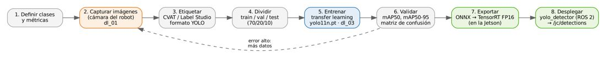
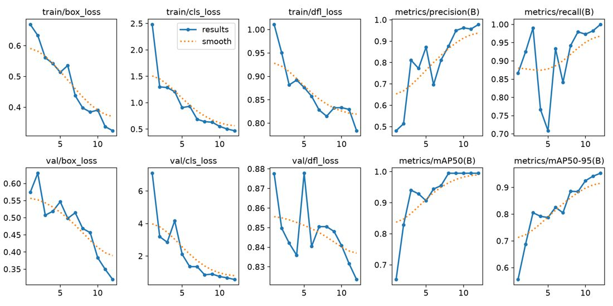
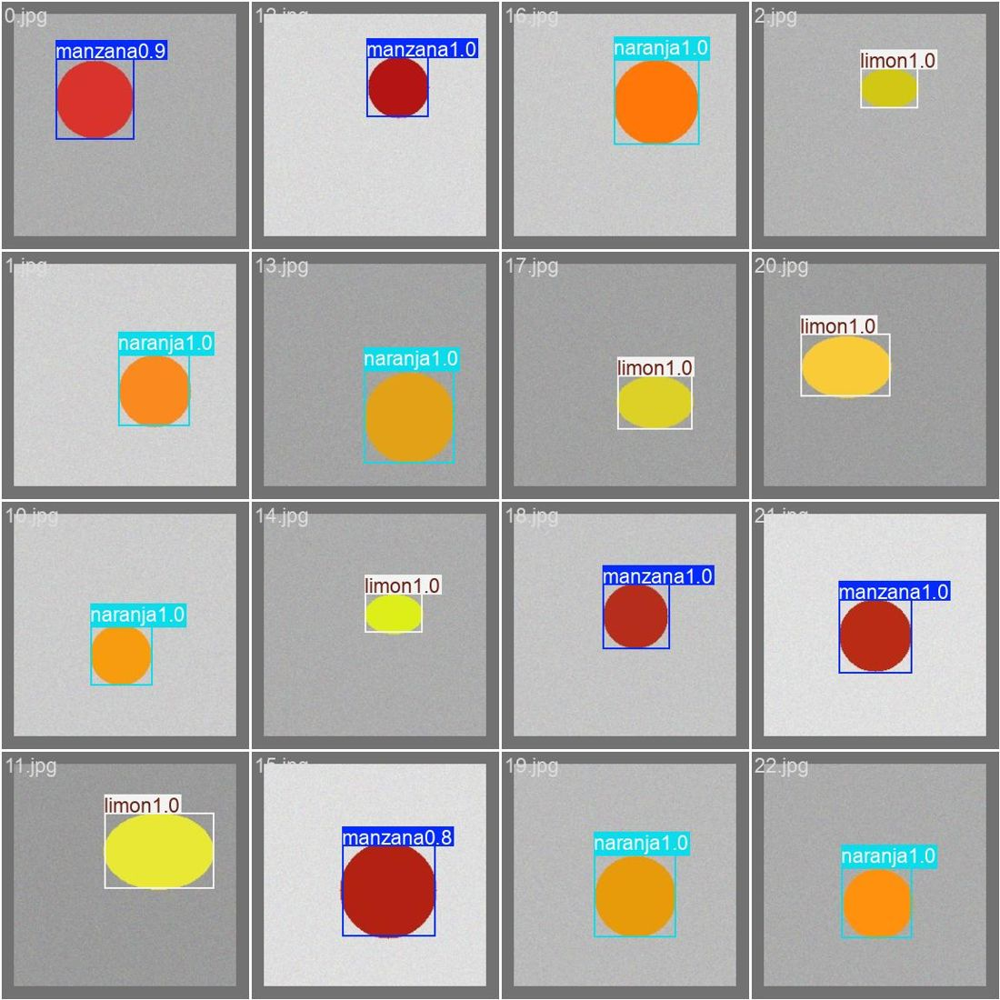

# Documento de Apoyo No. DA-11 – Visión con aprendizaje profundo en el PC: PyTorch, modelos preentrenados y entrenamiento de un detector de frutas.

> Versión en Markdown del documento de apoyo, para consultar y copiar comandos desde GitHub. El documento de Word (formato GFPI-F-135) no se publica en el repositorio.

**Nombre del Proyecto Formativo:** CELDA ROBÓTICA COLABORATIVA CON VISIÓN ARTIFICIAL INTEGRADA EN ROS 2 (JETCOBOT – NVIDIA JETSON AGX ORIN)

**Actividad de Proyecto Formativo:** IMPLEMENTAR UNA CELDA ROBÓTICA COLABORATIVA CON VISIÓN ARTIFICIAL Y ROS 2, DE LA SIMULACIÓN AL ROBOT REAL, Y TRANSFERIR EL CONOCIMIENTO AL CENTRO DE FORMACIÓN.

**Actividad de Aprendizaje:** Desarrollar modelos de aprendizaje profundo (clasificación y detección) con PyTorch y YOLO en el PC, evaluarlos con métricas estándar y probarlos como nodo ROS 2, dejándolos listos para su despliegue en la Jetson.

**Parte de la transferencia:** Parte A – Simulación en el PC.

**Equipo de trabajo:** PC con Ubuntu 22.04 y ROS 2 Humble. No se usa la Jetson ni se energiza el robot.

**Duración Estimada:** 1 hora en sesión + 3 horas de trabajo independiente (captura, etiquetado y entrenamiento).

**Sesión:** Día 3 – 05/11/2026, 11:00 a.m. – 12:00 m.

**Relación con la Guía de Aprendizaje:** Actividad 3.3.8 (apropiación).

> **PARTE A · TRABAJO EN EL PC (SIMULACIÓN):**
>
> Todo el trabajo de este documento se hace en el **PC** con Ubuntu 22.04 y ROS 2 Humble, con el robot simulado (mock y Gazebo) y, cuando se indique, una cámara USB conectada al PC. **No se usa la Jetson ni se energiza el robot.** Cada bloque de comandos indica **Terminal (PC)**.

## 1. OBJETIVOS DE APRENDIZAJE

- Explicar cuándo conviene un modelo de aprendizaje profundo frente a la visión clásica en una celda robótica.
- Usar un detector preentrenado (COCO) para detectar frutas sin entrenamiento.
- Entrenar por transferencia un clasificador (PyTorch/torchvision) y un detector (Ultralytics YOLO) con datos propios.
- Evaluar con IoU, precisión, exhaustividad, mAP50 y mAP50-95, y diagnosticar el sobreajuste.
- Exportar el detector a ONNX y probarlo como nodo ROS 2 en el PC (el despliegue con TensorRT en la Jetson se hace en DA-16).

## 2. FUNDAMENTOS

### 2.1 De la visión clásica al aprendizaje profundo

La segmentación por color (DA-08) es rápida y explicable, pero falla con fondos complejos, objetos de apariencia variable (frutas reales: color no uniforme, brillo, oclusiones) o muchas clases. Las redes convolucionales aprenden las características a partir de datos [1]. PyTorch es la biblioteca de referencia para su desarrollo [2]. Con pocos datos se usa **transferencia de aprendizaje**: las primeras capas de una red entrenada en un gran conjunto de datos son genéricas y se reutilizan [3].

*Tabla 1. Tareas de visión con aprendizaje profundo.*

| **Tarea** | **Salida** | **Modelo de ejemplo en el curso** | **Uso en la celda** |
|---|---|---|---|
| Clasificación | Una clase por imagen | MobileNetV3-Small [4] (dl\_02) | Inspección de una pieza ya ubicada |
| Detección | Cajas + clase + confianza | YOLO11n [6] (dl\_00, dl\_03) | Ubicar y clasificar varias frutas para pick & place |
| Segmentación de instancias | Máscara por objeto | YOLO11n-seg | Orientación y forma precisas (extensión) |

### 2.2 Detectores de una etapa (YOLO)

YOLO formula la detección como una regresión directa de cajas y clases en una sola pasada de la red [5], lo que lo hace adecuado para tiempo real en la Jetson. Ultralytics YOLO11 ofrece modelos n/s/m/l/x preentrenados en COCO [7], que incluye las clases *banana*, *apple*, *orange*, *broccoli* y *carrot*; por eso un modelo **sin entrenar** ya detecta frutas comunes.

> **Precaución:**
>
> Licencia: Ultralytics YOLO se distribuye bajo AGPL-3.0 [6]. Para uso formativo e investigación interna no hay inconveniente; si se integra en un producto o servicio distribuido, revise las obligaciones de la licencia o la licencia empresarial.

### 2.3 Métricas

La coincidencia entre una caja predicha \*B\*\_p y una real \*B\*\_g se mide con la intersección sobre la unión [9]:

$$IoU=\frac{\left| {B}_{p}∩{B}_{g} \right|}{\left| {B}_{p}∪{B}_{g} \right|},  P=\frac{TP}{TP+FP},  R=\frac{TP}{TP+FN} \qquad (1)$$

Una predicción es verdadero positivo si IoU ≥ umbral. La precisión promedio (AP) es el área bajo la curva precisión–exhaustividad; **mAP50** promedia AP sobre las clases con IoU ≥ 0,5 y **mAP50-95** promedia además sobre umbrales 0,50:0,05:0,95 (criterio COCO) [10]:

$$AP=\int_{0}^{1} P\left( R \right) dR,  {mAP}_{50-95}=\frac{1}{10 C}\sum_{c=1}^{C}  \sum_{τ∈{0.50,…,0.95}}^{​} {AP}_{c}\left( τ \right) \qquad (2)$$

### 2.4 Flujo de trabajo



*Figura 1. Flujo de desarrollo de un detector propio, desde los datos hasta el nodo ROS 2.*

*Tabla 2. Buenas prácticas de datos.*

| **Aspecto** | **Recomendación para la celda** |
|---|---|
| Datos | Capturar con **la cámara de la celda** conectada al PC, a una altura y ángulo similares a la pose `observe` (mismo dominio); ≥ 150 instancias por clase como punto de partida; variar posición, orientación, iluminación, fondo y oclusiones. En la Parte B (DA-16) se agregan imágenes tomadas con la cámara montada en el robot. |
| Etiquetado | CVAT [11] o Label Studio, exportando en formato YOLO (una línea por objeto: clase xc yc w h, normalizados). |
| Partición | train/val/test ≈ 70/20/10, separando por sesión de captura para evitar fuga de información. |
| Datos públicos | Fruits-360 (clasificación, fondo blanco) [8]; COCO (detección, escenas generales) [7]. |
| Sim-to-real | Imágenes de Gazebo con aleatorización de dominio pueden complementar, no sustituir, las reales [12]. |

## 3. ENTORNO DE SOFTWARE

### Incorporar al robots_ws el material de este documento

Agregue desde el repositorio robots\_ws la carpeta de prácticas de aprendizaje profundo (son scripts, no paquetes de ROS 2):

| **Se incorpora** | **Qué contiene** |
|---|---|
| `practicas/dia3_deep_learning` | Scripts de PyTorch/YOLO sin ROS: `dl_00` a `dl_03`, el archivo del dataset `frutas.yaml` y `requirements_dl.txt`. |

**Terminal (PC)**

```bash
cd ~/robots_ws && git sparse-checkout add practicas/dia3_deep_learning
```

### Entorno virtual de Python

Todo el entrenamiento y las pruebas de este documento se hacen en el PC. Use un entorno virtual de Python para no alterar los paquetes del sistema:

**Terminal (PC)**

```bash
python3 -m venv ~/venv_dl && source ~/venv_dl/bin/activate
pip install -U pip
# ultralytics, torch, torchvision, onnx, onnxscript
pip install -r ~/robots_ws/practicas/dia3_deep_learning/requirements_dl.txt
python -c "import torch; print(torch.__version__, torch.cuda.is_available())"
```

## 4. PROCEDIMIENTO PASO A PASO

### Paso 1. Detector preentrenado (sin entrenamiento)

**Terminal (PC)**

```bash
cd ~/robots_ws/practicas/dia3_deep_learning
# filtra frutas COCO
python3 dl_00_yolo_preentrenado.py --fuente /dev/video0 --modelo yolo11n.pt
python3 dl_00_yolo_preentrenado.py --fuente foto_frutas.jpg --guardar salida.jpg
```

Coloque frutas reales (banano, manzana, naranja) bajo la cámara y registre qué detecta, con qué confianza y los tiempos por imagen en CPU y GPU.

> **INSERTAR IMAGEN / CAPTURA (por el instructor):**
>
> *Imagen de salida de* `dl_00` *con frutas reales detectadas en la mesa de la celda.*

### Paso 2. Captura del dataset propio

**Terminal (PC)**

```bash
python3 dl_01_captura_dataset.py --fuente /dev/video0 --clase manzana --salida dataset_raw
python3 dl_01_captura_dataset.py --fuente /dev/video0 --clase limon   --salida dataset_raw
```

Etiquete en CVAT (una tarea por clase o mixta), exporte en formato *YOLO 1.1* y organice:

**Terminal (PC)**

```bash
datasets/frutas/images/{train,val,test}/*.jpg
# <clase> <xc> <yc> <w> <h> normalizados
datasets/frutas/labels/{train,val,test}/*.txt
# rutas y nombres de clases (plantilla incluida)
frutas.yaml
```

### Paso 3. Clasificador por transferencia con PyTorch (opcional, conceptual)

**Terminal (PC)**

```bash
python3 dl_02_clasificador_transfer.py --datos datos --epocas 10 --congelar
```

El script reemplaza la última capa de MobileNetV3-Small preentrenada en ImageNet, entrena solo el clasificador (`--congelar`) con aumentación de datos, reporta exactitud y matriz de confusión y exporta a ONNX. Analice el código: `transforms`, `DataLoader`, ciclo `zero_grad/backward/step`, `CosineAnnealingLR`, `label_smoothing`.

### Paso 4. Entrenamiento del detector YOLO

**Terminal (PC)**

```bash
python3 dl_03_yolo_entrenar.py --datos frutas.yaml --modelo yolo11n.pt --epocas 100 --imgsz 640 --lote 16
# resultados en runs/detect/frutas/: results.png, BoxPR_curve.png, confusion_matrix.png, weights/best.pt
```

*Tabla 3. Hiperparámetros principales (dl_03).*

| **Hiperparámetro** | **Valor inicial** | **Efecto** |
|---|---|---|
| epochs / patience | 100 / 30 | Parada temprana si mAP de validación no mejora en 30 épocas. |
| imgsz | 640 | Mayor resolución → mejor en objetos pequeños, más lento. |
| batch | 16 (ajustar a la memoria) | Reducir a 8 si la GPU del PC tiene poca memoria; en CPU usar lotes pequeños. |
| modelo | yolo11n.pt | n/s: tiempo real en Jetson; m/l/x: más exactos y lentos. |
| seed / deterministic | 42 / True | Reproducibilidad del experimento. |

**Validación funcional del material.** Para comprobar los scripts se entrenó YOLO11n (preentrenado en COCO) durante 12 épocas en CPU con un dataset **sintético** de 3 clases (90 imágenes de entrenamiento y 30 de validación). Se obtuvo mAP50 = 0,995 y mAP50-95 = 0,953 (manzana 0,929; naranja 0,984; limón 0,945) y la exportación a ONNX. Estas cifras solo demuestran que la cadena funciona: un dataset real será más difícil.



*Figura 2. Curvas de entrenamiento generadas por dl_03 en la prueba funcional (dataset sintético): pérdidas de caja, clase y DFL, precisión, exhaustividad y mAP por época.*



*Figura 3. Predicciones sobre el lote de validación en la prueba funcional.*

Interprete con su dataset real: si la pérdida de entrenamiento baja y la de validación sube → sobreajuste (más datos, más aumentación, modelo más pequeño); si ambas son altas → subajuste (más épocas, modelo mayor, revisar etiquetas).

*Tabla 4. Resultados del detector del equipo (diligenciar).*

| **Métrica** | **Validación** | **Prueba (test)** |
|---|---|---|
| mAP50 |  |  |
| mAP50-95 |  |  |
| Precisión |  |  |
| Exhaustividad |  |  |

### Paso 5. Exportación a ONNX y prueba del nodo ROS 2 en el PC

Al terminar el entrenamiento, `dl_03` exporta automáticamente `best.onnx` junto a `best.pt`. Pruebe el detector como nodo ROS 2 con la cámara conectada al PC. La celda en modo *mock* se lanza solo para que exista el árbol TF de la cámara:

**Terminal (PC)**

```bash
ros2 launch jc_bringup mock.launch.py
ros2 run jc_vision camera_node --ros-args -p device:=/dev/video0
ros2 run jc_vision yolo_detector --ros-args -p model:=$HOME/robots_ws/practicas/dia3_deep_learning/runs/detect/frutas/weights/best.pt \
     -p conf:=0.5 -p image_topic:=/camera/image_raw -p camera_info_topic:=/camera/camera_info
ros2 run rqt_image_view rqt_image_view /jc/debug_image
```

Verifique en `/jc/debug_image` las cajas, clases y confianzas. Las posiciones 3D publicadas en `/jc/detections` **no son significativas todavía**, porque la cámara no está montada en el robot: la localización real y el despliegue con TensorRT en la Jetson se hacen en la Parte B (DA-16). Para el modelo preentrenado COCO filtre clases con `-p classes:="['apple','orange','banana']"`.

> **INSERTAR IMAGEN / CAPTURA (por el instructor):**
>
> *Captura de* `/jc/debug_image` *con las frutas detectadas por el modelo del equipo.*

## 5. VERIFICACIÓN Y EVIDENCIAS

*Tabla 5. Evidencias de la actividad.*

| **#** | **Criterio** | **Evidencia** |
|---|---|---|
| 1 | Detección de frutas con modelo preentrenado y tiempos medidos | Imagen + tiempos |
| 2 | Dataset propio etiquetado y particionado sin fuga de información | Estructura + estadísticas por clase |
| 3 | Detector entrenado con métricas de validación y prueba | Tabla 4 + curvas |
| 4 | Modelo exportado a ONNX y nodo ROS 2 probado en el PC | Captura de /jc/debug\_image |

## 6. SOLUCIÓN DE PROBLEMAS

*Tabla 6. Problemas frecuentes.*

| **Síntoma** | **Causa probable** | **Solución** |
|---|---|---|
| `torch.cuda.is_available()` = False en el PC | Sin GPU NVIDIA o controlador/CUDA no instalado | Entrenar en CPU con menos épocas e `imgsz` 320, o usar un PC con GPU |
| Error de memoria al entrenar | Lote o imgsz grandes | Reducir `--lote` / `--imgsz`; cerrar Gazebo/RViz |
| `torch.onnx.export` pide `onnxscript` | Exportador nuevo de PyTorch ≥ 2.5 | `pip install onnx onnxscript` |
| mAP alto en validación, malo en el robot | Dominio distinto o fuga de datos | Capturar con la cámara del robot; partir por sesión |

## REFERENCIAS

**[1]** I. Goodfellow, Y. Bengio y A. Courville, *Deep Learning*. Cambridge, MA, USA: MIT Press, 2016.

**[2]** A. Paszke *et al.*, "PyTorch: An imperative style, high-performance deep learning library," en *Advances in Neural Information Processing Systems 32 (NeurIPS)*, 2019, pp. 8024–8035, arXiv: 1912.01703.

**[3]** J. Yosinski, J. Clune, Y. Bengio y H. Lipson, "How transferable are features in deep neural networks?," en *Advances in Neural Information Processing Systems 27 (NeurIPS)*, 2014, arXiv: 1411.1792.

**[4]** A. Howard *et al.*, "Searching for MobileNetV3," en *Proc. IEEE/CVF ICCV*, 2019, pp. 1314–1324, doi: 10.1109/ICCV.2019.00140.

**[5]** J. Redmon, S. Divvala, R. Girshick y A. Farhadi, "You Only Look Once: Unified, real-time object detection," en *Proc. IEEE CVPR*, 2016, pp. 779–788, doi: 10.1109/CVPR.2016.91.

**[6]** G. Jocher y J. Qiu, *Ultralytics YOLO11*, versión 11.0.0, 2024. [En línea]. Disponible: [https://github.com/ultralytics/ultralytics](https://github.com/ultralytics/ultralytics) (licencia AGPL-3.0).

**[7]** T.-Y. Lin *et al.*, "Microsoft COCO: Common objects in context," en *Proc. ECCV*, 2014, pp. 740–755, doi: 10.1007/978-3-319-10602-1\_48.

**[8]** H. Mureşan y M. Oltean, "Fruit recognition from images using deep learning," *Acta Universitatis Sapientiae, Informatica*, vol. 10, no. 1, pp. 26–42, 2018, doi: 10.2478/ausi-2018-0002.

**[9]** M. Everingham, L. Van Gool, C. K. I. Williams, J. Winn y A. Zisserman, "The PASCAL Visual Object Classes (VOC) challenge," *International Journal of Computer Vision*, vol. 88, no. 2, pp. 303–338, 2010, doi: 10.1007/s11263-009-0275-4.

**[10]** R. Padilla, S. L. Netto y E. A. B. da Silva, "A survey on performance metrics for object-detection algorithms," en *Proc. IWSSIP*, 2020, pp. 237–242, doi: 10.1109/IWSSIP48289.2020.9145130.

**[11]** CVAT.ai, *Computer Vision Annotation Tool (CVAT)*. [En línea]. Disponible: [https://github.com/cvat-ai/cvat](https://github.com/cvat-ai/cvat)

**[12]** J. Tobin *et al.*, "Domain randomization for transferring deep neural networks from simulation to the real world," en *Proc. IEEE/RSJ IROS*, 2017, pp. 23–30, doi: 10.1109/IROS.2017.8202133.

**[13]** J. R. Cháux Cedeño, *robots\_ws – paquetes ROS 2 del curso (repositorio en GitHub, licencia Apache-2.0), 2026. [En línea]. Disponible: https://github.com/jchauxdev/robots\_ws*
