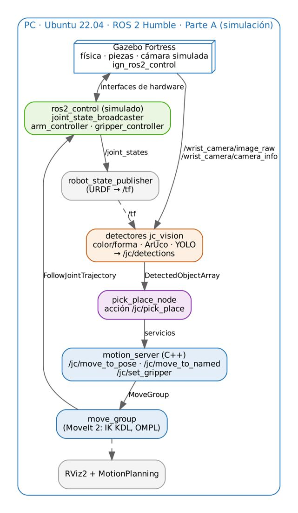
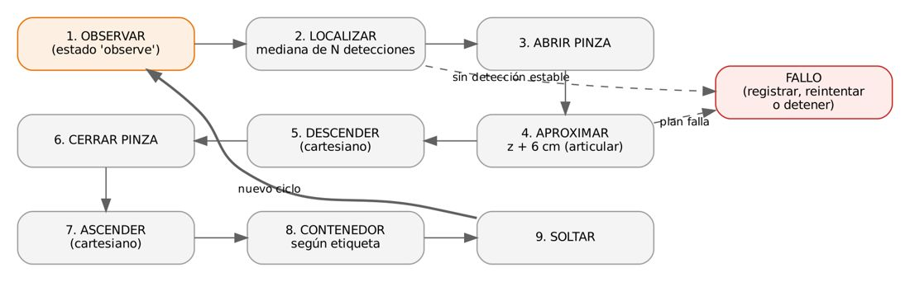
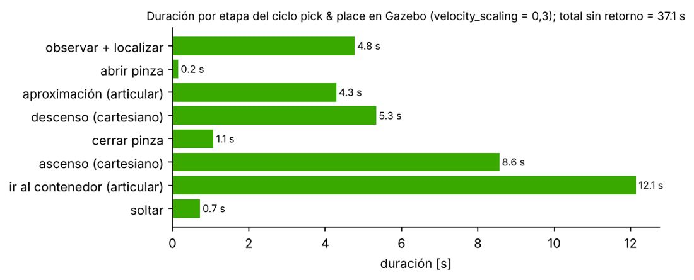

# Documento de Apoyo No. DA-12 – Práctica: integración visión–cobot en la celda simulada y planteamiento del proyecto final.

> Versión en Markdown del documento de apoyo, para consultar y copiar comandos desde GitHub. El documento de Word (formato GFPI-F-135) no se publica en el repositorio.

**Nombre del Proyecto Formativo:** CELDA ROBÓTICA COLABORATIVA CON VISIÓN ARTIFICIAL INTEGRADA EN ROS 2 (JETCOBOT – NVIDIA JETSON AGX ORIN)

**Actividad de Proyecto Formativo:** IMPLEMENTAR UNA CELDA ROBÓTICA COLABORATIVA CON VISIÓN ARTIFICIAL Y ROS 2, DE LA SIMULACIÓN AL ROBOT REAL, Y TRANSFERIR EL CONOCIMIENTO AL CENTRO DE FORMACIÓN.

**Actividad de Aprendizaje:** Integrar visión artificial, planificación de movimientos y control del cobot en una aplicación ROS 2 funcional sobre la celda simulada, con criterios de aceptación medibles, como base del proyecto final.

**Parte de la transferencia:** Parte A – Simulación en el PC.

**Equipo de trabajo:** PC con Ubuntu 22.04 y ROS 2 Humble. No se usa la Jetson ni se energiza el robot.

**Duración Estimada:** 1 hora.

**Sesión:** Día 3 – 05/11/2026, 1:30 p.m. – 2:30 p.m.

**Relación con la Guía de Aprendizaje:** Actividad 3.4.3 (transferencia). Cierra la Parte A.

> **PARTE A · TRABAJO EN EL PC (SIMULACIÓN):**
>
> Todo el trabajo de este documento se hace en el **PC** con Ubuntu 22.04 y ROS 2 Humble, con el robot simulado (mock y Gazebo) y, cuando se indique, una cámara USB conectada al PC. **No se usa la Jetson ni se energiza el robot.** Cada bloque de comandos indica **Terminal (PC)**.

## 1. OBJETIVOS DE APRENDIZAJE

- Integrar percepción (jc\_vision), decisión (`pick_place_node`) y movimiento (MoveIt 2 + controladores) en la celda simulada.
- Conocer el enunciado y los requisitos del proyecto final y cumplir en simulación el requisito R1.
- Medir la línea base del tiempo de ciclo en simulación y su desglose por etapa.
- Preparar el paso a la Parte B: identificar qué cambia (y qué no) al pasar al robot real.

## 2. ARQUITECTURA INTEGRADA EN SIMULACIÓN



*Figura 1. Arquitectura de la celda integrada en el PC (Parte A). En la Parte B, el driver del robot y la cámara USB reemplazan a Gazebo y los nodos pasan a la Jetson (DA-17).*

El nodo `pick_place_node` implementa la máquina de estados de la Figura 2 y expone la acción `/jc/pick_place`. Para cada ciclo: observa desde `observe`, toma la **mediana** de las detecciones de una ventana de 1 s (robustez ante ruido), elige el yaw del TCP equivalente por simetría más cercano a −90° (minimiza el giro de J6), y ejecuta aproximación articular, descenso y ascenso cartesianos, cierre/apertura de pinza y depósito en el contenedor asignado a la etiqueta (`config/celda.yaml`).



*Figura 2. Máquina de estados del ciclo de recogida y depósito.*

$${ψ}_{tcp}=argmin\left| wrap​\left( {ψ}_{obj}+k \frac{2\pi }{{n}_{s}}-\left( -\frac{\pi }{2} \right) \right) \right| \qquad (1)$$

donde nₛ es el orden de simetría de la pieza (4 para el cubo). La validación en Gazebo (DA-06) produjo un ciclo completo exitoso; la Figura 3 muestra su descomposición temporal, base para la optimización.



*Figura 3. Tiempos medidos por etapa en el ciclo validado en Gazebo. Los tramos cartesianos (escalado 0,15) y el traslado al contenedor dominan el tiempo de ciclo.*

## 3. ENUNCIADO DEL PROYECTO FINAL

> **Reto:**
>
> **Celda colaborativa de clasificación.** Sobre la mesa se disponen al azar 3–6 objetos (cubos de color, piezas con ArUco o frutas). La celda debe localizarlos con visión, recogerlos uno a uno y depositarlos en el contenedor que corresponde a su clase, deteniéndose de forma segura si una persona solicita la parada.
>
> Cada equipo elige una variante: (A) color/forma; (B) ArUco con orientación; (C) frutas con YOLO (DA-11).
>
> El proyecto se desarrolla en dos momentos: **en simulación** en este documento (requisito R1) y **con el robot real** en la Parte B (DA-17, requisitos R2 a R6).

*Tabla 1. Requisitos y criterios de aceptación del proyecto.*

| **Requisito** | **Criterio de aceptación** | **Cómo se mide** | **Parte** |
|---|---|---|---|
| R1. Simulación | ≥ 9/10 ciclos exitosos en Gazebo | Registro de la acción `/jc/pick_place` (success) | A (DA-12) |
| R2. Robot real | ≥ 8/10 ciclos exitosos a escalado ≤ 0,3 | Observación + registro | B (DA-17) |
| R3. Exactitud | Error de localización medio ≤ 5 mm (real) | Tabla de DA-16 | B (DA-16) |
| R4. Tiempo de ciclo | Reportado y reducido ≥ 20 % respecto a la línea base | Marcas de tiempo de la realimentación | A y B |
| R5. Seguridad | Parada funcional (cancelación de la acción + `stop`); zona señalizada | Prueba en la sustentación | B (DA-17) |
| R6. Ingeniería | Código en Git, launch reproducible, README con instrucciones | Revisión del repositorio | A y B |

## 4. PROCEDIMIENTO

### Paso 1. Integrar la celda en Gazebo

**Terminal (PC)**

```bash
# Terminal 1: celda simulada completa
ros2 launch jc_bringup sim.launch.py
# Terminal 2: visión + pick & place (modo manual por acción)
ros2 launch jc_apps celda.launch.py mode:=sim detector:=clasico
# Terminal 3: ordenar una recogida
ros2 action send_goal --feedback /jc/pick_place jc_interfaces/action/PickPlace "{label: rojo, use_place_pose: false}"
# modo automático (clasifica todo lo que vea):
ros2 launch jc_apps celda.launch.py mode:=sim detector:=clasico auto_sort:=true
```

> **Resultado esperado:**
>
> Realimentación por etapas (`observar`, `abrir pinza`, …, `retorno`) y `success: true`. En la validación del material el cubo rojo pasó de (0,160; −0,060) m a (0,020; 0,175) m en Gazebo, a 4,7 mm del objetivo, con la cadena completa visión → `pick_place_node` → MoveIt → física.

> **Nota:**
>
> Sin GPU: `sim.launch.py world:=celda_sin_camara.sdf` y la cámara sintética del material (`tools/synthetic_camera.py`, ver DA-10), que proyecta la escena con la pose real de la cámara.

Parámetros de percepción del ciclo (`config/celda.yaml`): `settle_time` (espera tras llegar a `observe`), `detection_window`, `min_detections` y `detection_timeout`: el nodo acumula detecciones nuevas hasta reunir el mínimo o agotar el tiempo, lo que lo hace robusto a cámaras lentas.

### Paso 2. Requisito R1: 10 ciclos en simulación

Reubique las piezas en Gazebo (herramienta Translate) entre ciclos para que no se repita siempre la misma posición, ejecute 10 ciclos y registre el resultado:

*Tabla 2. Registro de ciclos en simulación (diligenciar).*

| **Ciclo** | **Objeto** | **Éxito (S/N)** | **Etapa de fallo** | **Causa raíz** | **Tiempo [s]** |
|---|---|---|---|---|---|
| 1 |  |  |  |  |  |
| 2 |  |  |  |  |  |
| 3 |  |  |  |  |  |
| 4 |  |  |  |  |  |
| 5 |  |  |  |  |  |
| 6 |  |  |  |  |  |
| 7 |  |  |  |  |  |
| 8 |  |  |  |  |  |
| 9 |  |  |  |  |  |
| 10 |  |  |  |  |  |

### Paso 3. Línea base del tiempo de ciclo

Grabe `ros2 bag record /jc/detections /joint_states /jc/pick_place/_action/feedback` durante 3 ciclos y obtenga la duración de cada etapa a partir de las marcas de tiempo de la realimentación (como en la Figura 3). La parametrización temporal TOTG de MoveIt ya minimiza el tiempo de cada trayectoria [4]; las palancas de optimización están en DA-17.

*Tabla 3. Línea base del tiempo de ciclo en simulación (diligenciar).*

| **Etapa** | **Duración media en simulación [s]** |
|---|---|
| observar + localizar |  |
| aproximación |  |
| descenso |  |
| cerrar |  |
| ascenso |  |
| contenedor |  |
| soltar |  |
| retorno |  |
| TOTAL |  |

### Paso 4. Preparar el paso a la Parte B

Los nodos y las interfaces son los mismos con el robot real. Antes de pasar a la Jetson, revise la lista:

*Tabla 4. Qué cambia al pasar de la simulación al robot real.*

| **Elemento** | **En simulación (Parte A)** | **Con el robot real (Parte B)** |
|---|---|---|
| Lanzador de la celda | `sim.launch.py` en el PC | `real.launch.py` en la Jetson (DA-13, DA-14) |
| Imagen | `/wrist_camera/image_raw` (Gazebo) | `/camera/image_raw` (cámara USB en la Jetson) |
| Marco de la cámara | `camera_optical_frame` (exacto del modelo) | `camera_calibrated_optical` (mano-ojo real, DA-16) |
| Perfiles HSV | Colores de Gazebo | Recalibrados con la cámara del robot (DA-16) |
| Modelo YOLO | `best.pt` en el PC | `best.engine` (TensorRT) en la Jetson (DA-16) |
| Velocidad | Escalado libre | Escalado ≤ 0,3 y protocolo de seguridad (DA-14) |
| Código del equipo | Paquete `mi_celda` en el PC | El mismo paquete, sincronizado con Git en la Jetson (DA-13) |

Este cambio controlado es la razón del principio *primero simulación*: lo que falla con el robot real se puede atribuir a lo que cambió (calibración, iluminación, dinámica), no al programa [5].

## 5. VERIFICACIÓN Y EVIDENCIAS

*Tabla 5. Evidencias de la actividad.*

| **#** | **Criterio** | **Evidencia** |
|---|---|---|
| 1 | Ciclo integrado ejecutado en Gazebo con `success: true` | Registro de la acción |
| 2 | Requisito R1: ≥ 9/10 ciclos exitosos en simulación | Tabla 2 |
| 3 | Línea base del tiempo de ciclo por etapa | Tabla 3 + bag |
| 4 | Código del equipo versionado en Git y listo para la Parte B | Repositorio y Tabla 4 revisada |

## 6. SOLUCIÓN DE PROBLEMAS

*Tabla 6. Problemas frecuentes.*

| **Síntoma** | **Causa probable** | **Solución** |
|---|---|---|
| `pick_place_node` no encuentra el objeto | Sin detecciones nuevas en la ventana | Revisar `/jc/detections`; aumentar `detection_timeout` |
| El cubo se resbala de la pinza | Fricción o cierre insuficiente | Revisar `mu1`/`mu2` (DA-06) y la apertura de cierre |
| MoveIt no encuentra IK en el depósito | Contenedor fuera de la corona alcanzable | Ubicar depósitos según DA-05, Figura 1 |
| Ciclo lento con cámara sintética | Cámara a pocos Hz | Es esperado; el nodo acumula detecciones hasta `min_detections` |

## REFERENCIAS

**[1]** D. Coleman, I. A. Şucan, S. Chitta y N. Correll, "Reducing the barrier to entry of complex robotic software: a MoveIt! case study," *Journal of Software Engineering for Robotics*, vol. 5, no. 1, pp. 3–16, 2014, arXiv: 1404.3785.

**[2]** PickNik Robotics, *MoveIt 2 Documentation – Humble*. [En línea]. Disponible: [https://moveit.picknik.ai/humble/](https://moveit.picknik.ai/humble/)

**[3]** Open Robotics, *ROS 2 Documentation: Humble Hawksbill*. [En línea]. Disponible: [https://docs.ros.org/en/humble/](https://docs.ros.org/en/humble/)

**[4]** T. Kunz y M. Stilman, "Time-optimal trajectory generation for path following with bounded acceleration and velocity," en *Robotics: Science and Systems VIII*, 2012, doi: 10.15607/RSS.2012.VIII.027.

**[5]** J. Tobin *et al.*, "Domain randomization for transferring deep neural networks from simulation to the real world," en *Proc. IEEE/RSJ IROS*, 2017, pp. 23–30, doi: 10.1109/IROS.2017.8202133.

**[6]** J. R. Cháux Cedeño, *robots\_ws – paquetes ROS 2 del curso (repositorio en GitHub, licencia Apache-2.0), 2026. [En línea]. Disponible: https://github.com/jchauxdev/robots\_ws*
