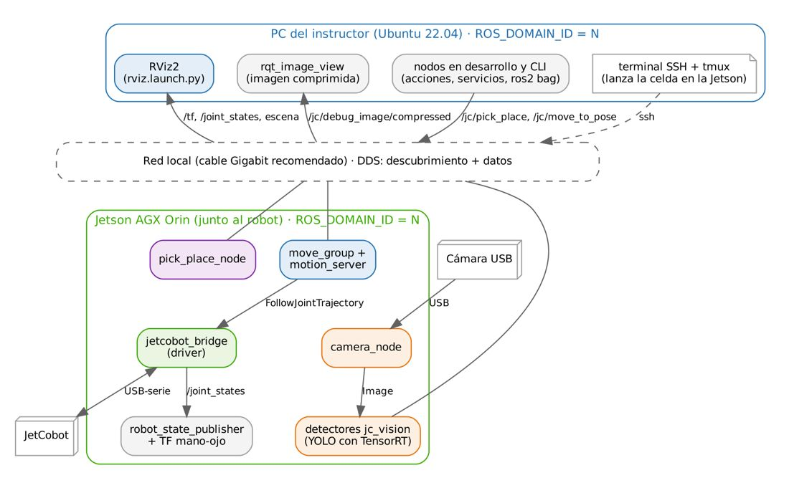

# Documento de Apoyo No. DA-13 – Jetson AGX Orin: ROS 2 Humble en el computador del robot y ejecución distribuida con el PC.

> Versión en Markdown del documento de apoyo, para consultar y copiar comandos desde GitHub. El documento de Word (formato GFPI-F-135) no se publica en el repositorio.

**Actividad de Aprendizaje:** Preparar la NVIDIA Jetson AGX Orin como computador del robot (ROS 2 Humble, espacio de trabajo, red y acceso remoto) y verificar la ejecución distribuida Jetson–PC antes de conectar el cobot.

**Parte de la transferencia:** Parte B – Robot real con la Jetson AGX Orin.

**Equipo de trabajo:** Jetson AGX Orin conectada al JetCobot (y a la cámara) + PC en la misma red y con el mismo ROS\_DOMAIN\_ID.

**Duración Estimada:** 1 hora en sesión. Los Pasos 1 a 5 (instalación en la Jetson) se ejecutan antes de la sesión como preparación del instructor o trabajo independiente.

**Sesión:** Día 3 – 05/11/2026, 2:30 p.m. – 3:30 p.m.

**Relación con la Guía de Aprendizaje:** Actividad 3.3.9 (apropiación). Inicia la Parte B.

> **PARTE B · TRABAJO CON EL ROBOT (JETSON AGX ORIN + JETCOBOT):**
>
> Este documento se trabaja con la **Jetson AGX Orin** conectada al JetCobot y con el **PC** en la misma red. Cada bloque de comandos indica dónde se ejecuta: **Terminal (Jetson)** o **Terminal (PC)**. Requisito: haber completado la Parte A en simulación (DA-02 a DA-12).

Aquí comienza el trabajo con el hardware. Todo lo que se desarrolló en la Parte A (DA-02 a DA-12) se ejecutará ahora repartido entre la **Jetson**, que está junto al robot, y el **PC**, desde el que se visualiza, se dan órdenes y se desarrolla. En este documento todavía **no se conecta el JetCobot**: primero se verifica que la Jetson y el PC trabajan juntos con el robot simulado.

## 1. OBJETIVOS DE APRENDIZAJE

- Verificar que la Jetson tiene JetPack 6.2 (Ubuntu 22.04), condición para usar ROS 2 Humble con binarios oficiales.
- Instalar ROS 2 Humble, los paquetes de la transferencia y `pymycobot` en la Jetson, y compilar robots\_ws.
- Configurar la comunicación ROS 2 entre la Jetson y el PC (`ROS_DOMAIN_ID`, `ROS_LOCALHOST_ONLY=0`).
- Operar la Jetson desde el PC (SSH, tmux) y distribuir los nodos entre ambos equipos.
- Verificar la ejecución distribuida con el robot simulado antes de conectar el JetCobot.

## 2. FUNDAMENTOS

### 2.1 JetPack 6.2 y ROS 2 Humble

La Jetson AGX Orin con **JetPack 6.2** usa Jetson Linux 36.4.3, cuyo sistema de archivos raíz es Ubuntu 22.04, con CUDA 12.6, cuDNN 9.3 y TensorRT 10.3 [3]. Ubuntu 22.04 en arm64 es plataforma de primer nivel de Humble [1], por lo que ROS 2 se instala en la Jetson con los mismos paquetes binarios que en el PC. Además, el material oficial del fabricante del robot para JetPack 6.2 (cursos de ROS 2, URDF y MoveIt 2) está construido sobre Humble [5], lo que facilita contrastar resultados.

> **Precaución:**
>
> Los scripts actuales del instructor se ejecutaron con Python 3.8 (cachés `cpython-38`), lo que corresponde a Ubuntu 20.04 / JetPack 5.x. **Humble no tiene binarios oficiales para Ubuntu 20.04** [1]. Si la Jetson está en JetPack 5.x, las opciones son: (a) **recomendado:** reinstalar con JetPack 6.2 mediante NVIDIA SDK Manager; (b) usar un contenedor Docker con ROS 2 Humble para Jetson. La opción (a) es la que se asume en todo el portafolio.

### 2.2 Roles de cada equipo de cómputo

*Tabla 1. Plataforma de cómputo de la Parte B y distribución de funciones.*

| **Elemento** | **Especificación verificada** | **Rol en la celda** |
|---|---|---|
| NVIDIA Jetson AGX Orin 32 GB | GPU Ampere de 1792 núcleos CUDA y 56 Tensor Cores; CPU Arm Cortex-A78AE de 8 núcleos; 32 GB LPDDR5 (204,8 GB/s); hasta 200 TOPS INT8 (dispersos); 15–60 W configurables [4]. | Computador del robot: driver del JetCobot, cámara, MoveIt 2, visión e inferencia con TensorRT. |
| PC (el mismo de la Parte A) | Ubuntu 22.04 amd64 con ROS 2 Humble y robots\_ws (DA-02). | Visualización (RViz2), órdenes, desarrollo y grabación de datos. |
| JetCobot (Yahboom) | Brazo de 6 GDL + pinza, alcance efectivo ~270 mm según el fabricante [5]; API `pymycobot` (clase `MyCobot280`) por puerto serie [6]. | Manipulador colaborativo de la celda (DA-14). |
| Red local | Misma subred para Jetson y PC (cableada preferiblemente). | Comunicación ROS 2 (DDS) distribuida. |

### 2.3 ¿Dónde se ejecuta cada cosa?

El espacio de trabajo robots\_ws se compila en los dos equipos (el mismo código fuente compila en amd64 y en arm64). En la Parte B los nodos se reparten así:

*Tabla 2. Distribución de nodos en la Parte B.*

| **Equipo** | **Nodos y tareas** |
|---|---|
| Jetson AGX Orin (junto al robot) | Driver `jetcobot_bridge`, `camera_node`, `robot_state_publisher` + TF mano-ojo, `move_group` + `motion_server`, detectores (YOLO con TensorRT), `pick_place_node`. |
| PC | RViz2 (`rviz.launch.py`), `rqt_image_view`, nodos en desarrollo, CLI (`ros2 action`, `ros2 service`), `ros2 bag`, terminal SSH. |

Los nodos que tocan hardware o tienen requisitos de tiempo (driver, cámara, MoveIt, visión) corren en la Jetson: el robot y la cámara están conectados a ella por USB, la percepción y el control no dependen de la red y la GPU acelera la inferencia. Como ROS 2 es distribuido (DDS), con la **misma red** y el **mismo** `ROS_DOMAIN_ID` el PC ve todos los tópicos, servicios y acciones de la Jetson sin configuración adicional (Figura 1). Un nodo que solo comanda, como `trajectory_demo`, puede ejecutarse en el PC y mover el robot real.



*Figura 1. Ejecución distribuida de la celda real entre la Jetson y el PC.*

> **Precaución:**
>
> **Un dominio por pareja Jetson–PC.** Equipo N usa `ROS_DOMAIN_ID=N` en su Jetson y en su PC; si dos equipos comparten dominio, cada PC verá y podrá **comandar el robot del otro**.
>
> **No mezcle simulación y robot en el mismo dominio.** Si el PC lanza `mock`/`sim` mientras está en el dominio de la Jetson, habrá dos `move_group`, dos `robot_state_publisher` y dos `/joint_states`. Para volver a simular en el PC, use `export ROS_LOCALHOST_ONLY=1` en esa terminal (o un dominio distinto, p. ej. N+50).
>
> **Ancho de banda de imágenes.** Una imagen 640×480 BGR sin comprimir ocupa 0,92 MB (medido): a 30 FPS son ≈ 221 Mbit/s, inviable por Wi-Fi. Vea en el PC solo la imagen **comprimida** (Paso 8).
>
> **Relojes sincronizados.** Las TF y los mensajes llevan marca de tiempo de la Jetson; si el reloj del PC difiere, RViz2 mostrará advertencias de extrapolación. Sincronice ambos con NTP (`chrony`).

## 3. MATERIALES

- Jetson AGX Orin 32 GB con JetPack 6.2 (Ubuntu 22.04), teclado, monitor o acceso SSH/VNC, conexión a Internet.
- El PC de la Parte A con robots\_ws compilado y su paquete `mi_celda` en un repositorio Git.
- Cable de red (recomendado) o red Wi-Fi sin aislamiento de clientes. El JetCobot **aún no** se conecta.

## 4. PROCEDIMIENTO PASO A PASO

> **Primera conexión sin monitor:**
>
> La AGX Orin no trae usuario ni contraseña por defecto: se crean en la configuración inicial (oem-config) del primer arranque. Sin monitor, conecte al PC el USB-C que está junto al conector de 40 pines y haga esa configuración por la consola serie (`sudo screen /dev/ttyACM0 115200`; en Windows, PuTTY a 115200 baudios). Luego entre por el mismo cable con `ssh usuario@192.168.55.1` (por USB la Jetson siempre tiene esa dirección), conéctela a la red con `sudo nmcli device wifi connect "RED" password "CLAVE"` y use en adelante la IP que muestra `hostname -I`. Desde ese momento, los bloques «Terminal (Jetson)» se ejecutan por SSH. Si el PC ya se había conectado a otra Jetson por 192.168.55.1, SSH rechaza la conexión con `REMOTE HOST IDENTIFICATION HAS CHANGED!`: borre la huella anterior con `ssh-keygen -R 192.168.55.1` y vuelva a conectarse.

### Paso 1. Verificar la versión del sistema en la Jetson

**Terminal (Jetson)**

```bash
# debe indicar R36 (REVISION 4.x) = JetPack 6.x
cat /etc/nv_tegra_release
# Ubuntu 22.04.x LTS (jammy)
lsb_release -a
# Python 3.10.x
python3 --version
# aarch64
uname -m
# modo de potencia actual
sudo nvpmodel -q
# opcional: 'jtop'
sudo apt install -y python3-pip && sudo pip3 install -U jetson-stats
```

> **Resultado esperado:**
>
> R36 / Ubuntu 22.04 / Python 3.10 / aarch64. Si aparece R35 o Ubuntu 20.04, vea la Precaución de la sección 2.1.

Para pruebas de rendimiento active el modo de máxima potencia y frecuencias fijas (revierta al terminar):

**Terminal (Jetson)**

```bash
# MAXN en AGX Orin (verifique con 'sudo nvpmodel -q')
sudo nvpmodel -m 0
# fija frecuencias máximas hasta el próximo reinicio
sudo jetson_clocks
```

### Paso 2. Instalar ROS 2 Humble y los paquetes en la Jetson

Ejecute en la Jetson **los mismos Pasos 2, 3 y 4 de DA-02** (idioma, repositorio `ros2-apt-source`, `ros-humble-desktop`, `ros-dev-tools` y paquetes de la transferencia). En la Jetson se instala además la biblioteca del robot, `pymycobot` ≥ 3.6, que expone la clase `MyCobot280` usada por el driver [6]:

**Terminal (Jetson)**

```bash
sudo apt update && sudo apt upgrade -y
sudo apt install -y ros-humble-desktop ros-dev-tools
# ... paquetes de la transferencia: mismo comando del Paso 4 de DA-02 ...
python3 -m pip install --user "pymycobot>=3.6"
# permiso para el puerto serie del robot (cerrar sesión y volver a entrar)
sudo usermod -aG dialout $USER
```

### Paso 3. Verificar la instalación de ROS 2 en la Jetson

**Terminal (Jetson)**

```bash
source /opt/ros/humble/setup.bash
# debe mostrar: humble
printenv ROS_DISTRO
# debe mostrar: 2
printenv ROS_VERSION
# todas las variables de ROS cargadas
printenv | grep -i ^ros
# distribution name: humble
ros2 doctor --report | grep -A4 "ROS 2 INFORMATION"
python3 -c "import pymycobot; print(pymycobot.__version__)"
```

Si `printenv ROS_DISTRO` no muestra nada, el entorno no está cargado: verifique que existe `/opt/ros/humble/setup.bash` y vuelva a ejecutar `source`; si el archivo no existe, repita el Paso 2.

### Paso 4. Configurar el entorno para trabajar en red

En la Parte B la Jetson y el PC deben verse en la red. Abra con un editor de texto el ~/.bashrc de la **Jetson**, agregue al final las líneas siguientes, y modifique el del **PC** (en la Parte A tenía `ROS_LOCALHOST_ONLY=1`). Use el **mismo** `N` en ambos:

**Terminal (Jetson y PC)**

```bash
# en el escritorio (si no está instalado: sudo apt install gedit)
gedit ~/.bashrc
# por SSH o sin escritorio
nano ~/.bashrc
```

Pegue al final del archivo las líneas del recuadro siguiente (solo las que no tenga ya), guarde (Ctrl + S en gedit; Ctrl + O, Enter y Ctrl + X en nano) y cierre el editor. Estas líneas no se escriben en la terminal: se cargan solas en cada terminal nueva.

**Contenido para ~/.bashrc (Jetson y PC) – se pega en el editor, no en la terminal**

```bash
# --- ROS 2 Humble - Celda JetCobot (Parte B) ---
source /opt/ros/humble/setup.bash
source /usr/share/colcon_argcomplete/hook/colcon-argcomplete.bash
export ROS_DOMAIN_ID=N            # el mismo en la Jetson y en el PC del equipo
export ROS_LOCALHOST_ONLY=0       # 0 = comunicación por la red (Jetson <-> PC)
[ -f ~/robots_ws/install/setup.bash ] && source ~/robots_ws/install/setup.bash
# colcon_cd: ir a robots_ws o a un paquete (equivalente de roscd, DA-02 Paso 7.1)
source /usr/share/colcon_cd/function/colcon_cd.sh
export _colcon_cd_root=~/robots_ws
```

> **Nota:**
>
> Rango recomendado de `ROS_DOMAIN_ID`: 0–101 en Linux, para evitar conflictos con puertos efímeros [2]. Asigne un dominio distinto a cada equipo del aula.

### Paso 5. Llevar el espacio de trabajo a la Jetson y compilarlo

En la Jetson se arma el mismo robots\_ws que el equipo construyó paso a paso en la Parte A: se clona el repositorio robots\_ws, se agregan los paquetes y carpetas ya trabajados (todos menos `jc_driver`, que se incorpora en DA-14 al conectar el robot) y se trae el paquete propio `mi_celda` desde el repositorio Git del equipo:

| **Paquete / carpeta** | **Para qué sirve** | **Qué contiene** | **Dónde se usa** |
|---|---|---|---|
| `src/jc_interfaces` | Interfaces de la celda del cobot (DA-03 de la transferencia), que mr\_cobot\_bridge usa para leer las detecciones. | msg/ DetectedObject y DetectedObjectArray; srv/ MoveToNamed, MoveToPose y SetGripper; action/ Countdown y PickPlace. | Equipo del cobot. |
| `src/jc_apps` | Nodos didácticos de la celda (DA-03, DA-05). | talker, listener, countdown, param\_demo, fk\_check, trajectory\_demo, square\_demo, pick\_place\_node y launch celda. | Jetson y PC. |
| `src/jc_description` | Modelo del cobot (DA-04). | URDF/Xacro del myCobot 280, ros2\_control y descripción para Gazebo. | Jetson y PC. |
| `src/jc_moveit_config` | Configuración de MoveIt 2 (DA-05). | SRDF, kinematics.yaml, OMPL, límites y controladores. | Jetson y PC. |
| `src/jc_motion` | Nodos de movimiento en C++ (DA-05). | motion\_server, pose\_goal\_demo y trajectory\_client. | Jetson y PC. |
| `src/jc_bringup` | Lanzamiento de la celda (DA-06). | launch mock, sim y real; celda.yaml, mundos y modelos de Gazebo. | Jetson y PC. |
| `src/jc_vision` | Visión de la celda (DA-09). | camera\_node, color\_shape\_detector, aruco\_detector, yolo\_detector, handeye\_calibration y perfiles HSV. | Jetson (con la cámara) y PC. |
| `tools/` | Scripts de apoyo (DA-06); no se compilan. | fake\_detections.py, synthetic\_camera.py y handeye\_auto.py. | Jetson y PC. |
| `practicas/` | Prácticas sin ROS (DA-08, DA-11); no se compilan. | dia2\_vision (OpenCV) y dia3\_deep\_learning (PyTorch/YOLO). | Jetson y PC. |

Se agrega con estos comandos:

**Terminal (Jetson)**

```bash
# si la Jetson ya tiene ~/robots_ws (robot móvil, carpeta 11), omita el git clone
git clone --filter=blob:none --sparse https://github.com/jchauxdev/robots_ws.git ~/robots_ws
# paquetes y carpetas trabajados en la Parte A (jc_driver se agrega en el DA-14)
# trae lo nuevo del repositorio (correcciones y mejoras)
cd ~/robots_ws && git pull
cd ~/robots_ws && git sparse-checkout add src/jc_interfaces src/jc_apps src/jc_description src/jc_moveit_config src/jc_motion src/jc_bringup src/jc_vision practicas tools
git clone <repositorio-del-equipo> ~/robots_ws/src/mi_celda
# 'rosdep init' solo la primera vez
sudo rosdep init; rosdep update
rosdep install --from-paths ~/robots_ws/src --ignore-src -r -y --skip-keys "mr_navigation jc_driver"
cd ~/robots_ws && colcon build --symlink-install
source install/setup.bash && ros2 pkg list | grep -E "jc_|mi_celda"
```

> **Resultado esperado:**
>
> `Summary: 8 packages finished` (los 7 paquetes jc\_\* trabajados en la Parte A más mi\_celda). En la Jetson AGX Orin la compilación toma del orden de 1–3 minutos (el paquete C++ `jc_motion` es el más pesado).

> **Nota:**
>
> Si el equipo modificó archivos de los paquetes `jc_*` en el PC (por ejemplo perfiles HSV o `celda.yaml`), cópielos también a la Jetson, o mejor, versione esos cambios en su repositorio Git.

> **INSERTAR IMAGEN / CAPTURA (por el instructor):**
>
> *Captura de pantalla de la terminal con el resumen de* `colcon build` *en la Jetson del equipo.*

### Paso 6. Comunicación Jetson ↔ PC

1. Verifique que ambos equipos estén en la misma subred: `ip -4 addr` y `ping <ip-del-otro-equipo>`.
1. Abra terminales nuevas en ambos equipos (para leer el `~/.bashrc` del Paso 4) y confirme con `printenv | grep -E "ROS_DOMAIN_ID|ROS_LOCALHOST_ONLY"`.
1. Terminal (Jetson): `ros2 run demo_nodes_cpp talker`. Terminal (PC): `ros2 topic echo /chatter`.
1. Si no hay comunicación: revise el cortafuegos (`sudo ufw status`), redes Wi-Fi con aislamiento de clientes y que el tráfico multicast UDP esté permitido (descubrimiento DDS).

### Paso 7. Acceso remoto, relojes y sincronización del código

**Terminal (Jetson y PC)**

```bash
sudo apt install -y openssh-server tmux chrony
# 'System time' debe estar a pocos ms del servidor NTP
chronyc tracking
```

**Terminal (PC)**

```bash
# clave SSH para no escribir la contraseña
ssh-keygen -t ed25519 && ssh-copy-id usuario@IP_JETSON
# desarrollo en el PC (puede volver a simular con ROS_LOCALHOST_ONLY=1 en esa terminal)
cd ~/robots_ws/src/mi_celda && git add -A && git commit -m "avance" && git push
```

**Terminal (Jetson, por SSH)**

```bash
cd ~/robots_ws/src/mi_celda && git pull && cd ~/robots_ws && colcon build --packages-select mi_celda
```

### Paso 8. Ejecución distribuida con el robot simulado (sin hardware)

Antes de conectar el JetCobot, verifique toda la cadena distribuida con el driver en **modo simulado**: la Jetson ejecuta la celda como si tuviera el robot y el PC visualiza y da órdenes por la red.

**Terminal (PC → Jetson por SSH)**

```bash
ssh usuario@IP_JETSON
tmux new -A -s celda
ros2 launch jc_bringup real.launch.py simulate:=true rviz:=false compress:=true
# Ctrl+B y luego D para dejar la sesión corriendo; 'tmux attach -t celda' para volver
```

**Terminal (PC)**

```bash
# deben aparecer /jetcobot_bridge, /move_group, ...
ros2 node list
# RViz2 + MotionPlanning, sin segundo move_group
ros2 launch jc_moveit_config rviz.launch.py
# corre en el PC y mueve el robot simulado de la Jetson
ros2 run jc_apps trajectory_demo
```

> **Resultado esperado:**
>
> `ros2 node list` en el PC muestra los nodos de la Jetson; RViz2 muestra el modelo moviéndose y `trajectory_demo` termina con `error_code=0`, igual que en la Parte A.
>
> Con `compress:=true` la Jetson publica `/…/compressed`; en la validación se midieron 5,5 KB por cuadro frente a 0,92 MB sin comprimir (escena sintética; con imágenes reales el JPEG suele ocupar algunas decenas de KB).

### Paso 9. Herramientas propias de la Jetson

*Tabla 3. Herramientas de la Jetson.*

| **Herramienta** | **Uso** | **Comando** |
|---|---|---|
| jtop | Uso de CPU/GPU/memoria/temperatura y modo de potencia | `jtop` |
| nvpmodel / jetson\_clocks | Modo de potencia y frecuencias fijas para medir rendimiento | `sudo nvpmodel -q` |
| tmux | Sesiones que siguen corriendo aunque se cierre el SSH | `tmux attach -t celda` |

> **Nota:**
>
> Acceso remoto sin monitor: la Jetson puede requerir una configuración de servidor X sin pantalla física para VNC (el instructor dispone del procedimiento en `habilitarpantalla.txt`). Haga siempre copia de `/etc/X11/xorg.conf` antes de modificarlo.

## 5. VERIFICACIÓN Y EVIDENCIAS

*Tabla 4. Lista de verificación de la actividad.*

| **#** | **Criterio verificable** | **Evidencia** | **Cumple (S/N)** |
|---|---|---|---|
| 1 | JetPack 6.x / Ubuntu 22.04 confirmados en la Jetson | Salida del Paso 1 |  |
| 2 | ROS 2 Humble instalado en la Jetson; `ROS_DISTRO=humble` | Salida del Paso 3 |  |
| 3 | Los 7 paquetes jc\_\* y mi\_celda compilan en la Jetson | Captura de `colcon build` |  |
| 4 | Talker (Jetson) → listener (PC) en red | Captura de ambas terminales |  |
| 5 | Celda con robot simulado lanzada en la Jetson por SSH/tmux y comandada desde el PC | Captura de `ros2 node list` y RViz2 |  |

## 6. SOLUCIÓN DE PROBLEMAS FRECUENTES

*Tabla 5. Problemas frecuentes.*

| **Síntoma** | **Causa probable** | **Solución** |
|---|---|---|
| `E: Unable to locate package ros-humble-...` en la Jetson | JetPack 5.x (Ubuntu 20.04) o repositorio no configurado | Paso 1; Precaución 2.1; repetir el Paso 2 de DA-02 |
| El listener no recibe en el PC | Dominios distintos, `ROS_LOCALHOST_ONLY=1` o cortafuegos | Igualar `ROS_DOMAIN_ID`, poner `ROS_LOCALHOST_ONLY=0`, revisar `ufw` |
| Nodos duplicados (`/move_group` dos veces) | PC simulando en el dominio de la Jetson | `ROS_LOCALHOST_ONLY=1` en la terminal del PC que simula |
| RViz2 en el PC: *TF\_OLD\_DATA* / extrapolación | Relojes no sincronizados | `chrony` en ambos equipos; `chronyc tracking` |
| `colcon build` lento o sin memoria en la Jetson | Compilación en paralelo de C++ | `colcon build --parallel-workers 2` |

## 7. RETO DE PROFUNDIZACIÓN

> **Reto:**
>
> Repita la medición de latencia del reto de DA-02, ahora entre la Jetson y el PC, con dos políticas QoS (`reliable` vs `best_effort`); documente media y percentil 95 para 100 mensajes y compárelas con las obtenidas dentro del PC.

## REFERENCIAS

**[1]** Open Robotics, *REP 2000 – ROS 2 Releases and Target Platforms*. [En línea]. Disponible: [https://www.ros.org/reps/rep-2000.html](https://www.ros.org/reps/rep-2000.html)

**[2]** Open Robotics, *ROS 2 Documentation: Humble Hawksbill*. [En línea]. Disponible: [https://docs.ros.org/en/humble/](https://docs.ros.org/en/humble/)

**[3]** NVIDIA, *JetPack SDK 6.2* (Jetson Linux 36.4.3, Ubuntu 22.04, CUDA 12.6, cuDNN 9.3, TensorRT 10.3). [En línea]. Disponible: [https://developer.nvidia.com/embedded/jetpack-sdk-62](https://developer.nvidia.com/embedded/jetpack-sdk-62)

**[4]** NVIDIA, *Jetson AGX Orin Series – Technical Specifications*. [En línea]. Disponible: [https://www.nvidia.com/en-us/autonomous-machines/embedded-systems/jetson-orin/](https://www.nvidia.com/en-us/autonomous-machines/embedded-systems/jetson-orin/)

**[5]** Yahboom Technology, *JetCobot – repositorio de cursos (incl. JetCobot-JetPack6.2: ROS 2 Humble, URDF, MoveIt 2)*. [En línea]. Disponible: [https://github.com/YahboomTechnology/JetCobot](https://github.com/YahboomTechnology/JetCobot)

**[6]** Elephant Robotics, *pymycobot – MyCobot 280 Python API* (v4.0.x). [En línea]. Disponible: [https://github.com/elephantrobotics/pymycobot/blob/main/docs/MyCobot_280_en.md](https://github.com/elephantrobotics/pymycobot/blob/main/docs/MyCobot_280_en.md)

**[7]** J. R. Cháux Cedeño, *robots\_ws – paquetes ROS 2 del curso (repositorio en GitHub, licencia Apache-2.0), 2026. [En línea]. Disponible: https://github.com/jchauxdev/robots\_ws*
