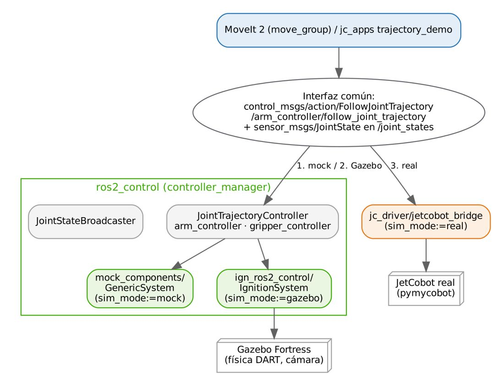

# Documento de Apoyo No. DA-14 – Práctica: conexión del controlador del JetCobot con ROS 2 mediante su driver.

> Versión en Markdown del documento de apoyo, para consultar y copiar comandos desde GitHub. El documento de Word (formato GFPI-F-135) no se publica en el repositorio.

**Actividad de Aprendizaje:** Conectar el controlador del cobot a ROS 2 mediante un driver, verificando de forma cuantitativa la comunicación (estado articular, comandos de trayectoria, servicios de seguridad) bajo condiciones seguras.

**Parte de la transferencia:** Parte B – Robot real con la Jetson AGX Orin.

**Equipo de trabajo:** Jetson AGX Orin conectada al JetCobot (y a la cámara) + PC en la misma red y con el mismo ROS\_DOMAIN\_ID.

**Duración Estimada:** 1,5 horas.

**Sesión:** Día 3 – 05/11/2026, 3:30 p.m. – 5:00 p.m.

**Relación con la Guía de Aprendizaje:** Actividad 3.4.4 (transferencia).

> **PARTE B · TRABAJO CON EL ROBOT (JETSON AGX ORIN + JETCOBOT):**
>
> Este documento se trabaja con la **Jetson AGX Orin** conectada al JetCobot y con el **PC** en la misma red. Cada bloque de comandos indica dónde se ejecuta: **Terminal (Jetson)** o **Terminal (PC)**. Requisito: haber completado la Parte A en simulación (DA-02 a DA-12).

## 1. OBJETIVOS DE APRENDIZAJE

- Identificar y configurar el enlace USB-serie del JetCobot (dispositivo, permisos, regla udev, velocidad).
- Usar la API `pymycobot` (`MyCobot280`) para leer y comandar el robot y conocer sus límites.
- Comprender el diseño de un driver ROS 2 que expone las mismas interfaces que ros2\_control.
- Verificar la comunicación ROS 2 ↔ robot: frecuencia de `/joint_states`, ejecución de una trayectoria, cancelación y servicios.
- Aplicar un protocolo de seguridad antes de energizar y mover el cobot.

## 2. FUNDAMENTOS

### 2.1 Interfaz del JetCobot

El JetCobot se comanda desde la Jetson por un puerto USB-serie, con el protocolo que implementa la biblioteca `pymycobot` de Elephant Robotics (clase `MyCobot280`) [1]. Los programas del instructor abren el robot en `/dev/ttyUSB0` a **1 000 000 baudios**; otras variantes del myCobot 280 usan 115 200 [2]. **Verifique** la velocidad de su unidad con el diagnóstico del Paso 2.

*Tabla 1. Funciones principales de la API MyCobot280 [1].*

| **Función (pymycobot)** | **Unidades / rango** | **Observación** |
|---|---|---|
| `get_angles()` | lista de 6 ángulos [°] | Puede devolver `-1` si el bus está ocupado: validar tipo y longitud. |
| `send_angles(angles, speed)` | [°], speed 1–100 | Movimiento articular a la configuración dada. |
| `get_coords()` | [x, y, z] mm, [rx, ry, rz] ° | Pose del extremo en el marco base del firmware. |
| `send_coords(coords, speed, mode)` | mm, °, mode 0 angular / 1 lineal | Cinemática inversa resuelta en el controlador. |
| `set_gripper_value(v, speed)` | v 0–100 | En las apps del instructor 100 = abierta, 0 = cerrada. |
| `is_moving()`, `is_gripper_moving()` | 0 / 1 | Útiles para esperar la llegada (ver `wait_until_stopped`). |
| `set_fresh_mode(m)` | 0 interpolación, 1 refresco | En refresco se ejecuta siempre el último comando (streaming). |
| `power_on()`, `release_all_servos()`, `focus_all_servos()`, `stop()` | — | Energizar, liberar (arrastre manual), bloquear, detener. |

*Tabla 2. Límites articulares documentados para send_angle [1] (usados también en el URDF de jc_description).*

| **Articulación** | **J1** | **J2** | **J3** | **J4** | **J5** | **J6** |
|---|---|---|---|---|---|---|
| Rango [°] (API MyCobot 280) | ±168 | ±135 | ±150 | ±145 | −155 … 160 | ±180 |

### 2.2 Diseño del driver jetcobot_bridge

En ROS 2 los manipuladores se integran normalmente con **ros2\_control**: un `controller_manager` carga controladores (p. ej. `JointTrajectoryController`) que escriben en interfaces de hardware [4], [5]. Como `pymycobot` es una biblioteca Python de alto nivel (el firmware ya interpola el movimiento), en esta celda se usa un **puente** que expone exactamente las mismas interfaces que el controlador de ros2\_control: el tópico `/joint_states` y las acciones `FollowJointTrajectory` en `/arm_controller/...` y `/gripper_controller/...`. Así, MoveIt 2 y los nodos de aplicación no cambian entre simulación y robot real (Figura 1).



*Figura 1. Interfaz común para mock, Gazebo y robot real.*

Decisiones de diseño (ver `jc_driver/jetcobot_bridge.py`):

- **Exclusión mutua**: todas las llamadas al puerto serie se serializan con un `threading.Lock`, como en el `RobotController` de las apps del instructor; el bus no admite accesos concurrentes.
- **Validación**: respuestas `-1` o listas incompletas se descartan (el valor `-1` es *verdadero* en Python).
- **Re-muestreo**: la trayectoria de MoveIt (decenas de puntos) se envía a ≤ `stream_rate` = 10 Hz en modo refresco.
- **Velocidad**: para cada segmento se calcula el porcentaje de velocidad a partir de la velocidad articular requerida (ecuación 1).
- **Cierre de lazo**: la acción solo informa éxito cuando el error articular máximo es ≤ `goal_tolerance_deg` (2°).
- **Cancelación**: una meta cancelada invoca `stop()` en el robot.

$${s}_{k}={sat}_{\left[ {s}_{min}, {s}_{max} \right]}​\left( 100 \frac{max\left| {q}_{j,k}-{q}_{j,k-1} \right|}{\left( {t}_{k}-{t}_{k-1} \right) {\bar{q}}_{max}} \right) \qquad (1)$$

donde s\_k es el parámetro `speed` (1–100) del segmento *k*, *q* en grados, q̇\_max = `max_joint_speed_deg_s` (150 °/s por defecto, **valor a caracterizar** con el robot real en el reto de la sección 6) y s\_min = 10, s\_max = 80 limitan la velocidad por seguridad.

### 2.3 Seguridad

Aunque el JetCobot es un brazo educativo de baja carga, se aplican los principios de las normas de seguridad de robots industriales y aplicaciones colaborativas (ISO 10218-1/-2:2025 e ISO/TS 15066) [7], [8]: evaluación de riesgos de la aplicación, limitación de velocidad, zona despejada y parada accesible.

> **Seguridad:**
>
> Antes de energizar: área de trabajo despejada en un radio de 40 cm; nadie con las manos dentro del alcance.
>
> Primeros movimientos con `speed` ≤ 30 y escalado de MoveIt ≤ 0,2.
>
> Tenga a mano la parada: `ros2 service call /jetcobot_bridge/stop std_srvs/srv/Trigger` o desconexión de la alimentación.
>
> `release_all_servos` deja el brazo sin par: **sosténgalo** antes de liberar para que no caiga.
>
> Nunca ejecute `joint_state_follower` y `jetcobot_bridge` al mismo tiempo (compiten por el puerto serie).

## 3. MATERIALES

- JetCobot con fuente de alimentación del fabricante y cable USB a la Jetson.
- Jetson con robots\_ws compilado y comunicación con el PC verificada (DA-13).
- Área de trabajo despejada y marcada.
- Calibrador (pie de rey) para el Paso 8.

> **INSERTAR IMAGEN / CAPTURA (por el instructor):**
>
> *Fotografía de la conexión física: fuente del JetCobot, cable USB a la Jetson AGX Orin y zona de trabajo señalizada.*

## 4. PROCEDIMIENTO PASO A PASO

### Paso 0. Incorporar al robots_ws el material de este documento

Este es el último paquete del espacio de trabajo y solo se usa en la Jetson, que es el equipo conectado al robot. Agréguelo en la Jetson desde el repositorio robots\_ws (DA-13, Paso 5):

| **Paquete / carpeta** | **Para qué sirve** | **Qué contiene** | **Dónde se usa** |
|---|---|---|---|
| `src/jc_driver` | Driver del robot real: conecta ROS 2 con el JetCobot por el puerto serie (pymycobot), publica el estado de las articulaciones y ejecuta las trayectorias. | jetcobot\_bridge (ROS 2 ↔ pymycobot), joint\_state\_follower, check\_robot (diagnóstico), config/bridge.yaml, launch y la regla udev en udev/. | Solo la Jetson AGX Orin, conectada al JetCobot por USB. No se agrega en el PC. |

**Terminal (Jetson)**

```bash
# trae lo nuevo del repositorio (correcciones y mejoras)
cd ~/robots_ws && git pull
cd ~/robots_ws && git sparse-checkout add src/jc_driver
# instala las dependencias de los paquetes agregados
rosdep install --from-paths ~/robots_ws/src --ignore-src -r -y --skip-keys "mr_navigation jc_driver"
cd ~/robots_ws
colcon build --symlink-install
source install/setup.bash
# explore la estructura
tree -L 2 src/jc_driver
# paquetes del workspace hasta ahora
ros2 pkg list | grep -E "jc_|mi_celda"
```

> **Resultado esperado:**
>
> `Summary: 1 package finished`. Con él, el robots\_ws de la Jetson queda completo: los 8 paquetes de la Tabla 2 de DA-02 más `mi_celda`. Ahora sí funciona `ros2 launch jc_bringup real.launch.py`.

### Paso 1. Identificar el puerto y dar permisos

**Terminal (Jetson)**

```bash
# conectar/desconectar para identificar
ls -l /dev/ttyUSB* /dev/ttyACM*
# driver del adaptador (cp210x, ch341, ...)
sudo dmesg | tail -20
udevadm info -a -n /dev/ttyUSB0 | grep -E "idVendor|idProduct|serial" | head
# permiso del puerto serie (DA-13, Paso 2)
groups | grep dialout
```

Opcional y recomendado: nombre fijo `/dev/jetcobot`. Edite `idVendor`/`idProduct` en `~/robots_ws/src/jc_driver/udev/99-jetcobot.rules` con los valores reales y ejecute:

**Terminal (Jetson)**

```bash
sudo cp ~/robots_ws/src/jc_driver/udev/99-jetcobot.rules /etc/udev/rules.d/
sudo udevadm control --reload && sudo udevadm trigger
# ModemManager busca módems en los puertos serie y puede quitarle el puerto a jetcobot_bridge
sudo systemctl disable --now ModemManager
ls -l /dev/jetcobot
```

### Paso 2. Diagnóstico sin ROS

**Terminal (Jetson)**

```bash
ros2 run jc_driver check_robot --port /dev/ttyUSB0 --baud 1000000
# ensayo sin hardware:
ros2 run jc_driver check_robot --simulate
```

> **Resultado esperado:**
>
> Versión de pymycobot, `is_power_on → 1`, `get_angles → [6 valores]`, `get_coords → [6 valores]`, `get_gripper_value → 0..100`. Si `get_angles` devuelve `-1` o `None` repetidamente: revise la velocidad en baudios y que ninguna otra aplicación tenga el puerto abierto.

*Tabla 3. Registro del diagnóstico (diligenciar).*

| **Lectura** | **Valor obtenido** |
|---|---|
| get\_angles() [°] |  |
| get\_coords() [mm, °] |  |
| get\_gripper\_value() |  |
| Baudios que funcionan |  |

### Paso 3. Primer movimiento: el robot sigue al modelo de RViz

Equivalente al `jetcobot_driver sync_plan` de Yahboom [3] y al `sync_plan.py` de Elephant Robotics [2]: el nodo `joint_state_follower` se suscribe a `/joint_states` (publicado por los deslizadores de `joint_state_publisher_gui`) y envía `send_angles`.

**Terminal (PC)**

```bash
# modelo + deslizadores en el PC
ros2 launch jc_description display.launch.py
```

**Terminal (Jetson, por SSH): seguidor a velocidad baja**

```bash
ros2 run jc_driver joint_state_follower --ros-args -p port:=/dev/ttyUSB0 -p baud:=1000000 -p speed:=25
```

Los deslizadores corren en el PC y el seguidor en la Jetson: el tópico `/joint_states` viaja por la red (DA-13).

> **Seguridad:**
>
> Mueva **un** deslizador a la vez y en pasos pequeños. Verifique que el sentido de giro del robot coincide con el del modelo; si alguna articulación gira al revés o con desfase, anótelo (Tabla 4) y corríjalo con el parámetro `joint_offsets_deg` del puente.

*Tabla 4. Verificación de correspondencia modelo–robot.*

| **Articulación** | **Sentido coincide (S/N)** | **Desfase observado [°]** |
|---|---|---|
| J1 |  |  |
| J2 |  |  |
| J3 |  |  |
| J4 |  |  |
| J5 |  |  |
| J6 |  |  |

> **INSERTAR IMAGEN / CAPTURA (por el instructor):**
>
> *Fotografía/video corto del robot siguiendo el deslizador de J1 en RViz2.*

Finalice con Ctrl+C en ambas terminales antes de continuar.

### Paso 4. Puente ROS 2 en modo simulado (sin hardware)

**Terminal (Jetson)**

```bash
ros2 launch jc_driver bridge.launch.py simulate:=true
```

**Terminal (PC)**

```bash
# ≈ 15 Hz
ros2 topic hz /joint_states
# /arm_controller/follow_joint_trajectory ...
ros2 action list -t
ros2 service list | grep jetcobot_bridge
```

### Paso 5. Puente ROS 2 con el robot real

> **Nota:**
>
> ¿Dónde se ejecuta? El puente **siempre** corre en la Jetson, porque el robot está conectado a ella por USB (láncelo por SSH desde el PC, ver DA-13, Paso 8). Los comandos de verificación (`ros2 topic`, `ros2 action`, `ros2 service`, `trajectory_demo`) pueden ejecutarse en la Jetson **o en el PC**, si ambos están en la misma red con el mismo `ROS_DOMAIN_ID`. Mientras el puente está activo, no lance simulaciones en ese dominio desde el PC.

**Terminal (Jetson)**

```bash
ros2 launch jc_driver bridge.launch.py port:=/dev/ttyUSB0 baud:=1000000
```

**Terminal (PC)**

```bash
ros2 topic hz /joint_states
ros2 topic echo /joint_states --once
```

Envíe una trayectoria corta (J1 a +20° y regreso, 3 s por tramo) directamente con la CLI:

**Terminal (PC)**

```bash
ros2 action send_goal --feedback /arm_controller/follow_joint_trajectory \
  control_msgs/action/FollowJointTrajectory "{trajectory: {
    joint_names: [joint1, joint2, joint3, joint4, joint5, joint6],
    points: [
      {positions: [0.349, 0.0, 0.0, 0.0, 0.0, 0.0], time_from_start: {sec: 3}},
      {positions: [0.0,   0.0, 0.0, 0.0, 0.0, 0.0], time_from_start: {sec: 6}} ]}}"
```

> **Resultado esperado:**
>
> Realimentación periódica con `actual.positions` y resultado `error_code: 0` (SUCCESSFUL). En el ensayo con el robot simulado del material se obtuvo exactamente este resultado.

Pruebe la cancelación: repita el envío y presione Ctrl+C a mitad de la trayectoria; el robot debe detenerse. Pruebe los servicios:

**Terminal (PC)**

```bash
ros2 service call /jetcobot_bridge/stop std_srvs/srv/Trigger
ros2 service call /jetcobot_bridge/power_on std_srvs/srv/Trigger
# 5 puntos de paso (ver DA-07)
ros2 run jc_apps trajectory_demo
```

### Paso 6. Métricas de comunicación

1. Frecuencia y fluctuación de `/joint_states`: `ros2 topic hz /joint_states --window 100` (anote media y desviación).
1. Retardo comando→inicio de movimiento: grabe `ros2 bag record /joint_states /arm_controller/follow_joint_trajectory/_action/feedback` durante la trayectoria del Paso 5 y estime el tiempo entre el envío y el primer cambio de `joint1`.
1. Error final: compare la última posición de `/joint_states` con la meta (debe ser ≤ 2°).

*Tabla 5. Resultados de la verificación de comunicación (diligenciar).*

| **Métrica** | **Valor medido** | **Criterio** |
|---|---|---|
| Frecuencia /joint\_states [Hz] |  | ≥ 10 Hz |
| Desviación del período [ms] |  | Reportar |
| Retardo comando→movimiento [ms] |  | Reportar |
| Error articular final máx. [°] |  | ≤ 2° |
| Cancelación detiene el robot |  | Sí |

### Paso 7. Relación entre coordenadas del firmware y la TF de ROS

Con el puente y el modelo en marcha en la Jetson (`ros2 launch jc_bringup real.launch.py rviz:=false`), compare `get_coords()` (marco base del firmware) con `ros2 run tf2_ros tf2_echo base_link link6_flange` en 3 configuraciones. Las posiciones pueden diferir en un desplazamiento constante (origen distinto del marco base del firmware respecto a `base_link` del URDF). Documente la diferencia: será necesaria para reutilizar posiciones guardadas con `send_coords` (como `PosEncimaPieza` en `posiciones_guardadas.json`).

*Tabla 6. Contraste firmware vs. modelo (diligenciar).*

| **Configuración q [°]** | **get\_coords x,y,z [mm]** | **TF base\_link→link6\_flange [mm]** | **Diferencia [mm]** |
|---|---|---|---|
| 0,0,0,0,0,0 |  | 45.6, −64.6, 436.1 (modelo) |  |
| 0,0,−90,0,0,0 |  | 169.2, −64.6, 221.4 (modelo) |  |
| libre |  |  |  |

### Paso 8. Medir el TCP y la cámara en el robot real

En la Parte A (DA-04) se usaron los valores nominales del modelo. Con el robot **apagado o con servos bloqueados**, mida con calibrador:

1. La distancia desde la brida (`link6_flange`) hasta el punto de agarre entre los dedos (modelo: 95 mm, parámetro `tcp_offset`).
1. La posición del centro óptico de la cámara respecto a la brida (modelo: 36 mm; parámetros `cam_x`, `cam_y`, `cam_z` del macro).
1. Si la diferencia supera 2 mm, actualice los valores por defecto en `jc_description/urdf/` (`jetcobot.urdf.xacro` y `jetcobot_macro.xacro`), recompile en la Jetson y en el PC, y verifique con `ros2 run tf2_ros tf2_echo link6_flange tcp`.

*Tabla 7. Medidas físicas del robot (diligenciar). La posición definitiva de la cámara se obtiene con la calibración mano-ojo (DA-16).*

| **Medida** | **Valor del modelo [mm]** | **Valor medido [mm]** | **¿Se actualizó el modelo?** |
|---|---|---|---|
| TCP (tcp\_offset) | 95 |  |  |
| Cámara (cam\_x, cam\_y, cam\_z) | 36, 0, 20 |  |  |

## 5. VERIFICACIÓN Y EVIDENCIAS

*Tabla 8. Evidencias de la práctica.*

| **#** | **Criterio** | **Evidencia** |
|---|---|---|
| 1 | Puerto identificado y con permisos; regla udev (opcional) | Salida de `ls -l /dev/jetcobot` |
| 2 | Diagnóstico de lectura exitoso | Tabla 3 diligenciada |
| 3 | Correspondencia modelo–robot verificada | Tabla 4 + video |
| 4 | Trayectoria vía acción con error\_code 0 y cancelación funcional | Registro de terminal |
| 5 | Métricas de comunicación medidas | Tabla 5 |
| 6 | Protocolo de seguridad aplicado | Observación directa del instructor |
| 7 | TCP y cámara medidos y modelo actualizado si corresponde | Tabla 7 |

## 6. RETO

> **Reto:**
>
> Caracterice la relación entre el parámetro `speed` de `send_angles` y la velocidad articular real (°/s) para J1 con speed = 20, 40, 60, 80, midiendo con `/joint_states`. Ajuste un modelo lineal y actualice `max_joint_speed_deg_s` del puente con el valor obtenido. Reporte R².

## 7. SOLUCIÓN DE PROBLEMAS

*Tabla 9. Problemas frecuentes.*

| **Síntoma** | **Causa probable** | **Solución** |
|---|---|---|
| `Permission denied: '/dev/ttyUSB0'` | Usuario fuera de `dialout` | `sudo usermod -aG dialout $USER` y reingresar |
| Lecturas `-1` intermitentes | Bus ocupado, dos procesos usando el puerto | Cerrar otras apps (GUI del instructor, follower) |
| El robot no se mueve pero responde | Servos liberados o sin energía | `power_on` / `focus_servos`; revisar fuente |
| Movimiento brusco al iniciar la trayectoria | Primer punto lejos del estado actual | Iniciar desde el estado actual o usar MoveIt |
| Acción termina en GOAL\_TOLERANCE\_VIOLATED | Carga, límite articular o tolerancia estricta | Revisar límites; aumentar `settle_timeout`/`goal_tolerance_deg` |
| El puente pierde la comunicación con el robot (SerialException: device reports readiness to read but returned no data) | ModemManager u otro programa abre el puerto serie del JetCobot | sudo systemctl disable --now ModemManager; sudo fuser -v &lt;puerto&gt; debe mostrar solo jetcobot\_bridge |

## REFERENCIAS

**[1]** Elephant Robotics, *pymycobot – MyCobot 280 Python API* (v4.0.x). [En línea]. Disponible: [https://github.com/elephantrobotics/pymycobot/blob/main/docs/MyCobot_280_en.md](https://github.com/elephantrobotics/pymycobot/blob/main/docs/MyCobot_280_en.md)

**[2]** Elephant Robotics, *mycobot\_ros2* (rama humble; modelo mycobot\_280\_jn). [En línea]. Disponible: [https://github.com/elephantrobotics/mycobot_ros2](https://github.com/elephantrobotics/mycobot_ros2)

**[3]** Yahboom Technology, *JetCobot – repositorio de cursos (incl. JetCobot-JetPack6.2: ROS 2 Humble, URDF, MoveIt 2)*. [En línea]. Disponible: [https://github.com/YahboomTechnology/JetCobot](https://github.com/YahboomTechnology/JetCobot)

**[4]** ros-controls, *ros2\_control Documentation (Humble)*. [En línea]. Disponible: [https://control.ros.org/humble/](https://control.ros.org/humble/)

**[5]** S. Chitta *et al.*, "ros\_control: A generic and simple control framework for ROS," *Journal of Open Source Software*, vol. 2, no. 20, p. 456, 2017, doi: 10.21105/joss.00456.

**[6]** Open Robotics, *ROS 2 Documentation: Humble Hawksbill*. [En línea]. Disponible: [https://docs.ros.org/en/humble/](https://docs.ros.org/en/humble/)

**[7]** International Organization for Standardization, *ISO 10218-1:2025 y ISO 10218-2:2025, Robotics — Safety requirements — Part 1: Industrial robots; Part 2: Industrial robot applications and robot cells*. Ginebra: ISO, 2025.

**[8]** International Organization for Standardization, *ISO/TS 15066:2016, Robots and robotic devices — Collaborative robots*. Ginebra: ISO, 2016.

**[9]** J. R. Cháux Cedeño, *robots\_ws – paquetes ROS 2 del curso (repositorio en GitHub, licencia Apache-2.0), 2026. [En línea]. Disponible: https://github.com/jchauxdev/robots\_ws*
