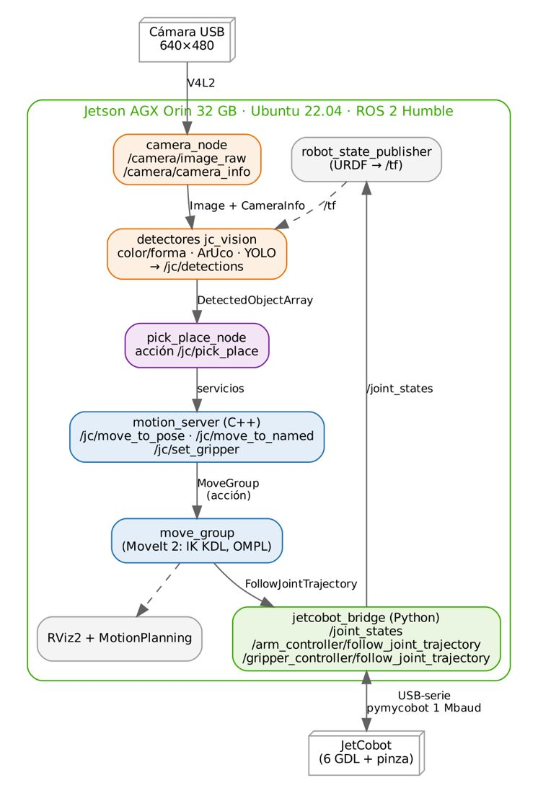

# Documento de Apoyo No. DA-17 – Proyecto final con el robot real: integración, depuración, optimización, sustentación y evaluación.

> Versión en Markdown del documento de apoyo, para consultar y copiar comandos desde GitHub. El documento de Word (formato GFPI-F-135) no se publica en el repositorio.

**Nombre del Proyecto Formativo:** CELDA ROBÓTICA COLABORATIVA CON VISIÓN ARTIFICIAL INTEGRADA EN ROS 2 (JETCOBOT – NVIDIA JETSON AGX ORIN)

**Actividad de Proyecto Formativo:** IMPLEMENTAR UNA CELDA ROBÓTICA COLABORATIVA CON VISIÓN ARTIFICIAL Y ROS 2, DE LA SIMULACIÓN AL ROBOT REAL, Y TRANSFERIR EL CONOCIMIENTO AL CENTRO DE FORMACIÓN.

**Actividad de Aprendizaje:** Integrar visión artificial, planificación de movimientos y control del cobot real en una aplicación ROS 2 funcional, depurarla y optimizarla con métricas, sustentarla y planear su transferencia al centro de formación.

**Parte de la transferencia:** Parte B – Robot real con la Jetson AGX Orin.

**Equipo de trabajo:** Jetson AGX Orin conectada al JetCobot (y a la cámara) + PC en la misma red y con el mismo ROS\_DOMAIN\_ID.

**Duración Estimada:** 4 horas (2,5 h de proyecto + 1,5 h de sustentación, evaluación y socialización).

**Sesión:** Día 4 – 06/11/2026, 11:30 a.m. – 12:00 m. y 1:30 p.m. – 5:00 p.m.

**Relación con la Guía de Aprendizaje:** Actividades 3.4.7 (proyecto final con el robot real) y 3.4.8 (sustentación, evaluación y socialización). Cierra la Parte B.

> **PARTE B · TRABAJO CON EL ROBOT (JETSON AGX ORIN + JETCOBOT):**
>
> Este documento se trabaja con la **Jetson AGX Orin** conectada al JetCobot y con el **PC** en la misma red. Cada bloque de comandos indica dónde se ejecuta: **Terminal (Jetson)** o **Terminal (PC)**. Requisito: haber completado la Parte A en simulación (DA-02 a DA-12).

## 1. OBJETIVOS DE APRENDIZAJE

- Ejecutar con el robot real la aplicación integrada que se validó en simulación en DA-12.
- Cumplir los requisitos R2 a R6 del proyecto final con criterios de aceptación medibles.
- Depurar y optimizar nodos, trayectorias y algoritmos de visión con herramientas de ROS 2 y métricas objetivas.
- Sustentar técnicamente la solución y diseñar su transferencia a programas de formación del centro.

## 2. ARQUITECTURA INTEGRADA CON EL ROBOT REAL



*Figura 1. Arquitectura de la celda integrada sobre la Jetson AGX Orin (Parte B). Es la misma de la simulación (DA-12, Figura 1) con el driver del robot y la cámara USB en lugar de Gazebo.*

La máquina de estados de `pick_place_node`, la elección del yaw de agarre y la línea base del tiempo de ciclo se estudiaron y midieron en simulación en DA-12. Distribución recomendada (DA-13): driver, cámara, MoveIt 2, visión y `pick_place_node` en la Jetson; RViz2, visualización de imágenes comprimidas, órdenes y grabación en el PC.

## 3. REQUISITOS DEL PROYECTO FINAL (ENUNCIADO EN DA-12)

> **Reto:**
>
> **Celda colaborativa de clasificación.** Sobre la mesa se disponen al azar 3–6 objetos (cubos de color, piezas con ArUco o frutas). La celda debe localizarlos con visión, recogerlos uno a uno y depositarlos en el contenedor que corresponde a su clase, deteniéndose de forma segura si una persona solicita la parada.
>
> Cada equipo elige una variante: (A) color/forma; (B) ArUco con orientación; (C) frutas con YOLO (DA-11).

*Tabla 1. Requisitos y criterios de aceptación del proyecto.*

| **Requisito** | **Criterio de aceptación** | **Cómo se mide** |
|---|---|---|
| R1. Simulación | ≥ 9/10 ciclos exitosos en Gazebo (cumplido en DA-12) | Registro de la acción `/jc/pick_place` (success) |
| R2. Robot real | ≥ 8/10 ciclos exitosos a escalado ≤ 0,3 | Observación + registro (Tabla 2) |
| R3. Exactitud | Error de localización medio ≤ 5 mm (real) | Tabla 4 de DA-16 |
| R4. Tiempo de ciclo | Reportado y reducido ≥ 20 % respecto a la línea base | Marcas de tiempo de la realimentación |
| R5. Seguridad | Parada funcional (cancelación de la acción + `stop`); zona señalizada | Prueba en la sustentación |
| R6. Ingeniería | Código en Git, launch reproducible, README con instrucciones | Revisión del repositorio |

## 4. PROCEDIMIENTO DE DESARROLLO

### Etapa 1. Ensayo en seco con el robot real (11:30 a.m. – 12:00 m.)

**Terminal (Jetson, por SSH + tmux): celda real y aplicación, cerca del hardware**

```bash
ros2 launch jc_bringup real.launch.py port:=/dev/ttyUSB0 camera:=true handeye:=true rviz:=false compress:=true
ros2 launch jc_apps celda.launch.py mode:=real detector:=clasico camera_frame:=camera_calibrated_optical dry_run:=true
```

**Terminal (PC): visualización y órdenes por la red (mismo ROS_DOMAIN_ID, ROS_LOCALHOST_ONLY=0)**

```bash
ros2 launch jc_moveit_config rviz.launch.py
ros2 run rqt_image_view rqt_image_view /jc/debug_image/compressed
ros2 action send_goal --feedback /jc/pick_place jc_interfaces/action/PickPlace "{label: rojo, use_place_pose: false}"
```

Para la variante C (frutas) use `detector:=yolo model:=$HOME/best.engine` (DA-16). Use los mismos parámetros de `celda.yaml` validados en simulación (DA-12); ajuste solo lo que cambió con el robot real.

Parámetros de percepción del ciclo (`config/celda.yaml`): `settle_time` (espera tras llegar a `observe`), `detection_window`, `min_detections` y `detection_timeout`: el nodo acumula detecciones nuevas hasta reunir el mínimo o agotar el tiempo, lo que lo hace robusto a cámaras lentas.

Con `dry_run:=true` el nodo calcula y registra las poses de agarre y depósito **sin mover el robot**. Compare esas poses con las posiciones medidas en la mesa antes de habilitar el movimiento.

> **Seguridad:**
>
> Escalado de velocidad ≤ 0,3; zona despejada y señalizada; un integrante dedicado a la parada.
>
> Cancelar la acción: Ctrl+C en el cliente o `ros2 action` (cancelación) y `ros2 service call /jetcobot_bridge/stop std_srvs/srv/Trigger`.
>
> Documente la evaluación de riesgos de la aplicación (principios de ISO 10218-2:2025 e ISO/TS 15066) [5], [6].

### Etapa 2. Ejecución real y medición (1:30 p.m. – 2:15 p.m.)

1. Retire `dry_run`, ejecute 10 ciclos y registre éxito/fallo y causa (Tabla 2).
1. Grabe: `ros2 bag record /jc/detections /joint_states /jc/pick_place/_action/feedback /tf /tf_static`.
1. Calcule el tiempo de ciclo real y su desglose por etapa y compárelo con la línea base de simulación (DA-12, Tabla 3).

*Tabla 2. Registro de ciclos en el robot real (diligenciar).*

| **Ciclo** | **Objeto** | **Éxito (S/N)** | **Etapa de fallo** | **Causa raíz** | **Tiempo [s]** |
|---|---|---|---|---|---|
| 1 |  |  |  |  |  |
| 2 |  |  |  |  |  |
| 3 |  |  |  |  |  |
| 4 |  |  |  |  |  |
| 5 |  |  |  |  |  |
| 6 |  |  |  |  |  |
| 7 |  |  |  |  |  |
| 8 |  |  |  |  |  |
| 9 |  |  |  |  |  |
| 10 |  |  |  |  |  |

## 5. DEPURACIÓN Y OPTIMIZACIÓN (2:15 P.M. – 3:30 P.M.)

### 5.1 Herramientas de depuración

*Tabla 3. Herramientas de depuración.*

| **Problema** | **Herramienta / comando** | **Qué observar** |
|---|---|---|
| Nodo no recibe datos | `ros2 topic info -v`, `ros2 node info` | Publicadores/suscriptores, QoS compatibles |
| Latencias | `ros2 topic hz`, `ros2 topic delay`, `ros2 bag` | Frecuencia real, retardos, pérdidas |
| Errores intermitentes | `ros2 run rqt_console rqt_console`; `--ros-args --log-level debug` | Mensajes por nodo y severidad |
| Marcos incorrectos | `ros2 run tf2_tools view_frames`, `tf2_echo` | Árbol TF completo, frecuencia, edad |
| Planificación lenta o fallida | Registro de `move_group`, RViz2 MotionPlanning | Tiempo de planificación, códigos MoveIt |
| Uso de recursos en la Jetson | `jtop` | CPU/GPU/EMC, temperatura, modo de potencia |
| Reproducir un fallo | `ros2 bag play` + nodos de visión | Repetir la percepción con datos grabados |

### 5.2 Palancas de optimización

*Tabla 4. Opciones de optimización con su efecto y riesgo.*

| **Subsistema** | **Acción** | **Efecto esperado / riesgo** |
|---|---|---|
| Movimiento | Aumentar `velocity_scaling` de aproximación y traslado (0,3 → 0,5) | Menor tiempo; verificar seguridad y error final |
| Movimiento | Reducir `approach_height`/`lift_height` y usar tramos cartesianos cortos | Menos tiempo en tramos lentos |
| Movimiento | Planificar el depósito desde una pose intermedia fija | Trayectorias más cortas y repetibles |
| Movimiento | Parametrización temporal TOTG (ya activa) [9] | Respeta límites con mínimo tiempo |
| Visión | ROI sobre la zona de trabajo; reducir `detection_window` | Menor latencia; riesgo de ruido |
| Visión | TensorRT FP16 (YOLO); resolución 640 → 480 | Más FPS; posible menor exactitud |
| Sistema | `nvpmodel -m 0`, `jetson_clocks`; QoS `best_effort` para imágenes | Menor latencia de cómputo y transporte |
| Sistema | Executors multihilo y grupos de callbacks (ya usados en robots\_ws) | Evita bloqueos entre servicios y suscripciones |

*Tabla 5. Optimización del tiempo de ciclo (diligenciar).*

| **Etapa** | **Línea base [s]** | **Optimizado [s]** | **Cambio aplicado** |
|---|---|---|---|
| observar + localizar |  |  |  |
| aproximación |  |  |  |
| descenso |  |  |  |
| cerrar |  |  |  |
| ascenso |  |  |  |
| contenedor |  |  |  |
| soltar |  |  |  |
| retorno |  |  |  |
| TOTAL |  |  |  |

## 6. VALIDACIÓN DEL MATERIAL DE LA TRANSFERENCIA

Todo el código del portafolio se compiló y ejecutó en un entorno ROS 2 Humble (MoveIt 2.5.9, Gazebo Fortress 6.16, OpenCV 4.11, PyTorch 2.14, Ultralytics 8.4) antes de su entrega. Resumen de resultados medidos:

*Tabla 6. Resumen de la validación previa del material.*

| **Prueba** | **Resultado** |
|---|---|
| Compilación `colcon build` (8 paquetes) y pruebas unitarias | 8/8 paquetes; 7/7 pruebas aprobadas |
| Mock: trayectoria, estados con nombre, cuadrado cartesiano, demo C++ | Todos exitosos; cartesiana 100 % |
| FK propia vs. TF (robot\_state\_publisher) | Diferencia 0,000 mm |
| Puente del robot (pymycobot simulado): trayectoria, cancelación, pinza, servicios | Exitosos (error\_code 0) |
| Gazebo Fortress: controladores, trayectoria, pick & place físico | Exitosos; cubo depositado a &lt; 3 mm del objetivo |
| Localización por color/forma y ArUco (escena sintética con TF real) | Error 0,1–1,5 mm (ver DA-10) |
| Cadena integrada en Gazebo: visión (cámara sintética) → pick\_place\_node → MoveIt → física | Éxito: cubo de (160; −60) mm a (20,0; 174,7) mm, a 4,7 mm del objetivo |
| Calibración intrínseca (20 vistas sintéticas) | fx con error 0,01 %; RMS 0,033 px |
| Calibración mano-ojo (simulación, 11 muestras) | ‖Δt‖ = 2,4 mm (PARK); rotación ≈ 2,7° |
| Clasificador PyTorch y detector YOLO11n (datos sintéticos) | Entrenan y exportan a ONNX; YOLO mAP50 = 0,995 |
| No validado en el entorno de pruebas | Render de cámara de Gazebo (requiere GPU), TensorRT y robot físico: se validan en el aula |

## 7. SUSTENTACIÓN Y DEMOSTRACIÓN (3:30 P.M. – 4:15 P.M.)

Cada equipo dispone de 10 minutos de presentación + 5 minutos de demostración en vivo + 5 de preguntas:

1. Problema y requisitos (R1–R6).
1. Arquitectura (grafo de nodos real capturado con rqt\_graph).
1. Decisiones técnicas y su justificación (detector, calibración, parámetros de movimiento).
1. Resultados cuantitativos: tasa de éxito, exactitud, tiempo de ciclo antes/después.
1. Limitaciones, riesgos y trabajo futuro.
1. Demostración en vivo, incluida la parada segura.

*Tabla 7. Rúbrica de evaluación del proyecto final.*

| **Criterio (peso)** | **Excelente (4)** | **Satisfactorio (3)** | **En desarrollo (2)** | **Insuficiente (1)** |
|---|---|---|---|---|
| Funcionalidad integrada (25 %) | R1 y R2 cumplidos | R1 cumplido; R2 ≥ 6/10 | Solo simulación parcial | No funciona |
| Rigor de medición (20 %) | Métricas completas con incertidumbre | Métricas completas | Métricas parciales | Sin métricas |
| Calidad de ingeniería (15 %) | Git, launch, README, pruebas | Git, launch y README | Código sin documentar | Sin repositorio |
| Optimización (15 %) | ≥ 20 % con análisis de causa | Mejora &lt; 20 % justificada | Cambios sin medir | Sin optimización |
| Seguridad (15 %) | Evaluación de riesgos + parada probada | Parada probada | Medidas informales | Sin medidas |
| Comunicación (10 %) | Clara, sintética, responde con fundamento | Clara | Confusa en partes | No sustenta |

## 8. EVALUACIÓN DE LA FORMACIÓN Y TRANSFERENCIA (4:15 P.M. – 5:00 P.M.)

### 8.1 Encuesta de evaluación (escala 1 = muy en desacuerdo … 5 = muy de acuerdo)

*Tabla 8. Encuesta de evaluación de la formación.*

| **#** | **Afirmación** | **1** | **2** | **3** | **4** | **5** |
|---|---|---|---|---|---|---|
| 1 | Los objetivos de cada día se cumplieron. |  |  |  |  |  |
| 2 | Los documentos de apoyo permitieron reproducir las prácticas sin asistencia. |  |  |  |  |  |
| 3 | La secuencia simulación → robot real fue adecuada. |  |  |  |  |  |
| 4 | El nivel de profundidad técnica fue apropiado. |  |  |  |  |  |
| 5 | Puedo replicar la celda con aprendices en mi programa de formación. |  |  |  |  |  |
| 6 | Los recursos (robot, Jetson, PC, software) fueron suficientes. |  |  |  |  |  |

Preguntas abiertas: ¿qué tema requiere más tiempo? ¿qué cambiaría en las prácticas? ¿qué aplicación industrial de la región podría modelarse con esta celda?

### 8.2 Plan de transferencia al centro de formación

*Tabla 9. Plan de transferencia (diligenciar en la socialización).*

| **Actividad de transferencia** | **Programa / ficha destino** | **Recursos** | **Responsable** | **Fecha** |
|---|---|---|---|---|
| Taller de ROS 2 y simulación del cobot (Parte A: DA-02 a DA-07) |  |  |  |  |
| Taller de visión, calibración y aprendizaje profundo en simulación (Parte A: DA-08 a DA-12) |  |  |  |  |
| Puesta en marcha con el robot real y la Jetson (Parte B: DA-13 a DA-17) |  |  |  |  |
| Semillero / proyecto de investigación aplicada |  |  |  |  |

> **INSERTAR IMAGEN / CAPTURA (por el instructor):**
>
> *Fotografía grupal de la socialización de resultados y de la celda funcionando.*

## 9. ENTREGABLES

- Repositorio Git del equipo con robots\_ws extendido (paquete `mi_celda`, configuraciones, launch y README).
- Bolsa de datos (`ros2 bag`) de 3 ciclos reales y video de la demostración.
- Informe técnico (máximo 6 páginas): arquitectura, calibraciones, métricas, optimización, riesgos.
- Tablas diligenciadas de la Parte A (DA-01, DA-07, DA-09, DA-10, DA-11, DA-12) y de la Parte B (DA-14, DA-15, DA-16, DA-17).
- Plan de transferencia (Tabla 9).

## REFERENCIAS

**[1]** S. Macenski, T. Foote, B. Gerkey, C. Lalancette y W. Woodall, "Robot Operating System 2: Design, architecture, and uses in the wild," *Science Robotics*, vol. 7, no. 66, eabm6074, 2022, doi: 10.1126/scirobotics.abm6074.

**[2]** D. Coleman, I. A. Şucan, S. Chitta y N. Correll, "Reducing the barrier to entry of complex robotic software: a MoveIt! case study," *Journal of Software Engineering for Robotics*, vol. 5, no. 1, pp. 3–16, 2014, arXiv: 1404.3785.

**[3]** PickNik Robotics, *MoveIt 2 Documentation – Humble*. [En línea]. Disponible: [https://moveit.picknik.ai/humble/](https://moveit.picknik.ai/humble/)

**[4]** Open Robotics, *ROS 2 Documentation: Humble Hawksbill*. [En línea]. Disponible: [https://docs.ros.org/en/humble/](https://docs.ros.org/en/humble/)

**[5]** International Organization for Standardization, *ISO 10218-1:2025 y ISO 10218-2:2025, Robotics — Safety requirements — Part 1: Industrial robots; Part 2: Industrial robot applications and robot cells*. Ginebra: ISO, 2025.

**[6]** International Organization for Standardization, *ISO/TS 15066:2016, Robots and robotic devices — Collaborative robots*. Ginebra: ISO, 2016.

**[7]** J. Tobin *et al.*, "Domain randomization for transferring deep neural networks from simulation to the real world," en *Proc. IEEE/RSJ IROS*, 2017, pp. 23–30, doi: 10.1109/IROS.2017.8202133.

**[8]** R. Padilla, S. L. Netto y E. A. B. da Silva, "A survey on performance metrics for object-detection algorithms," en *Proc. IWSSIP*, 2020, pp. 237–242, doi: 10.1109/IWSSIP48289.2020.9145130.

**[9]** T. Kunz y M. Stilman, "Time-optimal trajectory generation for path following with bounded acceleration and velocity," en *Robotics: Science and Systems VIII*, 2012, doi: 10.15607/RSS.2012.VIII.027.

**[10]** J. R. Cháux Cedeño, *robots\_ws – paquetes ROS 2 del curso (repositorio en GitHub, licencia Apache-2.0), 2026. [En línea]. Disponible: https://github.com/jchauxdev/robots\_ws*
