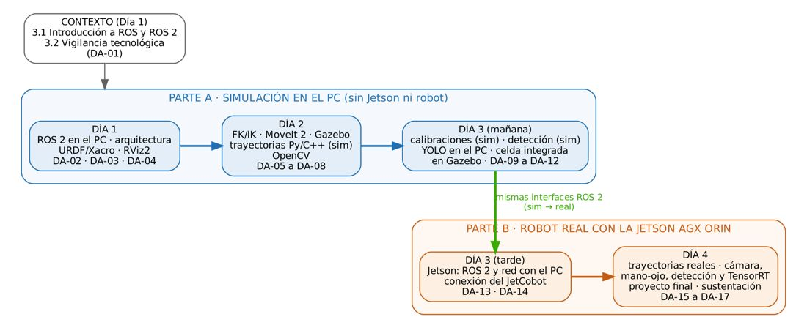

# FORMATO GUÍA DE APRENDIZAJE

> Versión en Markdown del documento [Guia_Aprendizaje_Cobot_Vision_ROS2.docx](Guia_Aprendizaje_Cobot_Vision_ROS2.docx) para consultar y copiar comandos desde GitHub. El documento de Word es la versión oficial (formato GFPI-F-135).

## 1. IDENTIFICACIÓN DE LA GUIA DE APRENDIZAJE

- Denominación del Programa de Formación:
- Código del Programa de Formación:
- Nombre del Proyecto Formativo (si aplica): **CELDA ROBÓTICA COLABORATIVA CON VISIÓN ARTIFICIAL INTEGRADA EN ROS 2 (JETCOBOT – NVIDIA JETSON AGX ORIN)**
- Fase del Proyecto (si aplica):
- Actividad de Proyecto Formativo (si aplica): **IMPLEMENTAR UNA CELDA ROBÓTICA COLABORATIVA CON VISIÓN ARTIFICIAL Y ROS 2, DE LA SIMULACIÓN AL ROBOT REAL, Y TRANSFERIR EL CONOCIMIENTO AL CENTRO DE FORMACIÓN.**
- Resultados de Aprendizaje:

**ACTIVIDAD 1.** CONFIGURAR EL ENTORNO DE DESARROLLO ROS 2 EN EL PC, COMPRENDER SU ARQUITECTURA Y MODELAR EL COBOT CON URDF/XACRO, A PARTIR DE UNA VIGILANCIA TECNOLÓGICA DEL USO DE COBOTS CON ROS 2 EN LA INDUSTRIA. (DÍA 1 – PARTE A)

**ACTIVIDAD 2.** PLANIFICAR, SIMULAR Y PROGRAMAR TRAYECTORIAS DEL COBOT CON MOVEIT 2 Y GAZEBO, E INICIAR EL PROCESAMIENTO DE IMÁGENES CON OPENCV. (DÍA 2 – PARTE A)

**ACTIVIDAD 3.** IMPLEMENTAR EN SIMULACIÓN LA PERCEPCIÓN CALIBRADA Y EL APRENDIZAJE PROFUNDO INTEGRADOS CON EL COBOT, Y PREPARAR LA JETSON AGX ORIN PARA CONECTAR EL COBOT REAL. (DÍA 3 – PARTES A Y B)

**ACTIVIDAD 4.** TRANSFERIR LA CELDA AL ROBOT REAL CON LA JETSON AGX ORIN, SUSTENTARLA Y PLANEAR SU TRANSFERENCIA AL CENTRO DE FORMACIÓN. (DÍA 4 – PARTE B)

- Duración de la Guía de Aprendizaje: **36 horas**

Horas de trabajo directo: 30 horas (4 jornadas × 7,5 h)

Horas de trabajo independiente: 6 horas

Fecha de Inicio: 03/11/2026

Fecha Fin: 06/11/2026

## 2. PRESENTACIÓN

Esta guía tiene la estructura de la transferencia de conocimiento sobre la integración de un robot colaborativo de escritorio (JetCobot de Yahboom) con visión artificial en Python, su integración en **ROS 2 Humble** y su control desde una **NVIDIA Jetson AGX Orin 32 GB**. Está dirigida a instructores, por lo que privilegia la fundamentación formal (modelos, ecuaciones y referencias), la medición cuantitativa de resultados y la reproducibilidad: todo el software entregado (espacio de trabajo `robots_ws`) fue compilado y probado antes de la formación, y cada documento de apoyo indica los resultados de validación obtenidos y sus límites.

La metodología sigue el principio **primero simulación, luego robot real**: cada capacidad se desarrolla en un entorno *mock* (sin física), se verifica en **Gazebo Fortress** y finalmente se transfiere al cobot con las mismas interfaces ROS 2. En visión se parte de **OpenCV** (técnicas clásicas, calibraciones) y se avanza a **PyTorch** con modelos preentrenados y el entrenamiento de un detector de frutas (Ultralytics YOLO), desplegado con TensorRT en la Jetson. En cada documento, **ROS** significa ROS 2.

Para que siempre sea claro con qué equipo se trabaja, la transferencia se divide en **dos partes**:

*Tabla 1. Organización de la transferencia en dos partes.*

| **Parte** | **Cuándo** | **Equipo de trabajo** | **Documentos** | **Qué se hace** |
|---|---|---|---|---|
| Contexto | Día 1 (8:00 – 10:00) | PC con navegador | Presentación, DA-01 | Introducción a ROS y ROS 2; vigilancia tecnológica del uso de cobots con ROS 2 en la industria. |
| **A. Simulación en el PC** | Días 1 y 2, y Día 3 hasta las 2:30 p.m. | Solo el **PC** (Ubuntu 22.04). No se usa la Jetson ni se energiza el robot. | DA-02 a DA-12 | Instalación de ROS 2, arquitectura, modelo del robot, MoveIt 2, Gazebo, trayectorias, visión, calibraciones, aprendizaje profundo y la celda completa integrada en simulación. |
| **B. Robot real con la Jetson** | Día 3 desde las 2:30 p.m. y Día 4 | **Jetson AGX Orin** junto al robot + **PC** en la misma red | DA-13 a DA-17 | ROS 2 en la Jetson, conexión del JetCobot, trayectorias reales, cámara y calibración mano-ojo reales, detección con TensorRT, proyecto final y sustentación. |

Solo se pasa a la Parte B cuando la celda funciona completa en simulación (requisito R1 del proyecto, DA-12). Cada documento de apoyo indica en su encabezado la parte y el equipo de trabajo, y cada bloque de comandos señala dónde se ejecuta: **Terminal (PC)** o **Terminal (Jetson)**.

*Figura 1. Ruta de aprendizaje de la semana en dos partes.*

Agenda (8:00 a.m. – 12:00 m. y 1:30 p.m. – 5:00 p.m.):

*Tabla 2. Agenda de la transferencia.*

| **Día / fecha** | **Mañana** | **Tarde** | **Documentos de apoyo** |
|---|---|---|---|
| Día 1 03/11/2026 Contexto y Parte A | Introducción a ROS y ROS 2 (presentación); vigilancia tecnológica de cobots con ROS 2; instalación de ROS 2 en el PC | Arquitectura de ROS 2 (nodos, tópicos, servicios, acciones, mensajes, parámetros); modelado URDF/Xacro y RViz2 | DA-01, DA-02, DA-03, DA-04 |
| Día 2 04/11/2026 Parte A | Cinemática directa e inversa y MoveIt 2; simulación de la celda en Gazebo; trayectorias en simulación (inicio) | Práctica: nodos Python/C++ para trayectorias en simulación; fundamentos de visión con OpenCV | DA-05, DA-06, DA-07, DA-08 |
| Día 3 05/11/2026 Partes A y B | **Parte A:** cámaras en ROS 2 y calibraciones (simulación); detección y localización en simulación; aprendizaje profundo en el PC | **Parte A:** celda integrada en Gazebo (1:30 – 2:30). **Parte B:** ROS 2 en la Jetson y ejecución distribuida; conexión del JetCobot | DA-09 a DA-12; DA-13, DA-14 |
| Día 4 06/11/2026 Parte B | Trayectorias en el robot real; cámara, calibración mano-ojo, detección y YOLO con TensorRT en el robot real; proyecto final (inicio) | Proyecto final con el robot real: ejecución, depuración y optimización; sustentación, evaluación y plan de transferencia | DA-15, DA-16, DA-17 |

Documentos de apoyo que acompañan esta guía (formato GFPI-F-135, archivos independientes):

*Tabla 3. Relación de documentos de apoyo.*

| **Código** | **Documento de apoyo (archivo)** | **Parte** | **Actividad** |
|---|---|---|---|
| DA-01 | Vigilancia tecnológica y estado del arte: cobots, visión artificial y ROS 2 en la industria (DA-01\_Vigilancia\_Tecnologica\_Cobots\_ROS2.docx) | Contexto | 3.2.1 |
| DA-02 | Entorno de desarrollo ROS 2 Humble en el PC (DA-02\_Entorno\_ROS2\_Humble\_PC.docx) | A | 3.3.1 |
| DA-03 | Arquitectura de ROS 2: nodos, tópicos, servicios, acciones, mensajes y parámetros (DA-03\_Arquitectura\_ROS2.docx) | A | 3.3.2 |
| DA-04 | Modelado del cobot con URDF/Xacro y RViz2 (DA-04\_URDF\_Xacro\_RViz.docx) | A | 3.3.3 |
| DA-05 | Cinemática directa e inversa y MoveIt 2 (DA-05\_Cinematica\_MoveIt2.docx) | A | 3.3.4 |
| DA-06 | Simulación de la celda en Gazebo con ROS 2 (DA-06\_Simulacion\_Gazebo.docx) | A | 3.3.5 |
| DA-07 | Práctica: nodos Python/C++ para trayectorias del cobot en simulación (DA-07\_Practica\_Trayectorias.docx) | A | 3.4.1 |
| DA-08 | Fundamentos de visión artificial con OpenCV (DA-08\_Fundamentos\_Vision\_OpenCV.docx) | A | 3.3.6 |
| DA-09 | Cámaras en ROS 2, calibración de cámara y mano-ojo en simulación (DA-09\_Camaras\_Calibracion\_ManoOjo.docx) | A | 3.3.7 |
| DA-10 | Práctica: detección y localización en la celda simulada (DA-10\_Practica\_Deteccion\_Localizacion.docx) | A | 3.4.2 |
| DA-11 | Visión con aprendizaje profundo en el PC: PyTorch y YOLO (DA-11\_Deep\_Learning\_PyTorch\_YOLO.docx) | A | 3.3.8 |
| DA-12 | Práctica: integración visión–cobot en la celda simulada y proyecto final (DA-12\_Integracion\_Simulacion.docx) | A | 3.4.3 |
| DA-13 | Jetson AGX Orin: ROS 2 y ejecución distribuida con el PC (DA-13\_Jetson\_ROS2\_Ejecucion\_Distribuida.docx) | B | 3.3.9 |
| DA-14 | Práctica: conexión del controlador del JetCobot con ROS 2 (DA-14\_Conexion\_JetCobot\_ROS2.docx) | B | 3.4.4 |
| DA-15 | Práctica: transferencia de las trayectorias al cobot real (DA-15\_Trayectorias\_Robot\_Real.docx) | B | 3.4.5 |
| DA-16 | Práctica: percepción con el robot real: cámara, mano-ojo, detección y TensorRT (DA-16\_Percepcion\_Robot\_Real.docx) | B | 3.4.6 |
| DA-17 | Proyecto final con el robot real, sustentación y evaluación (DA-17\_Proyecto\_Final\_Robot\_Real.docx) | B | 3.4.7, 3.4.8 |
| robots\_ws | Repositorio con los paquetes ROS 2 de todas las prácticas, https://github.com/jchauxdev/robots\_ws. Se clona vacío y cada documento agrega solo los paquetes que usa (Paso 0) | A y B | Todas |

Prerrequisitos de los participantes: programación en Python (y lectura de C++), Linux a nivel de usuario, álgebra lineal y fundamentos de robótica. Trabajo en equipos de 2–3 personas, uno por cobot.

## 3. FORMULACIÓN DE LAS ACTIVIDADES DE APRENDIZAJE

### 3.1 Actividades de reflexión inicial:

**3.1.1. Introducción a ROS y a ROS 2: del middleware de investigación al estándar de la robótica industrial.**

Se presenta ROS (Robot Operating System) como middleware y ecosistema de software para robótica: su vocabulario técnico, la evolución de ROS 1 a ROS 2 y las decisiones de arquitectura que justifican su adopción en la industria (comunicación sobre DDS sin nodo maestro, calidad de servicio configurable, nodos gestionados, seguridad y soporte de tiempo real). Se revisan el ciclo de distribuciones y los datos actuales de adopción: métricas de uso, fabricantes de robots industriales con driver ROS 2 y casos reales.

**Descripción de la actividad:**

1. Para abrir la sesión (15 minutos), ver en grupo el video «RB-KAIROS+: manipulación móvil autónoma con IA agéntica» (Robotnik, 1 min, en inglés; active los subtítulos en español): [https://www.youtube.com/watch?v=eMJkA2B7RYs](https://www.youtube.com/watch?v=eMJkA2B7RYs).
1. Conversar a partir de las preguntas orientadoras antes de la exposición (el instructor modera y anota las ideas en el tablero):
   1. **Lo que vimos:** ¿qué pasos sigue el robot desde que recibe la orden hasta que entrega la caja? ¿Cuáles son de percepción, cuáles de planificación y cuáles de ejecución?
   1. ¿Cómo distingue la caja «Robotnik» de las demás? ¿Cómo lo haría nuestra celda: por color, forma, marcador ArUco o con un detector como YOLO?
   1. Para agarrar la caja, el brazo necesita conocer su posición respecto a su propia base. ¿Qué datos de la cámara y qué calibración hacen falta?
   1. **Programar o pedir:** el video dice que no hay que escribir código. ¿Desaparece la programación o cambia de lugar? ¿Quién programó las habilidades que el agente combina?
   1. Esas habilidades se comunican entre sí: ¿qué piezas de software se necesitan para que «detectar», «planificar» y «mover» se pasen datos? Aquí entra ROS 2: nodos, tópicos, servicios y acciones.
   1. **Personas y robots:** ¿por qué el operador confirma antes de que el robot actúe? ¿Qué papel tiene la persona en un sistema colaborativo?
   1. ¿Qué diferencia a este manipulador de un brazo industrial en una celda cerrada? ¿Por qué el JetCobot puede trabajar cerca de personas y qué límites tiene?
   1. ¿Qué tarea de su entorno se podría resolver con un cobot de escritorio con visión?
1. Relacionar en el tablero las ideas de la charla (percepción, planificación, ejecución, interfaz con el operador) con las partes A (simulación) y B (robot real) de la transferencia.
1. Exposición dialogada de los conceptos clave (middleware, DDS, RTPS, RMW, nodo, tópico, mensaje, servicio, acción, parámetro, QoS, dominio, paquete y espacio de trabajo) y de qué es ROS: middleware, herramientas y ecosistema de paquetes, no un sistema operativo. Se contrastan las limitaciones de ROS 1 (nodo maestro como punto único de falla, transporte sin calidad de servicio, sin seguridad ni garantías de tiempo real) con ROS 2; ROS 1 Noetic llegó al fin de su soporte el 31 de mayo de 2025.
1. Analizar la arquitectura en capas de ROS 2 (rclpy/rclcpp → rcl → rmw → DDS/RTPS) y los mecanismos de comunicación (tópicos, servicios, acciones y parámetros) con ejemplos de código en rclpy; discutir el descubrimiento distribuido, los perfiles de QoS y su regla de compatibilidad, los nodos con ciclo de vida, la composición, SROS 2 y los requisitos de tiempo real.
1. Revisar el ciclo de distribuciones (Humble, Jazzy, Kilted y Lyrical, con sus versiones de Ubuntu y fechas de fin de soporte) y los criterios para elegir una distribución: sistema operativo, hardware, disponibilidad de paquetes y drivers, y tipo de soporte.
1. Analizar la adopción de ROS 2 con el reporte de métricas 2025 de Open Robotics, los fabricantes de robots industriales con driver ROS 2 (Universal Robots, FANUC, KUKA, Yaskawa, entre otros) y casos reales (NVIDIA Isaac ROS, Clearpath, Spot, Autoware, NASA); discutir en grupo qué ventaja de ROS 2 tiene mayor impacto en el contexto de formación de cada participante.

**Ambiente requerido:** Ambiente de aprendizaje tipo aula-laboratorio tecnológico. Para garantizar el bienestar integral de los aprendices e instructores, este espacio debe operar bajo estrictos estándares de seguridad industrial, salud ocupacional y medio ambiente. Esto exige la implementación de condiciones ergonómicas óptimas en el mobiliario para mitigar el riesgo biomecánico, iluminación y climatización adecuadas, señalización clara de rutas de evacuación y disposición de equipos de emergencia. Adicionalmente: laboratorio de robótica con JetCobot, NVIDIA Jetson AGX Orin 32 GB y estación de simulación por equipo, red local cableada, zona de trabajo del cobot delimitada y señalizada, y acceso a Internet para instalación de paquetes.

**Estrategias o técnicas didácticas activas:** Análisis de un caso real en video, exposición dialogada, análisis de casos reales, lectura de código, discusión técnica guiada.

**Materiales de formación:** video «RB-KAIROS+: manipulación móvil autónoma con IA agéntica» (Robotnik, YouTube), presentación «Introducción a ROS y ROS 2» (formato SENA), video beam, tablero.

**Material de apoyo:** Presentación «Introducción a ROS y ROS 2» (Introduccion\_ROS2\_SENA.pptx), DA-02 (sección 2), DA-03.

**Duración de la actividad:** 1 hora (Día 1).

### 3.2 Actividades de contextualización e identificación de conocimientos necesarios para el aprendizaje:

**3.2.1. Vigilancia tecnológica y estado del arte del uso de cobots con ROS 2 en la industria.**

Antes del trabajo técnico, los equipos identifican con un método de vigilancia tecnológica cómo se usan hoy los robots colaborativos con visión artificial y ROS 2 en la industria, y ubican la celda de la transferencia frente a ese estado del arte. Así, cada capacidad que se desarrollará durante la semana se relaciona con una necesidad real del sector productivo.

**Descripción de la actividad:**

1. Definir la pregunta de vigilancia del equipo y sus palabras clave en español e inglés (trabajo independiente previo).
1. Diligenciar la matriz de vigilancia con al menos 6 registros verificados en fuentes primarias: fabricantes de cobots y robots industriales con driver ROS 2 (oficial o de la comunidad) y aplicaciones documentadas, con fecha de consulta (trabajo independiente previo).
1. Socializar los hallazgos, consolidar una matriz del grupo y señalar la información contradictoria o sin verificar.
1. Analizar las brechas entre las aplicaciones industriales y la celda JetCobot, relacionando cada capacidad con el documento de apoyo donde se trabaja, y redactar tres conclusiones que orienten el proyecto del equipo.

**Equipo de trabajo:** PC con navegador web y hoja de cálculo (no requiere ROS 2, la Jetson ni el robot).

**Ambiente requerido:** Ambiente de aprendizaje tipo aula-laboratorio tecnológico. Para garantizar el bienestar integral de los aprendices e instructores, este espacio debe operar bajo estrictos estándares de seguridad industrial, salud ocupacional y medio ambiente. Esto exige la implementación de condiciones ergonómicas óptimas en el mobiliario para mitigar el riesgo biomecánico, iluminación y climatización adecuadas, señalización clara de rutas de evacuación y disposición de equipos de emergencia. Adicionalmente: laboratorio de robótica con JetCobot, NVIDIA Jetson AGX Orin 32 GB y estación de simulación por equipo, red local cableada, zona de trabajo del cobot delimitada y señalizada, y acceso a Internet para instalación de paquetes.

**Estrategias o técnicas didácticas activas:** Vigilancia tecnológica, aprendizaje colaborativo, análisis comparativo, socialización.

**Materiales de formación:** PC con acceso a Internet, matriz de vigilancia, tablero.

**Material de apoyo:** DA-01; presentación «Introducción a ROS y ROS 2» (sección Adopción).

**Duración de la actividad:** 1 hora (Día 1) + 2 horas de trabajo independiente previo.

### 3.3 Actividades de apropiación:

**PARTE A – SIMULACIÓN EN EL PC (sin Jetson ni robot)**

**3.3.1 Instalación y configuración del entorno ROS 2 en el PC.**

Se instala ROS 2 Humble y los paquetes de la transferencia en el PC y se crea el espacio de trabajo.

**Descripción de la actividad:**

1. Configurar repositorios (paquete `ros2-apt-source`), instalar `ros-humble-desktop` y `ros-dev-tools`, y verificar la instalación con `printenv ROS_DISTRO` (debe mostrar humble) y `printenv ROS_VERSION` (debe mostrar 2).
1. Instalar ros2\_control, MoveIt 2, Gazebo Fortress (`ros_gz`), cv\_bridge y calibración de cámara.
1. Clonar el espacio de trabajo ~/robots\_ws desde GitHub (vacío), que se construye paso a paso en los documentos siguientes; verificar con la demo talker/listener.
1. Configurar la terminal para la Parte A (`ROS_DOMAIN_ID` del equipo y `ROS_LOCALHOST_ONLY=1`).

**Equipo de trabajo:PC** con Ubuntu 22.04 y ROS 2 Humble (Parte A). No se usa la Jetson ni se energiza el robot.

**Ambiente requerido:** Ambiente de aprendizaje tipo aula-laboratorio tecnológico. Para garantizar el bienestar integral de los aprendices e instructores, este espacio debe operar bajo estrictos estándares de seguridad industrial, salud ocupacional y medio ambiente. Esto exige la implementación de condiciones ergonómicas óptimas en el mobiliario para mitigar el riesgo biomecánico, iluminación y climatización adecuadas, señalización clara de rutas de evacuación y disposición de equipos de emergencia. Adicionalmente: laboratorio de robótica con JetCobot, NVIDIA Jetson AGX Orin 32 GB y estación de simulación por equipo, red local cableada, zona de trabajo del cobot delimitada y señalizada, y acceso a Internet para instalación de paquetes.

**Estrategias o técnicas didácticas activas:** Demostración guiada, práctica dirigida con listas de verificación.

**Materiales de formación:** PC Ubuntu 22.04, robots\_ws.

**Material de apoyo:** DA-02.

**Duración de la actividad:** 2 horas (Día 1) + 1 hora de trabajo independiente previo.

**3.3.2 Arquitectura de ROS 2.**

Se estudian los mecanismos de comunicación de ROS 2 y su selección para las funciones de la celda.

**Descripción de la actividad:**

1. Inspeccionar un sistema en marcha (nodos, tópicos, QoS) con la CLI y `rqt_graph`.
1. Usar servicios y acciones con interfaces propias (`jc_interfaces`), incluida la cancelación.
1. Declarar y validar parámetros; crear el paquete `mi_celda` con un nodo y un archivo de lanzamiento.
1. Interpretar el árbol TF del robot.

**Equipo de trabajo:PC** con Ubuntu 22.04 y ROS 2 Humble (Parte A). No se usa la Jetson ni se energiza el robot.

**Ambiente requerido:** Ambiente de aprendizaje tipo aula-laboratorio tecnológico. Para garantizar el bienestar integral de los aprendices e instructores, este espacio debe operar bajo estrictos estándares de seguridad industrial, salud ocupacional y medio ambiente. Esto exige la implementación de condiciones ergonómicas óptimas en el mobiliario para mitigar el riesgo biomecánico, iluminación y climatización adecuadas, señalización clara de rutas de evacuación y disposición de equipos de emergencia. Adicionalmente: laboratorio de robótica con JetCobot, NVIDIA Jetson AGX Orin 32 GB y estación de simulación por equipo, red local cableada, zona de trabajo del cobot delimitada y señalizada, y acceso a Internet para instalación de paquetes.

**Estrategias o técnicas didácticas activas:** Clase magistral participativa, aprendizaje por indagación, codificación en vivo.

**Materiales de formación:** PC con robots\_ws.

**Material de apoyo:** DA-03.

**Duración de la actividad:** 2 horas (Día 1).

**3.3.3 Modelado del cobot con URDF/Xacro y RViz2.**

Se construye y valida el modelo cinemático-geométrico del cobot.

**Descripción de la actividad:**

1. Analizar los macros Xacro de `jc_description`; generar y validar el URDF.
1. Visualizar en RViz2 y verificar la cinemática directa en q = 0 contra TF.
1. Modificar TCP y cámara en el modelo y verificar el efecto con TF2.

**Equipo de trabajo:PC** con Ubuntu 22.04 y ROS 2 Humble (Parte A). No se usa la Jetson ni se energiza el robot.

**Ambiente requerido:** Ambiente de aprendizaje tipo aula-laboratorio tecnológico. Para garantizar el bienestar integral de los aprendices e instructores, este espacio debe operar bajo estrictos estándares de seguridad industrial, salud ocupacional y medio ambiente. Esto exige la implementación de condiciones ergonómicas óptimas en el mobiliario para mitigar el riesgo biomecánico, iluminación y climatización adecuadas, señalización clara de rutas de evacuación y disposición de equipos de emergencia. Adicionalmente: laboratorio de robótica con JetCobot, NVIDIA Jetson AGX Orin 32 GB y estación de simulación por equipo, red local cableada, zona de trabajo del cobot delimitada y señalizada, y acceso a Internet para instalación de paquetes.

**Estrategias o técnicas didácticas activas:** Estudio de caso, práctica dirigida.

**Materiales de formación:** PC con robots\_ws.

**Material de apoyo:** DA-04.

**Duración de la actividad:** 1,5 horas (Día 1).

**3.3.4 Cinemática directa e inversa y planificación con MoveIt 2.**

Se formulan FK, Jacobiano e IK y se planifican movimientos libres de colisión con el robot simulado.

**Descripción de la actividad:**

1. Calcular FK, manipulabilidad e IK numérica con `kinematics.py` y contrastar con TF.
1. Planificar y ejecutar en RViz2 (MotionPlanning) en modo *mock*; comparar planificadores OMPL.
1. Usar `/compute_ik` y los servicios de `motion_server`; ejecutar la demo C++ de MoveGroupInterface.

**Equipo de trabajo:PC** con Ubuntu 22.04 y ROS 2 Humble (Parte A). No se usa la Jetson ni se energiza el robot.

**Ambiente requerido:** Ambiente de aprendizaje tipo aula-laboratorio tecnológico. Para garantizar el bienestar integral de los aprendices e instructores, este espacio debe operar bajo estrictos estándares de seguridad industrial, salud ocupacional y medio ambiente. Esto exige la implementación de condiciones ergonómicas óptimas en el mobiliario para mitigar el riesgo biomecánico, iluminación y climatización adecuadas, señalización clara de rutas de evacuación y disposición de equipos de emergencia. Adicionalmente: laboratorio de robótica con JetCobot, NVIDIA Jetson AGX Orin 32 GB y estación de simulación por equipo, red local cableada, zona de trabajo del cobot delimitada y señalizada, y acceso a Internet para instalación de paquetes.

**Estrategias o técnicas didácticas activas:** Clase magistral con demostraciones, resolución de problemas.

**Materiales de formación:** PC con robots\_ws.

**Material de apoyo:** DA-05.

**Duración de la actividad:** 2 horas (Día 2).

**3.3.5 Simulación de la celda robótica colaborativa en Gazebo.**

Se simula la celda completa con física, cámara, ros2\_control y MoveIt 2.

**Descripción de la actividad:**

1. Lanzar `sim.launch.py` y verificar controladores, reloj simulado y cámara.
1. Ejecutar trayectorias y un pick & place con posición conocida; analizar fricción y masa.
1. Discutir la brecha simulación–realidad.

**Equipo de trabajo:PC** con Ubuntu 22.04 y ROS 2 Humble (Parte A). No se usa la Jetson ni se energiza el robot.

**Ambiente requerido:** Ambiente de aprendizaje tipo aula-laboratorio tecnológico. Para garantizar el bienestar integral de los aprendices e instructores, este espacio debe operar bajo estrictos estándares de seguridad industrial, salud ocupacional y medio ambiente. Esto exige la implementación de condiciones ergonómicas óptimas en el mobiliario para mitigar el riesgo biomecánico, iluminación y climatización adecuadas, señalización clara de rutas de evacuación y disposición de equipos de emergencia. Adicionalmente: laboratorio de robótica con JetCobot, NVIDIA Jetson AGX Orin 32 GB y estación de simulación por equipo, red local cableada, zona de trabajo del cobot delimitada y señalizada, y acceso a Internet para instalación de paquetes.

**Estrategias o técnicas didácticas activas:** Simulación, experimentación controlada.

**Materiales de formación:** PC con GPU, robots\_ws.

**Material de apoyo:** DA-06.

**Duración de la actividad:** 1,5 horas (Día 2).

**3.3.6 Fundamentos de visión artificial con OpenCV.**

Se aplican las etapas de adquisición, preprocesamiento, segmentación y extracción de características.

**Descripción de la actividad:**

1. Medir resolución y FPS reales de la cámara conectada al PC.
1. Comparar filtros, CLAHE y Canny.
1. Calibrar perfiles HSV de las piezas; aplicar Otsu y morfología.
1. Extraer rasgos y clasificar formas con matriz de confusión.

**Equipo de trabajo:PC** con Ubuntu 22.04 y ROS 2 Humble (Parte A). No se usa la Jetson ni se energiza el robot. La cámara USB se conecta al PC.

**Ambiente requerido:** Ambiente de aprendizaje tipo aula-laboratorio tecnológico. Para garantizar el bienestar integral de los aprendices e instructores, este espacio debe operar bajo estrictos estándares de seguridad industrial, salud ocupacional y medio ambiente. Esto exige la implementación de condiciones ergonómicas óptimas en el mobiliario para mitigar el riesgo biomecánico, iluminación y climatización adecuadas, señalización clara de rutas de evacuación y disposición de equipos de emergencia. Adicionalmente: laboratorio de robótica con JetCobot, NVIDIA Jetson AGX Orin 32 GB y estación de simulación por equipo, red local cableada, zona de trabajo del cobot delimitada y señalizada, y acceso a Internet para instalación de paquetes.

**Estrategias o técnicas didácticas activas:** Laboratorio experimental, análisis de datos.

**Materiales de formación:** PC, cámara USB, piezas de colores, scripts `practicas/dia2_vision`.

**Material de apoyo:** DA-08.

**Duración de la actividad:** 2 horas (Día 2).

**3.3.7 Integración de cámaras en ROS 2 y calibraciones en simulación.**

Se publica una cámara en ROS 2, se calibran sus parámetros intrínsecos y se obtiene la transformación mano-ojo en Gazebo, donde se conoce el valor verdadero.

**Descripción de la actividad:**

1. Publicar `Image` y `CameraInfo` con la cámara del PC; conocer la integración de cámaras RGB-D.
1. Calibrar intrínsecos (Zhang) con el script del curso o `camera_calibration`.
1. Calibrar mano-ojo en Gazebo con ≥ 10 poses; comparar 5 métodos contra la transformación verdadera.

**Equipo de trabajo:PC** con Ubuntu 22.04 y ROS 2 Humble (Parte A). No se usa la Jetson ni se energiza el robot.

**Ambiente requerido:** Ambiente de aprendizaje tipo aula-laboratorio tecnológico. Para garantizar el bienestar integral de los aprendices e instructores, este espacio debe operar bajo estrictos estándares de seguridad industrial, salud ocupacional y medio ambiente. Esto exige la implementación de condiciones ergonómicas óptimas en el mobiliario para mitigar el riesgo biomecánico, iluminación y climatización adecuadas, señalización clara de rutas de evacuación y disposición de equipos de emergencia. Adicionalmente: laboratorio de robótica con JetCobot, NVIDIA Jetson AGX Orin 32 GB y estación de simulación por equipo, red local cableada, zona de trabajo del cobot delimitada y señalizada, y acceso a Internet para instalación de paquetes.

**Estrategias o técnicas didácticas activas:** Práctica de laboratorio con protocolo de medición.

**Materiales de formación:** PC con GPU, cámara USB, tablero de ajedrez impreso.

**Material de apoyo:** DA-09.

**Duración de la actividad:** 1,5 horas (Día 3).

**3.3.8 Visión con aprendizaje profundo en el PC (PyTorch y YOLO).**

Se usan modelos preentrenados y se entrena un detector propio de frutas para la celda.

**Descripción de la actividad:**

1. Detectar frutas con YOLO preentrenado en COCO.
1. Capturar y etiquetar un dataset con la cámara de la celda conectada al PC.
1. Entrenar por transferencia, evaluar (mAP50, mAP50-95), exportar a ONNX y probar el detector como nodo ROS 2 en el PC.

**Equipo de trabajo:PC** con Ubuntu 22.04 y ROS 2 Humble (Parte A). No se usa la Jetson ni se energiza el robot.

**Ambiente requerido:** Ambiente de aprendizaje tipo aula-laboratorio tecnológico. Para garantizar el bienestar integral de los aprendices e instructores, este espacio debe operar bajo estrictos estándares de seguridad industrial, salud ocupacional y medio ambiente. Esto exige la implementación de condiciones ergonómicas óptimas en el mobiliario para mitigar el riesgo biomecánico, iluminación y climatización adecuadas, señalización clara de rutas de evacuación y disposición de equipos de emergencia. Adicionalmente: laboratorio de robótica con JetCobot, NVIDIA Jetson AGX Orin 32 GB y estación de simulación por equipo, red local cableada, zona de trabajo del cobot delimitada y señalizada, y acceso a Internet para instalación de paquetes.

**Estrategias o técnicas didácticas activas:** Aprendizaje basado en proyectos, experimentación.

**Materiales de formación:** PC (GPU opcional), cámara USB, frutas, scripts `practicas/dia3_deep_learning`.

**Material de apoyo:** DA-11.

**Duración de la actividad:** 1 hora (Día 3) + 3 horas de trabajo independiente (captura, etiquetado y entrenamiento).

**PARTE B – ROBOT REAL CON LA JETSON AGX ORIN**

**3.3.9 La Jetson AGX Orin como computador del robot y la ejecución distribuida.**

Se prepara la Jetson con ROS 2 Humble y el espacio de trabajo, y se verifica que la Jetson y el PC trabajan juntos con el robot simulado antes de conectar el cobot.

**Descripción de la actividad:**

1. Verificar JetPack 6.2 / Ubuntu 22.04 en la Jetson y la instalación de ROS 2 (`printenv ROS_DISTRO`).
1. Compilar robots\_ws y el paquete del equipo en la Jetson.
1. Configurar la red (`ROS_DOMAIN_ID` común y `ROS_LOCALHOST_ONLY=0`), SSH, tmux y sincronización de relojes.
1. Lanzar la celda con el robot simulado en la Jetson y comandarla desde el PC.

**Equipo de trabajo:Jetson AGX Orin** conectada al JetCobot y a la cámara + **PC** en la misma red (Parte B).

**Ambiente requerido:** Ambiente de aprendizaje tipo aula-laboratorio tecnológico. Para garantizar el bienestar integral de los aprendices e instructores, este espacio debe operar bajo estrictos estándares de seguridad industrial, salud ocupacional y medio ambiente. Esto exige la implementación de condiciones ergonómicas óptimas en el mobiliario para mitigar el riesgo biomecánico, iluminación y climatización adecuadas, señalización clara de rutas de evacuación y disposición de equipos de emergencia. Adicionalmente: laboratorio de robótica con JetCobot, NVIDIA Jetson AGX Orin 32 GB y estación de simulación por equipo, red local cableada, zona de trabajo del cobot delimitada y señalizada, y acceso a Internet para instalación de paquetes.

**Estrategias o técnicas didácticas activas:** Demostración guiada, práctica dirigida.

**Materiales de formación:** Jetson AGX Orin 32 GB, PC, red cableada, robots\_ws.

**Material de apoyo:** DA-13.

**Duración de la actividad:** 1 hora (Día 3). La instalación en la Jetson se hace antes de la sesión.

### 3.4 Actividades de Transferencia de Conocimiento:

**PARTE A – SIMULACIÓN EN EL PC (sin Jetson ni robot)**

**3.4.1. Práctica: programación de nodos ROS 2 (Python/C++) para trayectorias del cobot en simulación.**

Se programan clientes de trayectorias y se validan en las etapas de simulación del protocolo simulación → real.

**Descripción de la actividad:**

1. Analizar y ejecutar `trajectory_demo` (Python) y `trajectory_client` (C++) en modo *mock*.
1. Desarrollar un generador propio con verificación de límites de velocidad.
1. Ejecutar trayectorias cartesianas con `motion_server`.
1. Ejecutar en Gazebo y medir la línea base comandado vs. medido para compararla luego con el robot real.

**Equipo de trabajo:PC** con Ubuntu 22.04 y ROS 2 Humble (Parte A). No se usa la Jetson ni se energiza el robot.

**Ambiente requerido:** Ambiente de aprendizaje tipo aula-laboratorio tecnológico. Para garantizar el bienestar integral de los aprendices e instructores, este espacio debe operar bajo estrictos estándares de seguridad industrial, salud ocupacional y medio ambiente. Esto exige la implementación de condiciones ergonómicas óptimas en el mobiliario para mitigar el riesgo biomecánico, iluminación y climatización adecuadas, señalización clara de rutas de evacuación y disposición de equipos de emergencia. Adicionalmente: laboratorio de robótica con JetCobot, NVIDIA Jetson AGX Orin 32 GB y estación de simulación por equipo, red local cableada, zona de trabajo del cobot delimitada y señalizada, y acceso a Internet para instalación de paquetes.

**Estrategias o técnicas didácticas activas:** Aprendizaje basado en proyectos, codificación en pares.

**Materiales de formación:** PC con robots\_ws.

**Material de apoyo:** DA-07.

**Duración de la actividad:** 2 horas (Día 2).

**3.4.2. Práctica: detección y localización de objetos en la celda simulada publicando posiciones en tópicos ROS 2.**

Se localizan piezas por color, forma y ArUco en el marco del robot y se mide su exactitud contra la verdad de Gazebo.

**Descripción de la actividad:**

1. Ejecutar los detectores sobre la cámara simulada con el robot en `observe`.
1. Visualizar detecciones en RViz2; medir exactitud, repetibilidad y latencia en 5 posiciones.
1. Analizar las fuentes de error (paralaje).

**Equipo de trabajo:PC** con Ubuntu 22.04 y ROS 2 Humble (Parte A). No se usa la Jetson ni se energiza el robot.

**Ambiente requerido:** Ambiente de aprendizaje tipo aula-laboratorio tecnológico. Para garantizar el bienestar integral de los aprendices e instructores, este espacio debe operar bajo estrictos estándares de seguridad industrial, salud ocupacional y medio ambiente. Esto exige la implementación de condiciones ergonómicas óptimas en el mobiliario para mitigar el riesgo biomecánico, iluminación y climatización adecuadas, señalización clara de rutas de evacuación y disposición de equipos de emergencia. Adicionalmente: laboratorio de robótica con JetCobot, NVIDIA Jetson AGX Orin 32 GB y estación de simulación por equipo, red local cableada, zona de trabajo del cobot delimitada y señalizada, y acceso a Internet para instalación de paquetes.

**Estrategias o técnicas didácticas activas:** Práctica de laboratorio con análisis estadístico.

**Materiales de formación:** PC con GPU, robots\_ws.

**Material de apoyo:** DA-10.

**Duración de la actividad:** 1,5 horas (Día 3).

**3.4.3. Práctica: integración visión–cobot en la celda simulada y planteamiento del proyecto final.**

Los equipos integran percepción, decisión y movimiento en Gazebo y cumplen el primer requisito del proyecto final.

**Descripción de la actividad:**

1. Integrar la celda en Gazebo (`celda.launch.py`) y lograr ≥ 9/10 ciclos exitosos (requisito R1).
1. Medir la línea base del tiempo de ciclo por etapa.
1. Versionar el código en Git y revisar qué cambia al pasar al robot real.

**Equipo de trabajo:PC** con Ubuntu 22.04 y ROS 2 Humble (Parte A). No se usa la Jetson ni se energiza el robot.

**Ambiente requerido:** Ambiente de aprendizaje tipo aula-laboratorio tecnológico. Para garantizar el bienestar integral de los aprendices e instructores, este espacio debe operar bajo estrictos estándares de seguridad industrial, salud ocupacional y medio ambiente. Esto exige la implementación de condiciones ergonómicas óptimas en el mobiliario para mitigar el riesgo biomecánico, iluminación y climatización adecuadas, señalización clara de rutas de evacuación y disposición de equipos de emergencia. Adicionalmente: laboratorio de robótica con JetCobot, NVIDIA Jetson AGX Orin 32 GB y estación de simulación por equipo, red local cableada, zona de trabajo del cobot delimitada y señalizada, y acceso a Internet para instalación de paquetes.

**Estrategias o técnicas didácticas activas:** Aprendizaje basado en proyectos, trabajo colaborativo.

**Materiales de formación:** PC con GPU, robots\_ws.

**Material de apoyo:** DA-12.

**Duración de la actividad:** 1 hora (Día 3).

**PARTE B – ROBOT REAL CON LA JETSON AGX ORIN**

**3.4.4. Práctica: conexión del controlador del cobot con ROS 2 y verificación de la comunicación.**

Los equipos conectan el JetCobot a la Jetson mediante el driver y verifican cuantitativamente la comunicación.

**Descripción de la actividad:**

1. Configurar el puerto serie (permisos, regla udev) y diagnosticar con `check_robot`.
1. Mover el robot desde RViz2 en el PC con `joint_state_follower` en la Jetson, verificando sentidos y desfases.
1. Lanzar `jetcobot_bridge`, ejecutar y cancelar trayectorias, usar los servicios de seguridad.
1. Medir frecuencia de `/joint_states`, retardo y error final; medir TCP y cámara con calibrador.

**Equipo de trabajo:Jetson AGX Orin** conectada al JetCobot y a la cámara + **PC** en la misma red (Parte B).

**Ambiente requerido:** Ambiente de aprendizaje tipo aula-laboratorio tecnológico. Para garantizar el bienestar integral de los aprendices e instructores, este espacio debe operar bajo estrictos estándares de seguridad industrial, salud ocupacional y medio ambiente. Esto exige la implementación de condiciones ergonómicas óptimas en el mobiliario para mitigar el riesgo biomecánico, iluminación y climatización adecuadas, señalización clara de rutas de evacuación y disposición de equipos de emergencia. Adicionalmente: laboratorio de robótica con JetCobot, NVIDIA Jetson AGX Orin 32 GB y estación de simulación por equipo, red local cableada, zona de trabajo del cobot delimitada y señalizada, y acceso a Internet para instalación de paquetes.

**Estrategias o técnicas didácticas activas:** Práctica de laboratorio, trabajo colaborativo, protocolo de seguridad.

**Materiales de formación:** JetCobot, Jetson, PC, robots\_ws, calibrador.

**Material de apoyo:** DA-14.

**Duración de la actividad:** 1,5 horas (Día 3).

**3.4.5. Práctica: transferencia de las trayectorias al cobot real.**

Se ejecutan en el robot real los nodos desarrollados en simulación siguiendo las etapas 3 a 5 del protocolo.

**Descripción de la actividad:**

1. Etapa 3: ejecutar los nodos con el puente simulado en la Jetson.
1. Etapa 4: ejecutar en el robot real al 20 % de velocidad con registro en `ros2 bag`.
1. Comparar lo comandado con lo medido en el robot real y en Gazebo.
1. Etapa 5: repetibilidad a velocidad nominal.

**Equipo de trabajo:Jetson AGX Orin** conectada al JetCobot y a la cámara + **PC** en la misma red (Parte B).

**Ambiente requerido:** Ambiente de aprendizaje tipo aula-laboratorio tecnológico. Para garantizar el bienestar integral de los aprendices e instructores, este espacio debe operar bajo estrictos estándares de seguridad industrial, salud ocupacional y medio ambiente. Esto exige la implementación de condiciones ergonómicas óptimas en el mobiliario para mitigar el riesgo biomecánico, iluminación y climatización adecuadas, señalización clara de rutas de evacuación y disposición de equipos de emergencia. Adicionalmente: laboratorio de robótica con JetCobot, NVIDIA Jetson AGX Orin 32 GB y estación de simulación por equipo, red local cableada, zona de trabajo del cobot delimitada y señalizada, y acceso a Internet para instalación de paquetes.

**Estrategias o técnicas didácticas activas:** Práctica de laboratorio, protocolo de seguridad.

**Materiales de formación:** JetCobot, Jetson, PC, robots\_ws.

**Material de apoyo:** DA-15.

**Duración de la actividad:** 1 hora (Día 4).

**3.4.6. Práctica: percepción con el robot real (cámara, calibración mano-ojo, detección y TensorRT).**

Se integra la cámara del robot, se calibra la relación mano-ojo real y se localizan objetos con el robot real, comparando con los resultados de simulación.

**Descripción de la actividad:**

1. Publicar la cámara desde la Jetson y recalibrar los perfiles HSV con la cámara del robot.
1. Calibrar mano-ojo con ≥ 12 poses y validar con una medición independiente.
1. Medir exactitud y repetibilidad de la localización real y compararlas con la simulación.
1. Exportar el detector YOLO a TensorRT en la Jetson y desplegarlo como nodo ROS 2.

**Equipo de trabajo:Jetson AGX Orin** conectada al JetCobot y a la cámara + **PC** en la misma red (Parte B).

**Ambiente requerido:** Ambiente de aprendizaje tipo aula-laboratorio tecnológico. Para garantizar el bienestar integral de los aprendices e instructores, este espacio debe operar bajo estrictos estándares de seguridad industrial, salud ocupacional y medio ambiente. Esto exige la implementación de condiciones ergonómicas óptimas en el mobiliario para mitigar el riesgo biomecánico, iluminación y climatización adecuadas, señalización clara de rutas de evacuación y disposición de equipos de emergencia. Adicionalmente: laboratorio de robótica con JetCobot, NVIDIA Jetson AGX Orin 32 GB y estación de simulación por equipo, red local cableada, zona de trabajo del cobot delimitada y señalizada, y acceso a Internet para instalación de paquetes.

**Estrategias o técnicas didácticas activas:** Práctica de laboratorio con protocolo de medición.

**Materiales de formación:** Cámara, tablero de ajedrez, marcador ArUco, piezas y frutas, JetCobot, Jetson, PC.

**Material de apoyo:** DA-16.

**Duración de la actividad:** 2,5 horas (Día 4).

**3.4.7. Proyecto final: celda robótica colaborativa con cobot, visión artificial y ROS 2 con el robot real.**

Los equipos ejecutan con el robot real la aplicación validada en simulación y la depuran y optimizan con métricas.

**Descripción de la actividad:**

1. Ensayo en seco (`dry_run`) y ejecución real con ≥ 8/10 ciclos a escalado ≤ 0,3 (requisito R2).
1. Depurar y optimizar nodos, trayectorias y visión; reducir ≥ 20 % el tiempo de ciclo.
1. Documentar en Git, grabar bolsas de datos y preparar el informe técnico.

**Equipo de trabajo:Jetson AGX Orin** conectada al JetCobot y a la cámara + **PC** en la misma red (Parte B).

**Ambiente requerido:** Ambiente de aprendizaje tipo aula-laboratorio tecnológico. Para garantizar el bienestar integral de los aprendices e instructores, este espacio debe operar bajo estrictos estándares de seguridad industrial, salud ocupacional y medio ambiente. Esto exige la implementación de condiciones ergonómicas óptimas en el mobiliario para mitigar el riesgo biomecánico, iluminación y climatización adecuadas, señalización clara de rutas de evacuación y disposición de equipos de emergencia. Adicionalmente: laboratorio de robótica con JetCobot, NVIDIA Jetson AGX Orin 32 GB y estación de simulación por equipo, red local cableada, zona de trabajo del cobot delimitada y señalizada, y acceso a Internet para instalación de paquetes.

**Estrategias o técnicas didácticas activas:** Aprendizaje basado en proyectos, trabajo colaborativo, mejora continua.

**Materiales de formación:** Celda completa por equipo.

**Material de apoyo:** DA-17, DA-12, DA-16.

**Duración de la actividad:** 2,5 horas (Día 4).

**3.4.8. Sustentación, evaluación de la formación y socialización para la transferencia en el centro.**

Cada equipo sustenta y demuestra su solución; se evalúa la formación y se construye el plan de transferencia.

**Descripción de la actividad:**

1. Presentación técnica de 10 minutos y demostración en vivo (incluida la parada segura).
1. Evaluación con la rúbrica de DA-17; encuesta de evaluación de la formación.
1. Construcción colectiva del plan de transferencia al centro de formación.

**Equipo de trabajo:Jetson AGX Orin** conectada al JetCobot y a la cámara + **PC** en la misma red (Parte B).

**Ambiente requerido:** Ambiente de aprendizaje tipo aula-laboratorio tecnológico. Para garantizar el bienestar integral de los aprendices e instructores, este espacio debe operar bajo estrictos estándares de seguridad industrial, salud ocupacional y medio ambiente. Esto exige la implementación de condiciones ergonómicas óptimas en el mobiliario para mitigar el riesgo biomecánico, iluminación y climatización adecuadas, señalización clara de rutas de evacuación y disposición de equipos de emergencia. Adicionalmente: laboratorio de robótica con JetCobot, NVIDIA Jetson AGX Orin 32 GB y estación de simulación por equipo, red local cableada, zona de trabajo del cobot delimitada y señalizada, y acceso a Internet para instalación de paquetes.

**Estrategias o técnicas didácticas activas:** Exposición, coevaluación, socialización.

**Materiales de formación:** Proyector, celda, formatos de DA-17.

**Material de apoyo:** DA-17.

**Duración de la actividad:** 1,5 horas (Día 4).

## 4. PLANTEAMIENTO DE EVIDENCIAS DE APRENDIZAJE PARA LA EVALUACIÓN EN EL PROCESO FORMATIVO.

| **Fase del proyecto formativo** | **Actividad del proyecto formativo** | **Actividad de Aprendizaje** | **Evidencias de Aprendizaje** | **Criterios de Evaluación** | **Técnicas e Instrumentos de Evaluación** |
|---|---|---|---|---|---|
| No aplica | IMPLEMENTAR UNA CELDA ROBÓTICA COLABORATIVA CON VISIÓN ARTIFICIAL Y ROS 2, DE LA SIMULACIÓN AL ROBOT REAL. | 3.2.1, 3.3.1, 3.3.2, 3.3.3 (Día 1, Parte A) | Producto: matriz de vigilancia y análisis de brechas. Conocimiento: cuestionario de arquitectura ROS 2. Producto: workspace compilado en el PC, paquete `mi_celda` y modelo URDF validado. | Analiza el estado del arte con fuentes verificadas. Configura ROS 2 en el PC y verifica su funcionamiento con pruebas objetivas. Selecciona el patrón de comunicación adecuado. Valida el modelo URDF contra TF. | Técnica: Observación directa, valoración de producto y formulación de preguntas. Instrumento: Lista de chequeo de desempeño, lista de verificación de producto, cuestionario. |
| No aplica | IMPLEMENTAR UNA CELDA ROBÓTICA COLABORATIVA CON VISIÓN ARTIFICIAL Y ROS 2, DE LA SIMULACIÓN AL ROBOT REAL. | 3.3.4, 3.3.5, 3.4.1, 3.3.6 (Día 2, Parte A) | Desempeño: planificación y ejecución con MoveIt 2 en mock y Gazebo. Producto: nodos de trayectorias Python/C++, línea base en Gazebo y perfiles HSV. | Calcula FK/IK e interpreta multiplicidad y singularidades. Valida trayectorias en las etapas 1 y 2 del protocolo sim → real. Aplica técnicas de visión con parámetros justificados. | Técnica: Observación directa, valoración de producto y formulación de preguntas. Instrumento: Lista de chequeo de desempeño, lista de verificación de producto, cuestionario. |
| No aplica | IMPLEMENTAR UNA CELDA ROBÓTICA COLABORATIVA CON VISIÓN ARTIFICIAL Y ROS 2, DE LA SIMULACIÓN AL ROBOT REAL. | 3.3.7, 3.4.2, 3.3.8, 3.4.3 (Día 3, Parte A); 3.3.9, 3.4.4 (Día 3, Parte B) | Producto: calibraciones (YAML), detecciones en simulación con exactitud medida, detector YOLO entrenado, celda integrada en Gazebo (R1). Desempeño: Jetson configurada y cobot conectado con su driver. | Calibra la cámara con RMS ≤ 0,5 px y analiza los métodos mano-ojo contra la verdad. Cumple R1 (≥ 9/10 ciclos en simulación). Conecta el cobot aplicando el protocolo de seguridad y verifica la comunicación. | Técnica: Observación directa, valoración de producto y formulación de preguntas. Instrumento: Lista de chequeo de desempeño, lista de verificación de producto, cuestionario. |
| No aplica | IMPLEMENTAR UNA CELDA ROBÓTICA COLABORATIVA CON VISIÓN ARTIFICIAL Y ROS 2, DE LA SIMULACIÓN AL ROBOT REAL. | 3.4.5, 3.4.6, 3.4.7, 3.4.8 (Día 4, Parte B) | Producto: tablas de transferencia, calibración mano-ojo real, repositorio, informe técnico, bolsas de datos, video y plan de transferencia. Desempeño: demostración y sustentación. | Transfiere trayectorias de simulación a real con error ≤ 2°. Cuantifica el error de localización real frente a la simulación. Integra visión y cobot real cumpliendo R2–R6. Sustenta con fundamento y plantea la transferencia. | Técnica: Valoración de producto y observación directa. Instrumento: Rúbrica del proyecto final (DA-17) y lista de chequeo. |

## 5. GLOSARIO DE TÉRMINOS

**Acción (ROS 2):** Mecanismo de comunicación para tareas de larga duración con meta, realimentación, resultado y cancelación.

**ArUco:** Familia de marcadores fiduciales cuadrados con codificación binaria, usada para estimar poses 6D.

**Calibración intrínseca:** Estimación de la matriz K y de los coeficientes de distorsión de una cámara.

**Calibración mano-ojo:** Estimación de la transformación entre la cámara y la brida del robot (problema AX = XB).

**CameraInfo:** Mensaje de ROS 2 con los parámetros de calibración de la cámara asociados a cada imagen.

**Cinemática directa (FK):** Cálculo de la pose del efector final a partir de las posiciones articulares.

**Cinemática inversa (IK):** Cálculo de las posiciones articulares que producen una pose deseada del efector final.

**Cobot:** Robot diseñado para operar en un espacio compartido con personas bajo medidas de seguridad colaborativa.

**colcon:** Herramienta de compilación de espacios de trabajo de ROS 2.

**DDS:** Data Distribution Service: estándar de middleware publicador/suscriptor sobre el que se construye ROS 2.

**Gazebo:** Simulador 3D de robots con física y sensores; en Humble se recomienda la versión Fortress.

**IoU:** Intersección sobre la unión de dos cajas; base de las métricas de detección.

**Jacobiano:** Matriz que relaciona las velocidades articulares con la velocidad del efector final.

**Jetson AGX Orin:** Computador embebido de NVIDIA con GPU Ampere para inferencia y robótica.

**Manipulabilidad:** Medida de la capacidad de movimiento del efector final; tiende a cero en singularidades.

**mAP:** Media de la precisión promedio sobre clases (y umbrales de IoU) de un detector.

**Mock (simulación sin física):** Hardware simulado de ros2\_control que sigue exactamente las consignas; útil para probar programas sin física.

**MoveIt 2:** Marco de ROS 2 para planificación de movimientos, cinemática y verificación de colisiones.

**Nodo:** Proceso o componente de ROS 2 con una responsabilidad acotada que se comunica por tópicos, servicios o acciones.

**OMPL:** Biblioteca de planificadores de movimiento por muestreo (p. ej. RRTConnect).

**Parámetro (ROS 2):** Valor de configuración con nombre y tipo asociado a un nodo, modificable en ejecución.

**PnP:** Perspective-n-Point: estimación de la pose de la cámara a partir de correspondencias 3D–2D.

**QoS:** Calidad de servicio: políticas de confiabilidad, durabilidad e historial de la comunicación DDS.

**ros2\_control:** Marco de control de ROS 2 que separa controladores e interfaces de hardware.

**RViz2:** Herramienta de visualización 3D de ROS 2.

**Servicio (ROS 2):** Comunicación petición–respuesta entre un cliente y un servidor, para operaciones cortas.

**SRDF:** Descripción semántica del robot para MoveIt: grupos, estados con nombre y colisiones deshabilitadas.

**TCP:** Tool Center Point: punto de referencia de la herramienta del robot.

**TensorRT:** Optimizador y motor de inferencia de NVIDIA para redes neuronales en GPU.

**TF2:** Biblioteca de ROS 2 que mantiene el árbol de transformaciones entre marcos de referencia en el tiempo.

**Tópico:** Canal con nombre y tipo para comunicación asíncrona publicador/suscriptor.

**URDF / Xacro:** Formato XML de descripción de robots y su preprocesador con macros y parámetros.

**Vigilancia tecnológica:** Proceso organizado y sistemático de búsqueda, análisis y comunicación de información tecnológica para apoyar decisiones.

**YOLO:** Familia de detectores de objetos de una etapa para tiempo real.

## 6. REFERENTES BIBLIOGRÁFICOS

**[1]** AENOR, *UNE 166006:2018 – Gestión de la I+D+i: Sistema de vigilancia e inteligencia*. Madrid: AENOR, 2018.

**[2]** K. Scott, *2025 ROS Metrics Report*, Open Robotics Discourse, 19 feb. 2026. [En línea]. Disponible: [https://discourse.openrobotics.org/t/2025-ros-metrics-report/52575](https://discourse.openrobotics.org/t/2025-ros-metrics-report/52575)

**[3]** S. Macenski, T. Foote, B. Gerkey, C. Lalancette y W. Woodall, "Robot Operating System 2: Design, architecture, and uses in the wild," *Science Robotics*, vol. 7, no. 66, eabm6074, 2022, doi: 10.1126/scirobotics.abm6074.

**[4]** Open Robotics, *ROS 2 Documentation: Humble Hawksbill*. [En línea]. Disponible: [https://docs.ros.org/en/humble/](https://docs.ros.org/en/humble/)

**[5]** Open Robotics, *REP 2000 – ROS 2 Releases and Target Platforms*. [En línea]. Disponible: [https://www.ros.org/reps/rep-2000.html](https://www.ros.org/reps/rep-2000.html)

**[6]** PickNik Robotics, *MoveIt 2 Documentation – Humble*. [En línea]. Disponible: [https://moveit.picknik.ai/humble/](https://moveit.picknik.ai/humble/)

**[7]** D. Coleman, I. A. Şucan, S. Chitta y N. Correll, "Reducing the barrier to entry of complex robotic software: a MoveIt! case study," *Journal of Software Engineering for Robotics*, vol. 5, no. 1, pp. 3–16, 2014, arXiv: 1404.3785.

**[8]** S. Chitta *et al.*, "ros\_control: A generic and simple control framework for ROS," *Journal of Open Source Software*, vol. 2, no. 20, p. 456, 2017, doi: 10.21105/joss.00456.

**[9]** N. Koenig y A. Howard, "Design and use paradigms for Gazebo, an open-source multi-robot simulator," en *Proc. IEEE/RSJ IROS*, 2004, pp. 2149–2154, doi: 10.1109/IROS.2004.1389727.

**[10]** Open Robotics, *Gazebo – Installing Gazebo with ROS* (tabla de compatibilidad ROS 2/Gazebo). [En línea]. Disponible: [https://gazebosim.org/docs/all/ros_installation](https://gazebosim.org/docs/all/ros_installation)

**[11]** K. M. Lynch y F. C. Park, *Modern Robotics: Mechanics, Planning, and Control*. Cambridge, U.K.: Cambridge University Press, 2017.

**[12]** B. Siciliano, L. Sciavicco, L. Villani y G. Oriolo, *Robotics: Modelling, Planning and Control*. London, U.K.: Springer, 2009, doi: 10.1007/978-1-84628-642-1.

**[13]** P. Corke, *Robotics, Vision and Control: Fundamental Algorithms in Python*, 3rd ed. Cham, Switzerland: Springer, 2023, doi: 10.1007/978-3-031-06469-2.

**[14]** R. Hartley y A. Zisserman, *Multiple View Geometry in Computer Vision*, 2nd ed. Cambridge, U.K.: Cambridge University Press, 2004.

**[15]** R. Szeliski, *Computer Vision: Algorithms and Applications*, 2nd ed. Cham, Switzerland: Springer, 2022, doi: 10.1007/978-3-030-34372-9.

**[16]** Z. Zhang, "A flexible new technique for camera calibration," *IEEE Trans. Pattern Analysis and Machine Intelligence*, vol. 22, no. 11, pp. 1330–1334, 2000, doi: 10.1109/34.888718.

**[17]** R. Y. Tsai y R. K. Lenz, "A new technique for fully autonomous and efficient 3D robotics hand/eye calibration," *IEEE Trans. Robotics and Automation*, vol. 5, no. 3, pp. 345–358, 1989, doi: 10.1109/70.34770.

**[18]** F. C. Park y B. J. Martin, "Robot sensor calibration: solving AX = XB on the Euclidean group," *IEEE Trans. Robotics and Automation*, vol. 10, no. 5, pp. 717–721, 1994, doi: 10.1109/70.326576.

**[19]** S. Garrido-Jurado, R. Muñoz-Salinas, F. J. Madrid-Cuevas y M. J. Marín-Jiménez, "Automatic generation and detection of highly reliable fiducial markers under occlusion," *Pattern Recognition*, vol. 47, no. 6, pp. 2280–2292, 2014, doi: 10.1016/j.patcog.2014.01.005.

**[20]** OpenCV team, *OpenCV 4.x Documentation*. [En línea]. Disponible: [https://docs.opencv.org/4.x/](https://docs.opencv.org/4.x/)

**[21]** A. Paszke *et al.*, "PyTorch: An imperative style, high-performance deep learning library," en *Advances in Neural Information Processing Systems 32 (NeurIPS)*, 2019, pp. 8024–8035, arXiv: 1912.01703.

**[22]** J. Redmon, S. Divvala, R. Girshick y A. Farhadi, "You Only Look Once: Unified, real-time object detection," en *Proc. IEEE CVPR*, 2016, pp. 779–788, doi: 10.1109/CVPR.2016.91.

**[23]** G. Jocher y J. Qiu, *Ultralytics YOLO11*, versión 11.0.0, 2024. [En línea]. Disponible: [https://github.com/ultralytics/ultralytics](https://github.com/ultralytics/ultralytics) (licencia AGPL-3.0).

**[24]** T.-Y. Lin *et al.*, "Microsoft COCO: Common objects in context," en *Proc. ECCV*, 2014, pp. 740–755, doi: 10.1007/978-3-319-10602-1\_48.

**[25]** NVIDIA, *JetPack SDK 6.2* (Jetson Linux 36.4.3, Ubuntu 22.04, CUDA 12.6, cuDNN 9.3, TensorRT 10.3). [En línea]. Disponible: [https://developer.nvidia.com/embedded/jetpack-sdk-62](https://developer.nvidia.com/embedded/jetpack-sdk-62)

**[26]** NVIDIA, *Jetson AGX Orin Series – Technical Specifications*. [En línea]. Disponible: [https://www.nvidia.com/en-us/autonomous-machines/embedded-systems/jetson-orin/](https://www.nvidia.com/en-us/autonomous-machines/embedded-systems/jetson-orin/)

**[27]** Yahboom Technology, *JetCobot – repositorio de cursos (incl. JetCobot-JetPack6.2: ROS 2 Humble, URDF, MoveIt 2)*. [En línea]. Disponible: [https://github.com/YahboomTechnology/JetCobot](https://github.com/YahboomTechnology/JetCobot)

**[28]** Elephant Robotics, *pymycobot – MyCobot 280 Python API* (v4.0.x). [En línea]. Disponible: [https://github.com/elephantrobotics/pymycobot/blob/main/docs/MyCobot_280_en.md](https://github.com/elephantrobotics/pymycobot/blob/main/docs/MyCobot_280_en.md)

**[29]** Elephant Robotics, *mycobot\_ros2* (rama humble; modelo mycobot\_280\_jn). [En línea]. Disponible: [https://github.com/elephantrobotics/mycobot_ros2](https://github.com/elephantrobotics/mycobot_ros2)

**[30]** International Organization for Standardization, *ISO 10218-1:2025 y ISO 10218-2:2025, Robotics — Safety requirements — Part 1: Industrial robots; Part 2: Industrial robot applications and robot cells*. Ginebra: ISO, 2025.

**[31]** International Organization for Standardization, *ISO/TS 15066:2016, Robots and robotic devices — Collaborative robots*. Ginebra: ISO, 2016.

**[32]** J. R. Cháux Cedeño, *robots\_ws – paquetes ROS 2 del curso (repositorio en GitHub, licencia Apache-2.0), 2026. [En línea]. Disponible: https://github.com/jchauxdev/robots\_ws*

## 7. CONTROL DEL DOCUMENTO

|  | **Nombre** | **Cargo** | **Dependencia** | **Fecha** |
|---|---|---|---|---|
| **Autor (es)** | **Julián René Cháux Cedeño** | **Instructor** | **Centro de la Industria, la Empresa y los Servicios** | **26/10/2026** |

## 8. CONTROL DE CAMBIOS (diligenciar únicamente si realiza ajustes a la guía)

|  | **Nombre** | **Cargo** | **Dependencia** | **Fecha** | **Razón del Cambio** |
|---|---|---|---|---|---|
| **Autor (es)** |  |  |  |  |  |
